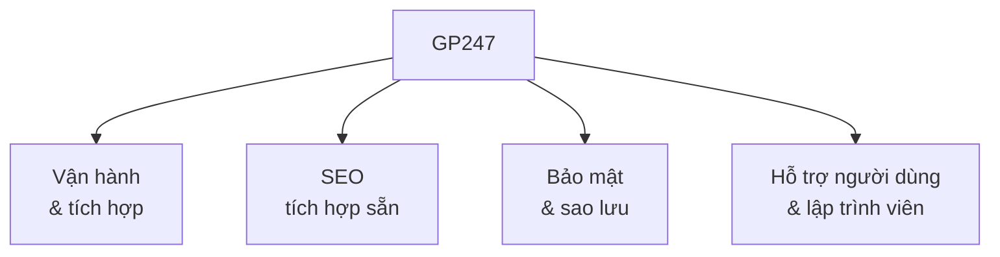
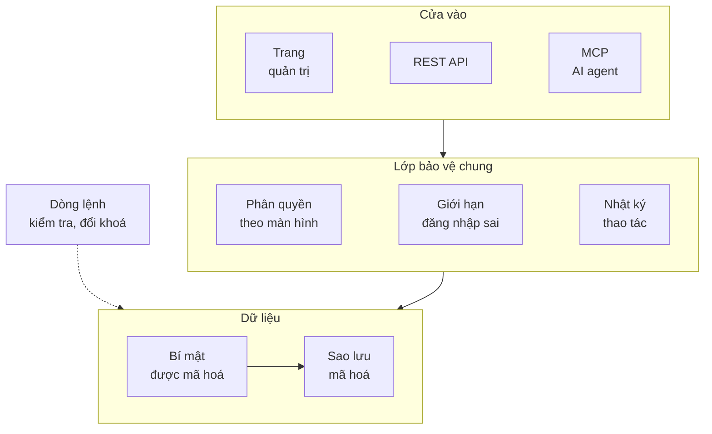
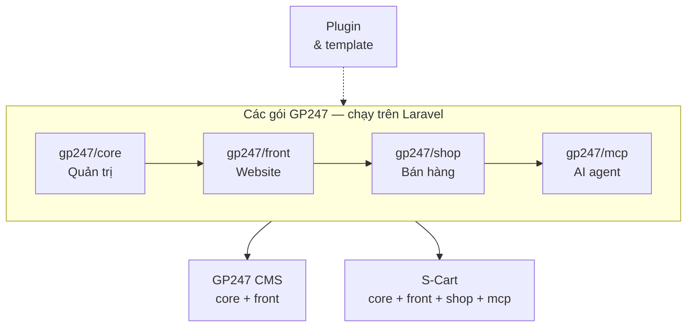

> 🌐 **Ngôn ngữ:** 🇻🇳 Tiếng Việt (hiện tại) · [🇬🇧 English](./gp247.md) · [🇯🇵 日本語](./gp247_ja.md)

# Giới thiệu về GP247

**GP247** là hệ sinh thái mã nguồn mở trên Laravel để xây dựng ứng dụng web cho doanh nghiệp. **S-Cart** — phần mềm bán hàng
trực tuyến — là sản phẩm xây dựng trên GP247. Nền tảng có sẵn **dòng lệnh** để vận hành tự động, **REST API v2** để kết nối ứng dụng và ERP, **MCP server** để làm việc
với AI agent, **SEO tích hợp sẵn** từ thẻ meta tới kiểm tra lỗi SEO, cùng lớp **bảo mật quản lý tập trung** và **sao lưu &
phục hồi** tích hợp sẵn. Tất cả miễn phí, giấy phép MIT.

## GP247 trong một phút

| Mục | Thông tin |
| --- | --- |
| **Là gì** | Hệ sinh thái mã nguồn mở trên Laravel để xây dựng ứng dụng web cho doanh nghiệp |
| **Giấy phép** | MIT — miễn phí, tự do tùy chỉnh và tích hợp vào hệ thống Laravel của bạn |
| **Công nghệ (GP247 3.x)** | PHP 8.3+ · Laravel 13 · Livewire 4 · Tailwind CSS 3 (biên dịch sẵn, không cần Node) · MySQL / MariaDB |
| **Thành phần** | `gp247/core` · `gp247/front` · `gp247/shop` · `gp247/mcp` |
| **Bản trọn gói** | **S-Cart** (bán hàng trực tuyến) = core + front + shop + mcp · **GP247 CMS** (website nội dung) = core + front |
| **Vận hành & tích hợp** | Dòng lệnh `php artisan gp247:*` · REST API v2 (đồng bộ ERP) · MCP server cho AI agent |
| **SEO** | Thẻ meta, sitemap, JSON-LD, hreflang tự động · tab SEO cho từng nội dung · tự 301 khi đổi đường dẫn · màn Kiểm tra SEO |
| **Bảo mật** | Phân quyền và nhật ký dùng chung cho trang quản trị, API, MCP · mã hoá bí mật · sao lưu & phục hồi mã hoá |
| **Môi trường chạy** | Từ shared hosting không có cron tới VPS, Docker |
| **Tài liệu** | Ba ngôn ngữ Việt · Anh · Nhật, kèm Agent Skills cho AI agent lập trình |

## Điểm nổi bật

GP247 tập trung vào bốn nhóm năng lực mà một website doanh nghiệp đang vận hành thật cần đến:

- **Vận hành & tích hợp** — dòng lệnh, REST API v2, MCP server cho AI agent.
- **SEO tích hợp sẵn** — website lên Google đúng chuẩn ngay khi cài, chủ site chỉnh từng trang không cần plugin.
- **Bảo mật & sao lưu** — một lớp bảo vệ chung cho mọi cửa vào, sao lưu & phục hồi có sẵn.
- **Hỗ trợ** — tài liệu ba ngôn ngữ cập nhật liên tục, Agent Skills cho lập trình viên.

### Vận hành & tích hợp

- **Dòng lệnh `gp247:*` — hướng tới tự động hoá hoàn toàn** — hơn 40 lệnh để cài đặt, cập nhật, kiểm tra sức khoẻ site
  (`gp247:doctor`), sao lưu, quản lý plugin và template mà không cần mở trang quản trị. Mọi lệnh có `--json` cho script, CI và
  Docker; lệnh có thể xoá dữ liệu luôn hỏi xác nhận. Xem [Dòng lệnh GP247 (CLI)](https://gp247.net/vi/docs/command-line/overview-command-line.html).
- **REST API v2 — kết nối ứng dụng và ERP** — hai nhóm API cho cửa hàng/khách hàng và cho quản trị, đăng nhập bằng token, đặc tả
  OpenAPI 3.1. ERP, phần mềm kho hay CRM đồng bộ dữ liệu bằng `updated_since`, nhật ký sự kiện và webhook có chữ ký. Xem
  [Giới thiệu API](https://gp247.net/vi/docs/api/about-api-gp247.html) và [Đồng bộ dữ liệu với ERP](https://gp247.net/vi/docs/api/api-sync.html).
- **MCP server — làm việc với AI agent** — có sẵn trong S-Cart, tắt sẵn cho tới khi bạn bật. Chủ cửa hàng hỏi bằng lời thường
  trong Claude Code, Claude Desktop / claude.ai, Cursor hay VS Code để tra đơn, xem tồn kho, tóm tắt doanh thu. 18 công cụ (13 đọc,
  5 ghi mặc định tắt); thao tác ghi luôn có bản xem trước và mã xác nhận. Xem [Giới thiệu MCP server](https://gp247.net/vi/docs/mcp/about-mcp-gp247.html).

### SEO tích hợp sẵn, không cần plugin

- **Đúng chuẩn ngay khi cài** — mọi trang tự có tiêu đề, mô tả, thẻ chia sẻ mạng xã hội, canonical, JSON-LD (sản phẩm, đường dẫn
  danh mục, bài viết), hreflang cho website nhiều ngôn ngữ; giỏ hàng, tài khoản và trang lọc tự giấu khỏi Google; trang không tồn
  tại trả lỗi 404 thật. Sitemap.xml và robots.txt tự sinh theo từng cửa hàng, không cần cron.
- **SEO cho từng nội dung** — tab SEO ở màn sửa sản phẩm, danh mục, thương hiệu, trang, bài viết: tiêu đề và mô tả hiện trên Google, ảnh chia
  sẻ, ẩn khỏi Google, canonical riêng, kèm khung xem trước kết quả tìm kiếm.
- **Đổi đường dẫn không mất khách** — đổi alias thì hệ thống tự tạo redirect 301 từ địa chỉ cũ; quản lý redirect và nhật ký trang
  404 ngay trong trang quản trị.
- **Biết ngay việc cần sửa** — màn Kiểm tra SEO liệt kê lỗi "Cần sửa" / "Nên xem" kèm link sửa, nhắc trên Cảnh báo hệ thống;
  xác minh Google / Bing, mẫu tiêu đề và IndexNow có hướng dẫn từng bước. AI agent đọc và sửa SEO được qua MCP (có xác nhận).
- **Plugin và template cắm vào được** — nội dung của plugin có cùng tab SEO, sitemap, JSON-LD qua các điểm cắm có sẵn.

Xem [SEO trong S-Cart](https://gp247.net/vi/docs/seo/seo-introduction.html).

### Bảo mật nâng cao, quản lý tập trung

Mọi cửa vào — trang quản trị, REST API, AI agent qua MCP — đi qua **cùng một lớp bảo vệ** trước khi chạm dữ liệu:

- **Một chuẩn bảo vệ cho mọi cửa vào** — API và AI agent dùng chung phân quyền và nhật ký với trang quản trị, nên không bao giờ làm
  được nhiều hơn tài khoản đó trên màn hình; đăng nhập quản trị qua web và API dùng chung bộ đếm đăng nhập sai.
- **Công tắc tập trung** — bật/tắt từng phần API và MCP trên màn **Cấu hình API**; tắt công tắc tổng là tắt luôn MCP.
- **Bí mật được mã hoá** — mật khẩu SMTP, khoá bên thứ ba, license được mã hoá trong cơ sở dữ liệu, không hiện lại trên màn hình;
  đổi khoá mã hoá bằng một lệnh.
- **Kiểm tra bằng một lệnh** — `gp247:doctor` kiểm máy chủ, cài đặt và cấu hình bảo mật.
- **Sao lưu & phục hồi tích hợp sẵn** — bản sao lưu được mã hoá và tự kiểm ngay sau khi tạo; site tự sao lưu mỗi 24 giờ mà không cần
  cron; tự chụp một bản trước khi cập nhật hệ thống, cập nhật extension hay đổi template; chép được ra lưu trữ S3-compatible hoặc
  SFTP / NAS; phục hồi theo từng tình huống.

Xem [Bảo mật hệ thống GP247](https://gp247.net/vi/docs/security/security-introduction.html) và [Sao lưu & phục hồi](https://gp247.net/vi/docs/backup-and-restore/overview-backup-restore.html).

### Hỗ trợ người dùng và lập trình viên

- **Tài liệu đầy đủ, cập nhật liên tục** — hơn 80 trang cho mỗi ngôn ngữ (Việt · Anh · Nhật), viết cho cả chủ cửa hàng lẫn lập trình
  viên, cập nhật cùng mỗi bản phát hành. Xem [mục lục tài liệu](https://gp247.net/vi/docs).
- **Agent Skills cho AI agent lập trình** — bộ skill giúp AI agent (như Claude Code) dựng plugin, plugin thanh toán, plugin vận
  chuyển, template, quản lý extension qua dòng lệnh và cập nhật plugin, template đang cài lên bản mới, theo đúng chuẩn GP247; skill
  tự nhận phiên bản core của site trước khi làm.
  Xem [gp247-skills](https://github.com/gp247net/gp247-skills).

## Các thành phần

Hệ sinh thái GP247 gồm các thành phần chính sau:

| Thành phần | Vai trò |
| --- | --- |
| **GP247/core** | Hệ thống backend, kèm thư viện plugin và template đáp ứng các nhu cầu nghiệp vụ phức tạp |
| **GP247/front** | Giao diện người dùng, làm việc với GP247/core |
| **GP247/shop** | Các tính năng xây dựng website bán hàng |
| **GP247/mcp** | Cho phép AI agent làm việc với hệ thống |

> **Dự án S-Cart** = GP247/core + GP247/front + GP247/shop + GP247/mcp
>
> **GP247 CMS** = GP247/core + GP247/front

Tất cả thành phần đều **miễn phí và mã nguồn mở**. Bạn có thể tùy chỉnh và tích hợp chúng vào hệ thống Laravel
của riêng mình.

## Mã nguồn

Tìm hiểu thêm và xem mã nguồn tại:

- **GP247/core**: <https://github.com/gp247net/core>
- **GP247/front**: <https://github.com/gp247net/front>
- **GP247/shop**: <https://github.com/gp247net/shop>
- **GP247/mcp**: <https://github.com/gp247net/mcp>
- **GP247/s-cart**: <https://github.com/gp247net/s-cart>
- **GP247/cms**: <https://github.com/gp247net/cms>
- **Plugin**: <https://github.com/gp247-plugin>
- **Tài liệu**: <https://github.com/gp247net/gp247-docs>
- **Agent Skills**: <https://github.com/gp247net/gp247-skills>

## Thông tin liên hệ

> **Email hỗ trợ kỹ thuật:** [support@gp247.net](mailto:support@gp247.net)

## Hỗ trợ nhanh qua cộng đồng

Tham gia cộng đồng trên mạng xã hội để được đội ngũ phát triển và các thành viên khác hỗ trợ nhanh:

- **Facebook**: <https://www.facebook.com/SCart.Ecommerce/>
- **Nhóm S-Cart**: <https://www.facebook.com/groups/scart.opensource>
