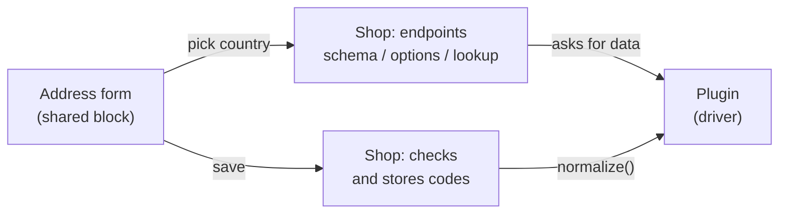
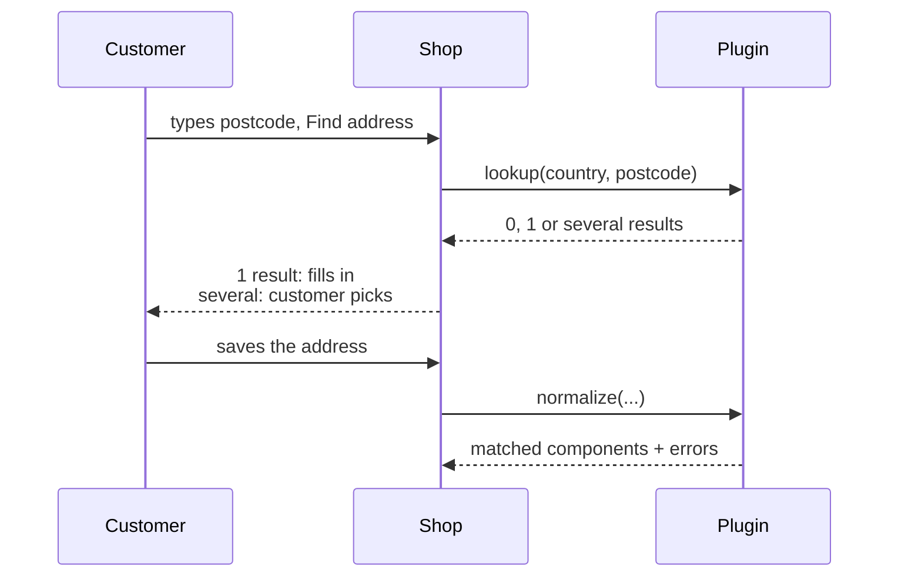

> 🌐 **Language:** [🇻🇳 Tiếng Việt](./create-address-plugin_vi.md) · 🇬🇧 English (current) · [🇯🇵 日本語](./create-address-plugin_ja.md)

# Create an address plugin for GP247 — pick lists and postal code lookup

## Introduction

This document shows developers how to write an **address plugin** for a country: customers pick their address from dependent
lists (province → district) or type a postal code and the fields fill in. Part 1 builds a **two-level list** plugin that runs
right away with a data file bundled in the plugin. Part 2 adds **postal code lookup**. Afterwards you know what `gp247/shop`
already does (form, checks, stored codes, the Address lists screen) and which data the plugin has to supply.

> ℹ️ **Available since:** gp247/shop 3.15 (address layer, lists). Postal code lookup: gp247/shop 3.15.1.

> 💡 **Working with an AI agent?** Use the **`gp247-plugin-create`** skill in the
> [gp247-skills](https://github.com/gp247net/gp247-skills) repo to scaffold the plugin (it probes the site version, writes
> `gp247.json`, keeps the lifecycle update-safe), then follow the steps below for the address part.

> 📦 **Two complete, free example plugins:** [AddressVN](https://github.com/gp247-plugin/AddressVN) (province → ward lists) and
> [AddressJP](https://github.com/gp247-plugin/AddressJP) (postal code lookup, sharded data).

---

## At a glance

The plugin only answers questions about data; `gp247/shop` takes care of the rest:



- **Plugin = one driver** registered in `Provider.php`: it describes the address components, returns the lists, looks up
  postal codes and checks an address on save.
- **The shop does the rest**: renders the form, orders the fields, serves the endpoints, caches the lists, checks again on the
  server, stores the official names + codes in `address_meta`, and offers the **Address lists** screen where the site owner
  picks which field receives what.
- **No table, no settings of its own** — the plugin is safe across one-click updates.
- **A plugin failure never blocks the customer**: when the driver throws, the form falls back to plain inputs.

## On this page

- [1. Before you start](#1-before-you-start) — requirements and concepts
- [2. Part 1 — A two-level list plugin](#2-part-1--a-two-level-list-plugin) — step by step with code
- [3. Part 2 — Postal code lookup](#3-part-2--postal-code-lookup) — `lookup` / `derived` components
- [4. Data shipped with the plugin](#4-data-shipped-with-the-plugin) — source, rebuild, shards
- [5. The address block in a template](#5-the-address-block-in-a-template) — for template authors
- [6. Quick reference](#6-quick-reference--what-gp247shop-provides) — classes, config, endpoints

---

## 1. Before you start

- A GP247 3.x website with `gp247/shop` 3.15 or later (`php artisan gp247:info`).
- You know how to build a basic plugin: [Plugin creation guide](./create-plugin.md).
- You know how store owners use it: [Customer addresses in S-Cart](../s-cart/customer-address/customer-address.md).

Three concepts to know:

| Concept | Meaning |
| --- | --- |
| **Component** | One level of the plugin's data: `province`, `ward`, `postcode`… Each component has a **kind**: `list` (pick from a list), `lookup` (a key the customer types, like a postal code), `derived` (only comes from a lookup result). |
| **Shop field** | A field of the address form: `postcode`, `city`, `district`, `ward`, `address1`, `address2`, `address3`. The site owner switches them on/off in the Customer tab. |
| **Mapping** | Which field receives which component. The plugin suggests a default mapping; the site owner changes it on the **Address lists** screen. One field ← one component. |

---

## 2. Part 1 — A two-level list plugin

The example builds an `AddressTH` plugin (Thailand): the customer picks a **province**, then a **district** of that
province. The data in the example is a few illustrative rows only — a real plugin uses the country's official catalog.

### Step 1 — Scaffold

Run in the website root:

```bash
php artisan gp247:make-plugin --name=AddressTH --download=0
```

An address plugin has no admin screen of its own: delete `Admin/`, `Livewire/`, `Views/`, `Controllers/`, `Route.php`,
`Seo.php` (and the Seo registration line in `Provider.php`). Keep `AppConfig.php`, `Provider.php`, `config.php`, `gp247.json`,
`Lang/`.

### Step 2 — `gp247.json`

```json
{
    "name": "Thailand Address",
    "image": "images/address-th.svg",
    "auth": "Your name",
    "configGroup": "Plugins",
    "configCode": "AddressTH",
    "configKey": "AddressTH",
    "version": "1.0.0",
    "requireCore": ["3.18"],
    "minUpdateFrom": "1.0.0",
    "requireComposerPackages": ["gp247/shop"],
    "requireGp247Extensions": [],
    "requireLivewire": false,
    "storeScope": "store"
}
```

`storeScope: store` lets a multi-store site switch the plugin on per store. Set `requireCore` to the core `major.minor` of
your site.

### Step 3 — `AppConfig.php`: refuse to install on a shop without the address layer

`requireComposerPackages` only checks that `gp247/shop` is present, not its version — so `install()` checks the interface
itself. The plugin only writes its on/off row; the ⚙ button opens the shop's Address lists screen. Keep the other methods
(`uninstall`, `enable`, `disable`, `getInfo`) as generated.

```php
public function install()
{
    if (AdminConfig::where('key', $this->configKey)->where('group', $this->configGroup)->exists()) {
        return ['error' => 1, 'msg' => gp247_language_render('admin.extension.plugin_exist')];
    }
    // The address layer exists from gp247/shop 3.15.
    if (!interface_exists(\GP247\Shop\Address\Contracts\AddressProvider::class)) {
        return ['error' => 1, 'msg' => trans($this->appPath.'::lang.requires_shop_address')];
    }
    AdminConfig::insert([
        'group' => $this->configGroup, 'code' => $this->configCode, 'key' => $this->configKey,
        'sort' => 0, 'store_id' => GP247_STORE_ID_GLOBAL, 'value' => self::ON,
        'detail' => $this->appPath.'::lang.title',
    ]);

    return ['error' => 0, 'msg' => gp247_language_render('admin.extension.install_success')];
}

public function clickApp()
{
    if (!\Illuminate\Support\Facades\Route::has('admin_address_mapping.index')) {
        return null;
    }

    return redirect(gp247_route_admin('admin_address_mapping.index', ['country' => 'TH']));
}
```

### Step 4 — `Provider.php`: register the driver

Register only while the plugin is enabled, and only when the shop has the address layer:

```php
if (gp247_extension_check_active($config['configGroup'], $config['configKey'])) {
    if (interface_exists(\GP247\Shop\Address\Contracts\AddressProvider::class)) {
        config(['gp247-config.shop.address_providers.AddressTH' => [
            'driver' => \App\GP247\Plugins\AddressTH\Services\ThailandAddressProvider::class,
            'countries' => ['TH'],
            'capabilities' => ['options'],
        ]]);
    }
}
```

`capabilities`: `options` = has lists, `postcode` = postal code lookup. The shop only uses a capability that is both declared
**and** implemented by the driver (the matching interface).

### Step 5 — Data `Data/th-units.json`

```json
{
    "version": "2026-01-01",
    "provinces": [
        { "code": "10", "name": "กรุงเทพมหานคร", "districts": [
            { "code": "1001", "name": "เขตพระนคร" },
            { "code": "1002", "name": "เขตดุสิต" }
        ] }
    ]
}
```

`version` goes into the `address_meta` of every address — you know which data release an address was checked against.

### Step 6 — Driver `Services/ThailandAddressProvider.php`

The driver describes the components, returns the lists and checks an address on save:

```php
<?php

namespace App\GP247\Plugins\AddressTH\Services;

use GP247\Shop\Address\Contracts\AddressProvider;
use GP247\Shop\Address\Contracts\ListsAddressOptions;
use GP247\Shop\Address\Data\AddressComponent;
use GP247\Shop\Address\Data\AddressOption;
use GP247\Shop\Address\Data\AddressSchema;
use GP247\Shop\Address\Data\NormalizedAddress;

class ThailandAddressProvider implements AddressProvider, ListsAddressOptions
{
    private ?array $data = null;

    public function schema(string $country): AddressSchema
    {
        return new AddressSchema(
            'TH',
            (string) $this->data()['version'],
            [
                new AddressComponent('province', 'Plugins/AddressTH::lang.province', AddressComponent::KIND_LIST),
                new AddressComponent('district', 'Plugins/AddressTH::lang.district', AddressComponent::KIND_LIST, 'province'),
            ],
            ['city' => 'province', 'district' => 'district'],   // default mapping: shop field => component
        );
    }

    public function options(string $country, string $component, ?string $parentCode, string $locale): array
    {
        $rows = match ($component) {
            'province' => $this->data()['provinces'],
            'district' => $this->province($parentCode)['districts'] ?? [],
            default => [],
        };

        return array_map(static fn (array $row) => new AddressOption((string) $row['code'], (string) $row['name']), $rows);
    }

    public function normalize(string $country, array $components, string $locale): NormalizedAddress
    {
        $matched = [];
        $province = $this->find($this->data()['provinces'], $components['province'] ?? null);
        if ($province !== null) {
            $matched['province'] = ['code' => (string) $province['code'], 'name' => (string) $province['name']];
            $district = $this->find($province['districts'], $components['district'] ?? null);
            if ($district !== null) {
                $matched['district'] = ['code' => (string) $district['code'], 'name' => (string) $district['name']];
            }
        }

        return new NormalizedAddress($matched);
    }

    private function province(?string $code): ?array
    {
        return $code === null ? null : $this->find($this->data()['provinces'], ['code' => $code, 'name' => null]);
    }

    /** A code must exist; without a code, the exact name decides. */
    private function find(array $rows, ?array $value): ?array
    {
        foreach ($rows as $row) {
            if (($value['code'] ?? null) !== null ? (string) $row['code'] === (string) $value['code']
                : trim((string) ($value['name'] ?? '')) === $row['name']) {
                return $row;
            }
        }

        return null;
    }

    private function data(): array
    {
        if ($this->data === null) {
            $data = json_decode((string) @file_get_contents(dirname(__DIR__).'/Data/th-units.json'), true);
            if (!is_array($data) || !isset($data['version'], $data['provinces'])) {
                // Thrown on purpose: the shop catches it and turns the fields back into text inputs.
                throw new \RuntimeException('AddressTH: data file missing or damaged.');
            }
            $this->data = $data;
        }

        return $this->data;
    }
}
```

Add the labels to `Lang/en/lang.php` (and `vi`, `ja`…): `'province' => 'Province'`, `'district' => 'District'`,
`'requires_shop_address' => 'This plugin needs gp247/shop 3.15 or later…'`. A component's label is shown on the form instead of
the field's own label.

### Step 7 — Install and try

```bash
php artisan optimize:clear
php artisan gp247:ext-install --type=plugin --key=AddressTH
```

1. In **Website configuration → Customer tab**, switch on the **City / Province**, **District** and **Country** fields.
2. Open **Shop setting → Address lists** and pick **Thailand**: the check panel must say **everything is in place**.
3. Open the registration page and pick the country Thailand: Province becomes a searchable list, District only shows the
   districts of the chosen province.

Try an uninstall of the data only, then reinstall (the plugin folder is kept):

```bash
php artisan gp247:ext-uninstall --type=plugin --key=AddressTH --only-data
php artisan gp247:ext-install --type=plugin --key=AddressTH
```

---

## 3. Part 2 — Postal code lookup

When a postal code identifies the address (as in Japan), the customer types the code and the fields fill in. Add the
`postcode` capability:



- **One result** → the shop fills the fields; **several** → the customer picks one; **none** → the customer is told, the
  fields stay typeable.
- On save, the shop calls `normalize()` again — it **does not trust** what the browser sent.

### 3.1. A schema with `lookup` and `derived` components

```php
return new AddressSchema(
    'JP',
    $this->data->version(),
    [
        new AddressComponent('postcode', 'Plugins/AddressJP::lang.postcode', AddressComponent::KIND_LOOKUP),
        new AddressComponent('prefecture', 'Plugins/AddressJP::lang.prefecture', AddressComponent::KIND_LIST),
        new AddressComponent('municipality', 'Plugins/AddressJP::lang.municipality', AddressComponent::KIND_DERIVED, 'prefecture'),
        new AddressComponent('town', 'Plugins/AddressJP::lang.town', AddressComponent::KIND_DERIVED, 'municipality'),
    ],
    ['postcode' => 'postcode', 'city' => 'prefecture', 'district' => 'municipality', 'address1' => 'town'],
    ['address1'],   // fields the shopper may edit after a lookup filled them
);
```

- **`lookup`**: the field the customer types (always typeable). When a country of the store has a `lookup` field, the shop
  puts the postal code field **right after the Country field**.
- **`derived`**: only comes from a lookup result. Fields in the fifth argument (`defaultEditable`) let the customer **keep
  typing** after the fill (add the block number); the code stays as long as the line still starts with the filled-in name.

### 3.2. `lookup()` returns `AddressSuggestion` objects

```php
use GP247\Shop\Address\Contracts\ResolvesPostcode;
use GP247\Shop\Address\Data\AddressSuggestion;

public function lookup(string $country, string $postcode, string $locale): array
{
    $digits = self::normalizePostcode($postcode);   // accept the ways people type it, return null when it cannot be one
    if ($digits === null) {
        return [];
    }
    $out = [];
    foreach ($this->data->rows($digits) as [$cityCode, $city, $town]) {
        $out[] = new AddressSuggestion([
            'prefecture' => ['code' => substr($cityCode, 0, 2), 'name' => $this->prefectureName($cityCode)],
            'municipality' => ['code' => $cityCode, 'name' => $city],
            'town' => $town === '' ? ['name' => ''] : ['code' => $digits, 'name' => $town],
        ]);
    }

    return $out;
}
```

Remember to declare `'capabilities' => ['options', 'postcode']` in `Provider.php` and to make the driver
`implements ResolvesPostcode`.

> ⚠️ **Note:** normalize the code in the **plugin**; do not make customers type it one exact way. The shop's endpoint accepts
> what a Japanese input method types (full-width digits, `〒`, the various dashes) and passes it on unchanged to the plugin.

### 3.3. `normalize()` — when to return an error

`NormalizedAddress($matched, $errors)`: a component that **does not match is left out** of `$matched`. As for `$errors`:

| Case | The plugin should | What the shop does ("ask the customer to pick again" mode) |
| --- | --- | --- |
| A list value that does not exist | Leave it out of `$matched` | Flags that field with the shop's generic message |
| A postal code that is **certainly wrong** (bad format, not in the chosen prefecture) | `$errors['postcode'] = 'Plugins/<Key>::lang.<key>'` | Flags it **on the postal code field** with the plugin's message, does not save |
| A well-formed postal code **missing** from the data | Leave it out of `$matched`, **no** error | Accepts the address without codes (the data may be older than a new code) |

Match the city / town **only among the results of the typed postal code** (same prefecture) — so a code is never stored next
to a place it does not belong to.

---

## 4. Data shipped with the plugin

Prefer **bundling the data in the plugin**: no network dependency, it runs on shared hosting, and no customer data leaves the
site.

- **Name the official source** and its reuse terms in the README (AddressVN: General Statistics Office of Viet Nam; AddressJP:
  Japan Post).
- **A rebuild command** in `tools/` (run by hand by the maintainer): reads the source file, checks every row, **stops without
  writing anything** on an unexpected row, writes `version` = the date of the source file.
- **Large data → shards**: AddressJP splits 120 thousand postal codes into 948 files by the first three digits; each lookup
  reads a single file of a few dozen KB.
- **Missing / damaged data → throw an exception**: the shop catches it, logs it once, and turns the form back into plain inputs.
- **Need an outside API?** Use a short timeout from `config('gp247-config.shop.address.timeout')` (seconds, default 3). The shop
  already caches the lists (`cache_ttl`, default 1 day) — no need to cache `options()` yourself.

---

## 5. The address block in a template

This part is for **template** authors. The address form is a shared block of the shop (`common/shop_address_fields`): a
template calls this block instead of its own address fields, so every address plugin works on your template.

```blade
@include(gp247_shop_process_view($GP247TemplatePath, 'common.shop_address_fields'), [
    'addressBlock' => \GP247\Shop\Address\View\AddressBlock::for(
        old('country'),
        \GP247\Shop\Address\AddressForm::CONTEXT_CUSTOMER_INSERT,
    ),
    'testidPrefix' => 'register-address',
    'countries' => $countries,
])
```

- Call it on every page with an address: registration, account details, address book, checkout (each page with its own
  `CONTEXT_*` of `AddressForm`).
- Change the look with the CSS class parameters (`inputClass`, `labelClass`, `fieldClass`, `buttonClass`…) — do not copy the
  block's view.
- A template that must also run on an older shop: wrap it in
  `@if (class_exists(\GP247\Shop\Address\View\AddressBlock::class))` and keep the old fields in the `@else` branch.
- Full contract: the "Address forms" section of the `gp247-template-create` skill in
  [gp247-skills](https://github.com/gp247net/gp247-skills).

---

## 6. Quick reference — what `gp247/shop` provides

| Item | Where | Used for |
| --- | --- | --- |
| `AddressProvider` | `GP247\Shop\Address\Contracts` | Required: `schema()`, `normalize()` |
| `ListsAddressOptions` | (same place) | `options` capability: `options()` |
| `ResolvesPostcode` | (same place) | `postcode` capability: `lookup()` |
| `AddressSchema`, `AddressComponent`, `AddressOption`, `AddressSuggestion`, `NormalizedAddress` | `GP247\Shop\Address\Data` | Return types |
| `gp247-config.shop.address_providers.<Key>` | the plugin's `Provider.php` | Registers `driver`, `countries`, `capabilities` |
| `gp247-config.shop.address.timeout` / `cache_ttl` | shop config (`GP247_ADDRESS_TIMEOUT`, `GP247_ADDRESS_CACHE_TTL`) | Timeout of outside calls; how long lists are cached |
| `address/schema`, `address/options`, `address/lookup` | public shop endpoints (rate-limited) | Called by the form block; the plugin needs no route |
| `AddressService::make()->normalize(...)` | `GP247\Shop\Address` | Call it in the plugin's tests to check the save path |
| `admin_address_mapping.index` | shop admin route | The Address lists screen (the plugin's ⚙ button points to it) |

---

## Conditions & Rules (know before you act)

**When writing the driver**

- **Component codes use only letters, digits, `_`, `.`, `-`, up to 64 characters** — the shop drops any other code it
  receives from the browser, so no odd characters reach the database.
- **One field ← one component**; a child component needs its parent mapped too — otherwise the Address lists screen reports
  an error and does not save the mapping.
- **The driver never receives the customer's name, phone or email** — only the address components; it does not need (and
  should not) store anything about the customer.

**When registering**

- **Two enabled plugins for one country** → the shop uses the plugin the site owner chose on the Address lists screen;
  without a choice, the plugin whose key comes first alphabetically.
- **A capability declared but not implemented by the driver is ignored** — so the shop never calls a missing method.

**When releasing**

- **The plugin folder must equal `configKey`** — GP247 recognises a plugin by its folder name.
- **State the minimum shop version in the README** (3.15 for lists, 3.15.1 for postal code lookup) —
  `requireComposerPackages` does not check versions.

---

## Q&A

**Q1: Does my plugin need a settings screen of its own?**

→ No. The shop's **Address lists** screen already lets the site owner choose which field receives what and how strict the
check is; the plugin only needs a ⚙ button pointing there (`clickApp()`).

**Q2: Should place names be translated into the interface language?**

→ It depends on the country. `options()` and `lookup()` receive `$locale`; AddressJP keeps Japanese in every language because a
delivery address in Japan is written in Japanese. Field labels are always translated through `Lang/`.

**Q3: Does a list with thousands of rows slow the form down?**

→ Not noticeably: the form block has a search box, the shop caches each list (1 day by default) and only loads the child list
of the selected parent.

**Q4: Can I get the data from a third-party API?**

→ Yes, but use the `gp247-config.shop.address.timeout` timeout and accept that the form falls back to plain inputs when the API
fails. Check the API's terms (many forbid passing the service on to third parties) and state in the README that customer
data is sent out.

**Q5: How do I test the plugin?**

→ Call the driver directly (`schema`, `options`, `lookup`, `normalize`) on a small data file of the same shape, and call
`AddressService::make()->normalize(...)` after declaring `gp247-config.shop.address_providers` to check the save path. Add a case
for a damaged data file (the form must fall back to plain inputs).

**Q6: When should `NormalizedAddress` carry an error?**

→ Only when the value is certainly wrong. For a postal code, the error shows right on the postal code field; a code merely
missing from the data is left out without an error (see [the table in section 3.3](#33-normalize--when-to-return-an-error)).

**Q7: The template I use does not show the lists?**

→ That template does not call the shared address block yet — see [The address block in a template](#5-the-address-block-in-a-template).

**Q8: Does an address plugin need cron or a queue?**

→ No. The data is read from files in the plugin on each request; update the data by releasing a new plugin version.

---

<sub>📅 **Last updated:** 2026-11-24 · ✍️ **Author:** GP247</sub>
