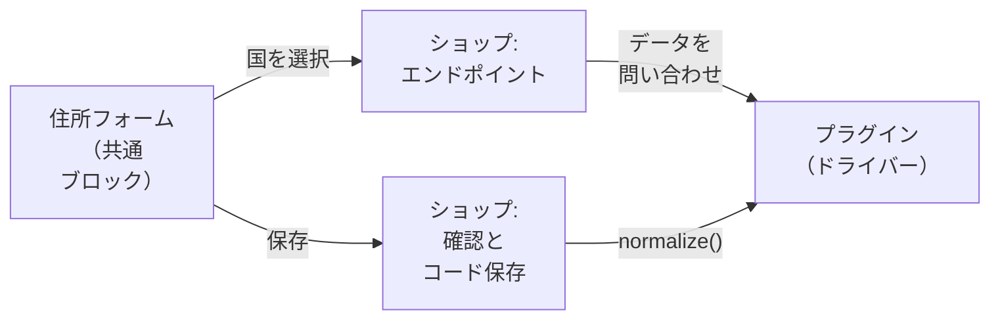
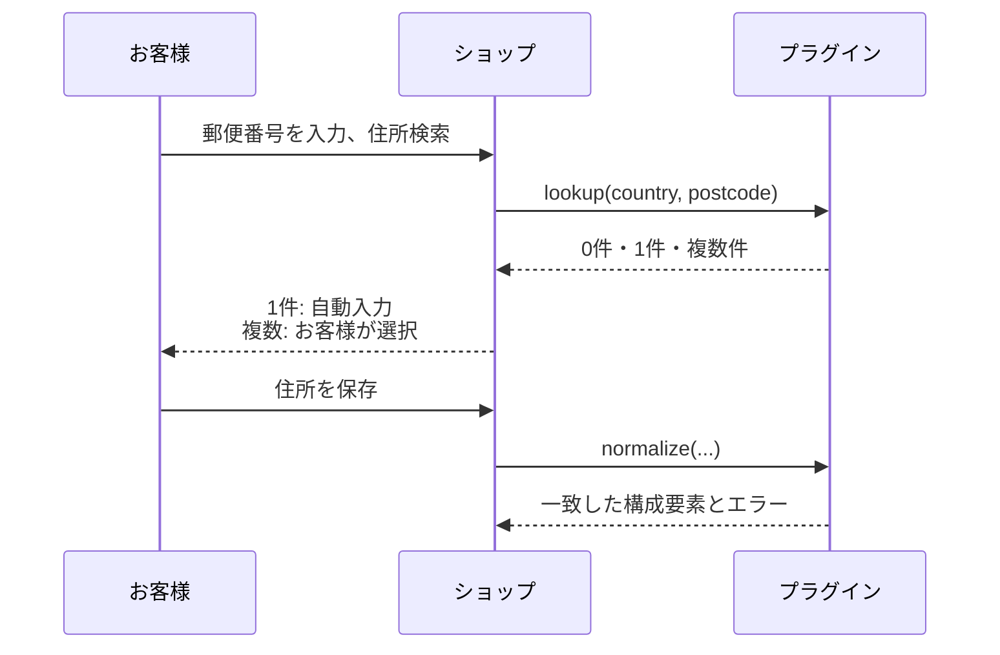

> 🌐 **言語:** [🇻🇳 Tiếng Việt](./create-address-plugin_vi.md) · [🇬🇧 English](./create-address-plugin.md) · 🇯🇵 日本語（現在）

# GP247 の住所プラグインを作成する — 選択式の一覧と郵便番号検索

## はじめに

このドキュメントでは、開発者向けに国別の **住所プラグイン** の作り方を説明します。お客様は連動する一覧（省 → 郡）から住所を
選ぶか、郵便番号を入力して各欄を自動入力できます。パート 1 では、プラグインに同梱したデータファイルですぐに動く **2 階層の一覧**
プラグインを作ります。パート 2 では **郵便番号検索** を追加します。読み終えると、`gp247/shop` がすでに行うこと（フォーム、入力チェック、
コードの保存、住所リスト画面）と、プラグインが用意すべきデータがわかります。

> ℹ️ **対応バージョン:** gp247/shop 3.15（住所レイヤー、一覧）。郵便番号検索は gp247/shop 3.15.1。

> 💡 **AI エージェントと作業していますか？** [gp247-skills](https://github.com/gp247-official/gp247-skills) リポジトリの
> **`gp247-plugin-create`** スキルでプラグインのひな形を作り（サイトのバージョン確認、`gp247.json`、更新に安全なライフサイクル）、
> 住所の部分は以下の手順に沿って進めてください。

> 📦 **無料の完成済みサンプル 2 つ:** [AddressVN](https://github.com/gp247-official/AddressVN)（省 → 坊・社の一覧）と
> [AddressJP](https://github.com/gp247-official/AddressJP)（郵便番号検索、分割データ）。

---

## ひと目でわかる

プラグインはデータについての問い合わせに答えるだけで、残りは `gp247/shop` が担当します。



- **プラグイン = 1 つのドライバー** を `Provider.php` で登録します。住所の構成要素を説明し、一覧を返し、郵便番号を検索し、保存時に
  住所を確認します。
- **残りはショップが担当**: フォームの表示、欄の並び順、エンドポイント（schema / options / lookup）、一覧のキャッシュ、サーバー側での
  再確認、正式名称とコードの `address_meta` への保存、どの欄に何を入れるかをサイト所有者が選ぶ **住所リスト** 画面。
- **独自のテーブルも設定もありません** — ワンクリック更新でも安全です。
- **プラグインのエラーでお客様が止まることはありません**: ドライバーが例外を投げると、フォームは通常の入力欄に戻ります。

## このページの内容

- [1. 始める前に](#1-始める前に) — 必要なものと基本概念
- [2. パート1 — 2階層の一覧プラグイン](#2-パート1--2階層の一覧プラグイン) — コード付きの手順
- [3. パート2 — 郵便番号検索](#3-パート2--郵便番号検索) — `lookup` / `derived` の構成要素
- [4. プラグインに同梱するデータ](#4-プラグインに同梱するデータ) — 出典、再作成、分割
- [5. テンプレートの住所ブロック](#5-テンプレートの住所ブロック) — テンプレート作成者向け
- [6. 早見表](#6-早見表--gp247shop-に用意されているもの) — クラス、設定、エンドポイント

---

## 1. 始める前に

- `gp247/shop` 3.15 以降をインストールした GP247 3.x のサイト（`php artisan gp247:info`）。
- 基本的なプラグインの作り方を知っていること: [プラグイン作成ガイド](./create-plugin_ja.md)。
- 店舗側での使い方: [S-Cart のお客様住所](../s-cart/customer-address/customer-address_ja.md)。

知っておきたい 3 つの概念:

| 概念 | 意味 |
| --- | --- |
| **構成要素**（component） | プラグインのデータの 1 階層: `province`、`ward`、`postcode` など。それぞれに **種類** があります: `list`（一覧から選択）、`lookup`（郵便番号のようにお客様が入力するキー）、`derived`（検索結果からのみ入る）。 |
| **ショップの欄**（field） | 住所フォームの欄: `postcode`、`city`、`district`、`ward`、`address1`、`address2`、`address3`。サイト所有者が顧客タブで有効・無効を切り替えます。 |
| **マッピング** | どの欄にどの構成要素を入れるか。プラグインが既定のマッピングを提案し、サイト所有者が **住所リスト** 画面で変更します。1 つの欄 ← 1 つの構成要素。 |

---

## 2. パート1 — 2階層の一覧プラグイン

例として `AddressTH`（タイ）プラグインを作ります。お客様は **県** を選び、続いてその県の **郡** を選びます。例のデータは説明用の
数行だけです。実際のプラグインでは、その国の公式な一覧を使います。

### 手順 1 — ひな形を作る

サイトのルートで実行します。

```bash
php artisan gp247:make-plugin --name=AddressTH --download=0
```

住所プラグインには独自の管理画面がありません。`Admin/`、`Livewire/`、`Views/`、`Controllers/`、`Route.php`、`Seo.php`（と
`Provider.php` の Seo 登録行）を削除します。`AppConfig.php`、`Provider.php`、`config.php`、`gp247.json`、`Lang/` は残します。

### 手順 2 — `gp247.json`

```json
{
    "name": "Thailand Address",
    "image": "images/address-th.svg",
    "auth": "Your name",
    "configGroup": "Plugins",
    "configCode": "AddressTH",
    "configKey": "AddressTH",
    "version": "1.0.0",
    "requireCore": ["3.18"],
    "minUpdateFrom": "1.0.0",
    "requireComposerPackages": ["gp247/shop"],
    "requireGp247Extensions": [],
    "requireLivewire": false,
    "storeScope": "store"
}
```

`storeScope: store` にすると、マルチストアのサイトでストアごとにプラグインを有効にできます。`requireCore` はサイトのコアの
`major.minor` にします。

### 手順 3 — `AppConfig.php`: 住所レイヤーのないショップではインストールを拒否する

`requireComposerPackages` は `gp247/shop` があるかどうかだけを確認し、バージョンは確認しません。そのため `install()` でインターフェースを
確認します。プラグインは有効・無効の行だけを書き込み、⚙ ボタンでショップの住所リスト画面を開きます。その他のメソッド（`uninstall`、
`enable`、`disable`、`getInfo`）は生成されたままにします。

```php
public function install()
{
    if (AdminConfig::where('key', $this->configKey)->where('group', $this->configGroup)->exists()) {
        return ['error' => 1, 'msg' => gp247_language_render('admin.extension.plugin_exist')];
    }
    // The address layer exists from gp247/shop 3.15.
    if (!interface_exists(\GP247\Shop\Address\Contracts\AddressProvider::class)) {
        return ['error' => 1, 'msg' => trans($this->appPath.'::lang.requires_shop_address')];
    }
    AdminConfig::insert([
        'group' => $this->configGroup, 'code' => $this->configCode, 'key' => $this->configKey,
        'sort' => 0, 'store_id' => GP247_STORE_ID_GLOBAL, 'value' => self::ON,
        'detail' => $this->appPath.'::lang.title',
    ]);

    return ['error' => 0, 'msg' => gp247_language_render('admin.extension.install_success')];
}

public function clickApp()
{
    if (!\Illuminate\Support\Facades\Route::has('admin_address_mapping.index')) {
        return null;
    }

    return redirect(gp247_route_admin('admin_address_mapping.index', ['country' => 'TH']));
}
```

### 手順 4 — `Provider.php`: ドライバーを登録する

プラグインが有効で、かつショップに住所レイヤーがある場合にだけ登録します。

```php
if (gp247_extension_check_active($config['configGroup'], $config['configKey'])) {
    if (interface_exists(\GP247\Shop\Address\Contracts\AddressProvider::class)) {
        config(['gp247-config.shop.address_providers.AddressTH' => [
            'driver' => \App\GP247\Plugins\AddressTH\Services\ThailandAddressProvider::class,
            'countries' => ['TH'],
            'capabilities' => ['options'],
        ]]);
    }
}
```

`capabilities`: `options` = 一覧あり、`postcode` = 郵便番号検索。ショップは、宣言され **かつ** ドライバーが実装している（対応する
インターフェースを持つ）機能だけを使います。

### 手順 5 — データ `Data/th-units.json`

```json
{
    "version": "2026-01-01",
    "provinces": [
        { "code": "10", "name": "กรุงเทพมหานคร", "districts": [
            { "code": "1001", "name": "เขตพระนคร" },
            { "code": "1002", "name": "เขตดุสิต" }
        ] }
    ]
}
```

`version` は各住所の `address_meta` に入ります。どのデータ版で確認された住所かがわかります。

### 手順 6 — ドライバー `Services/ThailandAddressProvider.php`

ドライバーは構成要素を説明し、一覧を返し、保存時に住所を確認します。

```php
<?php

namespace App\GP247\Plugins\AddressTH\Services;

use GP247\Shop\Address\Contracts\AddressProvider;
use GP247\Shop\Address\Contracts\ListsAddressOptions;
use GP247\Shop\Address\Data\AddressComponent;
use GP247\Shop\Address\Data\AddressOption;
use GP247\Shop\Address\Data\AddressSchema;
use GP247\Shop\Address\Data\NormalizedAddress;

class ThailandAddressProvider implements AddressProvider, ListsAddressOptions
{
    private ?array $data = null;

    public function schema(string $country): AddressSchema
    {
        return new AddressSchema(
            'TH',
            (string) $this->data()['version'],
            [
                new AddressComponent('province', 'Plugins/AddressTH::lang.province', AddressComponent::KIND_LIST),
                new AddressComponent('district', 'Plugins/AddressTH::lang.district', AddressComponent::KIND_LIST, 'province'),
            ],
            ['city' => 'province', 'district' => 'district'],   // default mapping: shop field => component
        );
    }

    public function options(string $country, string $component, ?string $parentCode, string $locale): array
    {
        $rows = match ($component) {
            'province' => $this->data()['provinces'],
            'district' => $this->province($parentCode)['districts'] ?? [],
            default => [],
        };

        return array_map(static fn (array $row) => new AddressOption((string) $row['code'], (string) $row['name']), $rows);
    }

    public function normalize(string $country, array $components, string $locale): NormalizedAddress
    {
        $matched = [];
        $province = $this->find($this->data()['provinces'], $components['province'] ?? null);
        if ($province !== null) {
            $matched['province'] = ['code' => (string) $province['code'], 'name' => (string) $province['name']];
            $district = $this->find($province['districts'], $components['district'] ?? null);
            if ($district !== null) {
                $matched['district'] = ['code' => (string) $district['code'], 'name' => (string) $district['name']];
            }
        }

        return new NormalizedAddress($matched);
    }

    private function province(?string $code): ?array
    {
        return $code === null ? null : $this->find($this->data()['provinces'], ['code' => $code, 'name' => null]);
    }

    /** A code must exist; without a code, the exact name decides. */
    private function find(array $rows, ?array $value): ?array
    {
        foreach ($rows as $row) {
            if (($value['code'] ?? null) !== null ? (string) $row['code'] === (string) $value['code']
                : trim((string) ($value['name'] ?? '')) === $row['name']) {
                return $row;
            }
        }

        return null;
    }

    private function data(): array
    {
        if ($this->data === null) {
            $data = json_decode((string) @file_get_contents(dirname(__DIR__).'/Data/th-units.json'), true);
            if (!is_array($data) || !isset($data['version'], $data['provinces'])) {
                // Thrown on purpose: the shop catches it and turns the fields back into text inputs.
                throw new \RuntimeException('AddressTH: data file missing or damaged.');
            }
            $this->data = $data;
        }

        return $this->data;
    }
}
```

`Lang/ja/lang.php`（と `vi`、`en` など）にラベルを追加します: `'province' => '県'`、`'district' => '郡'`、
`'requires_shop_address' => 'このプラグインには gp247/shop 3.15 以降が必要です…'`。フォームには欄のラベルの代わりに構成要素のラベルが
表示されます。

### 手順 7 — インストールして試す

```bash
php artisan optimize:clear
php artisan gp247:ext-install --type=plugin --key=AddressTH
```

1. **サイト設定 → 顧客タブ** で **都道府県・市区町村**、**区・郡**、**国** の欄を有効にします。
2. **ショップ設定 → 住所リスト** を開いて **Thailand** を選びます。チェック欄に **準備ができています** と表示されれば OK です。
3. 会員登録ページを開き、国に Thailand を選びます。県は検索付きの一覧になり、郡には選んだ県の郡だけが表示されます。

データだけをアンインストールしてから再インストールしてみます（プラグインのフォルダは残ります）。

```bash
php artisan gp247:ext-uninstall --type=plugin --key=AddressTH --only-data
php artisan gp247:ext-install --type=plugin --key=AddressTH
```

---

## 3. パート2 — 郵便番号検索

郵便番号で住所が決まる国（日本など）では、お客様が郵便番号を入力すると各欄が自動入力されます。`postcode` 機能を追加します。



- **1 件** → ショップが各欄を入力、**複数件** → お客様が 1 つを選択、**0 件** → お客様に知らせ、各欄は手入力できます。
- 保存時、ショップは再び `normalize()` を呼びます。ブラウザから送られた値は **信用しません**。

### 3.1. `lookup` と `derived` の構成要素を持つスキーマ

```php
return new AddressSchema(
    'JP',
    $this->data->version(),
    [
        new AddressComponent('postcode', 'Plugins/AddressJP::lang.postcode', AddressComponent::KIND_LOOKUP),
        new AddressComponent('prefecture', 'Plugins/AddressJP::lang.prefecture', AddressComponent::KIND_LIST),
        new AddressComponent('municipality', 'Plugins/AddressJP::lang.municipality', AddressComponent::KIND_DERIVED, 'prefecture'),
        new AddressComponent('town', 'Plugins/AddressJP::lang.town', AddressComponent::KIND_DERIVED, 'municipality'),
    ],
    ['postcode' => 'postcode', 'city' => 'prefecture', 'district' => 'municipality', 'address1' => 'town'],
    ['address1'],   // fields the shopper may edit after a lookup filled them
);
```

- **`lookup`**: お客様が入力する欄（常に入力可能）。ストアの国に `lookup` の欄があると、ショップは郵便番号の欄を **国の欄のすぐ後** に
  置きます。
- **`derived`**: 検索結果からのみ入ります。5 番目の引数（`defaultEditable`）の欄は、自動入力のあとお客様が **続けて入力** できます
  （番地の追加など）。入力した行が自動入力された名称で始まっている限り、コードは保持されます。

### 3.2. `lookup()` は `AddressSuggestion` を返す

```php
use GP247\Shop\Address\Contracts\ResolvesPostcode;
use GP247\Shop\Address\Data\AddressSuggestion;

public function lookup(string $country, string $postcode, string $locale): array
{
    $digits = self::normalizePostcode($postcode);   // accept the ways people type it, return null when it cannot be one
    if ($digits === null) {
        return [];
    }
    $out = [];
    foreach ($this->data->rows($digits) as [$cityCode, $city, $town]) {
        $out[] = new AddressSuggestion([
            'prefecture' => ['code' => substr($cityCode, 0, 2), 'name' => $this->prefectureName($cityCode)],
            'municipality' => ['code' => $cityCode, 'name' => $city],
            'town' => $town === '' ? ['name' => ''] : ['code' => $digits, 'name' => $town],
        ]);
    }

    return $out;
}
```

`Provider.php` で `'capabilities' => ['options', 'postcode']` を宣言し、ドライバーに `implements ResolvesPostcode` を付けるのを忘れないで
ください。

> ⚠️ **注意:** 郵便番号の正規化は **プラグイン** で行い、お客様に決まった書き方を強制しないでください。ショップのエンドポイントは
> 日本語入力で入力される文字（全角数字、`〒`、各種ハイフン）を受け付け、そのままプラグインに渡します。

### 3.3. `normalize()` — エラーを返すとき

`NormalizedAddress($matched, $errors)`: **一致しない構成要素は** `$matched` **に入れません**。`$errors` については次のとおりです。

| ケース | プラグインがすること | ショップの動作（「一覧から選び直してもらう」モード） |
| --- | --- | --- |
| 一覧に存在しない値 | `$matched` に入れない | その欄にショップ共通のメッセージを表示 |
| **明らかに誤った** 郵便番号（形式違い、選んだ都道府県に属さない） | `$errors['postcode'] = 'Plugins/<Key>::lang.<キー>'` | **郵便番号の欄** にプラグインのメッセージを表示し、保存しない |
| 形式は正しいがデータに **ない** 郵便番号 | `$matched` に入れず、エラーも **返さない** | コードなしで住所を受け付ける（データが新しい郵便番号より古い場合がある） |

市区町村・町域は、**入力された郵便番号の検索結果の中だけで**（同じ都道府県で）照合してください。その場所に属さないコードが一緒に
保存されることを防げます。

---

## 4. プラグインに同梱するデータ

**データはプラグインに同梱する** ことをおすすめします。ネットワークに依存せず、共有サーバーでも動き、お客様のデータを外部に送りません。

- **公式の出典** と再利用の条件を README に明記します（AddressVN: ベトナム統計総局、AddressJP: 日本郵便）。
- `tools/` に **再作成コマンド** を置きます（メンテナーが手動で実行）。出典ファイルを読み、各行を確認し、おかしな行があれば **何も書き込まずに
  停止** し、`version` には出典ファイルの日付を書きます。
- **大きなデータは分割**: AddressJP は 12 万件の郵便番号を先頭 3 桁で 948 ファイルに分け、1 回の検索では数十 KB のファイルを 1 つだけ読みます。
- **データがない・壊れている場合は例外を投げる**: ショップが受け止めて一度だけログに記録し、フォームを通常の入力欄に戻します。
- **外部 API が必要な場合は？** `config('gp247-config.shop.address.timeout')`（秒、既定 3）の短いタイムアウトを使います。一覧はショップが
  キャッシュする（`cache_ttl`、既定 1 日）ので、`options()` を自分でキャッシュする必要はありません。

---

## 5. テンプレートの住所ブロック

この部分は **テンプレート** の作成者向けです。住所フォームはショップの共通ブロック（`common/shop_address_fields`）です。テンプレートが
独自の住所欄の代わりにこのブロックを呼び出せば、どの住所プラグインもそのテンプレートで動きます。

```blade
@include(gp247_shop_process_view($GP247TemplatePath, 'common.shop_address_fields'), [
    'addressBlock' => \GP247\Shop\Address\View\AddressBlock::for(
        old('country'),
        \GP247\Shop\Address\AddressForm::CONTEXT_CUSTOMER_INSERT,
    ),
    'testidPrefix' => 'register-address',
    'countries' => $countries,
])
```

- 住所を扱うすべてのページで呼び出します: 会員登録、アカウント情報、住所録、注文手続き（ページごとに `AddressForm` の `CONTEXT_*` を使います）。
- 見た目は CSS クラスのパラメーター（`inputClass`、`labelClass`、`fieldClass`、`buttonClass` など）で変えます。ブロックのビューは
  コピーしません。
- 古いショップでも動かす必要があるテンプレートは、`@if (class_exists(\GP247\Shop\Address\View\AddressBlock::class))` で囲み、`@else` に
  従来の欄を残します。
- 契約の全体: [gp247-skills](https://github.com/gp247-official/gp247-skills) の `gp247-template-create` スキルの「Address forms」セクション。

---

## 6. 早見表 — `gp247/shop` に用意されているもの

| 項目 | 場所 | 用途 |
| --- | --- | --- |
| `AddressProvider` | `GP247\Shop\Address\Contracts` | 必須: `schema()`、`normalize()` |
| `ListsAddressOptions` | （同上） | `options` 機能: `options()` |
| `ResolvesPostcode` | （同上） | `postcode` 機能: `lookup()` |
| `AddressSchema`、`AddressComponent`、`AddressOption`、`AddressSuggestion`、`NormalizedAddress` | `GP247\Shop\Address\Data` | 戻り値の型 |
| `gp247-config.shop.address_providers.<Key>` | プラグインの `Provider.php` | `driver`、`countries`、`capabilities` の登録 |
| `gp247-config.shop.address.timeout` / `cache_ttl` | ショップの設定（`GP247_ADDRESS_TIMEOUT`、`GP247_ADDRESS_CACHE_TTL`） | 外部呼び出しのタイムアウト、一覧のキャッシュ時間 |
| `address/schema`、`address/options`、`address/lookup` | ショップの公開エンドポイント（回数制限あり） | フォームブロックが呼び出す。プラグインにルートは不要 |
| `AddressService::make()->normalize(...)` | `GP247\Shop\Address` | プラグインのテストで保存の流れを確認する |
| `admin_address_mapping.index` | ショップの管理ルート | 住所リスト画面（プラグインの ⚙ ボタンの行き先） |

---

## 条件と制約（操作の前に確認）

**ドライバーを書くとき**

- **構成要素のコードは英字、数字、`_`、`.`、`-` のみ、最大 64 文字** — ショップはブラウザから受け取ったそれ以外のコードを捨てます。
  データベースにおかしな文字が入らないようにするためです。
- **1 つの欄 ← 1 つの構成要素**。子の構成要素は親もマッピングされている必要があります。そうでないと、住所リスト画面がエラーを表示し、
  マッピングを保存しません。
- **ドライバーはお客様の名前、電話番号、メールアドレスを受け取りません** — 住所の構成要素だけです。お客様について何かを保存する
  必要はなく、保存すべきでもありません。

**登録するとき**

- **1 つの国に有効なプラグインが 2 つある場合** → ショップはサイト所有者が住所リスト画面で選んだプラグインを使います。選んでいない
  場合は、キーがアルファベット順で先のプラグインを使います。
- **宣言してもドライバーが実装していない機能は無視されます** — ショップが存在しないメソッドを呼ばないようにするためです。

**リリースするとき**

- **プラグインのフォルダ名は `configKey` と同じにします** — GP247 はフォルダ名でプラグインを認識します。
- **README にショップの最低バージョンを明記します**（一覧は 3.15、郵便番号検索は 3.15.1）— `requireComposerPackages` はバージョンを
  確認しません。

---

## よくある質問（Q&A）

**Q1: プラグインに独自の設定画面は必要ですか？**

→ いいえ。どの欄に何を入れるか、確認をどの程度厳しくするかは、ショップの **住所リスト** 画面でサイト所有者が設定できます。プラグインには
そこを開く ⚙ ボタン（`clickApp()`）があれば十分です。

**Q2: 地名は表示言語に合わせて翻訳すべきですか？**

→ 国によります。`options()` と `lookup()` は `$locale` を受け取ります。AddressJP は、日本の配送先住所は日本語で書くため、どの言語でも
日本語のままにしています。欄のラベルは常に `Lang/` で翻訳します。

**Q3: 数千行の一覧でフォームは遅くなりませんか？**

→ ほとんど影響はありません。フォームブロックには検索欄があり、ショップが一覧ごとにキャッシュし（既定 1 日）、選択中の親の子一覧だけを
読み込みます。

**Q4: 第三者の API からデータを取得してもよいですか？**

→ はい。ただし `gp247-config.shop.address.timeout` のタイムアウトを使い、API の障害時にはフォームが通常の入力欄に戻ることを前提にして
ください。API の利用規約（第三者への提供を禁じるものが多くあります）を確認し、お客様のデータが外部に送られることを README に明記します。

**Q5: プラグインのテストはどう書けばよいですか？**

→ 同じ形の小さなデータファイルでドライバーを直接呼び出し（`schema`、`options`、`lookup`、`normalize`）、
`gp247-config.shop.address_providers` を宣言したうえで `AddressService::make()->normalize(...)` を呼んで保存の流れを確認します。壊れた
データファイルのケース（フォームが通常の入力欄に戻ること）も加えます。

**Q6: `NormalizedAddress` にエラーを入れるのはいつですか？**

→ 値が明らかに誤っているときだけです。郵便番号の場合、エラーは郵便番号の欄にそのまま表示されます。データにないだけの郵便番号は、エラーを
返さずに外します（[3.3 の表](#33-normalize--エラーを返すとき) を参照）。

**Q7: 使っているテンプレートで一覧が表示されません。**

→ そのテンプレートがまだ共通の住所ブロックを呼び出していません。[テンプレートの住所ブロック](#5-テンプレートの住所ブロック) をご覧ください。

**Q8: 住所プラグインに cron やキューは必要ですか？**

→ いいえ。データはリクエストごとにプラグイン内のファイルから読み込みます。データの更新は、プラグインの新しいバージョンをリリースして
行います。

---

<sub>📅 **最終更新:** 2026-11-24 · ✍️ **作成者 (Author):** GP247</sub>
