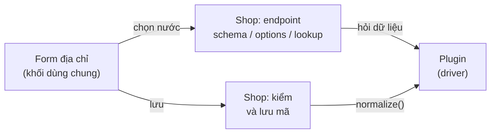
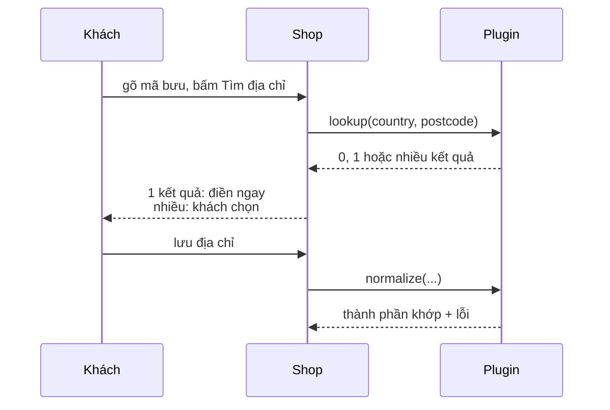

> 🌐 **Ngôn ngữ:** 🇻🇳 Tiếng Việt (hiện tại) · [🇬🇧 English](./create-address-plugin.md) · [🇯🇵 日本語](./create-address-plugin_ja.md)

# Tạo plugin địa chỉ cho GP247 — danh sách chọn và tra mã bưu chính

## Giới thiệu

Tài liệu này hướng dẫn lập trình viên viết một **plugin địa chỉ** cho một quốc gia: khách chọn địa chỉ từ danh sách phụ
thuộc (tỉnh → quận) hoặc gõ mã bưu chính để các ô tự điền. Phần 1 dựng plugin **danh sách hai cấp** chạy được ngay với một
file dữ liệu đóng gói trong plugin. Phần 2 thêm **tra mã bưu chính**. Đọc xong, bạn biết `gp247/shop` đã làm sẵn những gì
(form, kiểm tra, lưu mã, màn Danh mục địa chỉ) và plugin chỉ cần cung cấp phần dữ liệu nào.

> ℹ️ **Có từ:** gp247/shop 3.15 (lớp địa chỉ, danh sách). Tra mã bưu chính: gp247/shop 3.15.1.

> 💡 **Làm cùng AI agent?** Dùng skill **`gp247-plugin-create`** trong repo
> [gp247-skills](https://github.com/gp247net/gp247-skills) để dựng khung plugin (dò phiên bản site, `gp247.json`, vòng đời an
> toàn khi cập nhật), rồi làm theo các bước dưới đây cho phần địa chỉ.

> 📦 **Hai plugin mẫu hoàn chỉnh, miễn phí:** [AddressVN](https://github.com/gp247-plugin/AddressVN) (danh sách tỉnh →
> phường/xã) và [AddressJP](https://github.com/gp247-plugin/AddressJP) (tra mã bưu chính, dữ liệu chia mảnh).

---

## Nhìn nhanh

Plugin chỉ trả lời câu hỏi về dữ liệu; mọi phần còn lại do `gp247/shop` lo:



- **Plugin = một driver** đăng ký trong `Provider.php`: mô tả các thành phần của địa chỉ, trả danh sách, tra mã bưu, kiểm
  địa chỉ khi lưu.
- **Shop lo phần còn lại**: hiện form, thứ tự ô, gọi endpoint, cache danh sách, kiểm lại ở server, lưu tên chính thức + mã
  vào `address_meta`, màn **Danh mục địa chỉ** để chủ site chọn ô nào nhận giá trị.
- **Không có bảng riêng, không có cấu hình riêng** — plugin an toàn khi cập nhật một chạm.
- **Lỗi của plugin không bao giờ chặn khách**: driver ném lỗi thì form trở về ô gõ tay.

## Trong trang này

- [1. Trước khi bắt đầu](#1-trước-khi-bắt-đầu) — yêu cầu và khái niệm
- [2. Phần 1 — Plugin danh sách hai cấp](#2-phần-1--plugin-danh-sách-hai-cấp) — từng bước có code
- [3. Phần 2 — Tra mã bưu chính](#3-phần-2--tra-mã-bưu-chính) — thành phần `lookup` / `derived`
- [4. Dữ liệu đi kèm plugin](#4-dữ-liệu-đi-kèm-plugin) — nguồn, dựng lại, chia mảnh
- [5. Khối địa chỉ trong template](#5-khối-địa-chỉ-trong-template) — cho người làm template
- [6. Tra cứu nhanh](#6-tra-cứu-nhanh--gp247shop-có-sẵn-gì) — lớp, cấu hình, endpoint

---

## 1. Trước khi bắt đầu

- Website GP247 3.x có cài `gp247/shop` 3.15 trở lên (`php artisan gp247:info`).
- Biết cách tạo plugin cơ bản: [Hướng dẫn tạo plugin](./create-plugin_vi.md).
- Hiểu phía chủ cửa hàng dùng thế nào: [Địa chỉ khách hàng trong S-Cart](../s-cart/customer-address/customer-address_vi.md).

Ba khái niệm cần nắm:

| Khái niệm | Nghĩa |
| --- | --- |
| **Thành phần** (component) | Một cấp dữ liệu của plugin: `province`, `ward`, `postcode`… Mỗi thành phần có **loại**: `list` (danh sách chọn), `lookup` (khoá khách gõ, như mã bưu), `derived` (chỉ đến từ kết quả tra mã). |
| **Ô của shop** (field) | Ô trên form địa chỉ: `postcode`, `city`, `district`, `ward`, `address1`, `address2`, `address3`. Chủ site bật/tắt ở tab Khách hàng. |
| **Mapping** | Ô nào nhận thành phần nào. Plugin đề xuất mapping mặc định; chủ site đổi ở màn **Danh mục địa chỉ**. Một ô ← một thành phần. |

---

## 2. Phần 1 — Plugin danh sách hai cấp

Ví dụ dựng plugin `AddressTH` (Thái Lan): khách chọn **tỉnh** rồi **huyện** của tỉnh đó. Dữ liệu trong ví dụ chỉ có vài
dòng minh hoạ — plugin thật dùng danh mục chính thức của nước đó.

### Bước 1 — Sinh khung

Chạy ở thư mục gốc website:

```bash
php artisan gp247:make-plugin --name=AddressTH --download=0
```

Plugin địa chỉ không có màn quản trị riêng: xoá `Admin/`, `Livewire/`, `Views/`, `Controllers/`, `Route.php`, `Seo.php`
(và dòng đăng ký Seo trong `Provider.php`). Giữ `AppConfig.php`, `Provider.php`, `config.php`, `gp247.json`, `Lang/`.

### Bước 2 — `gp247.json`

```json
{
    "name": "Thailand Address",
    "image": "images/address-th.svg",
    "auth": "Your name",
    "configGroup": "Plugins",
    "configCode": "AddressTH",
    "configKey": "AddressTH",
    "version": "1.0.0",
    "requireCore": ["3.18"],
    "minUpdateFrom": "1.0.0",
    "requireComposerPackages": ["gp247/shop"],
    "requireGp247Extensions": [],
    "requireLivewire": false,
    "storeScope": "store"
}
```

`storeScope: store` để site nhiều cửa hàng bật plugin theo từng cửa hàng. `requireCore` lấy theo `major.minor` của core trên
site bạn.

### Bước 3 — `AppConfig.php`: từ chối cài khi shop chưa có lớp địa chỉ

`requireComposerPackages` chỉ kiểm `gp247/shop` có mặt, không kiểm phiên bản — nên `install()` tự kiểm interface. Plugin chỉ
ghi dòng bật/tắt; nút ⚙ mở màn Danh mục địa chỉ của shop. Các hàm khác (`uninstall`, `enable`, `disable`, `getInfo`) giữ như
file sinh ra.

```php
public function install()
{
    if (AdminConfig::where('key', $this->configKey)->where('group', $this->configGroup)->exists()) {
        return ['error' => 1, 'msg' => gp247_language_render('admin.extension.plugin_exist')];
    }
    // The address layer exists from gp247/shop 3.15.
    if (!interface_exists(\GP247\Shop\Address\Contracts\AddressProvider::class)) {
        return ['error' => 1, 'msg' => trans($this->appPath.'::lang.requires_shop_address')];
    }
    AdminConfig::insert([
        'group' => $this->configGroup, 'code' => $this->configCode, 'key' => $this->configKey,
        'sort' => 0, 'store_id' => GP247_STORE_ID_GLOBAL, 'value' => self::ON,
        'detail' => $this->appPath.'::lang.title',
    ]);

    return ['error' => 0, 'msg' => gp247_language_render('admin.extension.install_success')];
}

public function clickApp()
{
    if (!\Illuminate\Support\Facades\Route::has('admin_address_mapping.index')) {
        return null;
    }

    return redirect(gp247_route_admin('admin_address_mapping.index', ['country' => 'TH']));
}
```

### Bước 4 — `Provider.php`: đăng ký driver

Chỉ đăng ký khi plugin đang bật, và chỉ khi shop có lớp địa chỉ:

```php
if (gp247_extension_check_active($config['configGroup'], $config['configKey'])) {
    if (interface_exists(\GP247\Shop\Address\Contracts\AddressProvider::class)) {
        config(['gp247-config.shop.address_providers.AddressTH' => [
            'driver' => \App\GP247\Plugins\AddressTH\Services\ThailandAddressProvider::class,
            'countries' => ['TH'],
            'capabilities' => ['options'],
        ]]);
    }
}
```

`capabilities`: `options` = có danh sách, `postcode` = tra mã bưu. Shop chỉ dùng năng lực vừa được khai **vừa** được driver
hiện thực (interface tương ứng).

### Bước 5 — Dữ liệu `Data/th-units.json`

```json
{
    "version": "2026-01-01",
    "provinces": [
        { "code": "10", "name": "กรุงเทพมหานคร", "districts": [
            { "code": "1001", "name": "เขตพระนคร" },
            { "code": "1002", "name": "เขตดุสิต" }
        ] }
    ]
}
```

`version` đi vào `address_meta` của mỗi địa chỉ — biết địa chỉ được kiểm theo bản dữ liệu nào.

### Bước 6 — Driver `Services/ThailandAddressProvider.php`

Driver mô tả thành phần, trả danh sách và kiểm địa chỉ khi lưu:

```php
<?php

namespace App\GP247\Plugins\AddressTH\Services;

use GP247\Shop\Address\Contracts\AddressProvider;
use GP247\Shop\Address\Contracts\ListsAddressOptions;
use GP247\Shop\Address\Data\AddressComponent;
use GP247\Shop\Address\Data\AddressOption;
use GP247\Shop\Address\Data\AddressSchema;
use GP247\Shop\Address\Data\NormalizedAddress;

class ThailandAddressProvider implements AddressProvider, ListsAddressOptions
{
    private ?array $data = null;

    public function schema(string $country): AddressSchema
    {
        return new AddressSchema(
            'TH',
            (string) $this->data()['version'],
            [
                new AddressComponent('province', 'Plugins/AddressTH::lang.province', AddressComponent::KIND_LIST),
                new AddressComponent('district', 'Plugins/AddressTH::lang.district', AddressComponent::KIND_LIST, 'province'),
            ],
            ['city' => 'province', 'district' => 'district'],   // default mapping: shop field => component
        );
    }

    public function options(string $country, string $component, ?string $parentCode, string $locale): array
    {
        $rows = match ($component) {
            'province' => $this->data()['provinces'],
            'district' => $this->province($parentCode)['districts'] ?? [],
            default => [],
        };

        return array_map(static fn (array $row) => new AddressOption((string) $row['code'], (string) $row['name']), $rows);
    }

    public function normalize(string $country, array $components, string $locale): NormalizedAddress
    {
        $matched = [];
        $province = $this->find($this->data()['provinces'], $components['province'] ?? null);
        if ($province !== null) {
            $matched['province'] = ['code' => (string) $province['code'], 'name' => (string) $province['name']];
            $district = $this->find($province['districts'], $components['district'] ?? null);
            if ($district !== null) {
                $matched['district'] = ['code' => (string) $district['code'], 'name' => (string) $district['name']];
            }
        }

        return new NormalizedAddress($matched);
    }

    private function province(?string $code): ?array
    {
        return $code === null ? null : $this->find($this->data()['provinces'], ['code' => $code, 'name' => null]);
    }

    /** A code must exist; without a code, the exact name decides. */
    private function find(array $rows, ?array $value): ?array
    {
        foreach ($rows as $row) {
            if (($value['code'] ?? null) !== null ? (string) $row['code'] === (string) $value['code']
                : trim((string) ($value['name'] ?? '')) === $row['name']) {
                return $row;
            }
        }

        return null;
    }

    private function data(): array
    {
        if ($this->data === null) {
            $data = json_decode((string) @file_get_contents(dirname(__DIR__).'/Data/th-units.json'), true);
            if (!is_array($data) || !isset($data['version'], $data['provinces'])) {
                // Thrown on purpose: the shop catches it and turns the fields back into text inputs.
                throw new \RuntimeException('AddressTH: data file missing or damaged.');
            }
            $this->data = $data;
        }

        return $this->data;
    }
}
```

Thêm nhãn vào `Lang/vi/lang.php` (và `en`, `ja`…): `'province' => 'Tỉnh'`, `'district' => 'Huyện'`,
`'requires_shop_address' => 'Plugin cần gp247/shop 3.15 trở lên…'`. Nhãn thành phần hiện trên form thay cho nhãn của ô.

### Bước 7 — Cài và thử

```bash
php artisan optimize:clear
php artisan gp247:ext-install --type=plugin --key=AddressTH
```

1. Ở **Cấu hình website → tab Khách hàng**, bật ô **Tỉnh/Thành phố**, **Quận/Huyện**, **Quốc gia**.
2. Mở **Thiết lập cửa hàng → Danh mục địa chỉ**, chọn **Thailand**: khung kiểm tra phải báo **đã đủ điều kiện**.
3. Mở trang đăng ký, chọn quốc gia Thailand: ô Tỉnh thành danh sách có ô tìm, ô Huyện chỉ hiện huyện của tỉnh đã chọn.

Thử gỡ chỉ dữ liệu rồi cài lại (thư mục plugin được giữ):

```bash
php artisan gp247:ext-uninstall --type=plugin --key=AddressTH --only-data
php artisan gp247:ext-install --type=plugin --key=AddressTH
```

---

## 3. Phần 2 — Tra mã bưu chính

Khi mã bưu chính xác định được địa chỉ (như Nhật Bản), khách gõ mã và các ô tự điền. Thêm năng lực `postcode`:



- **Một kết quả** → shop điền thẳng các ô; **nhiều** → khách chọn; **không có** → báo, các ô gõ tay.
- Khi lưu, shop gọi lại `normalize()` — **không tin** giá trị trình duyệt gửi lên.

### 3.1. Schema có thành phần `lookup` và `derived`

```php
return new AddressSchema(
    'JP',
    $this->data->version(),
    [
        new AddressComponent('postcode', 'Plugins/AddressJP::lang.postcode', AddressComponent::KIND_LOOKUP),
        new AddressComponent('prefecture', 'Plugins/AddressJP::lang.prefecture', AddressComponent::KIND_LIST),
        new AddressComponent('municipality', 'Plugins/AddressJP::lang.municipality', AddressComponent::KIND_DERIVED, 'prefecture'),
        new AddressComponent('town', 'Plugins/AddressJP::lang.town', AddressComponent::KIND_DERIVED, 'municipality'),
    ],
    ['postcode' => 'postcode', 'city' => 'prefecture', 'district' => 'municipality', 'address1' => 'town'],
    ['address1'],   // fields the shopper may edit after a lookup filled them
);
```

- **`lookup`**: ô khách gõ (luôn gõ được). Khi một nước của cửa hàng có ô `lookup`, shop đặt ô mã bưu **ngay sau ô Quốc gia**.
- **`derived`**: chỉ đến từ kết quả tra mã. Ô trong danh sách thứ năm (`defaultEditable`) cho khách **gõ tiếp** sau khi điền
  (thêm số nhà); mã vẫn được giữ khi dòng còn bắt đầu bằng tên đã điền.

### 3.2. `lookup()` trả các `AddressSuggestion`

```php
use GP247\Shop\Address\Contracts\ResolvesPostcode;
use GP247\Shop\Address\Data\AddressSuggestion;

public function lookup(string $country, string $postcode, string $locale): array
{
    $digits = self::normalizePostcode($postcode);   // accept the ways people type it, return null when it cannot be one
    if ($digits === null) {
        return [];
    }
    $out = [];
    foreach ($this->data->rows($digits) as [$cityCode, $city, $town]) {
        $out[] = new AddressSuggestion([
            'prefecture' => ['code' => substr($cityCode, 0, 2), 'name' => $this->prefectureName($cityCode)],
            'municipality' => ['code' => $cityCode, 'name' => $city],
            'town' => $town === '' ? ['name' => ''] : ['code' => $digits, 'name' => $town],
        ]);
    }

    return $out;
}
```

Nhớ khai `'capabilities' => ['options', 'postcode']` ở `Provider.php` và cho driver `implements ResolvesPostcode`.

> ⚠️ **Lưu ý:** chuẩn hoá mã ở **plugin**, không bắt khách gõ đúng một kiểu. Endpoint của shop nhận cả ký tự bộ gõ tiếng Nhật
> (số toàn khổ, `〒`, các kiểu gạch) và chuyển nguyên cho plugin.

### 3.3. `normalize()` — khi nào trả lỗi

`NormalizedAddress($matched, $errors)`: thành phần **không khớp thì để ra ngoài** `$matched`. Còn `$errors`:

| Trường hợp | Plugin nên | Shop làm gì (chế độ "Yêu cầu khách chọn lại") |
| --- | --- | --- |
| Giá trị danh sách không có thật | Để ra ngoài `$matched` | Báo ở ô đó bằng thông điệp chung của shop |
| Mã bưu **chắc chắn sai** (sai định dạng, không thuộc tỉnh đã chọn) | `$errors['postcode'] = 'Plugins/<Key>::lang.<khoá>'` | Báo **ở ô mã bưu** bằng thông điệp của plugin, không lưu |
| Mã bưu đúng định dạng nhưng **chưa có** trong dữ liệu | Để ra ngoài `$matched`, **không** trả lỗi | Nhận địa chỉ, không có mã (dữ liệu có thể cũ hơn mã mới) |

Thành phố / khu phố chỉ nên khớp **trong các kết quả của mã bưu đã nhập** (cùng tỉnh) — để không bao giờ lưu một mã nằm cạnh
một nơi không thuộc về nó.

---

## 4. Dữ liệu đi kèm plugin

Ưu tiên **đóng gói dữ liệu trong plugin**: không phụ thuộc mạng, chạy trên shared host, không gửi dữ liệu khách ra ngoài.

- **Nguồn chính thức** và điều kiện dùng lại ghi rõ trong README (AddressVN: Cục Thống kê; AddressJP: Japan Post).
- **Lệnh dựng lại** trong `tools/` (chạy tay bởi người bảo trì): đọc file nguồn, kiểm từng dòng, **dừng không ghi gì** khi
  gặp dòng lạ, ghi `version` = ngày của file nguồn.
- **Dữ liệu lớn → chia mảnh**: AddressJP chia 120 nghìn mã thành 948 file theo 3 số đầu; mỗi lần tra chỉ đọc một file vài chục
  KB.
- **Thiếu / hỏng dữ liệu → ném exception**: shop bắt lỗi, ghi log một lần, đưa form về ô gõ tay.
- **Cần gọi API bên ngoài?** Dùng thời gian chờ ngắn theo `config('gp247-config.shop.address.timeout')` (giây, mặc định 3).
  Shop đã cache danh sách (`cache_ttl`, mặc định 1 ngày) — không cần tự cache `options()`.

---

## 5. Khối địa chỉ trong template

Phần này dành cho người làm **template**. Form địa chỉ là một khối dùng chung của shop
(`common/shop_address_fields`): template gọi khối này thay cho các ô địa chỉ tự viết, nhờ đó mọi plugin địa chỉ chạy được trên
template của bạn.

```blade
@include(gp247_shop_process_view($GP247TemplatePath, 'common.shop_address_fields'), [
    'addressBlock' => \GP247\Shop\Address\View\AddressBlock::for(
        old('country'),
        \GP247\Shop\Address\AddressForm::CONTEXT_CUSTOMER_INSERT,
    ),
    'testidPrefix' => 'register-address',
    'countries' => $countries,
])
```

- Gọi ở mọi trang có địa chỉ: đăng ký, sửa thông tin tài khoản, sổ địa chỉ, bước đặt hàng (mỗi trang một `CONTEXT_*` của
  `AddressForm`).
- Đổi giao diện bằng tham số lớp CSS (`inputClass`, `labelClass`, `fieldClass`, `buttonClass`…) — không chép view của khối.
- Template cần chạy cả trên shop cũ: bọc bằng `@if (class_exists(\GP247\Shop\Address\View\AddressBlock::class))` và giữ ô cũ
  ở nhánh `@else`.
- Hợp đồng đầy đủ: mục "Address forms" trong skill `gp247-template-create` của
  [gp247-skills](https://github.com/gp247net/gp247-skills).

---

## 6. Tra cứu nhanh — `gp247/shop` có sẵn gì

| Thứ | Ở đâu | Dùng để |
| --- | --- | --- |
| `AddressProvider` | `GP247\Shop\Address\Contracts` | Bắt buộc: `schema()`, `normalize()` |
| `ListsAddressOptions` | (cùng chỗ) | Năng lực `options`: `options()` |
| `ResolvesPostcode` | (cùng chỗ) | Năng lực `postcode`: `lookup()` |
| `AddressSchema`, `AddressComponent`, `AddressOption`, `AddressSuggestion`, `NormalizedAddress` | `GP247\Shop\Address\Data` | Kiểu dữ liệu trả về |
| `gp247-config.shop.address_providers.<Key>` | `Provider.php` của plugin | Đăng ký `driver`, `countries`, `capabilities` |
| `gp247-config.shop.address.timeout` / `cache_ttl` | cấu hình shop (`GP247_ADDRESS_TIMEOUT`, `GP247_ADDRESS_CACHE_TTL`) | Thời gian chờ gọi ngoài; thời gian cache danh sách |
| `address/schema`, `address/options`, `address/lookup` | endpoint công khai của shop (có giới hạn tần suất) | Khối form gọi; plugin không cần viết route |
| `AddressService::make()->normalize(...)` | `GP247\Shop\Address` | Gọi trong test của plugin để kiểm cả đường lưu |
| `admin_address_mapping.index` | route admin của shop | Màn Danh mục địa chỉ (nút ⚙ của plugin trỏ tới) |

---

## Điều kiện & ràng buộc (hiểu trước khi thao tác)

**Khi viết driver**

- **Mã thành phần chỉ gồm chữ, số, `_`, `.`, `-`, tối đa 64 ký tự** — shop bỏ mã khác dạng này khi nhận từ trình duyệt, để mã
  không mang theo ký tự lạ vào cơ sở dữ liệu.
- **Một ô ← một thành phần**; thành phần con phải có thành phần cha được map — nếu không, màn Danh mục địa chỉ báo lỗi và
  không lưu mapping.
- **Driver không nhận tên, điện thoại, email của khách** — chỉ các thành phần địa chỉ; không cần (và không nên) lưu gì về khách.

**Khi đăng ký**

- **Một nước có hai plugin cùng bật** → shop dùng plugin chủ site đã chọn ở màn Danh mục địa chỉ, nếu chưa chọn thì plugin có
  key đứng trước theo thứ tự chữ cái.
- **Năng lực khai mà driver không hiện thực bị bỏ qua** — tránh shop gọi một hàm không có.

**Khi phát hành**

- **Thư mục plugin phải trùng `configKey`** — GP247 nhận plugin theo tên thư mục.
- **Ghi rõ phiên bản shop tối thiểu trong README** (3.15 cho danh sách, 3.15.1 cho tra mã bưu) — `requireComposerPackages`
  không kiểm phiên bản.

---

## Hỏi & Đáp (Q&A)

**Câu 1: Plugin của tôi có cần màn cấu hình riêng không?**

→ Không. Màn **Danh mục địa chỉ** của shop đã cho chủ site chọn ô nhận giá trị và chế độ kiểm; plugin chỉ cần nút ⚙ trỏ tới đó
(`clickApp()`).

**Câu 2: Tên địa danh có cần dịch theo ngôn ngữ giao diện không?**

→ Tuỳ nước. `options()` và `lookup()` nhận `$locale`; AddressJP giữ chữ Nhật ở mọi ngôn ngữ vì địa chỉ giao hàng ở Nhật viết
bằng chữ Nhật. Nhãn các ô thì luôn dịch qua `Lang/`.

**Câu 3: Danh sách hàng nghìn dòng có làm form chậm không?**

→ Không đáng kể: khối form có ô tìm, shop cache từng danh sách (mặc định 1 ngày) và chỉ tải danh sách con của mục cha đang chọn.

**Câu 4: Tôi lấy dữ liệu từ API của bên thứ ba được không?**

→ Được, nhưng dùng thời gian chờ `gp247-config.shop.address.timeout` và chấp nhận rằng khi API lỗi, form về ô gõ tay. Kiểm
điều khoản của API (nhiều API cấm cung cấp lại cho bên thứ ba) và ghi rõ trong README là dữ liệu khách được gửi đi.

**Câu 5: Viết test cho plugin thế nào?**

→ Gọi thẳng driver (`schema`, `options`, `lookup`, `normalize`) trên một file dữ liệu nhỏ cùng dạng, và gọi
`AddressService::make()->normalize(...)` sau khi khai `gp247-config.shop.address_providers` để kiểm cả đường lưu. Thêm một case
cho file dữ liệu hỏng (form phải về ô gõ tay).

**Câu 6: Khi nào trả lỗi trong `NormalizedAddress`?**

→ Chỉ khi giá trị chắc chắn sai. Với mã bưu, lỗi hiện ngay ở ô mã bưu; mã chỉ thiếu trong dữ liệu thì để trống, không trả lỗi
(xem [bảng ở mục 3.3](#33-normalize--khi-nào-trả-lỗi)).

**Câu 7: Template tôi đang dùng không hiện danh sách?**

→ Template đó chưa gọi khối địa chỉ dùng chung — xem [Khối địa chỉ trong template](#5-khối-địa-chỉ-trong-template).

**Câu 8: Plugin địa chỉ có cần cron hay queue không?**

→ Không. Dữ liệu đọc từ file trong plugin ở mỗi request; cập nhật dữ liệu bằng cách phát hành bản plugin mới.

---

<sub>📅 **Cập nhật lần cuối:** 2026-11-24 · ✍️ **Tác giả (Author):** GP247</sub>
