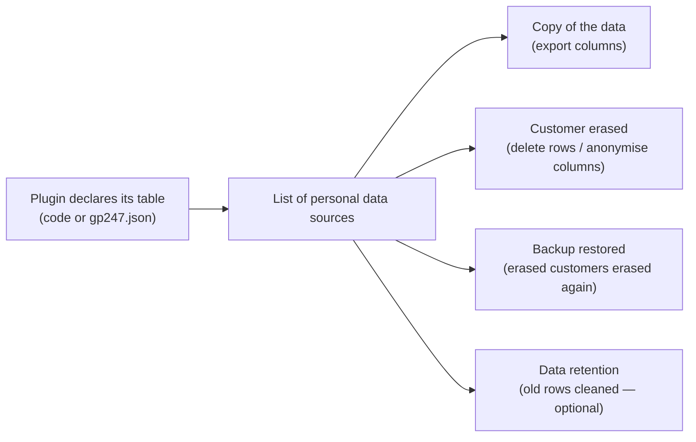

> 🌐 **Language:** [🇻🇳 Tiếng Việt](./declare-personal-data_vi.md) · 🇬🇧 English (current) · [🇯🇵 日本語](./declare-personal-data_ja.md)

# Declaring customers' personal data in a plugin

## Introduction

This guide is for GP247 plugin developers whose plugin has **a table of its own holding information about customers** —
names, emails, phone numbers, addresses, text customers wrote (reviews, messages, requests…). Once the table is
**declared**, the platform takes care of the customer's data rights:

- the customer (or the shop owner on their behalf) **downloads a copy of their data** — the plugin's rows are in the package;
- the customer **deletes their account** — their rows in the plugin's table are deleted or anonymised by the rule you choose;
- an older **backup is restored** — customers erased since are erased again, in the plugin's table too;
- **data retention** — old rows that have served their purpose are cleaned by age (optional).

An undeclared table shows on the "Personal data requests" screen under **"Customer data nobody declared"**, and the shop
owner has to handle it by hand. Read after [Creating a plugin](./create-plugin.md) and
[Update-safe plugins](./create-plugin-update-safety.md).

> 💡 **Working with an AI agent?** The `gp247-plugin-create`, `gp247-payment-plugin-create` and `gp247-shipping-plugin-create`
> skills in the [gp247-skills](https://github.com/gp247net/gp247-skills) repository declare the plugin's tables the way this page
> describes (the skill's `references/personal-data.md`).

**No declaration is needed** when the plugin keeps no customer data, or only writes into the platform's tables (orders,
payments, shipments — `gp247/shop` declares those).

---

## What the platform does with a declared table



Everything goes through **one erasure service** of the core: a plugin never writes its own `DELETE` for customers' data.

---

## Option 1 — Declare in `Provider.php` (recommended)

```php
// The plugin's Provider.php: `use` lines at the top of the file; the declaration OUTSIDE the
// if (gp247_extension_check_active(...)) block — a disabled plugin's data must still be erasable.
use GP247\Core\PersonalData\Application\PersonalDataRegistry;
use GP247\Core\PersonalData\Domain\PersonalDataSource;
use GP247\Core\PersonalData\Domain\SubjectLink;

// class_exists: the plugin also runs on a core without the personal data registry.
if (class_exists(PersonalDataRegistry::class)) {
    PersonalDataRegistry::declare(
        PersonalDataSource::table('acme_review')                         // table name without GP247_DB_PREFIX; key 'id'
            ->link(SubjectLink::customer('customer_id'))                  // rows of a customer account
            ->link(SubjectLink::email('author_email', onlyWhenEmpty: 'customer_id')) // guests, by the email they typed
            ->anonymise([                                                 // keep the row, remove the person
                'author_name' => 'mark',                                  // becomes "[deleted]"
                'author_email' => 'null',
                'content' => 'scrubText',                                 // remove the customer's known values from free text
            ])
            ->identity(['author_name'])                                   // values collected first, to scrub free text
            ->export(['product_id', 'rating', 'content', 'created_at'])   // columns put in the customer's data package
            ->order(30)                                                   // tables pointing to others are handled first
            ->describe(['en' => 'Product reviews', 'vi' => 'Đánh giá sản phẩm', 'ja' => '商品レビュー'], 'Plugins/AcmeReview')
    );
}
```

The example uses a made-up table `acme_review` of a made-up plugin `AcmeReview`.

> ⚠️ `->identity($columns, $emailColumns)`: the second argument is **only** for columns holding **the account's own** email.
> An email typed by a customer (a review, a form, a note) **never** goes there — otherwise someone else's email pulls their data into
> the package or into the erasure. Guests' rows are found with `SubjectLink::email()`.

### Linking rows to the customer

| Link | When |
|---|---|
| `SubjectLink::customer('customer_id')` | The table has the customer account id |
| `SubjectLink::email('email', onlyWhenEmpty: 'customer_id')` | Guests' rows, found by email; `onlyWhenEmpty` keeps rows of another account out |
| `SubjectLink::morph('owner_type', 'owner_id', $morphClass)` | A polymorphic table (a type column + an id column) |
| `SubjectLink::parent('acme_review', 'review_id')` | Child rows of a declared table (replies to a review…) |

Rows found by email join a customer's own request only when **the account's email is verified** — the platform applies this rule.

### What erasing a customer does to a row

| Rule | Meaning | Example |
|---|---|---|
| `->deleteRows()` | Delete the row | Carts, wishlists, messages |
| `->anonymise([...])` | Keep the row, change columns by their column rule | Rows with amounts, dates, transaction codes the books need |
| `->retain()` | Keep as is (the table has its own retention) | Security logs |

Column rules (`anonymise`): `mark` (`[deleted]`) · `null` (empty) · `scrubText` (remove known values from text) ·
`['scrubJson', ['receiver.name', …]]` (JSON: change the keys named; `scrubJson` without a list scrubs every string) · `keep`.
Columns not named are never touched.

### Other cases

| Case | What to do |
|---|---|
| Table without an `id` key | `PersonalDataSource::table('acme_cart', 'identifier')` |
| Table that looks personal but holds no customer data | `PersonalDataRegistry::notCustomerData('acme_supplier', 'suppliers of the shop, not customers')` |
| Table without the `GP247_DB_PREFIX` prefix | `->unprefixed()` |

The core checks every declaration: plain table / column names only (no SQL), at least one link, an `anonymise` rule changes
at least one column. **Never declare a table of the platform** (`admin_*`, `api_*`, `shop_*`…) — core, front and shop declare their own.

---

## Option 2 — Declare in `gp247.json` (no code)

```json
"personalData": [
  { "table": "acme_review", "key": "id",
    "link": [{"customer": "customer_id"}, {"email": "author_email", "guest": "customer_id"}],
    "rule": "anonymise",
    "columns": {"author_name": "mark", "author_email": "null", "content": "scrubText"},
    "identity": ["author_name"],
    "export": ["product_id", "rating", "content", "created_at"],
    "order": 30,
    "label": {"en": "Product reviews", "vi": "Đánh giá sản phẩm", "ja": "商品レビュー"} }
]
```

- `rule`: `delete` · `anonymise` · `retain`. `link` is one link or a list: `customer`, `email` (+ `guest`), `parent` + `column`
  (+ `type_column`, `type_value`). A `morph` link can be declared only in code.
- `emails` (optional) is only for columns holding **the account's own** email — like the second argument of `identity()`.
- The key is read **even while the plugin is disabled** (its data must still be erasable). A broken entry is skipped and written to the system log.
- A table also declared in code uses the code declaration.

---

## Data retention (optional)

When rows lose their purpose after a while (a log, a cart of the plugin), add a **retention item** next to the declaration. The
shop owner sees it on **Security → Data retention**, turns it on or off and sets the days; the core cleans a little at a time
while the site is visited (no cron needed).

```php
use GP247\Core\PersonalData\Domain\Retention\RetentionItem;

if (method_exists(PersonalDataRegistry::class, 'retention')) {
    // A retention item cleans only a table declared with deleteRows() (or notCustomerData).
    PersonalDataRegistry::declare(
        PersonalDataSource::table('acme_request_log')->link(SubjectLink::customer('customer_id'))->deleteRows()->order(60)
            ->describe(['en' => 'Acme request log', 'vi' => 'Nhật ký yêu cầu Acme', 'ja' => 'Acme リクエストログ'], 'Plugins/AcmeReview')
    );
    PersonalDataRegistry::retention(
        RetentionItem::rows('acme.request_log', 'acme_request_log')    // key: lower case, digits, _, one dot; 29 characters at most
            ->olderThan('created_at')->days(90, 7, 365)                 // default, minimum, maximum
            ->describe(['en' => 'Acme request log', 'vi' => 'Nhật ký yêu cầu Acme', 'ja' => 'Acme リクエストログ'], 'Plugins/AcmeReview', 50)
    );
}
```

- An item deletes rows only of a table declared with `->deleteRows()` (or marked `notCustomerData`).
- An item that removes business data: add `->disabledByDefault()->risky(['<backup data group>'])` — off by default; turning it on
  shows how many records it concerns, asks for the password again and lets the backup save the data first.
- An item new on a site waits **30 days** before its first clean.

---

## Check

1. **Personal data requests** screen → **Check the database**: the plugin's tables are no longer listed as undeclared.
2. Create a test customer with rows in the plugin's table → create an export request: the package has the columns listed in `export`.
3. Erase the test customer: their rows are deleted / anonymised; other customers' rows stay.

## Checklist before release

- [ ] Every table of the plugin with name / email / phone / address / text written by customers is declared, or marked `notCustomerData`.
- [ ] Declarations are wrapped in `class_exists` / `method_exists` when the plugin supports older cores, and sit outside the `gp247_extension_check_active` block.
- [ ] No email typed by customers is in `identity()` / `emails` — only the account's own email.
- [ ] Amounts, dates and transaction codes are kept (`anonymise` rather than `deleteRows` when the books need the row).
- [ ] `export` holds only the customer's own data (no secret keys, no internal shop data).

---

## Conditions & constraints (understand before acting)

- **The core skips `gp247.json` entries naming a table of the platform** (tables in the data groups of core / front / shop, names
  starting with `admin_`, `api_`, `personal_data_`) — only the platform's code declares those.
- **A wrong declaration in code stops the whole site** (the plugin load error is logged and every page stops) — always try the
  plugin on a development site before releasing; a wrong `gp247.json` entry is only skipped and logged.
- **Erasing a customer cannot be undone.** Try on made-up data, never on a live site.

## Questions & Answers (Q&A)

**Q1: The plugin stores only the customer id (`customer_id`), no name or email — must it be declared?**

→ Yes, when a row belongs to a customer (points, history): the customer has the right to a copy and to erasure. Choose
`deleteRows()` or `anonymise()` depending on whether the books need the row.

**Q2: A child table has no customer column, only a pointer to its parent?**

→ Use `SubjectLink::parent('parent_table', 'parent_column')`; the parent table must be declared.

**Q3: Free text with the customer's name (notes, history)?**

→ Give that column `scrubText` and list the identifying columns in `identity()` — the core collects the customer's values first
and removes them from the text.

**Q4: The plugin was released before it declared anything?**

→ Add the declaration in the next version; existing rows count as soon as it is installed. No data migration is needed.

## Change history
<!-- Only when logic/behavior changed. Newest row on top. One row per day: merge same-day changes into the existing row, never add a new row for the same date. -->

| Date | GP247 version | Change |
| --- | --- | --- |
| 2026-11-25 | gp247/core 3.19.0 | New page: declaring personal data (code, `gp247.json`), erasure / anonymisation rules, retention items |

---

<sub>📅 **Last updated:** 2026-11-25 · ✍️ **Author:** GP247</sub>
