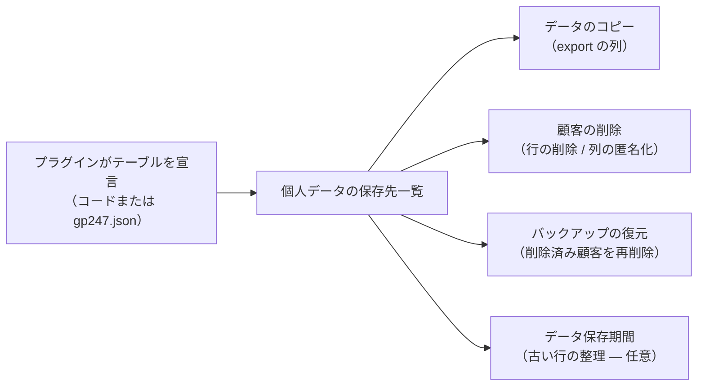

> 🌐 **言語:** [🇻🇳 Tiếng Việt](./declare-personal-data_vi.md) · [🇬🇧 English](./declare-personal-data.md) · 🇯🇵 日本語（現在）

# プラグインで顧客の個人データを宣言する

## はじめに

このガイドは、**顧客の情報を持つ独自テーブル**（氏名、メールアドレス、電話番号、住所、顧客が書いた文章 — レビュー、
メッセージ、依頼など）を持つ GP247 プラグインの開発者向けです。テーブルを**宣言**すると、顧客のデータに関する権利の
処理をプラットフォームが行います。

- 顧客（または顧客に代わってショップ運営者）が**データのコピーをダウンロード**すると、プラグインのテーブルの行もパッケージに入ります。
- 顧客が**アカウントを削除**すると、プラグインのテーブル内のその顧客の行が、選んだルールで削除または匿名化されます。
- 古い**バックアップを復元**すると、その後に削除された顧客が、プラグインのテーブルでも再度削除されます。
- **データ保存期間** — 役目を終えた古い行を経過日数で整理します（任意）。

宣言のないテーブルは「個人データの請求」画面の**「未申告の顧客データ」**に表示され、ショップ運営者が手作業で対応する
ことになります。[プラグイン作成ガイド](./create-plugin_ja.md) と [更新に安全なプラグイン](./create-plugin-update-safety_ja.md) の後に読んでください。

> 💡 **AI エージェントと作業する場合:** [gp247-skills](https://github.com/gp247net/gp247-skills) リポジトリのスキル
> `gp247-plugin-create`、`gp247-payment-plugin-create`、`gp247-shipping-plugin-create` は、このページのとおりにプラグインの
> テーブルを宣言します（スキルの `references/personal-data.md`）。

**宣言が不要な場合:** プラグインが顧客のデータを持たない、またはプラットフォームのテーブル（注文、支払い、配送 —
`gp247/shop` が宣言済み）にだけ書き込む場合。

---

## 宣言したテーブルにプラットフォームが行うこと



すべてコアの**ひとつの削除サービス**を通ります。プラグインが顧客データ用の `DELETE` を独自に書くことはありません。

---

## 方法 1 — `Provider.php` で宣言する（推奨）

```php
// プラグインの Provider.php: `use` はファイルの先頭。宣言は if (gp247_extension_check_active(...))
// ブロックの外に置く — 無効なプラグインのデータも削除できる必要があるため。
use GP247\Core\PersonalData\Application\PersonalDataRegistry;
use GP247\Core\PersonalData\Domain\PersonalDataSource;
use GP247\Core\PersonalData\Domain\SubjectLink;

// class_exists: 個人データの一覧を持たないコアでもプラグインが動くように。
if (class_exists(PersonalDataRegistry::class)) {
    PersonalDataRegistry::declare(
        PersonalDataSource::table('acme_review')                         // GP247_DB_PREFIX を除いたテーブル名、キーは 'id'
            ->link(SubjectLink::customer('customer_id'))                  // 顧客アカウントの行
            ->link(SubjectLink::email('author_email', onlyWhenEmpty: 'customer_id')) // ゲストの行（入力されたメールで）
            ->anonymise([                                                 // 行は残し、個人の情報だけ消す
                'author_name' => 'mark',                                  // "[deleted]" になる
                'author_email' => 'null',
                'content' => 'scrubText',                                 // 自由記述から顧客の既知の値を消す
            ])
            ->identity(['author_name'])                                   // 自由記述を消すために先に集める値
            ->export(['product_id', 'rating', 'content', 'created_at'])   // 顧客のデータパッケージに入れる列
            ->order(30)                                                   // 他のテーブルを指すテーブルを先に処理
            ->describe(['en' => 'Product reviews', 'vi' => 'Đánh giá sản phẩm', 'ja' => '商品レビュー'], 'Plugins/AcmeReview')
    );
}
```

例は架空のプラグイン `AcmeReview` の架空のテーブル `acme_review` です。

> ⚠️ `->identity($列, $メール列)` の第 2 引数は、**アカウント本人の**メールを持つ列**だけ**に使います。顧客が入力したメール
> （レビュー、フォーム、メモ）は**決して**入れないでください — 他人のメールでその人のデータがパッケージや削除の対象に
> 入ってしまいます。ゲストの行は `SubjectLink::email()` で探します。

### 顧客への紐付け

| 紐付け | 使う場面 |
|---|---|
| `SubjectLink::customer('customer_id')` | 顧客アカウントの ID 列がある |
| `SubjectLink::email('email', onlyWhenEmpty: 'customer_id')` | ゲストの行をメールで探す。`onlyWhenEmpty` で別アカウントの行を除外 |
| `SubjectLink::morph('owner_type', 'owner_id', $morphClass)` | ポリモーフィックなテーブル（型の列 + ID の列） |
| `SubjectLink::parent('acme_review', 'review_id')` | 宣言済みテーブルの子の行（レビューへの返信など） |

メールで見つけた行が顧客本人の請求に含まれるのは、**アカウントのメールアドレスが確認済み**の場合だけです（プラットフォームが適用）。

### 顧客の削除時に行をどうするか

| ルール | 意味 | 例 |
|---|---|---|
| `->deleteRows()` | 行を削除 | カート、お気に入り、メッセージ |
| `->anonymise([...])` | 行は残し、列ルールで列を変更 | 帳簿に必要な金額・日付・取引コードを持つ行 |
| `->retain()` | そのまま保持（独自の保存期間がある） | セキュリティログ |

列ルール（`anonymise`）: `mark`（`[deleted]`）· `null`（空）· `scrubText`（文章から既知の値を消す）·
`['scrubJson', ['receiver.name', …]]`（JSON: 指定キーを変更。一覧なしの `scrubJson` はすべての文字列が対象）· `keep`。
指定のない列は変更されません。

### その他の場合

| 場合 | 方法 |
|---|---|
| `id` キーのないテーブル | `PersonalDataSource::table('acme_cart', 'identifier')` |
| 個人データに見えるが顧客のデータではない | `PersonalDataRegistry::notCustomerData('acme_supplier', 'ショップの仕入先で、顧客ではない')` |
| `GP247_DB_PREFIX` のないテーブル | `->unprefixed()` |

コアは宣言を検査します: テーブル名・列名のみ（SQL 不可）、紐付けが 1 つ以上、`anonymise` は 1 列以上を変更すること。
**プラットフォームのテーブル**（`admin_*`、`api_*`、`shop_*` など）は宣言しないでください — core / front / shop が自分で宣言します。

---

## 方法 2 — `gp247.json` で宣言する（コード不要）

```json
"personalData": [
  { "table": "acme_review", "key": "id",
    "link": [{"customer": "customer_id"}, {"email": "author_email", "guest": "customer_id"}],
    "rule": "anonymise",
    "columns": {"author_name": "mark", "author_email": "null", "content": "scrubText"},
    "identity": ["author_name"],
    "export": ["product_id", "rating", "content", "created_at"],
    "order": 30,
    "label": {"en": "Product reviews", "vi": "Đánh giá sản phẩm", "ja": "商品レビュー"} }
]
```

- `rule`: `delete` · `anonymise` · `retain`。`link` は 1 つの紐付け、または一覧: `customer`、`email`（+ `guest`）、`parent` + `column`
  （+ `type_column`、`type_value`）。`morph` の紐付けはコードでのみ宣言できます。
- `emails`（任意）は**アカウント本人の**メールを持つ列だけに使います — `identity()` の第 2 引数と同じです。
- このキーは**プラグインが無効でも読まれます**（データは削除できる必要があるため）。不正な項目はスキップされ、システムログに記録されます。
- コードでも宣言されたテーブルは、コードの宣言が使われます。

---

## データ保存期間（任意）

一定期間で役目を終える行（ログ、プラグインのカートなど）には、宣言の隣に**保存期間の項目**を追加します。ショップ運営者は
**セキュリティ → データ保存期間**で項目を確認し、有効/無効と日数を設定します。コアはサイトへのアクセス時に少しずつ
整理します（cron 不要）。

```php
use GP247\Core\PersonalData\Domain\Retention\RetentionItem;

if (method_exists(PersonalDataRegistry::class, 'retention')) {
    // 保存期間の項目が整理するのは deleteRows()（または notCustomerData）で宣言したテーブルだけ。
    PersonalDataRegistry::declare(
        PersonalDataSource::table('acme_request_log')->link(SubjectLink::customer('customer_id'))->deleteRows()->order(60)
            ->describe(['en' => 'Acme request log', 'vi' => 'Nhật ký yêu cầu Acme', 'ja' => 'Acme リクエストログ'], 'Plugins/AcmeReview')
    );
    PersonalDataRegistry::retention(
        RetentionItem::rows('acme.request_log', 'acme_request_log')    // キー: 小文字・数字・_・ドット 1 つ、29 文字以内
            ->olderThan('created_at')->days(90, 7, 365)                 // 既定、最小、最大
            ->describe(['en' => 'Acme request log', 'vi' => 'Nhật ký yêu cầu Acme', 'ja' => 'Acme リクエストログ'], 'Plugins/AcmeReview', 50)
    );
}
```

- 項目が削除するのは、`->deleteRows()` で宣言したテーブル（または `notCustomerData` の印を付けたテーブル）の行だけです。
- 業務データを消す項目: `->disabledByDefault()->risky(['<バックアップのデータグループ>'])` を付けます — 既定で無効。有効にすると、
  対象件数を表示し、パスワードを再確認し、先にバックアップでデータを保存できます。
- サイトに新しく現れた項目は、最初の整理まで **30 日**待ちます。

---

## 確認

1. **個人データの請求**画面 → **データベースを確認**: プラグインのテーブルが未申告の一覧から消えている。
2. プラグインのテーブルに行を持つテスト顧客を作り、エクスポートの請求を作成: パッケージに `export` の列が入っている。
3. テスト顧客を削除: その顧客の行は削除 / 匿名化され、他の顧客の行は残っている。

## リリース前のチェックリスト

- [ ] 氏名 / メール / 電話 / 住所 / 顧客が書いた文章を持つプラグインのテーブルは、すべて宣言済みか `notCustomerData` の印付き。
- [ ] 古いコアに対応するプラグインでは、宣言を `class_exists` / `method_exists` で囲み、`gp247_extension_check_active` のブロックの外に置いている。
- [ ] 顧客が入力したメールを `identity()` / `emails` に入れていない — アカウント本人のメールだけ。
- [ ] 金額・日付・取引コードは残す（帳簿に行が必要なら `deleteRows` ではなく `anonymise`）。
- [ ] `export` は顧客本人のデータだけ（秘密鍵やショップの内部データは入れない）。

---

## 条件と制約（操作の前に確認）

- **プラットフォームのテーブルを指す `gp247.json` の項目はスキップされます**（core / front / shop のデータグループに属するテーブル、
  `admin_`・`api_`・`personal_data_` で始まるテーブル）— それらはプラットフォームのコードだけが宣言します。
- **コードでの宣言が誤っているとサイト全体が停止します**（プラグインの読み込みエラーがログに記録され、すべてのページが止まる）—
  リリース前に必ず開発サイトで試してください。`gp247.json` の誤った項目はスキップされ、ログに記録されるだけです。
- **顧客の削除は元に戻せません。** 架空のデータで試し、本番サイトでは試さないでください。

## よくある質問（Q&A）

**Q1: プラグインは顧客 ID（`customer_id`）だけを保存し、氏名もメールもありません。宣言は必要ですか？**

→ 必要です。行が顧客に属する場合（ポイント、履歴など）、顧客にはコピーを受け取る権利と削除の権利があります。帳簿に行が
必要かどうかで `deleteRows()` か `anonymise()` を選びます。

**Q2: 子テーブルに顧客の列がなく、親への参照だけがあります。**

→ `SubjectLink::parent('親テーブル', '親を指す列')` を使います。親テーブルは宣言済みである必要があります。

**Q3: 顧客の氏名を含む自由記述（メモ、履歴）は？**

→ その列を `scrubText` にし、識別に使う列を `identity()` に並べます — コアは先に顧客の値を集め、文章から取り除きます。

**Q4: 宣言する前にプラグインをリリースしてしまいました。**

→ 次のバージョンで宣言を追加します。インストールされた時点で既存の行も対象になります。データ移行は不要です。

## 変更履歴
<!-- ロジック・動作に変更があった場合のみ記録します。最新の行を一番上に。1 日 1 行：同じ日の変更は既存の行にまとめ、新しい行を追加しません。 -->

| 日付 | GP247 バージョン | 変更内容 |
| --- | --- | --- |
| 2026-11-25 | gp247/core 3.19 | 新規ページ: 個人データの宣言（コード、`gp247.json`）、削除 / 匿名化のルール、保存期間の項目 |

---

<sub>📅 **最終更新:** 2026-11-25 · ✍️ **作成者 (Author):** GP247</sub>
