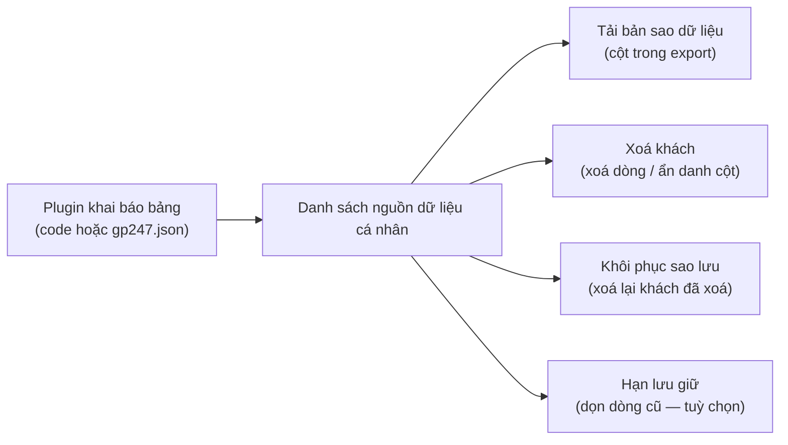

> 🌐 **Ngôn ngữ:** 🇻🇳 Tiếng Việt (hiện tại) · [🇬🇧 English](./declare-personal-data.md) · [🇯🇵 日本語](./declare-personal-data_ja.md)

# Khai báo dữ liệu cá nhân của khách trong plugin

## Giới thiệu

Tài liệu này dành cho lập trình viên plugin GP247 có **bảng dữ liệu riêng chứa thông tin của khách hàng** — tên, email,
số điện thoại, địa chỉ, nội dung khách viết (đánh giá, tin nhắn, yêu cầu…). Khi bảng được **khai báo**, nền tảng tự lo phần
quyền dữ liệu của khách:

- khách (hoặc chủ cửa hàng thay khách) **tải bản sao dữ liệu** — dữ liệu trong bảng của plugin có trong gói;
- khách **xoá tài khoản** — các dòng của khách trong bảng bị xoá hoặc ẩn danh theo quy tắc bạn chọn;
- **khôi phục bản sao lưu** cũ — khách đã xoá được xoá lại, kể cả trong bảng của plugin;
- **hạn lưu giữ** — dòng cũ hết mục đích được dọn theo tuổi (tuỳ chọn).

Bảng không khai báo hiện trong màn "Yêu cầu dữ liệu cá nhân" ở mục **"Dữ liệu khách chưa khai báo"**, và chủ cửa hàng phải tự
xử lý bằng tay. Nên đọc sau [Hướng dẫn tạo plugin](./create-plugin_vi.md) và [Plugin an toàn khi cập nhật](./create-plugin-update-safety_vi.md).

> 💡 **Làm cùng AI agent?** Skill `gp247-plugin-create`, `gp247-payment-plugin-create` và `gp247-shipping-plugin-create` trong repo
> [gp247-skills](https://github.com/gp247net/gp247-skills) khai báo bảng của plugin theo đúng trang này (tham chiếu
> `references/personal-data.md` của skill).

**Không cần khai báo** khi plugin không giữ dữ liệu của khách, hoặc chỉ ghi vào bảng của nền tảng (đơn hàng, thanh toán,
vận chuyển — `gp247/shop` đã khai báo các bảng đó).

---

## Nền tảng làm gì với một bảng đã khai báo



Mọi việc đi qua **một dịch vụ xoá chung** của lõi: plugin không tự viết lệnh `DELETE` cho dữ liệu của khách.

---

## Cách 1 — Khai báo trong `Provider.php` (khuyên dùng)

```php
// Provider.php của plugin: câu `use` ở đầu file; khai báo đặt NGOÀI khối
// if (gp247_extension_check_active(...)) — plugin đang tắt vẫn phải xoá được dữ liệu.
use GP247\Core\PersonalData\Application\PersonalDataRegistry;
use GP247\Core\PersonalData\Domain\PersonalDataSource;
use GP247\Core\PersonalData\Domain\SubjectLink;

// Bọc class_exists: plugin vẫn chạy trên lõi chưa có danh sách dữ liệu cá nhân.
if (class_exists(PersonalDataRegistry::class)) {
    PersonalDataRegistry::declare(
        PersonalDataSource::table('acme_review')                         // tên bảng không có GP247_DB_PREFIX; khoá 'id'
            ->link(SubjectLink::customer('customer_id'))                  // dòng của tài khoản khách
            ->link(SubjectLink::email('author_email', onlyWhenEmpty: 'customer_id')) // khách vãng lai, theo email đã gõ
            ->anonymise([                                                 // giữ dòng, bỏ thông tin người
                'author_name' => 'mark',                                  // thành "[deleted]"
                'author_email' => 'null',
                'content' => 'scrubText',                                 // xoá giá trị đã biết của khách khỏi văn bản tự do
            ])
            ->identity(['author_name'])                                   // giá trị gom trước để che văn bản tự do
            ->export(['product_id', 'rating', 'content', 'created_at'])   // cột đưa vào gói dữ liệu của khách
            ->order(30)                                                   // bảng trỏ tới bảng khác xử lý trước
            ->describe(['en' => 'Product reviews', 'vi' => 'Đánh giá sản phẩm', 'ja' => '商品レビュー'], 'Plugins/AcmeReview')
    );
}
```

Ví dụ dùng bảng giả `acme_review` của plugin giả `AcmeReview`.

> ⚠️ `->identity($cột, $cộtEmail)`: đối số thứ hai **chỉ** dành cho cột chứa email **của chính tài khoản**. Email khách tự gõ
> (đánh giá, form, ghi chú) **không bao giờ** đặt vào đây — nếu không, email của người khác bị gom vào gói dữ liệu hoặc bị xoá theo.
> Dòng của khách vãng lai tìm bằng `SubjectLink::email()`.

### Chọn liên kết tới khách

| Liên kết | Khi nào |
|---|---|
| `SubjectLink::customer('customer_id')` | Bảng có cột mã tài khoản khách |
| `SubjectLink::email('email', onlyWhenEmpty: 'customer_id')` | Dòng của khách vãng lai, tìm theo email; `onlyWhenEmpty` để không bắt nhầm dòng đã gắn tài khoản khác |
| `SubjectLink::morph('owner_type', 'owner_id', $morphClass)` | Bảng đa hình (một cột kiểu + một cột mã) |
| `SubjectLink::parent('acme_review', 'review_id')` | Bảng con của một bảng đã khai báo (trả lời của đánh giá…) |

Email chỉ được dùng để gom dữ liệu khi **email tài khoản đã xác minh** (khách tự yêu cầu) — nền tảng tự áp quy tắc này.

### Chọn việc làm với dòng khi xoá khách

| Quy tắc | Ý nghĩa | Ví dụ |
|---|---|---|
| `->deleteRows()` | Xoá cả dòng | Giỏ hàng, danh sách yêu thích, tin nhắn |
| `->anonymise([...])` | Giữ dòng, đổi cột theo quy tắc cột | Dòng có số tiền, ngày, mã giao dịch cần cho sổ sách |
| `->retain()` | Giữ nguyên (bảng có hạn giữ riêng) | Nhật ký bảo mật |

Quy tắc cột (`anonymise`): `mark` (`[deleted]`) · `null` (để trống) · `scrubText` (bỏ giá trị đã biết khỏi văn bản) ·
`['scrubJson', ['receiver.name', …]]` (JSON: đổi các khoá nêu tên; `scrubJson` không kèm danh sách thì quét mọi chuỗi) · `keep`.
Cột không nêu thì không bị đụng.

### Trường hợp khác

| Trường hợp | Cách làm |
|---|---|
| Bảng không có khoá `id` | `PersonalDataSource::table('acme_cart', 'identifier')` |
| Bảng trông giống dữ liệu cá nhân nhưng không phải của khách | `PersonalDataRegistry::notCustomerData('acme_supplier', 'nhà cung cấp của shop, không phải khách')` |
| Bảng không có tiền tố `GP247_DB_PREFIX` | `->unprefixed()` |

Lõi kiểm khai báo: chỉ tên cột / bảng thuần (không SQL), có ít nhất một liên kết, `anonymise` phải đổi ít nhất một cột.
**Không khai báo bảng của nền tảng** (`admin_*`, `api_*`, `shop_*`…) — core, front và shop đã khai báo bảng của mình.

---

## Cách 2 — Khai báo trong `gp247.json` (không cần code)

```json
"personalData": [
  { "table": "acme_review", "key": "id",
    "link": [{"customer": "customer_id"}, {"email": "author_email", "guest": "customer_id"}],
    "rule": "anonymise",
    "columns": {"author_name": "mark", "author_email": "null", "content": "scrubText"},
    "identity": ["author_name"],
    "export": ["product_id", "rating", "content", "created_at"],
    "order": 30,
    "label": {"en": "Product reviews", "vi": "Đánh giá sản phẩm", "ja": "商品レビュー"} }
]
```

- `rule`: `delete` · `anonymise` · `retain`. `link` là một liên kết hoặc danh sách: `customer`, `email` (+ `guest`), `parent` + `column`
  (+ `type_column`, `type_value`). Liên kết `morph` chỉ khai báo được bằng code.
- `emails` (tuỳ chọn) chỉ dành cho cột chứa email **của chính tài khoản** — như đối số thứ hai của `identity()`.
- Khoá này được đọc **cả khi plugin đang tắt** (dữ liệu vẫn phải xoá được). Mục sai được bỏ qua và ghi vào nhật ký hệ thống.
- Bảng đã khai báo bằng code thì khai báo code được dùng.

---

## Hạn lưu giữ (tuỳ chọn)

Dòng hết mục đích sau một thời gian (nhật ký, giỏ của plugin) thì thêm **mục hạn lưu giữ** cạnh khai báo. Chủ cửa hàng thấy mục
trên màn **Bảo mật → Hạn lưu giữ dữ liệu**, bật / tắt và đặt số ngày; lõi dọn từng ít một khi site có truy cập (không cần cron).

```php
use GP247\Core\PersonalData\Domain\Retention\RetentionItem;

if (method_exists(PersonalDataRegistry::class, 'retention')) {
    // Mục hạn giữ chỉ dọn bảng đã khai báo với deleteRows() (hoặc notCustomerData).
    PersonalDataRegistry::declare(
        PersonalDataSource::table('acme_request_log')->link(SubjectLink::customer('customer_id'))->deleteRows()->order(60)
            ->describe(['en' => 'Acme request log', 'vi' => 'Nhật ký yêu cầu Acme', 'ja' => 'Acme リクエストログ'], 'Plugins/AcmeReview')
    );
    PersonalDataRegistry::retention(
        RetentionItem::rows('acme.request_log', 'acme_request_log')    // khoá: chữ thường, số, _, một dấu chấm; ≤ 29 ký tự
            ->olderThan('created_at')->days(90, 7, 365)                 // mặc định, tối thiểu, tối đa
            ->describe(['en' => 'Acme request log', 'vi' => 'Nhật ký yêu cầu Acme', 'ja' => 'Acme リクエストログ'], 'Plugins/AcmeReview', 50)
    );
}
```

- Mục chỉ xoá dòng của bảng khai báo `->deleteRows()` (hoặc đánh dấu `notCustomerData`).
- Mục xoá dữ liệu kinh doanh: thêm `->disabledByDefault()->risky(['<nhóm dữ liệu sao lưu>'])` — tắt mặc định; khi bật, màn hiện số
  bản ghi bị ảnh hưởng, hỏi lại mật khẩu và để sao lưu chụp dữ liệu trước.
- Mục mới xuất hiện trên một site chờ **30 ngày** trước lần dọn đầu.

---

## Kiểm tra

1. Màn **Yêu cầu dữ liệu cá nhân** → **Kiểm tra cơ sở dữ liệu**: bảng của plugin không còn trong danh sách chưa khai báo.
2. Tạo khách thử có dữ liệu trong bảng của plugin → tạo yêu cầu xuất: gói có các cột đã khai báo trong `export`.
3. Xoá khách thử: dòng của khách bị xoá / ẩn danh; dòng của khách khác giữ nguyên.

## Danh sách kiểm tra trước khi phát hành

- [ ] Mọi bảng của plugin có cột tên / email / điện thoại / địa chỉ / nội dung khách viết đã khai báo, hoặc đánh dấu `notCustomerData`.
- [ ] Khai báo bọc `class_exists` / `method_exists` nếu plugin hỗ trợ lõi cũ, và nằm ngoài khối `gp247_extension_check_active`.
- [ ] Email khách tự gõ không nằm trong `identity()` / `emails` — chỉ email của chính tài khoản.
- [ ] Cột tiền, ngày, mã giao dịch giữ lại (`anonymise` thay vì `deleteRows` khi sổ sách cần dòng).
- [ ] `export` chỉ gồm dữ liệu của chính khách (không khoá bí mật, không dữ liệu nội bộ của shop).

---

## Điều kiện & ràng buộc (hiểu trước khi thao tác)

- **Lõi bỏ qua mục `gp247.json` trỏ tới bảng của nền tảng** (bảng trong các nhóm dữ liệu của core / front / shop, tên bắt đầu bằng `admin_`, `api_`, `personal_data_`) — chỉ code của nền tảng khai báo các bảng đó.
- **Khai báo sai bằng code làm cả site dừng** (lỗi nạp plugin được ghi log và mọi trang ngừng) — luôn thử plugin trên site dev
  trước khi phát hành; mục sai trong `gp247.json` chỉ bị bỏ qua và ghi log.
- **Xoá khách không hoàn tác được.** Thử trên dữ liệu giả, không thử trên site thật.

## Hỏi & Đáp (Q&A)

**Câu 1: Plugin chỉ lưu mã khách (`customer_id`), không lưu tên hay email — có cần khai báo không?**

→ Có, nếu dòng gắn với một khách (ví dụ điểm thưởng, lịch sử): khách có quyền nhận bản sao và xoá. Chọn `deleteRows()` hoặc
`anonymise()` theo việc dòng có cần cho sổ sách không.

**Câu 2: Bảng con không có cột khách mà chỉ trỏ tới bảng cha?**

→ Dùng `SubjectLink::parent('bảng_cha', 'cột_trỏ_cha')`; bảng cha phải được khai báo.

**Câu 3: Văn bản tự do có tên khách (ghi chú, lịch sử) thì sao?**

→ Đặt cột đó `scrubText` và liệt kê cột nhận diện trong `identity()` — lõi gom giá trị của khách trước rồi xoá chúng khỏi văn bản.

**Câu 4: Plugin đã phát hành trước khi có khai báo?**

→ Thêm khai báo ở bản mới; dữ liệu cũ được tính ngay khi bản mới cài. Không cần di trú dữ liệu.

## Lịch sử thay đổi
<!-- Chỉ ghi khi có thay đổi về logic/hành vi. Dòng mới nhất ở trên cùng. Mỗi ngày một dòng: cùng ngày thì gộp vào dòng có sẵn, không tách dòng mới. -->

| Ngày | Phiên bản GP247 | Thay đổi |
| --- | --- | --- |
| 2026-11-25 | gp247/core 3.19 | Trang mới: khai báo dữ liệu cá nhân (code, `gp247.json`), quy tắc xoá / ẩn danh, mục hạn lưu giữ |

---

<sub>📅 **Cập nhật lần cuối:** 2026-11-25 · ✍️ **Tác giả (Author):** GP247</sub>
