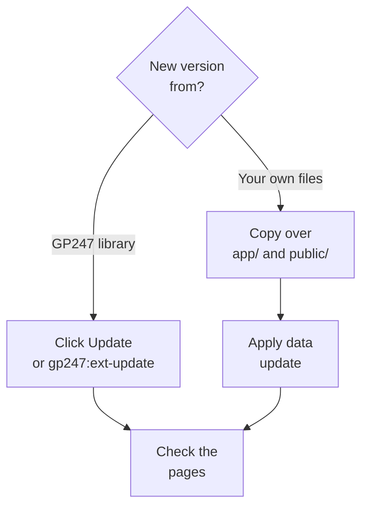
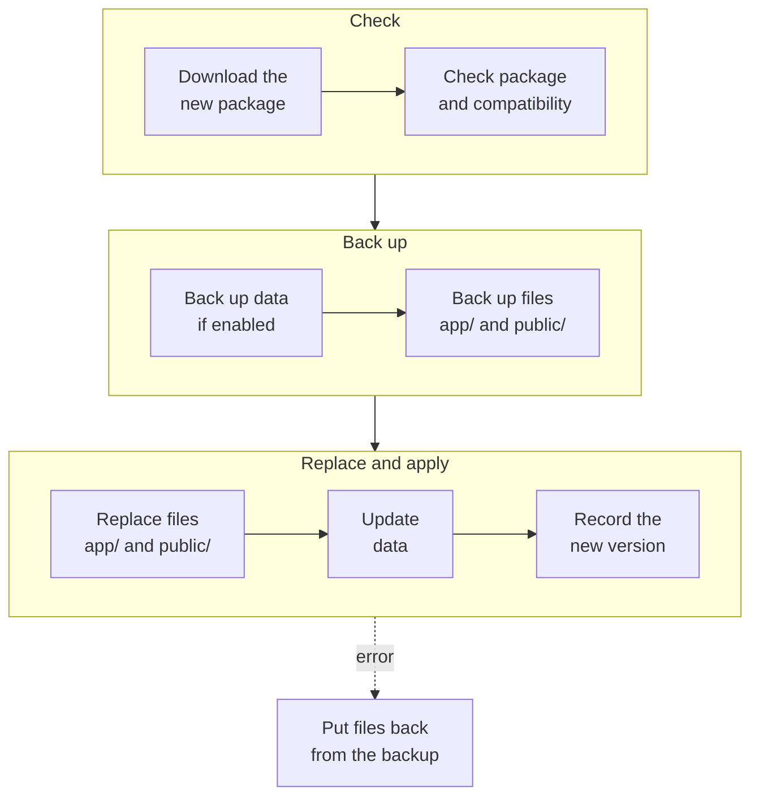
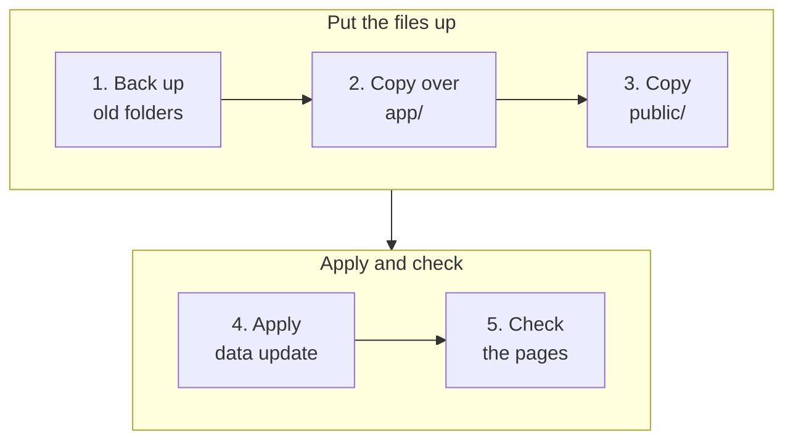

> 🌐 **Language:** [🇻🇳 Tiếng Việt](./update-extension_vi.md) · 🇬🇧 English (current) · [🇯🇵 日本語](./update-extension_ja.md)

# Updating Plugins & Templates

## Introduction
This guide explains how to bring an **installed** plugin or template to a new version, in every way GP247 supports: a button
in the admin, a command, or copying the new files to the server yourself. It is written for site owners and operators,
including those on hosting without a command line. After reading it you can pick the right method for your situation, know
what GP247 does at each step, and fix the most common problem yourself: the new version is copied but the look is still old or
broken because files are missing in `public/`.

> 💡 **Working with an AI agent?** To update a plugin, use the **`gp247-plugin-update`** skill in the [gp247-skills](https://github.com/gp247-official/gp247-skills)
> repo: it probes your site's version, checks the newest version in the library, picks the right method (online free, online paid, or
> applying new files you copied over the old ones) and reports the result of each step. To update a template, use the
> **`gp247-template-update`** skill — it also finds the stores using the template and any direct edits an update would erase,
> and sends `GP247Front` down the package update path.

## At a glance
Pick the update method by where the new version comes from:



- **Updating from the library is the safest method** — GP247 downloads, backs up, replaces the files, updates the data, and
  puts the old version back when something fails.
- **Copying files yourself means doing all three parts**: the source in `app/`, the static files in `public/`, and the
  **Apply data update** step. Skip one and the site is out of step on that part.
- **From gp247/core 3.14.3, the "Apply data update" step copies the static files** to `public/` before updating the data. On an
  older core this button does **not** copy static files — copying over and forgetting `public/` is the most common reason the
  look stays old or breaks after an update.
- **The `GP247Front` template that ships with S-Cart is not updated here** — it moves to a new version together with the
  `composer update` of the GP247 packages.

## On this page
- [An update has three parts](#an-update-has-three-parts) — why copying over is easy to get incomplete.
- [Before you update](#before-you-update) — backups, customized templates, folders under development.
- [Method 1 — Update from the library in the admin](#method-1--update-from-the-library-in-the-admin) — one button.
- [Method 2 — Update from the library on the command line](#method-2--update-from-the-library-on-the-command-line) — `gp247:ext-update`.
- [Method 3 — Copy the new version to the server yourself](#method-3--copy-the-new-version-to-the-server-yourself) — git pull, Composer, FTP, a `.zip` file.
- [New version copied but the look is still old or broken](#new-version-copied-but-the-look-is-still-old-or-broken) — missing or outdated `public/`.
- [When an update reports an error](#when-an-update-reports-an-error) — restore, backups, common errors.

## An update has three parts
This section explains why a library update is "complete on its own" while copying files yourself is easy to get incomplete.
Every extension (plugin or template) has three parts that live in three different places:

| Part | Lives in | Update from the library (Methods 1, 2) | Copy the new version yourself (Method 3) |
| --- | --- | --- | --- |
| **Source** (PHP, views, language) | `app/GP247/<Plugins\|Templates>/<Key>/` | Replaced for you | You copy it |
| **Static files** (CSS, JS, images) | `public/GP247/<Plugins\|Templates>/<Key>/` | Replaced for you | The Apply step copies them (from core 3.14.3); older core: you copy them, or run `gp247:ext-publish` |
| **Data** (new settings, new tables, moving old data) | Database | Run for you | Click **Apply data update** or run a command |

- **`<Key>`** is the extension's folder name, equal to `configKey` in its `gp247.json` file.
- **Static files must be in `public/`** because the browser can only read that folder. An extension package carries them in
  its own `public/` subfolder (`app/GP247/<Plugins|Templates>/<Key>/public/`), and GP247 copies them out on install or update.
- **GP247 remembers the installed version** of each extension. When the version in `gp247.json` is higher than the
  remembered one, GP247 knows the data part is pending and shows a yellow badge **"Data update pending: x → y"** in the
  extension list.

## Before you update
This section lists what to do first, so that a failed update does not become an incident.

- **Back up your data.** A library update backs up the extension's **files** and puts them back when it fails, but it does
  **not** undo what the data update step already wrote to the database. If the site has the backup feature on, GP247 takes a
  backup before updating; otherwise back up the database yourself.
- **Edits made directly in a template are lost.** An update overwrites the template's whole folder. To keep your own look,
  copy the template to a template with a different name and edit that copy.
- **Files you put in `public/GP247/<Plugins|Templates>/<Key>/` are replaced too.** That folder is a copy of the package and is
  rebuilt on every update. Keep your own images and files elsewhere.
- **Do not use the Update button on a folder under development (with `.git`).** A library update deletes the folder and copies
  the download into it, losing the git history and unsaved changes. For such a folder, use `git pull` and follow
  [Method 3](#method-3--copy-the-new-version-to-the-server-yourself).
- **Read the extension's release notes**: a new version may need a higher GP247 version, or need a minimum installed version
  to update from.

## Method 1 — Update from the library in the admin
This method is for extensions installed from the GP247 library and works on every kind of hosting, including hosting without
a command line.

1. Open the admin and go to the **Plugin** (or **Template**) menu. An extension with a new version shows a yellow badge
   **"New version x.y.z"** in the Version column.
2. Click that badge, or open the **From library** tab. No badge although you know a new version exists? Click **Check
   update**: the list of new versions is cached for a few hours, and this button makes GP247 ask the library again right away.
3. Click the **Update x.y.z** button on the extension's row.
4. Read the confirmation box and click **OK**. For a template, the box also warns that every local customization will be
   overwritten.
5. If the site has backups on but the backup could not be taken, GP247 asks **"Update anyway without a snapshot?"**. Click
   **Cancel** to stop (nothing has changed yet), or **OK** to continue.
6. Wait for the page to reload. On success it shows **"<Key> has been updated to version x.y.z"** and the "New version" badge
   disappears.

> ℹ️ **Available since:** gp247/core 3.14.3
>
> Sometimes the page first shows **"<Key> files replaced with version x.y.z, applying the data update…"** and only then reports
> success. That happens when another plugin is using the code of the extension being updated (for example a Pro edition running
> with the free edition): GP247 replaces the files first, then the page sends one more step to update the data **with the new
> version's code**. You do not need to do anything; just wait for the reload. If you closed the page halfway, the extension
> shows the **"Data update pending"** badge in the **Plugin** (or **Template**) menu — click **Apply data update** to finish.

GP247 does the following, in this order:



- **An error during Check changes nothing** — the package is for another extension, is not newer than the installed one, is
  not compatible with your GP247 version, or the installed version is too old to update directly.
- **An error after the files were replaced makes GP247 put both `app/` and `public/` back from the backup** and report
  **"Update failed, files restored from backup. Error: …"**. See [When an update reports an error](#when-an-update-reports-an-error).
- **The file backup lives in** `storage/backups/extensions/<Plugins|Templates>/<Key>/<old-version>_<time>/`; GP247 keeps the
  3 most recent backups per extension.
- **A data update in a second step** (from core 3.14.3, the case in the note above) has the same safety net: if that step
  fails, GP247 puts the old files back from the backup and keeps the old version.

**Special badges instead of the Update button** on the **From library** tab:

| Badge | Meaning | What to do |
| --- | --- | --- |
| **New version x · Requires y+** | The new version can only be reached from version `y` or higher; the site is on a lower one | Update to an intermediate version first (ask the extension's author), then update again |
| **New version x** (no button; hovering shows "paid product") | A paid extension without a valid license for the new version | Enter the extension's license on this tab, or download the new version from its product page and follow Method 3 |

## Method 2 — Update from the library on the command line
This method does exactly what Method 1 does (same checks, backups and automatic restore on error) and suits SSH, Docker or
scripted updates. Run the commands in the site's root folder (where the `artisan` file is).

1. See which extensions have a new version:

   ```bash
   php artisan gp247:ext-check-update --force
   ```

2. Update one extension (use `--type=template` for a template):

   ```bash
   php artisan gp247:ext-update --type=plugin --key=News
   ```

   On success the command prints the extension name and its new version, with exit code `0`.

3. Or update every extension of that type that has a new version:

   ```bash
   php artisan gp247:ext-update --type=plugin --all
   ```

The command says clearly when it could not update:

| The command reports | Meaning | Exit code |
| --- | --- | --- |
| `<Key> is already up to date` | Already the latest version, or the library has nothing newer | `0` |
| `check_failed` | The library could not be reached (network, SSL certificate, connection license); the message includes the library's error | non-`0` |
| `not_installed` | There is no `app/GP247/<Plugins\|Templates>/<Key>/` folder on the server | non-`0` |
| `data_update_pending` *(from core 3.14.3)* | The files are replaced, but the command could not run the data update in a new process (the hosting blocks child processes); the message names the command to run, usually `php artisan gp247:ext-update --local --type=plugin --key=<Key>` | non-`0` |

From core 3.14.3, when the extension's code was already loaded while the command ran (another plugin uses it), the command
replaces the files and then runs the data update in **a new PHP process** so that the new version's code runs; if that step
fails, the old files are put back as in Method 1.

- **Add `--json`** to get a machine-readable result for scripts and CI.
- **Add `--skip-pre-change`** to skip the data backup taken before the update (only when you already backed up yourself).
- Full command list: [Plugin and template (extension) commands](../cli/cli-extensions.md).

## Method 3 — Copy the new version to the server yourself
Use this method when the new version does not come from the Update button: `git pull`, Composer, FTP, your hosting's File
Manager, or a `.zip` file from the author. You do all three parts from [An update has three parts](#an-update-has-three-parts) yourself.



1. **Back up the old folders.** Copy `app/GP247/<Plugins|Templates>/<Key>/` and `public/GP247/<Plugins|Templates>/<Key>/`
   somewhere else (or rename the old folder to `<Key>_old`). If the new version fails, copying them back is all it takes.
2. **Replace the source folder** `app/GP247/<Plugins|Templates>/<Key>/` with the new version's folder.
   - **Replace the whole folder** rather than merging into the old one: files the new version dropped will not linger.
   - The folder name must equal `configKey` in `gp247.json`.
   - Got a `.zip` file? Extract it on your computer and copy the folder inside. The admin's **Import** is only for new
     installs and refuses an extension that is already installed.
   - With `git pull` or Composer, this step is done when the command finishes.
3. **Put the static files in `public/`** — **from gp247/core 3.14.3 you can skip this step**: step 4 copies
   `app/GP247/<Plugins|Templates>/<Key>/public/` to `public/GP247/<Plugins|Templates>/<Key>/` before updating the data. On an
   older core, do it in **one** of two ways:
   - With a command line:

     ```bash
     php artisan gp247:ext-publish --type=plugin --key=<Key>
     ```

   - Without a command line: copy the **contents** of `app/GP247/<Plugins|Templates>/<Key>/public/` into
     `public/GP247/<Plugins|Templates>/<Key>/`, choosing to overwrite when asked.

   Skip this step if the new version has no `public/` folder.
4. **Apply the data update** — in **one** of three ways:
   - Admin: open the **Plugin** (or **Template**) menu; the extension shows a yellow badge **"Data update pending: x → y"**;
     click the **Apply data update** button (database icon) on its row.
   - Only the extension, on the command line (`--dry-run` previews without doing anything):

     ```bash
     php artisan gp247:ext-update --local --type=plugin --key=<Key>
     ```

   - The site's general update command — it already includes this step for every plugin and template:

     ```bash
     php artisan gp247:update
     ```

5. **Check.** The "Data update pending" badge is gone; open a page that uses the extension and reload it with **Ctrl+F5** (Mac:
   **Cmd+Shift+R**) so the browser drops its cached CSS/JS.

> ⚠️ **Caution, by core version:**
> - **From gp247/core 3.14.3:** `Apply data update`, `gp247:ext-update --local` and `gp247:update` copy the static files first,
>   then update the data. If they cannot be copied to `public/` (no write permission), GP247 **stops without updating the data**
>   and reports the path; fix the write permission and click again.
> - **Older core:** these three ways **only** run the data part. Skip step 3 and the site runs the new source with the old CSS/JS.

## New version copied but the look is still old or broken
This section helps you spot and fix the most common Method 3 problem: the `app/` folder is the new version, but `public/` is
missing new files or still holds old ones.

**Symptoms:**
- **Missing files** — the extension's pages lose colors and layout, images do not show, buttons do nothing; the browser's tools
  report 404 errors for `.css` and `.js` files.
- **Old files** — the pages show but look off: the new parts of the update have no styling, or new features do not work.

**How to check** (with a command line):

```bash
php artisan gp247:doctor
```

The `extension_assets` row lists installed extensions whose static files in `public/` are **missing or outdated** — from
gp247/core 3.14.3 it compares the content of each file with the copy in `app/`. An older core only detects **missing** files; a
file that **exists but is an old version** is not reported, so do not conclude "complete" just because this row passes. The
admin shows the same warning in its system alerts block.

**How to fix** — copy all static files again from the version now in `app/`:

```bash
php artisan gp247:ext-publish --type=template --key=<Key>
php artisan gp247:ext-publish --type=plugin --all
```

Without a command line: from core 3.14.3, if the extension still shows **"Data update pending"**, clicking **Apply data update**
copies the static files again; otherwise do it by hand as in step 3 of [Method 3](#method-3--copy-the-new-version-to-the-server-yourself). Then reload
the page with **Ctrl+F5**. If the site uses a CDN or a cache in front of the web server, purge the cached CSS/JS.

- **Both the command and the manual way overwrite and add files**; they do not delete files the new version dropped. Leftover
  files do no harm.
- **Library updates (Methods 1, 2) do not have this problem**: GP247 deletes and recreates
  `public/GP247/<Plugins|Templates>/<Key>/` from the new package.

## When an update reports an error
This section helps you get the site running again and find the cause.

**"Update failed, files restored from backup. Error: …"** (Methods 1, 2)
- The extension's files are back to the old version; the site runs as before. Read the part after **Error** for the cause.
- **Another plugin that extends the one being updated** (for example a Pro edition used together with the free edition) can
  make the data update step run the **old version's** code and fail. From gp247/core 3.14.3, GP247 detects this case and updates
  the data in a second step with the new version's code. On an older core: update the extending plugin first (if it has a new
  version), or **disable** it for a moment, update the main plugin, then **enable** it again.
- The data update step may have written part of its changes to the database before failing. If the site behaves oddly,
  restore the data backup taken before the update.

**"Data update of <Key> failed: …"** (Method 3)
- The new files stay, the remembered version stays old, and the "Data update pending" badge stays. Fix the cause and click
  **Apply data update** again; running it again is always safe.
- To go back to the old version: copy back the folders you saved in step 1.

**"Cannot update directly from version x"**
- The new version can only be reached from a certain version or higher. Update to an intermediate version first (ask the
  extension's author), then update again.

**New files copied but the site still runs the old source**
- The server may keep compiled PHP code in a cache (OPcache) and not reread the files. Restart PHP (PHP-FPM or the web
  server), or use your hosting's PHP cache-clearing feature, then click **Apply data update** again if the badge is still there.
- A library update (Methods 1, 2) on gp247/core 3.14.3 or later clears this cache for the files it replaced; the case above only
  remains when you copy files yourself.

**Put the old version back yourself from GP247's backup**
1. Open `storage/backups/extensions/<Plugins|Templates>/<Key>/` and pick the `<version>_<time>` folder to go back to.
2. Copy the contents of its `app/` folder into `app/GP247/<Plugins|Templates>/<Key>/` (replacing the whole folder).
3. Copy the contents of its `public/` folder into `public/GP247/<Plugins|Templates>/<Key>/` (replacing the whole folder).

## Conditions & Rules (know before you act)
The conditions below are why an update is refused or does nothing.

**When updating from the library (Methods 1, 2)**
- **The extension must have its folder on the server** (`app/GP247/<Plugins|Templates>/<Key>/gp247.json`) — GP247 reads the
  installed version from this file.
- **The new version must be higher than the installed one** — GP247 does not use the Update button to downgrade or reinstall
  the same version.
- **The new version must be compatible with the site's GP247 version** — this avoids installing a version that will not run.
  Upgrade GP247 first, then update the extension.
- **The installed version must meet the minimum the new version asks for** (if any) — too big a jump could skip a data
  migration step in between.
- **The downloaded package must be for the extension being updated** — this stops a wrong package from overwriting another
  extension.
- **The server must be able to write to** `app/GP247/<Plugins|Templates>`, `public/GP247/<Plugins|Templates>` and `storage/tmp` —
  without write permission GP247 stops **before** touching any file.
- **A paid extension needs a valid license** for the new version.

**When applying a data update (Method 3)**
- **Only installed extensions are applied** — an extension that is only on disk and not installed needs **Install**, not Apply.
- **If the version in `gp247.json` is lower than the remembered one, GP247 skips it** and logs a warning — GP247 does not run
  data updates in the downgrade direction.
- **Sites installed before 2026-09-29 have no remembered version**, so the first time every extension shows as pending (old
  version `?`). Applying once clears it.
- **From gp247/core 3.14.3, the server must be able to write to** `public/GP247/<Plugins|Templates>` — the Apply step copies the
  static files first and, if it cannot, does not update the data, so the site never runs new data with an old look.

## Q&A
**Q1: Which method should I use?**

→ An extension installed from the library: Method 1 (no command line) or Method 2 (command line, scripts). An extension you
received as files, or a folder that is source code you are developing: Method 3.

**Q2: Does updating lose the plugin's settings?**

→ No, if the plugin keeps its settings in the admin as GP247's standard requires: settings live in the database and an update
only replaces files. Anything you **edited directly in the extension's files** (templates included) is overwritten.

**Q3: I clicked "Apply data update" but the look is still old?**

→ From gp247/core 3.14.3 that button copies the static files before updating the data; if the look is still old, the browser or
a CDN usually still holds the old CSS/JS — reload with Ctrl+F5 and purge the CDN cache. On an older core the button does not
copy static files: run `php artisan gp247:ext-publish --type=<plugin|template> --key=<Key>`, or copy
`app/GP247/<Plugins|Templates>/<Key>/public/` to `public/GP247/<Plugins|Templates>/<Key>/` by hand, then reload with Ctrl+F5.

**Q4: `gp247:doctor` says `extension_assets` passes but the CSS is still the old version?**

→ From gp247/core 3.14.3 that row compares file content, so "pass" means `public/` matches the copy in `app/` — the old CSS is
then in the browser's or the CDN's cache. An older core only detects **missing** files: run `gp247:ext-publish` for that
extension; it overwrites every static file with the version now in `app/`.

**Q5: I have the new version as a `.zip` file. Can I just Import it again?**

→ No. Import is only for new installs and refuses an extension that is already installed. Extract it and follow Method 3.

**Q6: Will a failed update break my site?**

→ With Methods 1 and 2: GP247 puts the old files back and the site runs as before; only what the data update step already
wrote to the database is not undone automatically. With Method 3: the new files stay; fix the cause and apply again, or copy
back the folders you saved.

**Q7: Where is GP247's file backup and how long is it kept?**

→ `storage/backups/extensions/<Plugins|Templates>/<Key>/`, one `<old-version>_<time>` folder per update; GP247 keeps the 3 most
recent per extension.

**Q8: I don't see the Update button although I know a new version exists?**

→ Click **Check update** on the **From library** tab. Still nothing: the new version may not be compatible with your GP247
version yet, or the site is not connected to the library (register the connection license as in
[Installing Plugins & Templates](./install-extension.md)).

**Q9: How is the `GP247Front` template updated?**

→ Together with the GP247 packages: `composer update`, then `php artisan gp247:update`; its static files are copied to `public/`
automatically. See [Updating GP247 and S-Cart](../install-upgrade/update.md).

**Q10: I write plugins. How do I make my new versions update safely for users?**

→ See [Update-safe plugins](./create-plugin-update-safety.md): raise `version`, keep settings in the database, write an
`update()` that is correct when run again, and declare `minUpdateFrom` when needed.

## Change history
<!-- Only when logic/behavior changed. Newest row on top. One row per day: merge same-day changes into the existing row, never add a new row for the same date. -->

| Date | GP247 version | Change |
| --- | --- | --- |
| 2026-11-17 | gp247/core 3.14.3 | Apply data update (button, `gp247:ext-update --local`, `gp247:update`) copies the static files to `public/` first; a library update while another plugin uses the extension's code updates the data in a second step with the new code (CLI: a new process, code `data_update_pending`); `extension_assets` also reports outdated files |

---

<sub>📅 **Last updated:** 2026-11-19 · ✍️ **Author:** GP247</sub>
