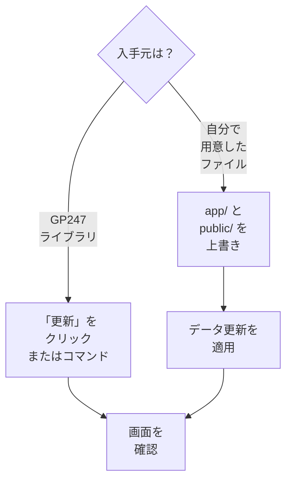
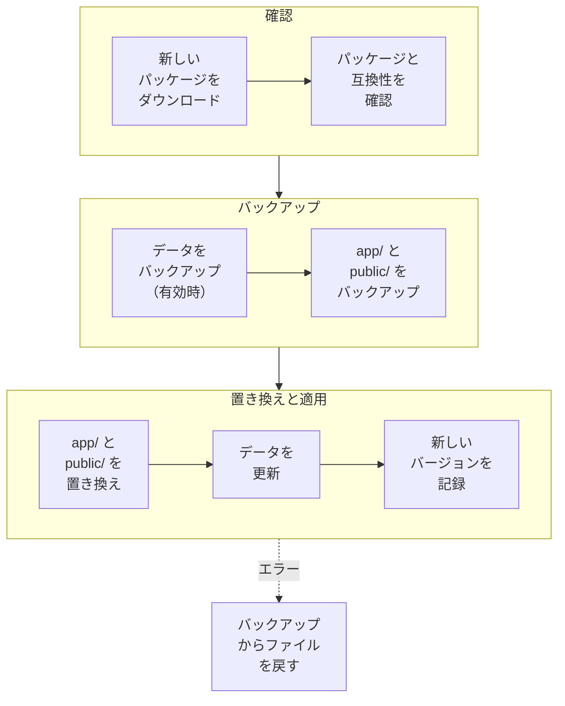
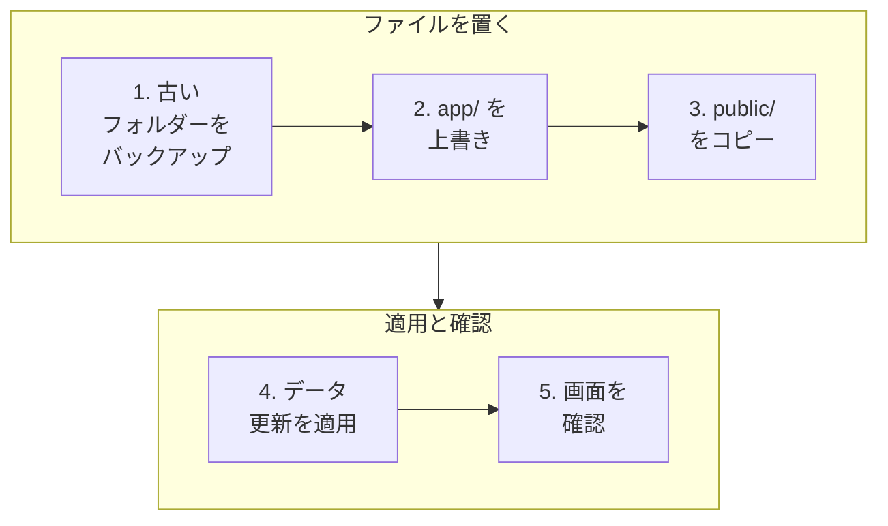

> 🌐 **言語:** [🇻🇳 Tiếng Việt](./update-extension_vi.md) · [🇬🇧 English](./update-extension.md) · 🇯🇵 日本語（現在）

# プラグインとテンプレートの更新

## はじめに
このドキュメントでは、**インストール済み**のプラグインやテンプレートを新しいバージョンにする方法を、GP247 が対応するすべての
やり方で説明します。管理画面のボタン、コマンド、または新しいファイルを自分でサーバーにコピーする方法です。対象はサイト運営者と
運用担当者で、コマンドラインのないホスティングも含みます。読み終えると、状況に合った方法を選べ、各ステップで GP247 が何をするかが
分かり、最もよくある問題（新しいバージョンをコピーしたのに `public/` のファイルが足りず、表示が古いまま、または崩れる）を自分で
解決できます。

> 💡 **ヒント:** **AI エージェントと作業する場合**は、[gp247-skills](https://github.com/gp247net/gp247-skills) リポジトリの
> **`gp247-extension-lifecycle`** スキルを使ってください。サイトのバージョンを調べ、そのサイトに実際にあるコマンドとオプションだけを
> 使い、更新の各ステップの結果を報告します。

## ひと目でわかる
新しいバージョンの入手元で、更新方法を選びます。



- **ライブラリからの更新が最も安全です** — GP247 がダウンロード、バックアップ、ファイルの置き換え、データの更新まで行い、
  失敗したときは古いバージョンに戻します。
- **自分でファイルをコピーする場合は 3 つの部分すべてが必要です**。`app/` のソース、`public/` の静的ファイル、そして
  **「データ更新を適用」** の手順です。どれかを抜かすと、その部分だけサイトが古いままになります。
- **「データ更新を適用」ボタンは静的ファイルをコピーしません。** 上書きコピーで `public/` を忘れることが、更新後に表示が古いまま、
  または崩れる最も多い原因です。
- **S-Cart に同梱の `GP247Front` テンプレートはここでは更新しません** — GP247 パッケージ一式の `composer update` と一緒に新しい
  バージョンになります。

## このページの内容
- [更新を構成する3つの部分](#更新を構成する3つの部分) — 上書きコピーで抜けが起きやすい理由。
- [更新の前に](#更新の前に) — バックアップ、カスタマイズしたテンプレート、開発中のフォルダー。
- [方法1 — 管理画面からライブラリで更新](#方法1--管理画面からライブラリで更新) — ボタン 1 つ。
- [方法2 — コマンドラインでライブラリから更新](#方法2--コマンドラインでライブラリから更新) — `gp247:ext-update`。
- [方法3 — 新しいバージョンを自分でサーバーにコピー](#方法3--新しいバージョンを自分でサーバーにコピー) — git pull、Composer、FTP、`.zip` ファイル。
- [コピー後に表示が古いままか崩れる場合](#コピー後に表示が古いままか崩れる場合) — `public/` の不足や古いファイル。
- [更新でエラーが出たとき](#更新でエラーが出たとき) — 復元、バックアップ、よくあるエラー。

## 更新を構成する3つの部分
このセクションでは、ライブラリからの更新は「それだけで完結」し、自分でファイルをコピーすると抜けが起きやすい理由を説明します。
拡張機能（プラグインまたはテンプレート）には、3 か所に分かれた 3 つの部分があります。

| 部分 | 場所 | ライブラリから更新（方法1、2） | 自分でコピー（方法3） |
| --- | --- | --- | --- |
| **ソース**（PHP、ビュー、言語） | `app/GP247/<Plugins\|Templates>/<Key>/` | 自動で置き換え | 自分でコピー |
| **静的ファイル**（CSS、JS、画像） | `public/GP247/<Plugins\|Templates>/<Key>/` | 自動で置き換え | 自分でコピー、または `gp247:ext-publish` を実行 |
| **データ**（新しい設定、新しいテーブル、既存データの移行） | データベース | 自動で実行 | **「データ更新を適用」** をクリック、またはコマンドを実行 |

- **`<Key>`** は拡張機能のフォルダー名で、`gp247.json` の `configKey` と同じです。
- **静的ファイルは `public/` に置く必要があります。** ブラウザーが読めるのはこのフォルダーだけだからです。拡張機能のパッケージは
  自身の `public/` サブフォルダー（`app/GP247/<Plugins|Templates>/<Key>/public/`）に静的ファイルを持ち、GP247 がインストールや
  更新のときに外へコピーします。
- **GP247 は拡張機能ごとにインストール済みのバージョンを記録しています。** `gp247.json` のバージョンが記録より高いと、データの部分が
  未適用だと判断し、拡張機能の一覧に黄色のバッジ **「データ更新待ち: x → y」** を表示します。

## 更新の前に
このセクションでは、更新の失敗が障害にならないよう、先にしておくことを挙げます。

- **データをバックアップしてください。** ライブラリからの更新は拡張機能の**ファイル**をバックアップし、失敗すれば元に戻しますが、
  データ更新の手順がすでにデータベースに書き込んだ内容は**元に戻しません**。サイトでバックアップ機能が有効なら、GP247 は更新前に
  バックアップを取ります。無効なら、データベースを自分でバックアップしてください。
- **テンプレートを直接編集した部分は失われます。** 更新はテンプレートのフォルダー全体を上書きします。独自のデザインを残したい場合は、
  テンプレートを別の名前のテンプレートとして複製し、そちらを編集してください。
- **`public/GP247/<Plugins|Templates>/<Key>/` に自分で置いたファイルも置き換えられます。** このフォルダーはパッケージのコピーで、
  更新のたびに作り直されます。独自の画像やファイルは別の場所に置いてください。
- **開発中のフォルダー（`.git` があるもの）には「更新」ボタンを使わないでください。** ライブラリからの更新はフォルダーを削除して
  ダウンロードしたものをコピーするため、git の履歴と未保存の変更が失われます。そのようなフォルダーは `git pull` を使い、
  [方法3](#方法3--新しいバージョンを自分でサーバーにコピー) に従ってください。
- **拡張機能のリリースノートを読んでください。** 新しいバージョンが、より新しい GP247 や、更新元として一定以上のインストール済み
  バージョンを必要とすることがあります。

## 方法1 — 管理画面からライブラリで更新
この方法は GP247 ライブラリからインストールした拡張機能向けで、コマンドラインのないホスティングを含むあらゆる環境で使えます。

1. 管理画面を開き、**プラグイン**（または**テンプレート**）メニューに進みます。新しいバージョンがある拡張機能は、バージョン列に黄色の
   バッジ **「新しいバージョン x.y.z」** が表示されます。
2. そのバッジをクリックするか、**「ライブラリから」** タブを開きます。新しいバージョンがあるはずなのにバッジが出ない場合は
   **「更新を確認」** をクリックします。新しいバージョンの一覧は数時間キャッシュされるため、このボタンでライブラリにすぐ問い合わせ直します。
3. 拡張機能の行にある **「更新 x.y.z」** ボタンをクリックします。
4. 確認ダイアログを読み、**OK** をクリックします。テンプレートの場合、ローカルでのカスタマイズがすべて上書きされるという警告も
   表示されます。
5. サイトでバックアップが有効なのにバックアップを取れなかった場合、GP247 は **「スナップショットなしで更新しますか？」** と確認します。
   **キャンセル** で中止（まだ何も変わっていません）、**OK** で更新を続けます。
6. ページの再読み込みを待ちます。成功すると **「<Key> をバージョン x.y.z に更新しました」** と表示され、「新しいバージョン」のバッジが
   消えます。

GP247 は次の順に処理します。



- **「確認」の段階でのエラーでは何も変わりません** — 別の拡張機能のパッケージ、インストール済みより新しくない、GP247 のバージョンと
  互換性がない、またはインストール済みのバージョンが古すぎて直接更新できない場合です。
- **ファイルを置き換えた後のエラーでは、GP247 が `app/` と `public/` の両方をバックアップから戻し**、
  **「更新に失敗したため、バックアップからファイルを復元しました。エラー: …」** と表示します。
  [更新でエラーが出たとき](#更新でエラーが出たとき) を参照してください。
- **ファイルのバックアップの場所は** `storage/backups/extensions/<Plugins|Templates>/<Key>/<旧バージョン>_<時刻>/` です。
  GP247 は拡張機能ごとに最新 3 件を保持します。

**「ライブラリから」タブで「更新」ボタンの代わりに表示される特別なバッジ:**

| バッジ | 意味 | 対処 |
| --- | --- | --- |
| **新しいバージョン x · y 以上が必要** | 新しいバージョンへはバージョン `y` 以上からしか更新できず、サイトはそれより低い | まず中間のバージョンに更新し（拡張機能の作者に確認）、その後もう一度更新 |
| **新しいバージョン x**（ボタンなし。マウスを重ねると「有料製品」と表示） | 新しいバージョンに有効なライセンスがない有料拡張機能 | このタブで拡張機能のライセンスを入力するか、製品ページから新しいバージョンをダウンロードして方法3 に従う |

## 方法2 — コマンドラインでライブラリから更新
この方法は方法1 とまったく同じ処理（同じ確認、バックアップ、エラー時の自動復元）を行い、SSH、Docker、スクリプトでの更新に向いています。
コマンドはサイトのルートフォルダー（`artisan` ファイルがある場所）で実行します。

1. 新しいバージョンがある拡張機能を確認します。

   ```bash
   php artisan gp247:ext-check-update --force
   ```

2. 拡張機能を 1 つ更新します（テンプレートは `--type=template`）。

   ```bash
   php artisan gp247:ext-update --type=plugin --key=News
   ```

   成功すると、拡張機能名と新しいバージョンが表示され、終了コードは `0` です。

3. または、その種類で新しいバージョンがある拡張機能をすべて更新します。

   ```bash
   php artisan gp247:ext-update --type=plugin --all
   ```

更新できなかったときは、理由がはっきり表示されます。

| コマンドの表示 | 意味 | 終了コード |
| --- | --- | --- |
| `<Key> is already up to date` | すでに最新、またはライブラリに新しいバージョンがない | `0` |
| `check_failed` | ライブラリに問い合わせできない（ネットワーク、SSL 証明書、接続ライセンス）。ライブラリが返したエラーも表示 | `0` 以外 |
| `not_installed` | サーバーに `app/GP247/<Plugins\|Templates>/<Key>/` フォルダーがない | `0` 以外 |

- **`--json` を付ける**と、スクリプトや CI 向けの機械可読な結果が得られます。
- **`--skip-pre-change` を付ける**と、更新前のデータのバックアップを省きます（自分ですでにバックアップした場合のみ）。
- コマンドの一覧: [プラグインとテンプレート（拡張機能）のコマンド](../cli/cli-extensions_ja.md)。

## 方法3 — 新しいバージョンを自分でサーバーにコピー
新しいバージョンが「更新」ボタン以外から来る場合に使います。`git pull`、Composer、FTP、ホスティングのファイルマネージャー、作者から
受け取った `.zip` ファイルなどです。[更新を構成する3つの部分](#更新を構成する3つの部分) の 3 つすべてを自分で行います。



1. **古いフォルダーをバックアップします。** `app/GP247/<Plugins|Templates>/<Key>/` と `public/GP247/<Plugins|Templates>/<Key>/` を
   別の場所にコピーします（または古いフォルダー名を `<Key>_old` に変えます）。新しいバージョンで問題が出たら、コピーし戻すだけです。
2. **ソースのフォルダー** `app/GP247/<Plugins|Templates>/<Key>/` を新しいバージョンのフォルダーに置き換えます。
   - 古いフォルダーに混ぜてコピーするのではなく、**フォルダーごと置き換えてください**。新しいバージョンで削除されたファイルが残りません。
   - フォルダー名は `gp247.json` の `configKey` と同じにします。
   - `.zip` ファイルの場合は、手元のパソコンで展開し、中のフォルダーをコピーします。管理画面の **「インポート」** は新規インストール専用で、
     インストール済みの拡張機能は受け付けません。
   - `git pull` や Composer を使う場合、このステップはコマンドが終われば完了です。
3. **静的ファイルを `public/` に置きます** — 次の**どちらか**で行います。
   - コマンドラインがある場合:

     ```bash
     php artisan gp247:ext-publish --type=plugin --key=<Key>
     ```

   - コマンドラインがない場合: `app/GP247/<Plugins|Templates>/<Key>/public/` の**中身**を `public/GP247/<Plugins|Templates>/<Key>/`
     にコピーし、上書きを確認されたら上書きを選びます。

   新しいバージョンに `public/` フォルダーがなければ、このステップは不要です。
4. **データ更新を適用します** — 次の 3 つの**どれか**で行います。
   - 管理画面: **プラグイン**（または**テンプレート**）メニューを開くと、拡張機能に黄色のバッジ **「データ更新待ち: x → y」** が出ています。
     同じ行の **「データ更新を適用」** ボタン（データベースのアイコン）をクリックします。
   - その拡張機能だけをコマンドで（`--dry-run` を付けると何もせずに確認だけします）:

     ```bash
     php artisan gp247:ext-update --local --type=plugin --key=<Key>
     ```

   - サイト全体の更新コマンド — すべてのプラグインとテンプレートについてこの手順を含んでいます:

     ```bash
     php artisan gp247:update
     ```

5. **確認します。** 「データ更新待ち」のバッジが消えていること。拡張機能を使うページを開き、**Ctrl+F5**（Mac は **Cmd+Shift+R**）で
   再読み込みして、ブラウザーにキャッシュされた古い CSS/JS を捨てます。

> ⚠️ **注意:** ステップ4 は静的ファイルを**コピーしません**。「データ更新を適用」、`gp247:ext-update --local`、`gp247:update` は
> データの部分だけを実行します。ステップ3 を抜かすと、新しいソースが古い CSS/JS で動きます。

## コピー後に表示が古いままか崩れる場合
このセクションでは、方法3 で最もよくある問題（`app/` は新しいバージョンなのに、`public/` に新しいファイルがない、または古いファイルが
残っている）の見分け方と直し方を説明します。

**症状:**
- **ファイルが足りない** — 拡張機能のページの色やレイアウトが消え、画像が出ず、ボタンが反応しません。ブラウザーの開発ツールで
  `.css` や `.js` に 404 エラーが出ます。
- **ファイルが古い** — ページは出るものの、更新で増えた部分にスタイルがない、または新機能が動きません。

**確認方法**（コマンドラインがある場合）:

```bash
php artisan gp247:doctor
```

`extension_assets` の行に、`public/` のファイルが**不足している**インストール済み拡張機能が表示されます。この行が検出するのは
**不足**しているファイルだけで、**存在するが古い**ファイルは報告されません。この行が合格でも「そろっている」とは判断しないでください。

**直し方** — いま `app/` にあるバージョンから、静的ファイルをすべてコピーし直します。

```bash
php artisan gp247:ext-publish --type=template --key=<Key>
php artisan gp247:ext-publish --type=plugin --all
```

コマンドラインがない場合は、[方法3](#方法3--新しいバージョンを自分でサーバーにコピー) のステップ3 と同じ手作業で行います。その後
**Ctrl+F5** で再読み込みします。CDN や Web サーバーの前段のキャッシュを使っている場合は、該当する CSS/JS のキャッシュを削除してください。

- **コマンドも手作業も、ファイルを上書き・追加します**。新しいバージョンで削除されたファイルは消しません。残ったファイルは害がありません。
- **ライブラリからの更新（方法1、2）ではこの問題は起きません**。GP247 が `public/GP247/<Plugins|Templates>/<Key>/` を削除し、
  新しいパッケージから作り直します。

## 更新でエラーが出たとき
このセクションでは、サイトを動く状態に戻し、原因を探す方法を説明します。

**「更新に失敗したため、バックアップからファイルを復元しました。エラー: …」**（方法1、2）
- 拡張機能のファイルは古いバージョンに戻り、サイトは以前どおり動きます。**エラー** の後の部分で原因を確認してください。
- **更新するプラグインを拡張している別のプラグイン**（例: 無料版と一緒に使う Pro 版）が原因で、データ更新の手順が失敗することがあります。
  拡張しているプラグインを一時的に**無効化**し、本体のプラグインを更新してから、再び**有効化**してください。
- データ更新の手順は、失敗する前に変更の一部をデータベースに書き込んでいる可能性があります。サイトの動きがおかしい場合は、更新前に
  取ったデータのバックアップを復元してください。

**「<Key> のデータ更新に失敗しました: …」**（方法3）
- 新しいファイルはそのまま残り、記録されたバージョンは古いままで、「データ更新待ち」のバッジも残ります。原因を直してから、もう一度
  **「データ更新を適用」** をクリックしてください。何度実行しても安全です。
- 古いバージョンに戻すには、ステップ1 で保存したフォルダーをコピーし戻します。

**「バージョン x から直接更新することはできません」**
- 新しいバージョンへは、一定以上のバージョンからしか更新できません。まず中間のバージョンに更新し（拡張機能の作者に確認）、その後
  もう一度更新してください。

**新しいファイルをコピーしたのに、サイトが古いソースのまま動く**
- サーバーがコンパイル済みの PHP コードをキャッシュ（OPcache）に保持し、ファイルを読み直していない可能性があります。PHP（PHP-FPM または
  Web サーバー）を再起動するか、ホスティングの PHP キャッシュ削除機能を使い、バッジが残っていれば **「データ更新を適用」** をもう一度
  クリックしてください。

**GP247 のバックアップから自分で古いバージョンに戻す**
1. `storage/backups/extensions/<Plugins|Templates>/<Key>/` を開き、戻したい `<バージョン>_<時刻>` フォルダーを選びます。
2. その中の `app/` フォルダーの中身を `app/GP247/<Plugins|Templates>/<Key>/` にコピーします（フォルダーごと置き換え）。
3. その中の `public/` フォルダーの中身を `public/GP247/<Plugins|Templates>/<Key>/` にコピーします（フォルダーごと置き換え）。

## 条件と制約（操作の前に確認）
次の条件が、更新が拒否されたり何も起きなかったりする理由です。

**ライブラリから更新するとき（方法1、2）**
- **拡張機能のフォルダーがサーバーにあること**（`app/GP247/<Plugins|Templates>/<Key>/gp247.json`） — GP247 はこのファイルから
  インストール済みのバージョンを読みます。
- **新しいバージョンがインストール済みより高いこと** — GP247 は「更新」ボタンでダウングレードや同じバージョンの再インストールを行いません。
- **新しいバージョンがサイトの GP247 のバージョンと互換であること** — 動かないバージョンをインストールしないためです。先に GP247 を
  更新してから、拡張機能を更新してください。
- **インストール済みのバージョンが、新しいバージョンの求める最低バージョンを満たすこと**（指定がある場合） — 一度に大きく飛ぶと、
  途中のデータ移行の手順を飛ばすおそれがあるためです。
- **ダウンロードしたパッケージが、更新する拡張機能のものであること** — 誤ったパッケージで別の拡張機能を上書きしないためです。
- **サーバーが** `app/GP247/<Plugins|Templates>`、`public/GP247/<Plugins|Templates>`、`storage/tmp` **に書き込めること** — 書き込み
  権限がない場合、GP247 はファイルに触れる**前に**止まります。
- **有料の拡張機能には、新しいバージョンに有効なライセンスが必要です。**

**データ更新を適用するとき（方法3）**
- **インストール済みの拡張機能だけが対象です** — ディスクにあるだけでインストールしていない拡張機能は、「適用」ではなく
  **「インストール」** を行います。
- **`gp247.json` のバージョンが記録より低い場合、GP247 はスキップし**、ログに警告を残します — GP247 はダウングレード方向のデータ更新を
  実行しません。
- **2026-09-29 より前にインストールしたサイトにはバージョンの記録がありません。** そのため初回は、すべての拡張機能が「待ち」
  （旧バージョン `?`）と表示されます。1 回適用すれば解消します。

## よくある質問（Q&A）
**Q1: どの方法を使えばよいですか？**

→ ライブラリからインストールした拡張機能なら、方法1（コマンドラインなし）または方法2（コマンドライン、スクリプト）。ファイルで受け取った
拡張機能や、開発中のソースのフォルダーなら方法3 です。

**Q2: 更新するとプラグインの設定は消えますか？**

→ GP247 の標準どおりプラグインが設定を管理画面に保存していれば消えません。設定はデータベースにあり、更新はファイルを置き換えるだけです。
拡張機能の**ファイルを直接編集した部分**（テンプレートを含む）は上書きされます。

**Q3: 「データ更新を適用」をクリックしたのに、表示が古いままです。**

→ このボタンは静的ファイルをコピーしません。`php artisan gp247:ext-publish --type=<plugin|template> --key=<Key>` を実行するか、
`app/GP247/<Plugins|Templates>/<Key>/public/` を `public/GP247/<Plugins|Templates>/<Key>/` に手作業でコピーし、Ctrl+F5 で再読み込み
してください。

**Q4: `gp247:doctor` で `extension_assets` は合格なのに、CSS が古いバージョンのままです。**

→ この行は**不足**しているファイルだけを検出し、**古い**ファイルは検出しません。その拡張機能に `gp247:ext-publish` を実行してください。
いま `app/` にあるバージョンで静的ファイルをすべて上書きします。

**Q5: 新しいバージョンが `.zip` ファイルです。もう一度インポートできますか？**

→ できません。インポートは新規インストール専用で、インストール済みの拡張機能は受け付けません。展開して方法3 に従ってください。

**Q6: 更新に失敗するとサイトが壊れますか？**

→ 方法1、2 では、GP247 が古いファイルを戻し、サイトは以前どおり動きます。データ更新の手順がすでにデータベースに書き込んだ内容だけは
自動で元に戻りません。方法3 では新しいファイルが残るので、原因を直して再度適用するか、保存しておいたフォルダーをコピーし戻してください。

**Q7: GP247 のファイルのバックアップはどこにあり、どのくらい保持されますか？**

→ `storage/backups/extensions/<Plugins|Templates>/<Key>/` に、更新 1 回ごとに `<旧バージョン>_<時刻>` フォルダーができます。
GP247 は拡張機能ごとに最新 3 件を保持します。

**Q8: 新しいバージョンがあるはずなのに「更新」ボタンが出ません。**

→ **「ライブラリから」** タブで **「更新を確認」** をクリックしてください。それでも出ない場合、新しいバージョンがまだサイトの GP247 の
バージョンに対応していないか、サイトがライブラリに接続できていません（接続ライセンスの登録は
[GP247 のプラグイン・テンプレートのインストールガイド](./install-extension_ja.md) を参照）。

**Q9: `GP247Front` テンプレートはどう更新しますか？**

→ GP247 パッケージ一式と一緒に、`composer update` の後に `php artisan gp247:update` を実行します。静的ファイルは自動で `public/` に
コピーされます。[GP247 と S-Cart の更新](../install-upgrade/update_ja.md) を参照してください。

**Q10: プラグインを作っています。新しいバージョンをユーザーが安全に更新できるようにするには？**

→ [安全に更新できるプラグイン](./create-plugin-update-safety_ja.md) を参照してください。`version` を上げ、設定をデータベースに保存し、
何度実行しても正しい `update()` を書き、必要に応じて `minUpdateFrom` を宣言します。

---

<sub>📅 **最終更新:** 2026-11-17 · ✍️ **作成者 (Author):** GP247</sub>
