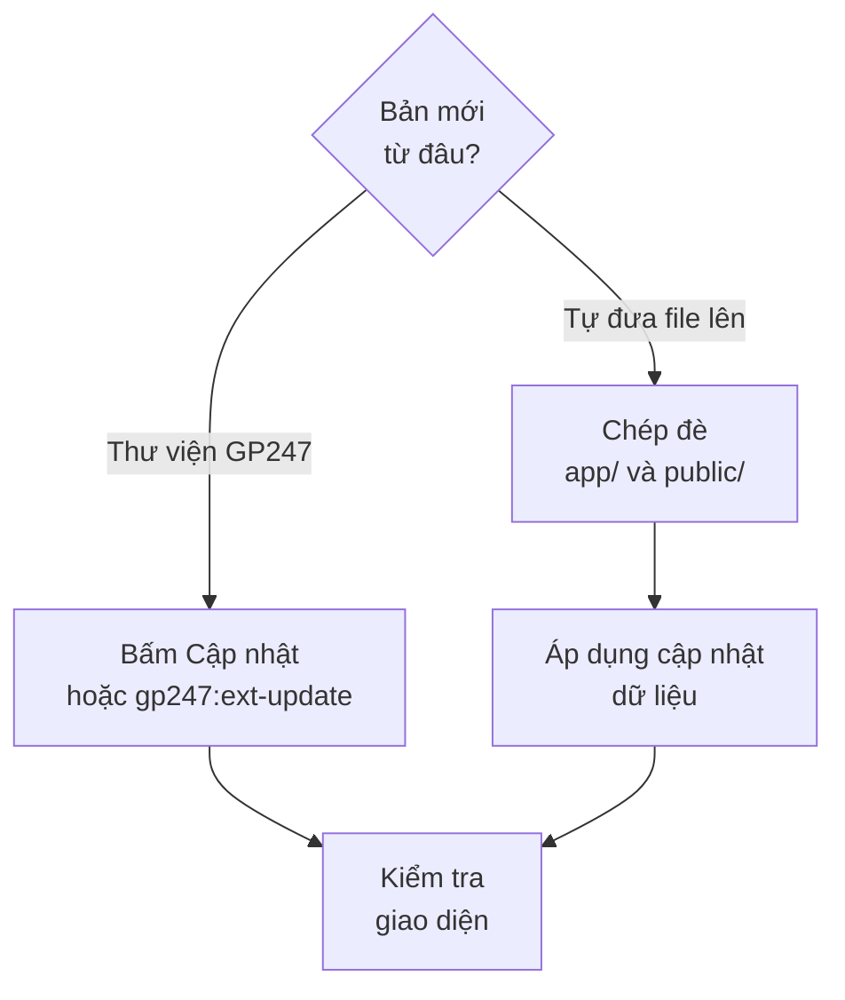
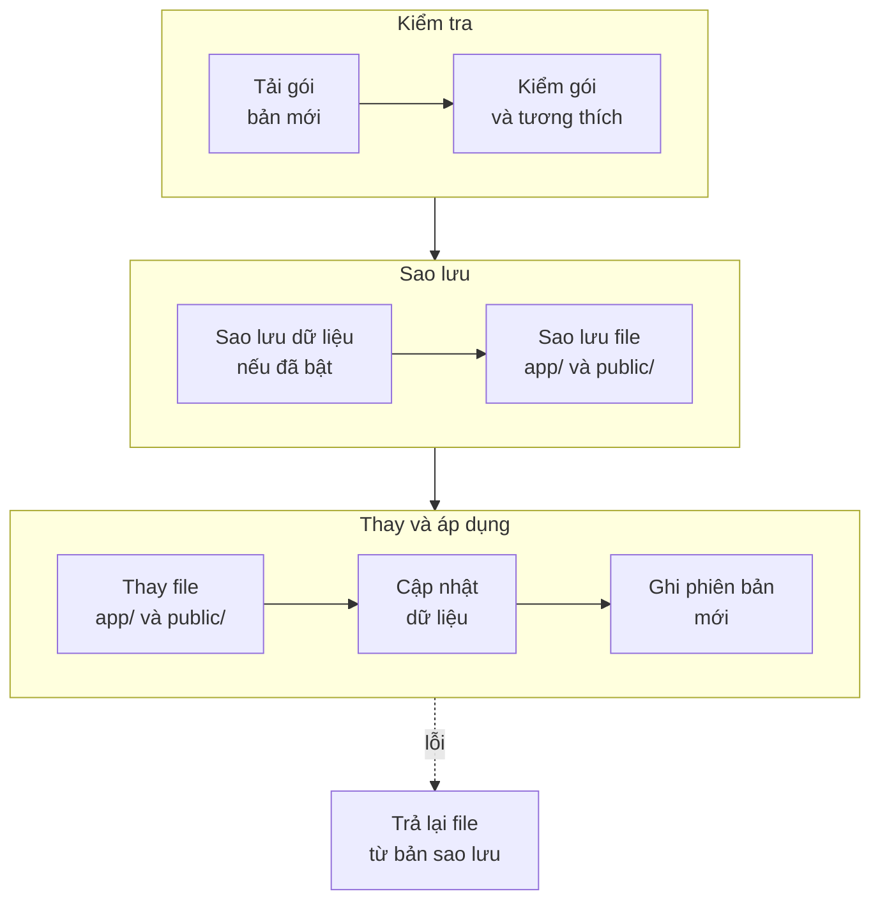
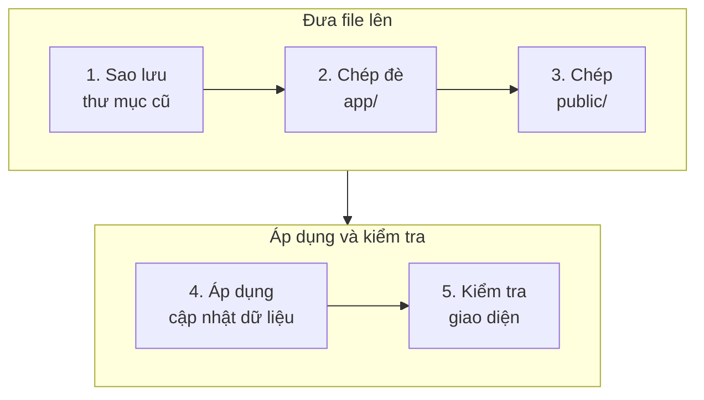

> 🌐 **Ngôn ngữ:** 🇻🇳 Tiếng Việt (hiện tại) · [🇬🇧 English](./update-extension.md) · [🇯🇵 日本語](./update-extension_ja.md)

# Cập nhật Plugin & Template

## Giới thiệu
Tài liệu này hướng dẫn đưa một plugin hoặc template **đã cài** lên phiên bản mới, theo mọi cách GP247 hỗ trợ: bấm nút trên
trang quản trị, chạy lệnh, hoặc tự chép file bản mới lên máy chủ. Tài liệu dành cho chủ site và người vận hành, kể cả trên
hosting không có dòng lệnh. Đọc xong, bạn chọn đúng cách cho tình huống của mình, biết GP247 làm gì ở từng bước, và tự xử lý
được ca hay gặp nhất: đã chép bản mới nhưng giao diện vẫn cũ hoặc vỡ vì thiếu file trong `public/`.

> 💡 **Làm cùng AI agent?** Cập nhật plugin: dùng skill **`gp247-plugin-update`** trong repo [gp247-skills](https://github.com/gp247net/gp247-skills)
> — skill dò phiên bản site, kiểm tra bản mới nhất trên thư viện, rồi chọn đúng cách (online miễn phí, online trả phí, hay áp dụng
> bản mới đã chép đè) và báo kết quả từng bước. Cập nhật template: dùng skill **`gp247-template-update`** — skill còn tìm các
> store đang dùng template, những chỉnh sửa trực tiếp sẽ bị xoá khi cập nhật, và đưa `GP247Front` sang đúng đường cập nhật package.

## Nhìn nhanh
Chọn cách cập nhật theo nơi bạn lấy bản mới:



- **Cập nhật từ thư viện là cách an toàn nhất** — GP247 tự tải, sao lưu, thay file, cập nhật dữ liệu, và tự trả lại bản cũ
  khi lỗi.
- **Tự chép file thì phải làm đủ ba phần**: mã nguồn trong `app/`, file tĩnh trong `public/`, và bước **Áp dụng cập nhật dữ
  liệu**. Thiếu phần nào thì site lệch phần đó.
- **Từ gp247/core 3.14.3, bước "Áp dụng cập nhật dữ liệu" tự chép file tĩnh** ra `public/` trước khi cập nhật dữ liệu. Core
  thấp hơn thì nút này **không** chép file tĩnh — chép đè mà quên `public/` là lý do phổ biến nhất khiến giao diện vẫn cũ hoặc
  vỡ sau cập nhật.
- **Template `GP247Front` đi kèm S-Cart không cập nhật ở đây** — nó lên bản mới cùng `composer update` của bộ gói GP247.

## Trong trang này
- [Một bản cập nhật gồm ba phần](#một-bản-cập-nhật-gồm-ba-phần) — hiểu vì sao chép đè dễ thiếu.
- [Trước khi cập nhật](#trước-khi-cập-nhật) — sao lưu, template đã tuỳ biến, thư mục đang phát triển.
- [Cách 1 — Cập nhật từ thư viện trên trang quản trị](#cách-1--cập-nhật-từ-thư-viện-trên-trang-quản-trị) — bấm một nút.
- [Cách 2 — Cập nhật từ thư viện bằng dòng lệnh](#cách-2--cập-nhật-từ-thư-viện-bằng-dòng-lệnh) — `gp247:ext-update`.
- [Cách 3 — Tự chép bản mới lên máy chủ](#cách-3--tự-chép-bản-mới-lên-máy-chủ) — git pull, Composer, FTP, file `.zip`.
- [Đã chép bản mới nhưng giao diện vẫn cũ hoặc vỡ](#đã-chép-bản-mới-nhưng-giao-diện-vẫn-cũ-hoặc-vỡ) — thiếu hoặc cũ `public/`.
- [Khi cập nhật báo lỗi](#khi-cập-nhật-báo-lỗi) — khôi phục, sao lưu, các lỗi hay gặp.

## Một bản cập nhật gồm ba phần
Mục này giải thích vì sao cập nhật bằng thư viện "tự đủ", còn tự chép file thì dễ thiếu. Mỗi extension (plugin hoặc template)
có ba phần nằm ở ba nơi khác nhau:

| Phần | Nằm ở | Cập nhật từ thư viện (Cách 1, 2) | Tự chép bản mới (Cách 3) |
| --- | --- | --- | --- |
| **Mã nguồn** (PHP, giao diện, ngôn ngữ) | `app/GP247/<Plugins\|Templates>/<Key>/` | Tự thay | Bạn chép |
| **File tĩnh** (CSS, JS, ảnh) | `public/GP247/<Plugins\|Templates>/<Key>/` | Tự thay | Bước Áp dụng tự chép (từ core 3.14.3); core thấp hơn: bạn chép, hoặc chạy `gp247:ext-publish` |
| **Dữ liệu** (cấu hình mới, bảng mới, chuyển dữ liệu cũ) | Cơ sở dữ liệu | Tự chạy | Bấm **Áp dụng cập nhật dữ liệu** hoặc chạy lệnh |

- **`<Key>`** là tên thư mục của extension, trùng `configKey` trong file `gp247.json`.
- **File tĩnh phải nằm trong `public/`** vì trình duyệt chỉ đọc được thư mục này. Gói extension mang chúng trong thư mục con
  `public/` của chính nó (`app/GP247/<Plugins|Templates>/<Key>/public/`), và GP247 chép ra ngoài khi cài hoặc cập nhật.
- **GP247 ghi nhớ phiên bản đã cài** của từng extension. Khi phiên bản trong `gp247.json` cao hơn phiên bản đã ghi nhớ,
  GP247 biết phần dữ liệu còn chờ và hiện nhãn vàng **"Chờ cập nhật dữ liệu: x → y"** trên danh sách extension.

## Trước khi cập nhật
Mục này liệt kê những việc nên làm trước, để một bản cập nhật lỗi không thành sự cố.

- **Sao lưu dữ liệu.** Cập nhật từ thư viện sao lưu **file** của extension và tự trả lại khi lỗi, nhưng **không** tự hoàn
  tác những gì bước cập nhật dữ liệu đã ghi vào cơ sở dữ liệu. Nếu site bật tính năng sao lưu, GP247 chụp một bản sao lưu
  trước khi cập nhật; nếu không, hãy tự sao lưu cơ sở dữ liệu.
- **Template đã sửa trực tiếp sẽ mất phần sửa.** Cập nhật ghi đè toàn bộ thư mục của template. Muốn giữ giao diện riêng, hãy
  sao chép template thành một template tên khác rồi sửa bản đó.
- **File bạn tự đặt trong `public/GP247/<Plugins|Templates>/<Key>/` cũng bị thay.** Thư mục này là bản sao của gói, được tạo
  lại mỗi lần cập nhật. Ảnh và file riêng của bạn hãy để ở chỗ khác.
- **Thư mục đang phát triển (có `.git`) không dùng nút Cập nhật.** Cập nhật từ thư viện xoá thư mục rồi chép bản tải về vào,
  mất lịch sử git và thay đổi chưa lưu. Với thư mục này, dùng `git pull` rồi làm theo [Cách 3](#cách-3--tự-chép-bản-mới-lên-máy-chủ).
- **Đọc ghi chú phát hành của extension**: bản mới có thể yêu cầu phiên bản GP247 cao hơn, hoặc yêu cầu đang cài từ một
  phiên bản nhất định trở lên.

## Cách 1 — Cập nhật từ thư viện trên trang quản trị
Cách này dành cho extension cài từ thư viện GP247 và hợp với mọi loại hosting, kể cả không có dòng lệnh.

1. Vào trang quản trị, mở menu **Plugin** (hoặc **Template**). Extension có bản mới hiện nhãn vàng **"Có bản mới x.y.z"** ở
   cột Phiên bản.
2. Bấm vào nhãn đó, hoặc mở tab **Tải từ thư viện**. Không thấy nhãn dù biết đã có bản mới? Bấm **Kiểm tra bản mới**: danh
   sách bản mới được lưu tạm vài giờ, nút này buộc GP247 hỏi lại thư viện ngay.
3. Bấm nút **Cập nhật x.y.z** ở dòng của extension.
4. Đọc hộp xác nhận rồi bấm **OK**. Với template, hộp này cảnh báo thêm rằng mọi tuỳ biến cục bộ sẽ bị ghi đè.
5. Nếu site bật sao lưu mà không chụp được bản sao lưu, GP247 hỏi **"Vẫn cập nhật mà không có snapshot?"**. Bấm **Cancel**
   để dừng (chưa có gì thay đổi), hoặc **OK** để cập nhật tiếp.
6. Chờ trang tải lại. Thành công thì hiện **"Đã cập nhật <Key> lên phiên bản x.y.z"**, nhãn "Có bản mới" biến mất.

> ℹ️ **Có từ:** gp247/core 3.14.3
>
> Có lúc trang hiện thêm **"Đã thay file <Key> bản x.y.z, đang áp dụng cập nhật dữ liệu…"** rồi mới báo thành công. Đó là khi
> một plugin khác đang dùng mã của extension vừa cập nhật (ví dụ bản Pro chạy cùng bản miễn phí): GP247 thay file trước, rồi
> trang tự gửi thêm một bước để cập nhật dữ liệu **bằng mã của bản mới**. Bạn không cần làm gì, chỉ chờ trang tải lại. Lỡ đóng
> trang giữa chừng: extension hiện nhãn **"Chờ cập nhật dữ liệu"** trên menu **Plugin** (hoặc **Template**) — bấm **Áp dụng cập
> nhật dữ liệu** để hoàn tất.

GP247 làm các việc sau, theo đúng thứ tự:



- **Lỗi ở bước Kiểm tra thì chưa có gì thay đổi** — gói sai extension, không mới hơn bản đang cài, chưa tương thích phiên
  bản GP247, hoặc bản đang cài quá cũ để lên thẳng.
- **Lỗi sau khi đã thay file thì GP247 trả lại cả `app/` lẫn `public/` từ bản sao lưu** và báo **"Cập nhật thất bại, đã khôi
  phục file từ backup. Lỗi: …"**. Xem [Khi cập nhật báo lỗi](#khi-cập-nhật-báo-lỗi).
- **Bản sao lưu file nằm ở** `storage/backups/extensions/<Plugins|Templates>/<Key>/<phiên-bản-cũ>_<thời-điểm>/`; GP247 giữ 3
  bản gần nhất cho mỗi extension.
- **Cập nhật dữ liệu ở bước thứ hai** (từ core 3.14.3, trường hợp ở ghi chú trên) vẫn có cùng lưới an toàn: bước này lỗi thì
  GP247 trả lại file bản cũ từ bản sao lưu và giữ phiên bản cũ.

**Các nhãn đặc biệt thay cho nút Cập nhật** trên tab **Tải từ thư viện**:

| Nhãn | Nghĩa | Làm gì |
| --- | --- | --- |
| **Có bản mới x · Cần y trở lên** | Bản mới chỉ nâng được từ phiên bản `y` trở lên; site đang ở bản thấp hơn | Lên một bản trung gian trước (hỏi tác giả extension), rồi cập nhật tiếp |
| **Có bản mới x** (không có nút; rê chuột thấy "sản phẩm trả phí") | Extension trả phí chưa có giấy phép hợp lệ cho bản mới | Nhập giấy phép của extension ở tab này, hoặc tải bản mới từ trang sản phẩm rồi làm theo Cách 3 |

## Cách 2 — Cập nhật từ thư viện bằng dòng lệnh
Cách này làm đúng những việc của Cách 1 (cùng kiểm tra, sao lưu, tự trả lại khi lỗi), hợp khi bạn có SSH, dùng Docker, hoặc
muốn cập nhật bằng script. Chạy các lệnh trong thư mục gốc của site (nơi có file `artisan`).

1. Xem extension nào có bản mới:

   ```bash
   php artisan gp247:ext-check-update --force
   ```

2. Cập nhật một extension (template thì đổi `--type=template`):

   ```bash
   php artisan gp247:ext-update --type=plugin --key=News
   ```

   Thành công thì lệnh in tên extension và phiên bản mới, mã thoát `0`.

3. Hoặc cập nhật mọi extension cùng loại đang có bản mới:

   ```bash
   php artisan gp247:ext-update --type=plugin --all
   ```

Lệnh nói rõ khi không cập nhật được:

| Lệnh báo | Nghĩa | Mã thoát |
| --- | --- | --- |
| `<Key> is already up to date` | Đã là bản mới nhất, hoặc thư viện không có bản mới hơn | `0` |
| `check_failed` | Không hỏi được thư viện (mạng, chứng chỉ SSL, giấy phép kết nối); thông báo kèm lỗi thư viện trả về | khác `0` |
| `not_installed` | Không có thư mục `app/GP247/<Plugins\|Templates>/<Key>/` trên máy chủ | khác `0` |
| `data_update_pending` *(từ core 3.14.3)* | File đã thay, nhưng lệnh không tự chạy được bước cập nhật dữ liệu ở tiến trình mới (hosting chặn chạy tiến trình con); thông báo nêu đúng lệnh cần chạy, thường là `php artisan gp247:ext-update --local --type=plugin --key=<Key>` | khác `0` |

Từ core 3.14.3, khi mã của extension đã được nạp trong lúc chạy lệnh (một plugin khác dùng nó), lệnh thay file rồi tự chạy bước
cập nhật dữ liệu ở **một tiến trình PHP mới** để dùng mã của bản mới; bước đó lỗi thì file bản cũ được trả lại như Cách 1.

- **Thêm `--json`** để nhận kết quả dạng máy đọc được, dùng trong script và CI.
- **Thêm `--skip-pre-change`** để bỏ bước chụp sao lưu dữ liệu trước khi cập nhật (chỉ khi bạn đã tự sao lưu).
- Danh sách đầy đủ các lệnh: [Lệnh quản lý plugin và template](../cli/cli-extensions_vi.md).

## Cách 3 — Tự chép bản mới lên máy chủ
Cách này dùng khi bản mới không đến từ nút Cập nhật: `git pull`, Composer, FTP, File Manager của hosting, hoặc một file `.zip`
nhận từ tác giả. Bạn tự làm cả ba phần ở [Một bản cập nhật gồm ba phần](#một-bản-cập-nhật-gồm-ba-phần).



1. **Sao lưu thư mục cũ.** Chép `app/GP247/<Plugins|Templates>/<Key>/` và `public/GP247/<Plugins|Templates>/<Key>/` ra một nơi
   khác (hoặc đổi tên thư mục cũ thành `<Key>_old`). Nếu bản mới lỗi, bạn chép lại là xong.
2. **Thay thư mục mã nguồn** `app/GP247/<Plugins|Templates>/<Key>/` bằng thư mục của bản mới.
   - Nên **thay cả thư mục** thay vì chép trộn lên thư mục cũ: file mà bản mới đã bỏ sẽ không còn sót lại.
   - Tên thư mục phải trùng `configKey` trong `gp247.json`.
   - Có file `.zip`? Giải nén trên máy của bạn rồi chép thư mục bên trong. Chức năng **Import** trên trang quản trị chỉ dành
     cho cài mới và sẽ từ chối extension đã cài.
   - Dùng `git pull` hay Composer thì bước này đã xong khi lệnh chạy xong.
3. **Đưa file tĩnh ra `public/`** — **từ gp247/core 3.14.3 bỏ qua được bước này**: bước 4 tự chép
   `app/GP247/<Plugins|Templates>/<Key>/public/` ra `public/GP247/<Plugins|Templates>/<Key>/` trước khi cập nhật dữ liệu. Core
   thấp hơn thì làm bằng **một** trong hai cách:
   - Có dòng lệnh:

     ```bash
     php artisan gp247:ext-publish --type=plugin --key=<Key>
     ```

   - Không có dòng lệnh: chép **nội dung** của `app/GP247/<Plugins|Templates>/<Key>/public/` vào
     `public/GP247/<Plugins|Templates>/<Key>/`, chọn ghi đè khi được hỏi.

   Bỏ qua bước này nếu bản mới không có thư mục `public/`.
4. **Áp dụng cập nhật dữ liệu** — bằng **một** trong ba cách:
   - Trang quản trị: mở menu **Plugin** (hoặc **Template**), extension có nhãn vàng **"Chờ cập nhật dữ liệu: x → y"**; bấm
     nút **Áp dụng cập nhật dữ liệu** (biểu tượng cơ sở dữ liệu) cùng dòng.
   - Chỉ extension, bằng dòng lệnh (`--dry-run` để xem trước mà chưa làm gì):

     ```bash
     php artisan gp247:ext-update --local --type=plugin --key=<Key>
     ```

   - Lệnh cập nhật chung của site — đã có sẵn bước này cho mọi plugin và template:

     ```bash
     php artisan gp247:update
     ```

5. **Kiểm tra.** Nhãn "Chờ cập nhật dữ liệu" đã biến mất; mở trang dùng extension và tải lại bằng **Ctrl+F5** (Mac:
   **Cmd+Shift+R**) để trình duyệt bỏ CSS/JS cũ đã lưu.

> ⚠️ **Lưu ý theo phiên bản core:**
> - **Từ gp247/core 3.14.3:** `Áp dụng cập nhật dữ liệu`, `gp247:ext-update --local` và `gp247:update` chép file tĩnh trước rồi
>   mới cập nhật dữ liệu. Không chép được vào `public/` (thiếu quyền ghi) thì GP247 **dừng, không cập nhật dữ liệu**, báo lỗi
>   kèm đường dẫn; sửa quyền ghi rồi bấm lại.
> - **Core thấp hơn:** ba cách trên **chỉ** chạy phần dữ liệu. Bỏ bước 3 thì site chạy mã nguồn mới với CSS/JS cũ.

## Đã chép bản mới nhưng giao diện vẫn cũ hoặc vỡ
Mục này giúp bạn nhận ra và sửa ca hay gặp nhất của Cách 3: thư mục `app/` đã là bản mới, nhưng `public/` thiếu file mới hoặc
vẫn giữ file cũ.

**Dấu hiệu:**
- **Thiếu file** — trang của extension mất màu, mất bố cục, ảnh không hiện, nút không bấm được; công cụ của trình duyệt báo lỗi
  404 cho file `.css`, `.js`.
- **File cũ** — trang hiện ra nhưng lệch: phần mới của bản cập nhật không có kiểu dáng, hoặc tính năng mới không chạy.

**Cách kiểm tra** (có dòng lệnh):

```bash
php artisan gp247:doctor
```

Mục `extension_assets` liệt kê extension đã cài có file tĩnh **thiếu hoặc cũ** trong `public/` — từ gp247/core 3.14.3 mục này
so cả nội dung từng file với bản trong `app/`. Core thấp hơn chỉ nhận ra file **thiếu**; file **có nhưng là bản cũ** thì không
báo, nên đừng kết luận "đủ" chỉ vì mục này đạt. Trang quản trị cũng hiện cùng cảnh báo này trong khối cảnh báo hệ thống.

**Cách sửa** — chép lại toàn bộ file tĩnh từ bản đang có trong `app/`:

```bash
php artisan gp247:ext-publish --type=template --key=<Key>
php artisan gp247:ext-publish --type=plugin --all
```

Không có dòng lệnh: từ core 3.14.3, extension còn nhãn **"Chờ cập nhật dữ liệu"** thì bấm **Áp dụng cập nhật dữ liệu** là file tĩnh
được chép lại; ngoài ra làm thủ công như bước 3 của [Cách 3](#cách-3--tự-chép-bản-mới-lên-máy-chủ). Xong, tải lại trang bằng
**Ctrl+F5**. Site dùng CDN hoặc bộ nhớ đệm trước web server thì xoá bộ nhớ đệm của CSS/JS đó.

- **Lệnh và cách thủ công đều ghi đè và thêm file**, không xoá file mà bản mới đã bỏ. File thừa không ảnh hưởng gì.
- **Cập nhật từ thư viện (Cách 1, 2) không gặp ca này**: GP247 xoá rồi tạo lại `public/GP247/<Plugins|Templates>/<Key>/`
  từ gói mới.

## Khi cập nhật báo lỗi
Mục này giúp bạn đưa site về trạng thái chạy được và tìm nguyên nhân.

**"Cập nhật thất bại, đã khôi phục file từ backup. Lỗi: …"** (Cách 1, 2)
- File của extension đã trở về bản cũ; site chạy như trước. Đọc phần sau chữ **Lỗi** để biết nguyên nhân.
- **Một plugin khác đang mở rộng plugin cần cập nhật** (ví dụ bản Pro dùng chung với bản miễn phí) có thể khiến bước cập nhật
  dữ liệu chạy mã của **bản cũ** và lỗi. Từ gp247/core 3.14.3, GP247 tự nhận ra trường hợp này và cập nhật dữ liệu ở bước thứ
  hai bằng mã bản mới. Core thấp hơn: cập nhật plugin mở rộng trước (nếu nó có bản mới), hoặc tạm **tắt** plugin mở rộng, cập
  nhật plugin chính, rồi **bật** lại.
- Bước cập nhật dữ liệu có thể đã ghi một phần vào cơ sở dữ liệu trước khi lỗi. Nếu site hoạt động bất thường, khôi phục bản
  sao lưu dữ liệu chụp trước khi cập nhật.

**"Cập nhật dữ liệu <Key> thất bại: …"** (Cách 3)
- File mới vẫn được giữ, phiên bản ghi nhớ vẫn là bản cũ, nhãn "Chờ cập nhật dữ liệu" vẫn còn. Sửa nguyên nhân rồi bấm
  **Áp dụng cập nhật dữ liệu** lại; chạy lại bao nhiêu lần cũng an toàn.
- Muốn quay về bản cũ: chép lại thư mục đã sao lưu ở bước 1.

**"Không thể cập nhật trực tiếp từ phiên bản x"**
- Bản mới chỉ nâng được từ một phiên bản nhất định trở lên. Lên bản trung gian trước (hỏi tác giả extension), rồi cập nhật tiếp.

**Đã chép file mới nhưng site vẫn chạy mã nguồn cũ**
- Máy chủ có thể giữ mã PHP đã biên dịch trong bộ nhớ đệm (OPcache) và không đọc lại file. Khởi động lại PHP (PHP-FPM hoặc web
  server), hoặc dùng chức năng xoá bộ nhớ đệm PHP của hosting, rồi bấm **Áp dụng cập nhật dữ liệu** lại nếu nhãn vẫn còn.
- Cập nhật từ thư viện (Cách 1, 2) trên gp247/core 3.14.3 trở lên tự xoá bộ nhớ đệm này cho các file vừa thay; trường hợp trên
  chỉ còn gặp khi bạn tự chép file.

**Tự trả lại bản cũ từ bản sao lưu của GP247**
1. Mở `storage/backups/extensions/<Plugins|Templates>/<Key>/` và chọn thư mục `<phiên-bản>_<thời-điểm>` muốn quay về.
2. Chép nội dung thư mục `app/` trong đó vào `app/GP247/<Plugins|Templates>/<Key>/` (thay toàn bộ thư mục).
3. Chép nội dung thư mục `public/` trong đó vào `public/GP247/<Plugins|Templates>/<Key>/` (thay toàn bộ thư mục).

## Điều kiện & ràng buộc (hiểu trước khi thao tác)
Các điều kiện dưới đây là lý do một lần cập nhật bị từ chối hoặc không làm gì.

**Khi cập nhật từ thư viện (Cách 1, 2)**
- **Extension phải có thư mục trên máy chủ** (`app/GP247/<Plugins|Templates>/<Key>/gp247.json`) — GP247 đọc phiên bản đang cài từ
  file này.
- **Bản mới phải cao hơn bản đang cài** — GP247 không dùng nút Cập nhật để hạ cấp hay cài lại cùng phiên bản.
- **Bản mới phải tương thích phiên bản GP247 của site** — tránh cài một bản sẽ không chạy. Nâng GP247 trước rồi cập nhật extension.
- **Bản đang cài phải đạt mức tối thiểu mà bản mới yêu cầu** (nếu có) — bước nhảy quá xa có thể bỏ sót bước chuyển dữ liệu ở giữa.
- **Gói tải về phải đúng extension đang cập nhật** — chặn gói nhầm ghi đè extension khác.
- **Máy chủ phải ghi được vào** `app/GP247/<Plugins|Templates>`, `public/GP247/<Plugins|Templates>` và `storage/tmp` — thiếu
  quyền ghi thì GP247 dừng **trước** khi động vào file nào.
- **Extension trả phí cần giấy phép còn hiệu lực** cho phiên bản mới.

**Khi áp dụng cập nhật dữ liệu (Cách 3)**
- **Chỉ áp dụng cho extension đã cài** — extension chỉ nằm trên đĩa mà chưa cài thì bấm **Cài đặt**, không phải Áp dụng.
- **Phiên bản trong `gp247.json` thấp hơn phiên bản đã ghi nhớ thì GP247 bỏ qua** và ghi cảnh báo vào nhật ký — GP247 không
  chạy cập nhật dữ liệu theo chiều hạ cấp.
- **Site cài trước 2026-09-29 chưa có phiên bản ghi nhớ**, nên lần đầu mọi extension hiện "chờ" (phiên bản cũ là `?`). Áp dụng
  một lần là hết.
- **Từ gp247/core 3.14.3, máy chủ phải ghi được vào** `public/GP247/<Plugins|Templates>` — bước Áp dụng chép file tĩnh trước, và
  không chép được thì không cập nhật dữ liệu, để site không chạy dữ liệu mới với giao diện cũ.

## Hỏi & Đáp (Q&A)
**Câu 1: Tôi nên dùng cách nào?**

→ Extension cài từ thư viện: Cách 1 (không có dòng lệnh) hoặc Cách 2 (có dòng lệnh, script). Extension nhận dạng file, hoặc thư
mục là mã nguồn bạn đang phát triển: Cách 3.

**Câu 2: Cập nhật có làm mất cấu hình của plugin không?**

→ Không, nếu plugin lưu cấu hình trong trang quản trị như chuẩn của GP247: cấu hình nằm trong cơ sở dữ liệu, cập nhật chỉ thay
file. Phần bạn **sửa trực tiếp trong file** của extension (kể cả template) thì bị ghi đè.

**Câu 3: Tôi bấm "Áp dụng cập nhật dữ liệu" rồi mà giao diện vẫn cũ?**

→ Từ gp247/core 3.14.3 nút này chép file tĩnh trước khi cập nhật dữ liệu; giao diện vẫn cũ thì thường do trình duyệt hoặc CDN
còn giữ CSS/JS cũ — tải lại bằng Ctrl+F5, xoá bộ nhớ đệm CDN. Core thấp hơn: nút không chép file tĩnh; chạy
`php artisan gp247:ext-publish --type=<plugin|template> --key=<Key>`, hoặc chép tay `app/GP247/<Plugins|Templates>/<Key>/public/`
sang `public/GP247/<Plugins|Templates>/<Key>/`, rồi tải lại trang bằng Ctrl+F5.

**Câu 4: `gp247:doctor` báo `extension_assets` đạt mà CSS vẫn là bản cũ?**

→ Từ gp247/core 3.14.3 mục này so cả nội dung file, nên "đạt" nghĩa là `public/` đã khớp bản trong `app/` — CSS cũ khi đó nằm ở
bộ nhớ đệm của trình duyệt hoặc CDN. Core thấp hơn chỉ phát hiện file **thiếu**: chạy `gp247:ext-publish` cho extension đó; lệnh
ghi đè mọi file tĩnh bằng bản đang có trong `app/`.

**Câu 5: Tôi có file `.zip` bản mới, Import lại có được không?**

→ Không. Import chỉ dành cho cài mới và từ chối extension đã cài. Giải nén rồi làm theo Cách 3.

**Câu 6: Cập nhật lỗi thì site có bị hỏng không?**

→ Với Cách 1, 2: GP247 trả lại file cũ, site chạy như trước; chỉ những gì bước cập nhật dữ liệu đã kịp ghi vào cơ sở dữ liệu là
không tự hoàn tác. Với Cách 3: file mới được giữ, bạn sửa nguyên nhân rồi áp dụng lại, hoặc chép lại thư mục đã sao lưu.

**Câu 7: Bản sao lưu file của GP247 nằm ở đâu, giữ bao lâu?**

→ `storage/backups/extensions/<Plugins|Templates>/<Key>/`, mỗi lần cập nhật một thư mục `<phiên-bản-cũ>_<thời-điểm>`; GP247 giữ 3
bản gần nhất cho mỗi extension.

**Câu 8: Không thấy nút Cập nhật dù biết đã có bản mới?**

→ Bấm **Kiểm tra bản mới** trên tab **Tải từ thư viện**. Vẫn không thấy: bản mới có thể chưa tương thích phiên bản GP247 của site,
hoặc site chưa kết nối được thư viện (đăng ký giấy phép kết nối ở [Cài đặt Plugin & Template](./install-extension_vi.md)).

**Câu 9: Template `GP247Front` cập nhật thế nào?**

→ Cùng bộ gói GP247: `composer update` rồi `php artisan gp247:update`; file tĩnh của nó được chép ra `public/` tự động. Xem
[Cập nhật GP247 và S-Cart](../install-upgrade/update_vi.md).

**Câu 10: Tôi viết plugin, làm sao để bản mới của tôi cập nhật an toàn cho người dùng?**

→ Xem [Plugin an toàn khi cập nhật](./create-plugin-update-safety_vi.md): tăng `version`, lưu cấu hình trong cơ sở dữ liệu, viết hàm
`update()` chạy lại nhiều lần vẫn đúng, và khai `minUpdateFrom` khi cần.

## Lịch sử thay đổi
<!-- Chỉ ghi khi có thay đổi về logic/hành vi. Dòng mới nhất ở trên cùng. Mỗi ngày một dòng: cùng ngày thì gộp vào dòng có sẵn, không tách dòng mới. -->

| Ngày | Phiên bản GP247 | Thay đổi |
| --- | --- | --- |
| 2026-11-17 | gp247/core 3.14.3 | Áp dụng cập nhật dữ liệu (nút, `gp247:ext-update --local`, `gp247:update`) tự chép file tĩnh ra `public/` trước; cập nhật từ thư viện khi plugin khác đang dùng mã của extension thì cập nhật dữ liệu ở bước thứ hai bằng mã bản mới (CLI: tiến trình mới, mã `data_update_pending`); `extension_assets` báo cả file cũ |

---

<sub>📅 **Cập nhật lần cuối:** 2026-11-19 · ✍️ **Tác giả (Author):** GP247</sub>
