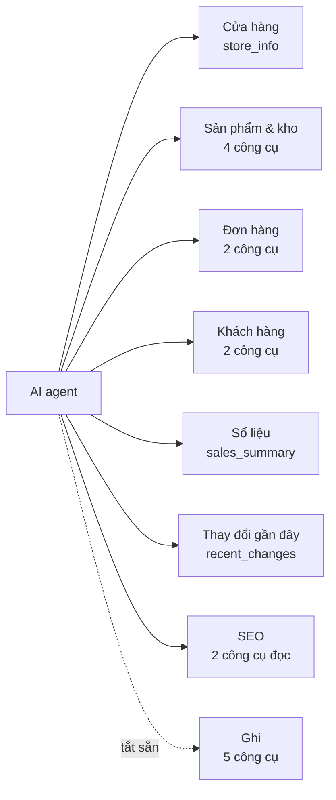
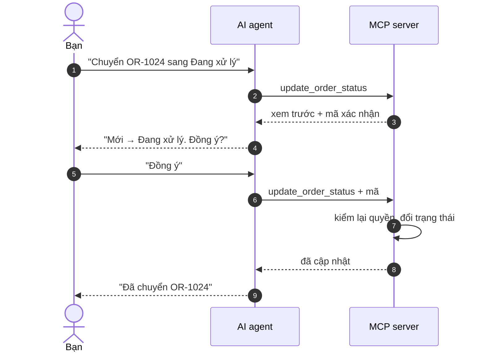

> 🌐 **Ngôn ngữ:** 🇻🇳 Tiếng Việt (hiện tại) · [🇬🇧 English](./mcp-tools.md) · [🇯🇵 日本語](./mcp-tools_ja.md)

# Danh mục công cụ MCP

## Giới thiệu

Trang này liệt kê **18 công cụ** mà MCP server của GP247 cung cấp cho AI agent: mỗi công cụ làm gì, cần quyền nào trên trang quản trị, nhận
những tham số gì và bạn có thể hỏi agent ra sao. Tài liệu dành cho chủ site (để quyết định bật công cụ nào) và người dùng agent (để biết
nên hỏi gì). Bạn không cần nhớ tên công cụ — agent tự chọn; bảng dưới giúp bạn hiểu vì sao agent làm được hoặc không làm được một việc.

## Nhìn nhanh

Công cụ chia thành 8 nhóm theo việc; nhóm **Ghi** tắt sẵn và luôn cần token mức *Đọc + ghi*:

- **13 công cụ đọc bật sẵn**, **5 công cụ ghi tắt sẵn** — chủ site bật/tắt từng công cụ trong **Cấu hình MCP Server**.
- **Agent chỉ thấy công cụ nó được dùng** — công cụ tắt, ngoài mức token hoặc chủ token không có quyền màn tương ứng thì không hiện trong danh sách.
- **Gọi `store_info` trước** — các công cụ khác dùng mã trạng thái và tiền tệ lấy từ đây.
- **Ba công cụ ghi luôn cần xem trước + xác nhận**; `update_seo` chỉ cần khi đổi điều quyết định trang có lên Google hay không, còn thêm ghi chú
  đơn thì không ([xem bên dưới](#công-cụ-ghi-xem-trước-rồi-mới-xác-nhận)).

## Trong trang này

- [Bảng tổng hợp](#bảng-tổng-hợp) — 18 công cụ, mức, quyền cần có, bật sẵn hay không
- [Cửa hàng](#cửa-hàng) — thông tin và bảng mã
- [Sản phẩm & kho](#sản-phẩm--kho) — tìm, xem chi tiết, danh mục, hàng sắp hết
- [Đơn hàng](#đơn-hàng) — tìm và xem đơn
- [Khách hàng](#khách-hàng) — tìm và xem khách
- [Số liệu bán hàng](#số-liệu-bán-hàng) — doanh thu, sản phẩm bán chạy
- [Thay đổi gần đây](#thay-đổi-gần-đây) — "có gì mới từ hôm qua"
- [SEO](#seo) — kết quả Kiểm tra SEO, giá trị SEO của từng nội dung
- [Công cụ ghi](#công-cụ-ghi-xem-trước-rồi-mới-xác-nhận) — đổi trạng thái, ghi chú, nhập/xuất kho, sửa SEO

## Bảng tổng hợp

Mỗi công cụ yêu cầu chủ token có quyền ở **màn quản trị** tương ứng (đọc cần quyền xem, ghi cần quyền sửa):

| Công cụ | Mức | Màn quản trị cần quyền | Bật sẵn |
| --- | --- | --- | --- |
| `store_info` | Đọc | — | Có |
| `search_products` | Đọc | Sản phẩm | Có |
| `get_product` | Đọc | Sản phẩm | Có |
| `list_categories` | Đọc | Danh mục | Có |
| `low_stock_products` | Đọc | Sản phẩm | Có |
| `search_orders` | Đọc | Đơn hàng | Có |
| `get_order` | Đọc | Đơn hàng | Có |
| `search_customers` | Đọc | Khách hàng | Có |
| `get_customer` | Đọc | Khách hàng | Có |
| `sales_summary` | Đọc | Báo cáo (sản phẩm) | Có |
| `recent_changes` | Đọc | Màn của từng loại thay đổi | Có |
| `seo_audit` | Đọc | Kiểm tra SEO | Có |
| `get_seo` | Đọc | Kiểm tra SEO + màn của nội dung | Có |
| `update_order_status` | Ghi, xác nhận | Sửa chi tiết đơn | Không |
| `update_shipping_status` | Ghi, xác nhận | Sửa chi tiết đơn | Không |
| `add_order_note` | Ghi | Sửa chi tiết đơn | Không |
| `adjust_stock` | Ghi, xác nhận | Sửa sản phẩm | Không |
| `update_seo` | Ghi, xác nhận khi đổi `noindex` / `nofollow` / `canonical` | Sửa ở Kiểm tra SEO + sửa màn của nội dung | Không |

> ℹ️ **Thông tin:** danh sách tham số dưới đây để bạn hiểu agent hỏi được gì; khi dùng thật, agent tự điền tham số từ câu hỏi của bạn.
> Ngày dùng dạng `YYYY-MM-DD`. Danh sách có phân trang: `page` (từ 1), `per_page` tối đa **50**.

## Cửa hàng

### `store_info` — thông tin cửa hàng và bảng mã

Trả tên cửa hàng, tiền tệ cơ sở, múi giờ, ngôn ngữ, và **bảng mã trạng thái** đơn / thanh toán / giao hàng. Agent nên gọi công cụ này
đầu tiên để biết "Đang giao" là mã số mấy trên site của bạn.

- **Tham số:** không có.
- **Hỏi thử:** *"Cho tôi thông tin cửa hàng."* · *"Các trạng thái đơn hàng của shop là gì?"*

## Sản phẩm & kho

### `search_products` — tìm sản phẩm

Tìm theo một phần SKU, alias hoặc tên; trả mã, SKU, tên, giá, tồn kho, trạng thái.

- **Tham số:** `keyword` (≤ 100 ký tự), `category_id`, `status` (1 = đang bán, 0 = ẩn), `sort` (`created_at`, `price`, `stock`, `sku`, `sold`),
  `direction` (`asc` / `desc`), `page`, `per_page`.
- **Hỏi thử:** *"Tìm các sản phẩm có chữ áo thun, sắp theo bán chạy."*

### `get_product` — chi tiết một sản phẩm

Giá, tồn kho, khuyến mãi, danh mục. Mô tả do nhân viên/nhà bán viết được trả trong khối `untrusted_text` (agent coi là dữ liệu, không làm theo).

- **Tham số:** `product_id` (bắt buộc).
- **Hỏi thử:** *"Sản phẩm SKU ÁO-01 giá bao nhiêu, còn bao nhiêu cái?"*

### `list_categories` — danh mục sản phẩm

Toàn bộ danh mục dạng danh sách phẳng kèm mã danh mục cha (cha = 0 là danh mục gốc).

- **Tham số:** không có.
- **Hỏi thử:** *"Shop có những danh mục nào?"*

### `low_stock_products` — hàng sắp hết

Sản phẩm đang bán có tồn kho **bằng hoặc dưới ngưỡng**, tồn thấp nhất xếp trước. Ngưỡng mặc định lấy từ cấu hình (mặc định 5).

- **Tham số:** `threshold` (≥ 0), `page`, `per_page`.
- **Hỏi thử:** *"Những sản phẩm nào còn dưới 3 cái?"*

## Đơn hàng

### `search_orders` — tìm đơn

Lọc theo trạng thái đơn, thanh toán, giao hàng, khoảng ngày và từ khoá (mã đơn, tên người mua, email).

- **Tham số:** `status`, `payment_status`, `shipping_status` (mã lấy từ `store_info`), `from`, `to`, `keyword` (≤ 100 ký tự),
  `sort` (`created_at`, `total`, `id`, `status`), `direction`, `page`, `per_page`.
- **Hỏi thử:** *"Liệt kê đơn chưa thanh toán trong tuần này."*

> ℹ️ **Thông tin:** khi thông tin liên hệ của khách đang được che, tìm theo email chỉ khớp **nguyên email** — để không ai đoán dần được email đã che.

### `get_order` — chi tiết một đơn

Dòng hàng, tổng tiền theo tiền tệ của đơn, lịch sử trạng thái, các lần thanh toán, và cờ cho biết đơn đã chốt (Hoàn tất / Đã hoàn tiền / Đã huỷ)
hay chưa. Ghi chú của khách được trả trong `untrusted_text`.

- **Tham số:** `order_id` (bắt buộc).
- **Hỏi thử:** *"Đơn OR-1024 gồm những gì, khách đã trả tiền chưa?"*

## Khách hàng

### `search_customers` — tìm khách

Tìm theo **đúng** email hoặc số điện thoại, hoặc theo một phần tên.

- **Tham số:** `keyword` (≤ 150 ký tự), `page`, `per_page`.
- **Hỏi thử:** *"Tìm khách tên Lan."*

### `get_customer` — hồ sơ khách

Hồ sơ khách kèm số đơn và tổng chi tiêu trên các đơn Hoàn tất, theo từng tiền tệ. Email, điện thoại, địa chỉ được che nếu chủ site chưa cho phép gửi.

- **Tham số:** `customer_id` (bắt buộc).
- **Hỏi thử:** *"Khách này đã mua bao nhiêu đơn, tiêu bao nhiêu?"*

## Số liệu bán hàng

### `sales_summary` — tổng quan bán hàng

Doanh thu theo **từng tiền tệ** (đơn Hoàn tất), số đơn theo trạng thái và sản phẩm bán chạy trong khoảng ngày. Mặc định 30 ngày gần nhất.

- **Tham số:** `from`, `to` (tính cả ngày cuối), `top` (số sản phẩm bán chạy, 1–20, mặc định 5).
- **Hỏi thử:** *"Tháng 10 bán được bao nhiêu, 10 sản phẩm chạy nhất là gì?"*

> ℹ️ **Thông tin:** doanh thu USD và VND được trả riêng, **không bao giờ cộng chéo**. Một lần hỏi tối đa 366 ngày (chỉnh được trong cấu hình).

## Thay đổi gần đây

### `recent_changes` — có gì thay đổi

Đơn mới, đổi trạng thái đơn / thanh toán / giao hàng, biến động kho, cập nhật sản phẩm và khách — cũ trước, mới sau. Mặc định 24 giờ gần nhất.

- **Tham số:** `since` (thời điểm bắt đầu, dạng ISO 8601), `types` (giữ loại sự kiện nào, ví dụ `order.created`, `stock.changed`),
  `after` (dùng giá trị `next_after` của trang trước để đọc tiếp), `limit` (1–100, mặc định 50).
- **Hỏi thử:** *"Từ sáng tới giờ có đơn mới nào, kho biến động gì?"*

> ⚠️ **Lưu ý:** công cụ này đọc **nhật ký sự kiện** của REST API. Nhật ký đang tắt thì công cụ trả `enabled: false` kèm gợi ý — bật ở màn
> quản lý API (xem [Đồng bộ dữ liệu](../api/api-sync_vi.md)). Mỗi loại sự kiện chỉ hiện khi chủ token có quyền ở màn tương ứng.

## SEO

Hai công cụ đọc giúp agent rà lỗi SEO của cửa hàng và xem giá trị SEO của từng nội dung; muốn sửa thì dùng công cụ ghi `update_seo`
([xem bên dưới](#công-cụ-ghi-xem-trước-rồi-mới-xác-nhận)). Ý nghĩa từng lỗi và cách sửa trên trang quản trị: xem
[Theo dõi & sửa lỗi SEO](../seo/seo-monitoring_vi.md).

> ℹ️ **Thông tin:** ba công cụ SEO chỉ hiện khi site chạy gp247/mcp 2.1.0 trở lên **cùng** gp247/front 3.11.0 trở lên — với gp247/front
> cũ hơn, chúng tự ẩn.

### `seo_audit` — kết quả Kiểm tra SEO

Trả kết quả **Kiểm tra SEO** gần nhất đã lưu của cửa hàng gắn với token: các lỗi tìm thấy (mã lỗi, mức **Cần sửa** / **Nên xem**, số lượng,
tối đa 20 ví dụ), thời điểm kiểm `checked_at` và cờ `complete` (đã kiểm hết hay chưa).

- **Tham số:** `refresh` (tuỳ chọn, `true` = chạy một lần kiểm tra mới). Lần kiểm mới dừng sau 20 giây, khi đó `complete=false`. Mỗi 2 phút
  chỉ kiểm lại được một lần — gọi sớm hơn thì nhận kết quả đang lưu kèm `refreshed: false` và `retry_after_seconds` (số giây phải chờ).
- **Hỏi thử:** *"Cửa hàng có lỗi SEO nào cần sửa?"* · *"Kiểm tra SEO lại giúp tôi."*

### `get_seo` — giá trị SEO của một nội dung

Trả các giá trị **hiển thị trên trang công khai** theo từng ngôn ngữ (tiêu đề, mô tả, canonical, robots…) và giá trị SEO riêng đã đặt cho
nội dung đó. Cần quyền màn Kiểm tra SEO **và** quyền xem màn của nội dung (Sản phẩm / Danh mục / Thương hiệu / Quản lý trang).

- **Tham số:** `type` (`product` | `category` | `brand` | `page`), `id`.
- **Hỏi thử:** *"Sản phẩm này đang hiện tiêu đề và mô tả gì trên Google?"*

> ℹ️ **Thông tin:** chỉ đọc nội dung của cửa hàng gắn với token — nội dung của cửa hàng khác trả "không tìm thấy", loại khác bốn loại trên
> trả "loại không được hỗ trợ". Nội dung do plugin thêm (ví dụ tin tức) không đọc được bằng công cụ này.

## Công cụ ghi: xem trước rồi mới xác nhận

Năm công cụ ghi giúp agent làm việc thay bạn, nên được rào chắn kỹ nhất:

- **Tắt sẵn, bật từng cái** — không có công tắc "bật tất cả".
- **Cần token mức *Đọc + ghi*** và chủ token có quyền **sửa** ở màn tương ứng.
- **Cùng quy tắc với trang quản trị** — ví dụ huỷ đơn thì hoàn kho, mở lại đơn đã huỷ cần đủ tồn kho.
- **Không có công cụ xoá, hoàn tiền, sửa giá hay thao tác hàng loạt.**

| Công cụ | Làm gì | Tham số chính | Xác nhận |
| --- | --- | --- | --- |
| `update_order_status` | Đổi trạng thái đơn | `order_id`, `status`, `note` (≤ 500 ký tự) | Có |
| `update_shipping_status` | Đổi trạng thái giao hàng | `order_id`, `shipping_status`, `note` (≤ 500 ký tự) | Có |
| `adjust_stock` | Nhập (số dương) / xuất (số âm) kho ngoài bán hàng | `product_id`, `delta` (≠ 0, tối đa 4 chữ số thập phân), `reason` (≤ 255) | Có |
| `add_order_note` | Thêm ghi chú nội bộ vào lịch sử đơn (gắn nhãn [MCP]) | `order_id`, `note` (≤ 1000 ký tự, chữ thường) | Không |
| `update_seo` | Sửa SEO của **một** nội dung theo một ngôn ngữ | `type`, `id`, `lang` và một hoặc nhiều trường `title`, `description`, `canonical`, `noindex`, `nofollow` | Khi đổi `noindex`, `nofollow`, `canonical` |

Với ba công cụ luôn có xác nhận (và `update_seo` khi cần xác nhận), agent gọi **hai lần**. Ví dụ bạn bảo *"Chuyển đơn OR-1024 sang Đang xử lý"*:

- **Lần gọi đầu không đổi gì** — chỉ trả bản xem trước (cũ → mới) và mã xác nhận.
- **Mã sống 5 phút, dùng một lần, gắn đúng token + bản ghi + thay đổi** — đổi sang giá trị khác phải xem trước lại; mã sai hay hết hạn thì không ghi.
- **Agent đúng chuẩn sẽ hỏi bạn giữa hai lần gọi** — chỉ cấp token ghi cho agent bạn tin cậy.
- **`add_order_note` ghi ngay một lần gọi** vì chỉ *thêm* một dòng lịch sử, không đổi tiền, kho hay trạng thái.
- **`update_seo` chỉ cần xác nhận khi đổi `noindex`, `nofollow` hoặc `canonical`** — những thứ quyết định trang có hiện trên Google hay không;
  chỉ đổi tiêu đề hoặc mô tả thì ghi ngay một lần gọi. Ảnh chia sẻ không sửa được qua MCP — `get_seo` chỉ đọc nó.

## Điều kiện & ràng buộc (hiểu trước khi thao tác)

**Khi tra cứu**
- **Mỗi trang tối đa 50 dòng** — giữ site nhanh trên hosting nhỏ; agent đọc trang tiếp nếu cần.
- **Bản ghi ngoài phạm vi cửa hàng của bạn trả "không tìm thấy"** — giống hệt bản ghi không tồn tại, để không lộ dữ liệu cửa hàng khác.
- **Tổng quan bán hàng tối đa 366 ngày mỗi lần** — chia nhỏ khoảng thời gian nếu cần xa hơn (chủ site chỉnh được giới hạn).

**Khi ghi**
- **Trạng thái đích phải tồn tại** trong bảng mã của `store_info` — mã lạ bị từ chối.
- **Đổi trạng thái giao hàng sang đúng trạng thái đang có thì không cấp mã** — không có gì để đổi.
- **Đơn đã chốt vẫn đổi được như trên trang quản trị**, bản xem trước có ghi chú để bạn cân nhắc.
- **Tồn kho không bao giờ âm** — thay đổi làm tồn âm bị từ chối, kể cả khi tồn bị dùng mất giữa lúc xem trước và lúc xác nhận.
- **`adjust_stock` chỉ cộng/trừ chênh lệch**, không ghi đè số tồn tuyệt đối và không đụng số đã bán.
- **`update_seo` sửa đúng một nội dung mỗi lần gọi**, cần quyền sửa ở cả màn Kiểm tra SEO lẫn màn của nội dung; tham số gửi giá trị `null`
  được coi như không gửi.
- **Giá trị SEO không hợp lệ bị từ chối, không ghi gì** — canonical phải là URL tuyệt đối `http`/`https`, tiêu đề tối đa 255 ký tự, mô tả
  tối đa 500 ký tự. Cách kiểm tra và lưu giống hệt tab SEO trên trang quản trị.
- **Khi site đang ở chế độ demo chỉ-đọc, mọi thao tác ghi qua MCP bị chặn.**

## Hỏi & Đáp (Q&A)

**Câu 1: Agent nói không có công cụ để làm việc tôi yêu cầu?**

→ Kiểm tra ba chỗ: công cụ có đang bật trong **Cấu hình MCP Server** không; token có bị giới hạn ở công cụ khác không; tài khoản tạo token
có quyền ở màn quản trị tương ứng không (ví dụ màn Khách hàng cho `search_customers`).

**Câu 2: Agent đổi trạng thái đơn có hoàn kho như khi tôi làm trên trang quản trị không?**

→ Có. Công cụ ghi đi qua đúng quy tắc của trang quản trị: huỷ đơn hoàn kho, mở lại đơn đã huỷ cần đủ tồn kho, mọi thay đổi ghi vào lịch sử đơn.

**Câu 3: Vì sao agent hỏi lại tôi trước khi đổi trạng thái?**

→ Đó là bước xem trước bắt buộc: lần gọi đầu chỉ trả bản xem trước và mã xác nhận; agent cần bạn đồng ý rồi mới gọi lần hai.

**Câu 4: Mã xác nhận báo hết hạn?**

→ Mã chỉ sống 5 phút và dùng một lần. Bảo agent làm lại từ đầu để lấy bản xem trước và mã mới.

**Câu 5: `recent_changes` trả về "chưa bật"?**

→ Nhật ký sự kiện của REST API đang tắt. Chủ site bật nó ở màn quản lý API; từ lúc bật, các thay đổi mới bắt đầu được ghi lại.

**Câu 6: Doanh thu agent báo khác số trên dashboard?**

→ `sales_summary` chỉ tính đơn **Hoàn tất** và tách riêng từng tiền tệ. Hãy so với báo cáo cùng khoảng ngày, cùng điều kiện đơn Hoàn tất.

**Câu 7: Agent có xoá được đơn hay sản phẩm không?**

→ Không. MCP không có công cụ xoá, hoàn tiền, sửa giá hay thao tác hàng loạt.

**Câu 8: Nhập kho bằng `adjust_stock` khác sửa tồn kho trên màn sản phẩm thế nào?**

→ `adjust_stock` chỉ cộng hoặc trừ một lượng (ví dụ +20, −3) và không cho tồn âm; nó không đặt lại số tồn tuyệt đối. Lý do ghi vào nhật ký thao tác.

**Câu 9: Ghi chú do agent thêm hiện ở đâu?**

→ Trong lịch sử của đơn trên màn chi tiết đơn, gắn nhãn **[MCP]**, để nhân viên phân biệt với ghi chú do người viết.

---

📅 **Cập nhật lần cuối:** 2026-11-22 · ✍️ **Tác giả (Author):** GP247
