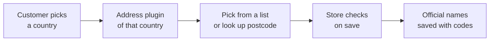
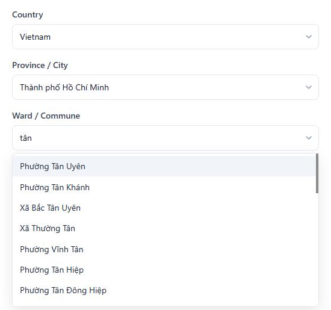
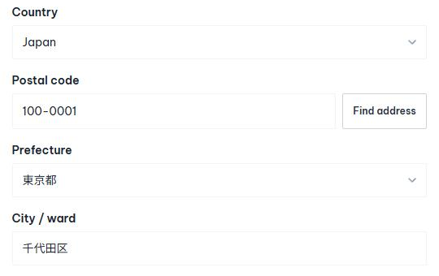
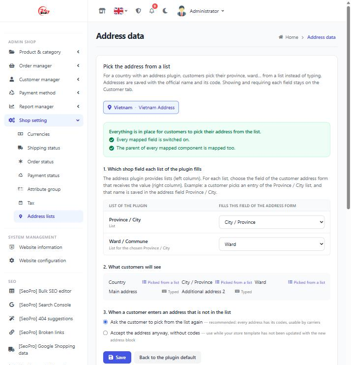

> 🌐 **Language:** [🇻🇳 Tiếng Việt](./customer-address_vi.md) · 🇬🇧 English (current) · [🇯🇵 日本語](./customer-address_ja.md)

# Customer addresses in S-Cart — pick from a list, fill from a postal code

## Introduction

This document explains how S-Cart takes a customer's address and how to turn the typed address fields into **lists to pick
from** (province → ward) or **fields that fill in from a postal code**, with a country address plugin. **Part A** is for store
managers: which plugin to install, which fields to switch on, how to set up the **Address lists** screen. Afterwards the
addresses customers enter in your store carry the official names and their codes, instead of everyone writing them their own
way. Developers who want to build a plugin for another country: see **Part B**.

> ℹ️ **Available since:** gp247/shop 3.15 (address plugin seam, Address lists screen). Postal code lookup needs gp247/shop
> 3.15.1.

---

## At a glance

Without a plugin, every address field is typed by hand. Install the plugin of the country you sell to and those fields become
lists or fill in by themselves:

- **Two free plugins are ready:** **AddressVN** (Vietnam) and **AddressJP** (Japan) — download and install them like any plugin.
- **Countries without a plugin still sell as usual** — customers type the address as before.
- **The same address block everywhere**: registration, account, address book, checkout, and the admin order / customer screens.
- **The data ships inside the plugin**, no outside service is called: it runs on shared hosting too, no cron needed.
- **Your country has no plugin yet?** A developer can build one with [Create an address plugin](../../extension/create-address-plugin.md).

---

## Part A — For store managers

### A1. Why use an address plugin

Typed addresses let the same place be written many ways ("Dist. 1", "District 1", "district1"), which makes delivery and
reporting harder.

| | Typed (no plugin) | With an address plugin |
| --- | --- | --- |
| **How customers enter it** | They type each field | Pick from a searchable list, or type a postal code and the rest fills in |
| **Name saved in the order** | As typed | The **official name** of the province, ward / city… |
| **Address codes** | None | Yes (province code, ward / local government code) — usable by shipping plugins and reports |
| **Address that does not exist** | Goes through | The customer is asked to pick again (if you switch it on) |

### A2. Plugins available — pick by the country you sell to

Both plugins are **free and open source**, and run on any hosting plan.

| Plugin | Country | How customers enter it | Data shipped | Requires |
| --- | --- | --- | --- | --- |
| **AddressVN** — [source](https://github.com/gp247-plugin/AddressVN) | Vietnam | Pick **Province / City** → **Ward / Commune** from searchable lists (typing without accents works) | The two-level units in force since 2025-07-01, from the General Statistics Office: 34 provinces, 3,321 wards / communes / special zones | gp247/shop 3.15+ |
| **AddressJP** — [source](https://github.com/gp247-plugin/AddressJP) | Japan | Type the **postal code** → **Prefecture**, **City / ward**, **Town** fill in; the customer adds the block number | Japan Post postal code data: 47 prefectures, 120,721 postal codes | gp247/shop 3.15.1+ |

Customers in Vietnam pick a province, then a ward, from lists:

Customers in Japan type a postal code and the next fields fill in:

> 💡 **Tip:** each plugin has its own README (Vietnamese, English, Japanese) describing its features and data source in detail —
> open the "source" link in the table above.

### A3. Setting up, step by step

Follow the order below; each step is done once.

1. **Update S-Cart** if the site does not have gp247/shop 3.15.1 yet (run `composer update`, then `php artisan gp247:update`
   in the website root). On an older version, installing the plugin asks you to update first.
2. **Download and install the plugin** following [How to install plugins and templates](../../extension/install-extension.md):
   - **Online** from the extension library, with the key `AddressVN` or `AddressJP`; or
   - **From GitHub:** open the source link in table A2 → **Code** → **Download ZIP**, unzip, **rename the folder** to exactly
     `AddressVN` / `AddressJP` (drop the `-main` part), copy it into `app/GP247/Plugins/`, then click **Install** in
     **Admin → Extensions / Plugins**.
3. The plugin is **enabled** right after installation. On a multi-store site, switch it on or off per store on the Plugins screen.
4. Go to **Website configuration → Customer tab** and **switch on** the fields the plugin fills (table A4), plus the **Country**
   field if you sell to several countries.
5. Open **Shop setting → Address lists** (or click the plugin's ⚙ settings button), pick the country and read the check panel at
   the top: **"Everything is in place"** means you are done. If something is missing, the check panel has a button to the place
   to fix it.

If it worked, on your store's **registration** page, picking the country shows the lists (Vietnam) or a postal code field with
a **Find address** button (Japan).

### A4. The Address lists screen: which field each list fills

Each plugin provides **lists** (left column); you choose which field of the customer address form receives the value (right
column). The defaults are sensible and rarely need changing:

| Plugin | Plugin list → form field |
| --- | --- |
| AddressVN | Province / City → **City / Province** · Ward / Commune → **Ward** |
| AddressJP | Postal code → **Post code** · Prefecture → **City / Province** · City / ward → **District** · Town → **Main address** (the customer adds the block number) |

The screen has three steps: **(1)** which field each list fills, **(2)** a preview of what customers will see, **(3)** what to do
when a customer enters an address that is not in the list.

In step **(3)**, choose one of two:

- **Ask the customer to pick from the list again** (recommended) — every address has its codes; a postal code that does not
  belong to the chosen prefecture is flagged right on the postal code field.
- **Accept the address anyway, without codes** — use it while your store template has not been updated with the new address
  block.

### A5. Older addresses and customers in other countries

Switching a plugin on does not break existing data — everything carries on like this:

- **Addresses typed earlier still open and save.** When edited, the plugin matches the typed names against its list to add
  the codes.
- **Customers in a country without a plugin** type their address as before, without codes.
- **Plugin data missing or damaged**: the lists turn back into plain inputs, customers can still order.
- **Uninstalling the plugin** keeps the settings of the Address lists screen — reinstall and carry on.

---

## Part B — For developers

An address plugin is an ordinary GP247 plugin plugged into the address layer of gp247/shop: it declares its components
(province, ward, postal code…), returns the lists, looks up postal codes and checks addresses on save. The form, the checks,
the stored codes and the Address lists screen are already in the shop — the plugin only supplies the data.

- Step-by-step guide with code: [Create an address plugin](../../extension/create-address-plugin.md).
- AddressVN (lists) and AddressJP (postal code lookup) are two complete examples to read alongside.

> 💡 **Working with an AI agent?** Use the `gp247-plugin-create` skill to scaffold the plugin, then follow the guide above for
> the address data.

---

## Conditions & Rules (know before you act)

**When installing the plugin**

- **gp247/shop 3.15 or later is required** (AddressJP: 3.15.1) — the address layer the plugin plugs into only exists from that
  version; on an older one, the Install button asks you to update S-Cart.
- **The folder must have the plugin's exact name** (`AddressVN`, `AddressJP`) — GP247 recognises a plugin by its folder name;
  a folder called `AddressVN-main` is not picked up.

**When switching fields on**

- **The fields the plugin fills must be switched on** in the Customer tab — a field that is off is not shown and that part of
  the address is not saved. The check panel of the Address lists screen names any field still off.
- **Switching the Country field off only fits a store with exactly one address plugin on** — without a country field, S-Cart
  treats every address as being in that country. With both plugins on and Country off, the store cannot tell which country the
  customer is in: the fields go back to plain inputs (the check panel warns about it).
- **Vietnam has no district level since 2025-07-01** — if you only sell within Vietnam, switch the District field off. If you
  also sell to Japan, keep it, because AddressJP puts the city / ward there.

**When a customer saves an address** ("Ask the customer to pick from the list again" mode)

- **A value that is not in the list must be picked again** — so every address has the right codes.
- **A postal code with the wrong format, or not in the chosen prefecture, is flagged on the postal code field** — so a code that
  does not match the address is never saved.
- **A well-formed postal code missing from the plugin's data is still accepted** (without codes) — Japan Post adds postal codes
  every month, and the data shipped with the plugin may be older.

---

## Q&A

**Q1: I only sell within Vietnam — what do I install?**

→ Only AddressVN. Switch on the City / Province and Ward fields, switch District off; Country can be off too, as the store has a
single address plugin.

**Q2: Do the plugins cost anything or need an outside service?**

→ No. Both plugins are free, the data is bundled inside the plugin, and no outside service is called.

**Q3: What happens when the administrative units or postal codes change?**

→ Each plugin release states the date of its data in its README. When a new release comes out, update the plugin like any
other; saved addresses are not changed.

**Q4: I installed the plugin but the registration page still has plain inputs?**

→ Open **Shop setting → Address lists** and read the check panel: usually a needed field is switched off in the Customer tab, or
your store template does not use the new address block yet.

**Q5: Does it work with a template I built myself?**

→ Yes, if the template's address pages call S-Cart's **shared address block**. The default template already does; a custom
template needs a few lines from a developer, see [The address block in a template](../../extension/create-address-plugin.md#5-the-address-block-in-a-template).
Meanwhile, choose "Accept the address anyway, without codes" on the Address lists screen.

**Q6: Can customers type the postal code in full-width digits (１００－０００１)?**

→ Yes. AddressJP accepts full-width digits, with or without a dash, with a leading `〒`; the code is saved as `100-0001`.

**Q7: What about a country with no plugin yet?**

→ Customers in that country type their address by hand as before. To get lists for it, ask a developer to build a plugin with
[Create an address plugin](../../extension/create-address-plugin.md).

**Q8: Does uninstalling the plugin lose the saved addresses?**

→ No. Addresses stay in the orders and in the customers' address books; uninstalling only turns the fields back into plain
inputs.

---

📅 **Last updated:** 2026-11-24 · ✍️ **Author:** GP247
