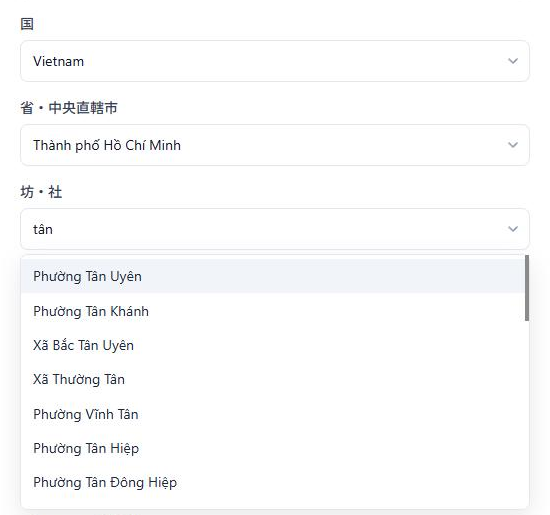
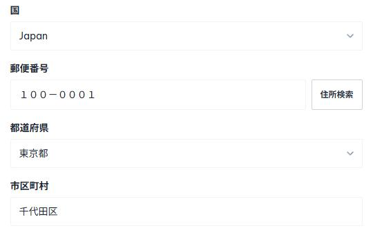
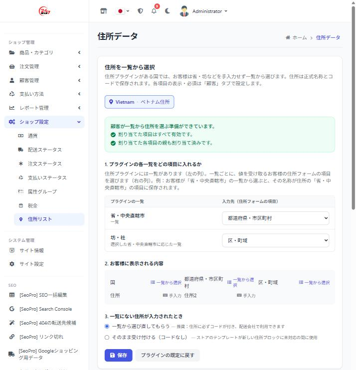

> 🌐 **言語:** [🇻🇳 Tiếng Việt](./customer-address_vi.md) · [🇬🇧 English](./customer-address.md) · 🇯🇵 日本語（現在）

# S-Cart のお客様住所 — 一覧から選ぶ、郵便番号から入力する

## はじめに

このドキュメントでは、S-Cart がお客様の住所をどのように受け付けるか、そして国別の住所プラグインで、手入力の住所欄を
**選択式の一覧**（省 → 坊・社）や **郵便番号からの自動入力** に変える方法を説明します。**パート A** は店舗の管理者向けです。
どのプラグインを入れるか、どの欄を有効にするか、**住所リスト** 画面をどう設定するかを説明します。読み終えると、お客様が
入力する住所は人によって書き方がばらばらにならず、正式名称とコード付きで保存されます。ほかの国のプラグインを作りたい開発者は
**パート B** をご覧ください。

> ℹ️ **対応バージョン:** gp247/shop 3.15（住所プラグインの差し込み口、住所リスト画面）。郵便番号検索には gp247/shop 3.15.1 が
> 必要です。

---

## ひと目でわかる

プラグインがなければ、住所欄はすべて手入力です。販売先の国のプラグインを入れると、その欄が一覧になったり自動入力されたり
します。

- **無料プラグインが 2 つあります:** **AddressVN**（ベトナム）と **AddressJP**（日本）。他のプラグインと同じようにダウンロード
  してインストールします。
- **プラグインがない国にも通常どおり販売できます** — お客様はこれまでどおり住所を手入力します。
- **どこでも同じ住所ブロック**: 会員登録、アカウント、住所録、注文手続き、管理画面の注文・顧客画面。
- **データはプラグインに同梱**され、外部サービスへの通信はありません。共有サーバーでも動き、cron も不要です。
- **販売先の国のプラグインがまだない場合は？** 開発者が [住所プラグインの作成](../../extension/create-address-plugin_ja.md) に沿って
  作成できます。

---

## パート A — 店舗の管理者向け

### A1. 住所プラグインを使う理由

手入力の住所では、同じ場所でも書き方がばらばらになり（「1区」「第1区」「1-ku」）、配送や集計が難しくなります。

| | 手入力（プラグインなし） | 住所プラグインあり |
| --- | --- | --- |
| **入力方法** | お客様が各欄を入力 | 検索付きの一覧から選ぶ、または郵便番号を入力すると残りが自動入力 |
| **注文に保存される名称** | 入力されたまま | 省・都道府県、坊・社・市区町村などの **正式名称** |
| **住所コード** | なし | あり（省・都道府県コード、坊・社コード／地方公共団体コード）— 配送プラグインやレポートで利用可能 |
| **実在しない住所** | そのまま通る | 選び直しを求める（設定で有効にした場合） |

### A2. 利用できるプラグイン — 販売先の国で選ぶ

どちらのプラグインも **無料・オープンソース** で、どのホスティングプランでも動作します。

| プラグイン | 国 | 入力方法 | 同梱データ | 必要環境 |
| --- | --- | --- | --- | --- |
| **AddressVN** — [ソース](https://github.com/gp247-official/AddressVN) | ベトナム | 検索付きの一覧から **省・中央直轄市** → **坊・社** を選択（声調記号なしでも検索可） | 統計総局が公表した 2025-07-01 からの 2 階層の行政区画: 34 省、3,321 坊・社・特区 | gp247/shop 3.15 以降 |
| **AddressJP** — [ソース](https://github.com/gp247-official/AddressJP) | 日本 | **郵便番号** を入力 → **都道府県**、**市区町村**、**町域** が自動入力。お客様は続けて番地を入力 | 日本郵便の郵便番号データ: 47 都道府県、郵便番号 120,721 件 | gp247/shop 3.15.1 以降 |

ベトナムのお客様は、一覧から省、続いて坊・社を選びます。

日本のお客様は郵便番号を入力すると、次の欄が自動入力されます。

> 💡 **ヒント:** 各プラグインには機能とデータの出典を詳しく説明した README（ベトナム語・英語・日本語）があります。上の表の
> 「ソース」リンクを開いてください。

### A3. 設定の手順

以下の順に進めてください。各手順は 1 回だけ行います。

1. サイトがまだ gp247/shop 3.15.1 でない場合は **S-Cart を更新** します（サイトのルートで `composer update` のあと
   `php artisan gp247:update`）。古いバージョンでは、プラグインのインストール時に更新を求めるメッセージが出ます。
2. [プラグイン・テンプレートのインストール](../../extension/install-extension_ja.md) に沿って **プラグインをダウンロードしてインストール**
   します。
   - 拡張機能ライブラリから **オンライン** で、キー `AddressVN` または `AddressJP` を指定してインストール、または
   - **GitHub から:** A2 の表のソースリンクを開き → **Code** → **Download ZIP**。解凍して **フォルダ名を** `AddressVN` /
     `AddressJP` に **変更**（`-main` を削除）し、`app/GP247/Plugins/` にコピーしてから **管理画面 → Extensions / Plugins** で
     **Install** をクリックします。
3. インストール後、プラグインは **すぐに有効** になります。マルチストアのサイトでは、プラグイン画面でストアごとに有効・無効を
   切り替えます。
4. **サイト設定 → 顧客タブ** で、プラグインが入力する欄（A4 の表）と、複数の国に販売する場合は **国** の欄を **有効** にします。
5. **ショップ設定 → 住所リスト** を開き（またはプラグインの ⚙ 設定ボタンをクリック）、国を選んで画面上部のチェック欄を確認します。
   **「準備ができています」** と表示されれば完了です。不足があれば、チェック欄に修正する場所へのボタンが表示されます。

うまくいけば、ストアの **会員登録** ページで国を選ぶと一覧（ベトナム）、または **住所検索** ボタン付きの郵便番号欄（日本）が
表示されます。

### A4. 住所リスト画面: 各一覧をどの欄に入れるか

各プラグインには **一覧**（左の列）があり、その値をお客様の住所フォームのどの欄に入れるか（右の列）を選びます。既定の設定で
十分なことがほとんどです。

| プラグイン | プラグインの一覧 → フォームの欄 |
| --- | --- |
| AddressVN | 省・中央直轄市 → **都道府県・市区町村** · 坊・社 → **区・町域** |
| AddressJP | 郵便番号 → **郵便番号** · 都道府県 → **都道府県・市区町村** · 市区町村 → **区・郡** · 町域 → **住所**（お客様が続けて番地を入力） |

画面は 3 つのステップです。**(1)** 各一覧をどの欄に入れるか、**(2)** お客様に表示される内容のプレビュー、**(3)** 一覧にない住所が
入力されたときの扱い。

ステップ **(3)** では次のどちらかを選びます。

- **一覧から選び直してもらう**（推奨）— すべての住所にコードが付きます。選んだ都道府県に属さない郵便番号は、郵便番号の欄でその場で
  お知らせします。
- **そのまま受け付ける（コードなし）** — ストアのテンプレートが新しい住所ブロックに未対応の間に使います。

### A5. 以前の住所と他の国のお客様

プラグインを有効にしても既存のデータは壊れません。次のように引き続き動作します。

- **以前に手入力した住所もそのまま開いて保存できます。** 編集すると、プラグインが入力済みの名称を一覧と照合してコードを付けます。
- **プラグインがない国のお客様** は、これまでどおりコードなしで住所を手入力します。
- **プラグインのデータがない・壊れている場合**: 一覧は通常の入力欄に戻り、お客様は注文を続けられます。
- **プラグインをアンインストール** しても住所リスト画面の設定は残ります。再インストールすればそのまま使えます。

---

## パート B — 開発者向け

住所プラグインは、gp247/shop の住所レイヤーに差し込む通常の GP247 プラグインです。構成要素（省・都道府県、坊・社、郵便番号など）を
宣言し、一覧を返し、郵便番号を検索し、保存時に住所を確認します。フォーム、入力チェック、コードの保存、住所リスト画面はショップに
すでにあり、プラグインはデータだけを提供します。

- コード付きの手順ガイド: [住所プラグインの作成](../../extension/create-address-plugin_ja.md)。
- AddressVN（一覧）と AddressJP（郵便番号検索）は、あわせて読める完成済みの例です。

> 💡 **AI エージェントと作業していますか？** `gp247-plugin-create` スキルでプラグインのひな形を作り、住所データの部分は上の
> ガイドに沿って進めてください。

---

## 条件と制約（操作の前に確認）

**プラグインをインストールするとき**

- **gp247/shop 3.15 以降が必要です**（AddressJP は 3.15.1）— プラグインが差し込む住所レイヤーはこのバージョンからです。古い
  バージョンでは、Install ボタンが S-Cart の更新を求めます。
- **フォルダ名はプラグイン名と完全に一致させます**（`AddressVN`、`AddressJP`）— GP247 はフォルダ名でプラグインを認識します。
  `AddressVN-main` というフォルダは認識されません。

**欄を有効にするとき**

- **プラグインが入力する欄は顧客タブで有効にしておく必要があります** — 無効の欄は表示されず、その部分の住所は保存されません。
  住所リスト画面のチェック欄に、無効のままの欄が表示されます。
- **国の欄を無効にできるのは、住所プラグインを 1 つだけ有効にしているストアです** — 国の欄がないと、S-Cart はすべての住所を
  その国の住所として扱います。2 つのプラグインを有効にしたまま国の欄を無効にすると、お客様の国が判断できず、各欄は通常の入力欄に
  戻ります（チェック欄に警告が出ます）。
- **ベトナムは 2025-07-01 から郡のレベルがありません** — ベトナム国内だけに販売する場合は区・郡の欄を無効にします。日本にも販売
  する場合は、AddressJP が市区町村をそこに入れるため、有効のままにします。

**お客様が住所を保存するとき**（「一覧から選び直してもらう」モード）

- **一覧にない値は選び直しを求められます** — すべての住所に正しいコードを付けるためです。
- **形式が違う郵便番号や、選んだ都道府県に属さない郵便番号は、郵便番号の欄でお知らせします** — 住所と合わないコードを保存しない
  ためです。
- **形式は正しいがプラグインのデータにない郵便番号は、そのまま受け付けます**（コードなし）— 日本郵便は毎月郵便番号を追加しており、
  プラグインに同梱したデータのほうが古いことがあるためです。

---

## よくある質問（Q&A）

**Q1: ベトナム国内だけに販売しています。何をインストールすればよいですか？**

→ AddressVN だけです。都道府県・市区町村と区・町域の欄を有効にし、区・郡の欄を無効にします。住所プラグインが 1 つだけなので、
国の欄も無効にできます。

**Q2: プラグインは有料ですか？外部サービスが必要ですか？**

→ いいえ。どちらも無料で、データはプラグインに同梱されており、外部サービスへの通信はありません。

**Q3: 行政区画や郵便番号が変わったらどうなりますか？**

→ 各プラグインのリリースには、README にデータの日付が記載されています。新しいリリースが出たら、他のプラグインと同じように
更新してください。保存済みの住所は変更されません。

**Q4: プラグインを入れたのに、会員登録ページが手入力の欄のままです。**

→ **ショップ設定 → 住所リスト** を開き、チェック欄を確認してください。多くの場合、必要な欄が顧客タブで無効になっているか、
ストアのテンプレートがまだ新しい住所ブロックを使っていません。

**Q5: 自作のテンプレートでも使えますか？**

→ はい。テンプレートの住所を扱うページが S-Cart の **共通住所ブロック** を呼び出していれば使えます。既定のテンプレートは対応済みです。
自作のテンプレートは、開発者が [テンプレートの住所ブロック](../../extension/create-address-plugin_ja.md#5-テンプレートの住所ブロック) に
沿って数行追加します。それまでは住所リスト画面で「そのまま受け付ける（コードなし）」を選んでください。

**Q6: お客様が全角数字（１００－０００１）で郵便番号を入力しても大丈夫ですか？**

→ 大丈夫です。AddressJP は全角数字、ハイフンの有無、先頭の `〒` を受け付け、`100-0001` の形式で保存します。

**Q7: まだプラグインがない国はどうなりますか？**

→ その国のお客様はこれまでどおり住所を手入力します。その国の一覧がほしい場合は、開発者に
[住所プラグインの作成](../../extension/create-address-plugin_ja.md) に沿ったプラグインの作成を依頼してください。

**Q8: プラグインをアンインストールすると保存済みの住所は消えますか？**

→ いいえ。住所は注文とお客様の住所録に残ります。アンインストールすると、各欄が通常の入力欄に戻るだけです。

---

📅 **最終更新:** 2026-11-24 · ✍️ **作成者 (Author):** GP247
