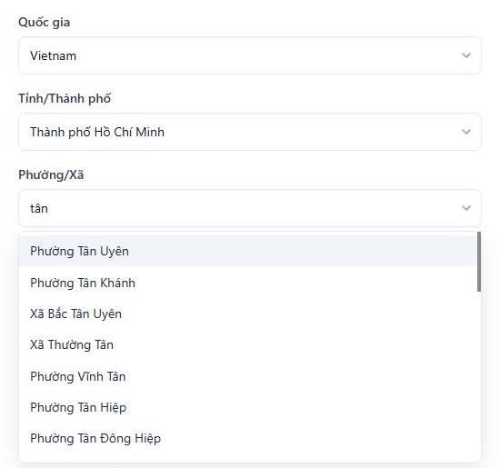
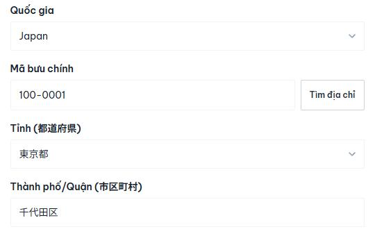
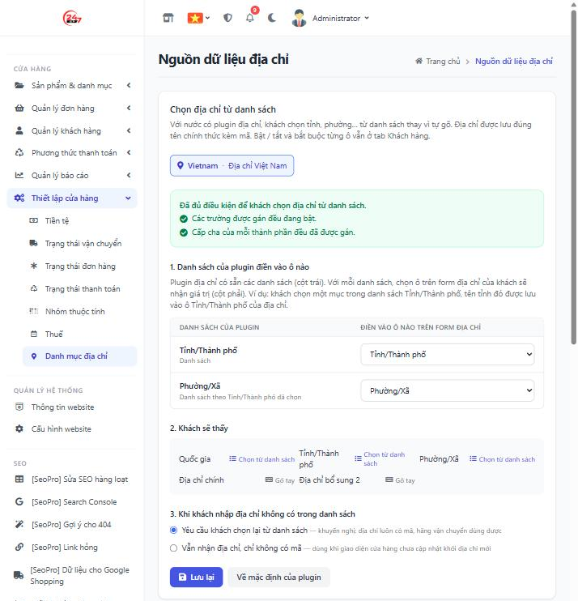

> 🌐 **Ngôn ngữ:** 🇻🇳 Tiếng Việt (hiện tại) · [🇬🇧 English](./customer-address.md) · [🇯🇵 日本語](./customer-address_ja.md)

# Địa chỉ khách hàng trong S-Cart — chọn từ danh sách, tra theo mã bưu chính

## Giới thiệu

Tài liệu này giải thích cách S-Cart nhận địa chỉ của khách và cách biến các ô địa chỉ gõ tay thành **danh sách chọn**
(tỉnh → phường/xã) hoặc **tự điền theo mã bưu chính**, nhờ plugin địa chỉ theo quốc gia. **Phần A** dành cho người quản
lý cửa hàng: nên cài plugin nào, bật ô nào, chỉnh màn **Danh mục địa chỉ** ra sao. Đọc xong, địa chỉ khách nhập vào cửa
hàng của bạn sẽ đúng tên chính thức và có mã, thay vì mỗi người viết một kiểu. Lập trình viên muốn làm plugin cho một nước
khác: xem **Phần B**.

> ℹ️ **Có từ:** gp247/shop 3.15 (chỗ cắm plugin địa chỉ, màn Danh mục địa chỉ). Tra theo mã bưu chính cần gp247/shop
> 3.15.1.

---

## Nhìn nhanh

Không có plugin, mọi ô địa chỉ là ô gõ tay. Cài plugin của nước bạn bán tới, các ô đó thành danh sách hoặc tự điền:

- **Có sẵn hai plugin miễn phí:** **AddressVN** (Việt Nam) và **AddressJP** (Nhật Bản) — tải về và cài như mọi plugin.
- **Nước chưa có plugin vẫn bán bình thường** — khách gõ địa chỉ tay như trước.
- **Cùng một khối địa chỉ ở mọi nơi**: đăng ký, tài khoản, sổ địa chỉ, đặt hàng, và các màn quản trị đơn / khách hàng.
- **Dữ liệu nằm trong plugin**, không gọi dịch vụ ngoài: chạy được cả trên shared host, không cần cron.
- **Nước khác chưa có plugin?** Lập trình viên tự làm được theo [Tạo plugin địa chỉ](../../extension/create-address-plugin_vi.md).

---

## Phần A — Dành cho người quản lý cửa hàng

### A1. Vì sao nên dùng plugin địa chỉ

Địa chỉ gõ tay khiến cùng một nơi có nhiều cách viết ("Q.1", "Quận 1", "quan 1"), khó giao hàng và khó thống kê.

| | Gõ tay (không plugin) | Có plugin địa chỉ |
| --- | --- | --- |
| **Cách nhập** | Khách tự gõ từng ô | Chọn từ danh sách có ô tìm, hoặc gõ mã bưu chính là tự điền |
| **Tên lưu vào đơn** | Như khách gõ | **Tên chính thức** của tỉnh, phường / quận… |
| **Mã địa chỉ** | Không có | Có (mã tỉnh, mã phường / mã địa phương) — plugin vận chuyển và báo cáo dùng được |
| **Địa chỉ không có thật** | Lọt qua | Bị yêu cầu chọn lại (tuỳ bạn bật) |

### A2. Plugin có sẵn — chọn theo nước bạn bán tới

Cả hai plugin đều **miễn phí, mã nguồn mở**, cài được trên mọi gói hosting.

| Plugin | Nước | Khách nhập thế nào | Dữ liệu đi kèm | Yêu cầu |
| --- | --- | --- | --- | --- |
| **AddressVN** — [mã nguồn](https://github.com/gp247-official/AddressVN) | Việt Nam | Chọn **Tỉnh/Thành phố** → **Phường/Xã** từ danh sách có ô tìm (gõ không dấu vẫn tìm được) | Địa giới hai cấp từ 01/7/2025 của Cục Thống kê: 34 tỉnh, 3.321 phường/xã/đặc khu | gp247/shop 3.15+ |
| **AddressJP** — [mã nguồn](https://github.com/gp247-official/AddressJP) | Nhật Bản | Gõ **mã bưu chính** → **Tỉnh**, **Thành phố/Quận**, **Khu phố** tự điền; khách gõ tiếp số nhà | Dữ liệu mã bưu chính của Japan Post: 47 tỉnh, 120.721 mã | gp247/shop 3.15.1+ |

Khách ở Việt Nam chọn tỉnh rồi phường/xã từ danh sách:

Khách ở Nhật gõ mã bưu chính, các ô sau tự điền:

> 💡 **Mẹo:** mỗi plugin có README riêng (tiếng Việt, Anh, Nhật) mô tả chi tiết tính năng và nguồn dữ liệu — mở link
> "mã nguồn" ở bảng trên.

### A3. Cài đặt từng bước

Làm theo thứ tự dưới đây; mỗi bước chỉ làm một lần.

1. **Cập nhật S-Cart** nếu site chưa có gp247/shop 3.15.1 (chạy `composer update` rồi `php artisan gp247:update` ở thư mục
   gốc website). Plugin cài trên bản cũ hơn sẽ báo cần cập nhật.
2. **Tải và cài plugin** theo [Hướng dẫn cài đặt Plugin & Template](../../extension/install-extension_vi.md):
   - **Online** từ thư viện extension, với key `AddressVN` hoặc `AddressJP`; hoặc
   - **Từ GitHub:** mở link mã nguồn ở bảng A2 → **Code** → **Download ZIP**, giải nén, **đổi tên thư mục** thành đúng
     `AddressVN` / `AddressJP` (bỏ phần `-main`), chép vào `app/GP247/Plugins/` rồi bấm **Install** ở **Admin →
     Extensions / Plugins**.
3. Plugin **tự bật** sau khi cài. Site nhiều cửa hàng: bật / tắt cho từng cửa hàng ở màn Plugins.
4. Vào **Cấu hình website → tab Khách hàng**, **bật** các ô plugin cần (bảng A4) và ô **Quốc gia** nếu bạn bán cho nhiều
   nước.
5. Mở **Thiết lập cửa hàng → Danh mục địa chỉ** (hoặc bấm nút cài đặt ⚙ của plugin), chọn nước, xem khung kiểm tra ở đầu
   màn: **"Đã đủ điều kiện"** nghĩa là xong. Còn thiếu gì, khung kiểm tra có nút mở đúng chỗ sửa.

Nếu thành công, ở trang **đăng ký** của cửa hàng, chọn quốc gia là bạn thấy danh sách (Việt Nam) hoặc ô mã bưu chính có nút
**Tìm địa chỉ** (Nhật Bản).

### A4. Màn Danh mục địa chỉ: plugin điền vào ô nào

Mỗi plugin có sẵn các **danh sách** (cột trái); bạn chọn ô nào trên form địa chỉ của khách nhận giá trị (cột phải). Mặc định
đã hợp lý, thường không cần đổi:

| Plugin | Danh sách của plugin → ô trên form |
| --- | --- |
| AddressVN | Tỉnh/Thành phố → **Tỉnh/Thành phố** · Phường/Xã → **Phường/Xã** |
| AddressJP | Mã bưu chính → **Mã bưu điện** · Tỉnh → **Tỉnh/Thành phố** · Thành phố/Quận → **Quận/Huyện** · Khu phố → **Địa chỉ chính** (khách gõ tiếp số nhà) |

Màn chia ba bước: **(1)** danh sách điền vào ô nào, **(2)** xem trước khách sẽ thấy gì, **(3)** khi khách nhập địa chỉ không
có trong danh sách thì làm gì.

Ở bước **(3)**, chọn một trong hai:

- **Yêu cầu khách chọn lại từ danh sách** (khuyến nghị) — địa chỉ nào cũng có mã; mã bưu chính không thuộc tỉnh đã chọn được
  báo ngay ở ô mã bưu chính.
- **Vẫn nhận địa chỉ, chỉ không có mã** — dùng khi giao diện cửa hàng của bạn chưa cập nhật khối địa chỉ mới.

### A5. Địa chỉ cũ và khách ở nước khác

Bật plugin không làm hỏng dữ liệu đã có — mọi thứ chạy tiếp như sau:

- **Địa chỉ gõ tay trước đây vẫn mở và lưu được.** Khi sửa, plugin tự khớp tên đã gõ với danh mục để gắn mã.
- **Khách ở nước chưa có plugin** gõ địa chỉ như cũ, không có mã.
- **Dữ liệu của plugin lỗi hoặc thiếu**: ô chọn tự trở về ô gõ tay, khách vẫn đặt được hàng.
- **Gỡ plugin** không xoá cấu hình ở màn Danh mục địa chỉ — cài lại là dùng tiếp.

---

## Phần B — Dành cho lập trình viên

Plugin địa chỉ là một plugin GP247 thường, cắm vào lớp địa chỉ của gp247/shop: khai báo các thành phần (tỉnh, phường, mã
bưu…), trả danh sách, tra mã bưu chính và kiểm địa chỉ khi lưu. Form, kiểm tra, lưu mã và màn Danh mục địa chỉ đã có sẵn ở
shop — plugin chỉ cung cấp dữ liệu.

- Hướng dẫn từng bước có code: [Tạo plugin địa chỉ](../../extension/create-address-plugin_vi.md).
- AddressVN (danh sách) và AddressJP (tra mã bưu chính) là hai mẫu hoàn chỉnh để đọc kèm.

> 💡 **Làm việc với AI agent?** Dùng skill `gp247-plugin-create` để dựng khung plugin, rồi làm theo hướng dẫn trên cho phần
> dữ liệu địa chỉ.

---

## Điều kiện & ràng buộc (hiểu trước khi thao tác)

**Khi cài plugin**

- **Cần gp247/shop 3.15 trở lên** (AddressJP: 3.15.1) — lớp địa chỉ mà plugin cắm vào chỉ có từ bản này; bản cũ hơn, nút
  Install báo cần cập nhật S-Cart.
- **Thư mục phải đúng tên plugin** (`AddressVN`, `AddressJP`) — GP247 nhận plugin theo tên thư mục; thư mục `AddressVN-main`
  không được nhận.

**Khi bật ô trên form**

- **Ô mà plugin điền vào phải đang bật** ở tab Khách hàng — ô tắt thì khách không thấy, phần địa chỉ đó không được lưu. Khung
  kiểm tra ở màn Danh mục địa chỉ nêu tên ô còn tắt.
- **Tắt ô Quốc gia chỉ hợp khi cửa hàng bật đúng một plugin địa chỉ** — không có ô quốc gia, S-Cart coi mọi địa chỉ là của
  nước đó. Bật cả hai plugin mà tắt ô Quốc gia thì không biết khách ở nước nào: các ô trở về gõ tay (khung kiểm tra có cảnh
  báo).
- **Việt Nam không còn cấp huyện từ 01/7/2025** — nếu chỉ bán trong Việt Nam, tắt ô Quận/Huyện. Bán cả Nhật Bản thì giữ ô
  này, vì AddressJP điền Thành phố/Quận vào đó.

**Khi khách lưu địa chỉ** (chế độ "Yêu cầu khách chọn lại")

- **Giá trị không có trong danh sách bị yêu cầu chọn lại** — để địa chỉ nào cũng có mã đúng.
- **Mã bưu chính sai định dạng hoặc không thuộc tỉnh đã chọn bị báo ở ô mã bưu chính** — tránh lưu một mã sai lệch với địa
  chỉ.
- **Mã bưu chính đúng định dạng nhưng chưa có trong dữ liệu của plugin vẫn được nhận** (không có mã) — Japan Post thêm mã mới
  hằng tháng, dữ liệu đi kèm plugin có thể cũ hơn.

---

## Hỏi & Đáp (Q&A)

**Câu 1: Tôi chỉ bán trong Việt Nam, cần cài gì?**

→ Chỉ AddressVN. Bật ô Tỉnh/Thành phố và Phường/Xã, tắt ô Quận/Huyện; ô Quốc gia tắt cũng được vì cửa hàng chỉ có một plugin
địa chỉ.

**Câu 2: Plugin có tốn phí hay cần dịch vụ ngoài không?**

→ Không. Cả hai plugin miễn phí, dữ liệu đóng gói sẵn trong plugin, không gọi dịch vụ nào bên ngoài.

**Câu 3: Danh mục hành chính / mã bưu chính thay đổi thì sao?**

→ Mỗi bản plugin ghi rõ ngày của dữ liệu trong README. Có bản mới thì cập nhật plugin như mọi plugin khác; địa chỉ đã lưu
không bị thay đổi.

**Câu 4: Tôi đã cài plugin nhưng trang đăng ký vẫn là ô gõ tay?**

→ Mở **Thiết lập cửa hàng → Danh mục địa chỉ** và đọc khung kiểm tra: thường là ô cần thiết đang tắt ở tab Khách hàng, hoặc
giao diện cửa hàng của bạn chưa dùng khối địa chỉ mới.

**Câu 5: Giao diện (template) tôi tự làm có dùng được không?**

→ Được, nếu các trang có địa chỉ của template gọi **khối địa chỉ dùng chung** của S-Cart. Template mặc định đã gọi sẵn;
template riêng cần lập trình viên thêm vài dòng theo mục
[Khối địa chỉ trong template](../../extension/create-address-plugin_vi.md#5-khối-địa-chỉ-trong-template). Trong lúc chờ,
chọn chế độ "Vẫn nhận địa chỉ, chỉ không có mã" ở màn Danh mục địa chỉ.

**Câu 6: Khách gõ mã bưu chính bằng số toàn khổ (１００－０００１) có được không?**

→ Được. AddressJP nhận cả số toàn khổ, có hoặc không gạch ngang, có `〒` phía trước; mã được lưu dạng `100-0001`.

**Câu 7: Tôi bán sang nước chưa có plugin thì sao?**

→ Khách nước đó gõ địa chỉ tay như trước. Muốn danh sách cho nước đó, nhờ lập trình viên làm plugin theo
[Tạo plugin địa chỉ](../../extension/create-address-plugin_vi.md).

**Câu 8: Gỡ plugin có mất địa chỉ đã lưu không?**

→ Không. Địa chỉ vẫn nằm trong đơn hàng và sổ địa chỉ của khách; gỡ plugin chỉ đưa các ô về gõ tay.

---

📅 **Cập nhật lần cuối:** 2026-11-24 · ✍️ **Tác giả (Author):** GP247
