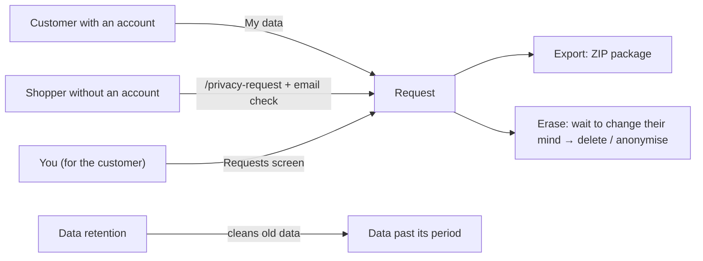
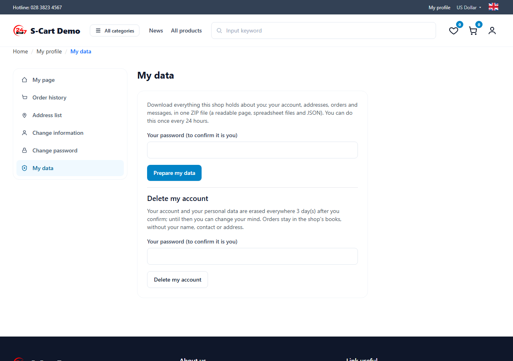
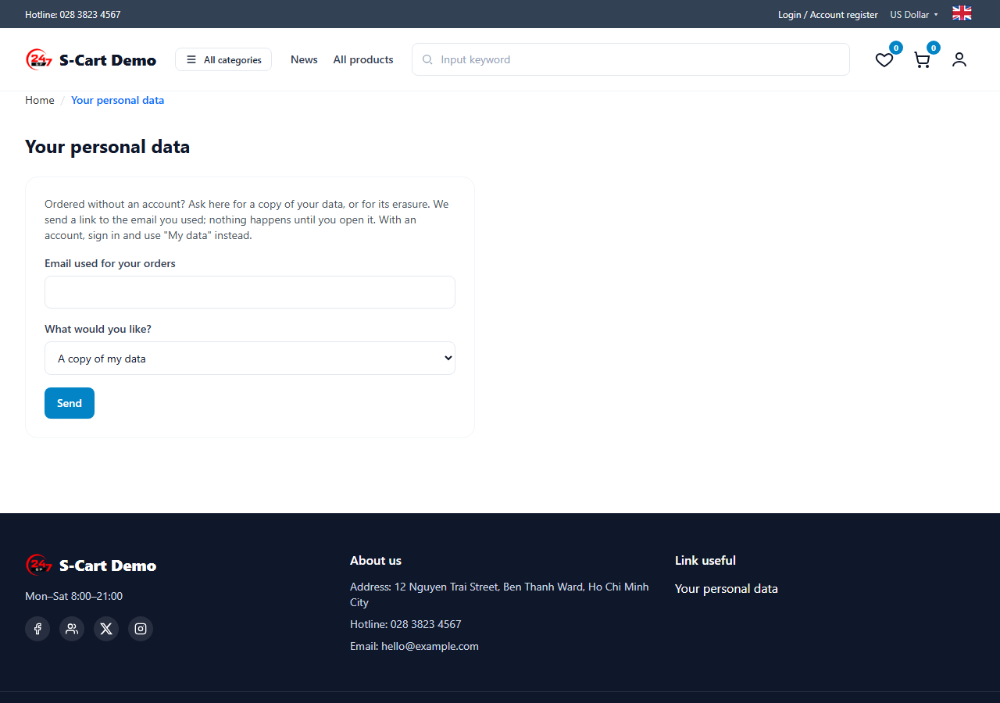
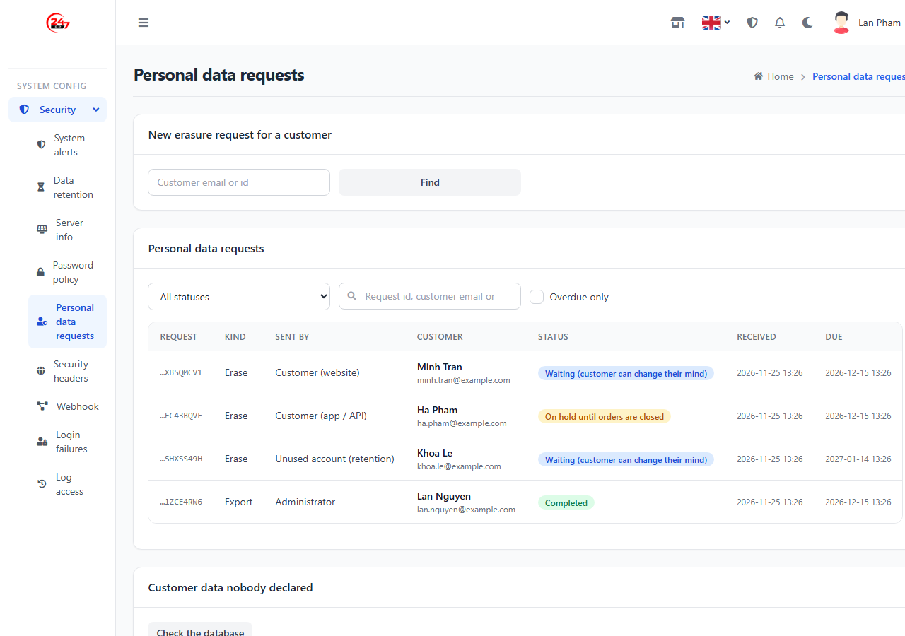
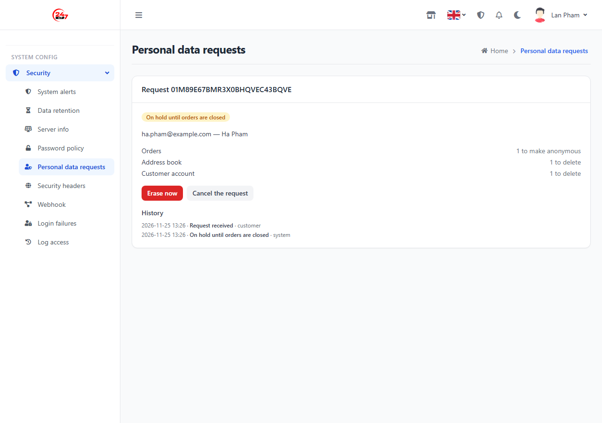
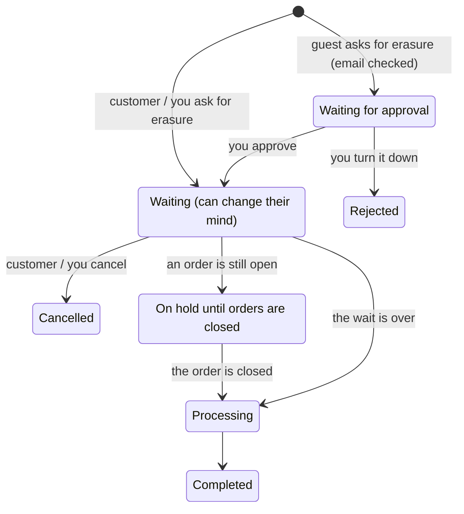
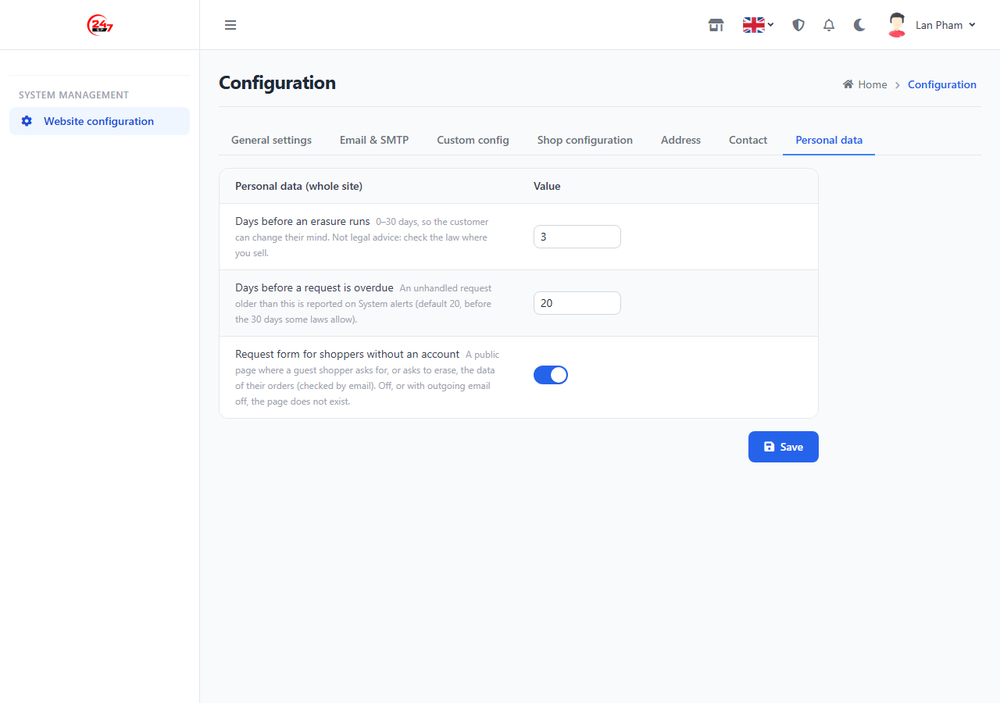
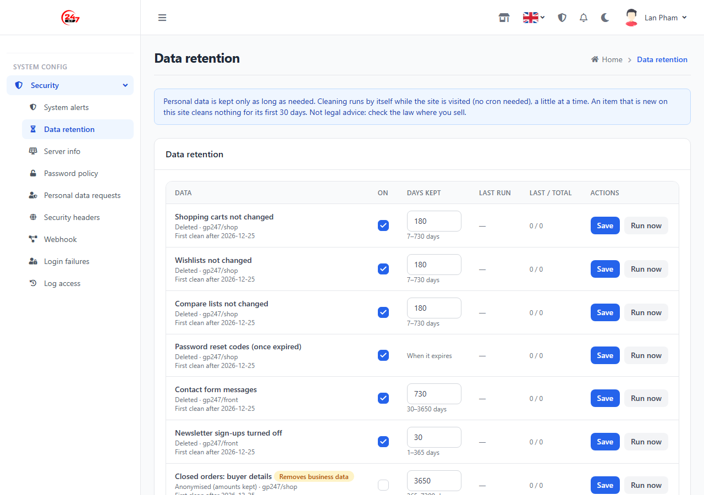

> 🌐 **Language:** [🇻🇳 Tiếng Việt](./personal-data_vi.md) · 🇬🇧 English (current) · [🇯🇵 日本語](./personal-data_ja.md)

# Customers' personal data in S-Cart — download, deletion, retention

## Introduction

This guide is for shop managers. Customers have the right to **see, download and delete** the personal data a shop keeps about
them; data protection laws in many countries (Vietnam, Japan, the EU…) require the shop to answer within a deadline and not to
keep data longer than needed. S-Cart does this out of the box: customers download or delete their data in their account,
shoppers without an account send a request through a page of their own, you handle every request on one screen, and old data
is cleaned by **data retention** without cron. After reading, you know what customers see, what you have to do, how to set the
periods, and you have the list of data S-Cart stores to put in your shop's privacy policy.

> ⚠️ **Not legal advice.** The deadline to answer a request, how long invoices must be kept… differ by country and change over
> time — check the laws in force where you sell, then set the numbers in S-Cart to match.

---

## At a glance

| Task | Who | Where |
|---|---|---|
| Download a copy of the data (ZIP file) | Customer with an account | Account area → **My data** (website or app) |
| Delete the account | Customer with an account | Account area → **My data** → **Delete my account** |
| Ask for a copy / for deletion without an account | Shopper without an account | **Your personal data** page (`/privacy-request`) |
| See and handle every request; create one for a customer | You (Administrator or a role given the permission) | **Security → Personal data requests** |
| Set the waiting days, the overdue threshold, the guest form | Administrator | **Website configuration → Personal data** |
| Set how long each kind of data is kept | Administrator | **Security → Data retention** |

---

## 1. What customers do in their account

The customer signs in and opens **My data**:

- **Download the data:** the customer types their password again (and their two-step code if they use one) → S-Cart prepares a
  ZIP file with a readable page, spreadsheet files and JSON: account, addresses, orders, messages… The page updates itself until
  the package is ready; it can be downloaded for 24 hours, and one package can be made every 24 hours.
- **Delete the account:** the customer types their password again → the deletion **waits the number of days you set** (3 by
  default) so they can change their mind. Meanwhile the account area shows a notice with a **Call off the deletion** button; the
  email sent to the customer has a call-off button too (no sign-in needed).
- While an order is **still open** (not completed / cancelled / failed / refunded), the deletion is **put on hold** until it is
  closed — you never lose the delivery details of an order in progress.
- Mobile apps using API v2 do both with the same rules.

> The **account deletion** and **unused account** emails go only to **verified** addresses: nobody can use your shop to send mail to
> an address that is not theirs.

## 2. Shoppers without an account

Shoppers who ordered without an account use the **Your personal data** page (`https://<your-domain>/privacy-request`). Link to it
from your privacy policy page or your footer.

1. The shopper types the email used for the order and chooses **A copy of my data** or **Erase my data**. The page always answers
   the same way — it never reveals which emails the shop knows.
2. S-Cart sends an email with a confirmation button to that address; nothing happens until it is pressed.
3. **A copy:** after confirming, the shopper downloads the package from a page with a download button. **Erase:** the request waits
   for **your approval** (or a refusal with a reason) — erasing by a guest's email cannot be undone.

The page exists only when the shop **sends email** and the form is on (section 4). For an email that never ordered, the shopper
gets the same answer as everyone, but there is nothing to send. For an email that belongs to an account, the email invites the
shopper to **sign in** and use **My data**. A request not confirmed within **24 hours** is cancelled by itself.

## 3. You handle requests — Security → Personal data requests

- Every request (website, app, guest form, created by you, unused account) is in one list, filtered by status or **Overdue only**.
  **Due** = received date + the days you set (20 by default); overdue dates turn red and **System alerts** warns you.
- **New erasure request for a customer** (they phoned, they wrote): search by email / customer id → choose **Erase** or **Export** →
  confirm with your password. You download an export package with the button on the screen (up to 3 times, within 24 hours), then
  send it to the customer the way you choose.
- Click a row for the detail: which data will be deleted / anonymised, the history, the **Erase now** / **Cancel the request** /
  **Approve the erasure** / **Turn down** buttons.

| Status | Meaning |
|---|---|
| Waiting for email check | A guest has not pressed the link in the email yet |
| Waiting for approval | A guest's erasure — you approve or turn it down |
| Waiting (customer can change their mind) | Waiting the set days before erasing; the customer / you can cancel |
| On hold until orders are closed | The customer has an open order — runs again by itself once it is closed |
| Processing → Completed | Erasing / building the package, then done |
| Cancelled / Rejected / Failed | Finished; **Failed** has a **Run again** button and a system alert |

**Who can use this screen:** only **Administrators** by default. To hand it to staff, give their role the **Personal data requests**
permission. "View all screens" (View.all) does **not** open it — it holds customers' personal data.

**What erasing a customer does:**

| Data | When the customer is erased |
|---|---|
| Account, address book, cart / wishlist / compare list, website and app sessions, password reset codes, custom fields | **Deleted** |
| Orders, order history, transactions, payment requests, shipments | **Kept for the books**, without name, contact, address, notes (the name becomes `[deleted]`); amounts, dates, order codes and lines stay |
| Contact form messages, newsletter sign-ups (by the account's email) | **Deleted** |
| Failed sign-in log | Kept until its own period (a security record) |

Revenue reports and accounting figures **do not change** when a customer is erased.

## 4. Settings — Website configuration → Personal data

| Setting | Default | Tip |
|---|---|---|
| Days before an erasure runs | 3 (0–30) | 0 = erase as soon as the customer confirms |
| Days before a request is overdue | 20 | Shorter than the legal deadline where you sell |
| Request form for shoppers without an account | On | Off if the shop sells only to customers with an account |

Only **Administrators** change these settings — they apply to the whole site (every store).

## 5. Data retention — Security → Data retention

S-Cart does not keep personal data forever: each kind has **days kept**, and past them it is cleaned by itself.

| Data | Default | When past its period |
|---|---|---|
| Shopping carts / wishlists / compare lists not changed | 180 days | Deleted |
| Password reset codes | Once expired | Deleted |
| Contact form messages | 730 days | Deleted |
| Newsletter sign-ups turned off | 30 days | Deleted |
| Admin activity log | 365 days | Old rows deleted (no row is ever edited) |
| Closed orders: buyer details | **Off** (10 years when on) | Anonymised as when a customer is erased; amounts kept |
| Customer accounts not used | **Off** (3 years when on) | Told 30 days before, then erased like a customer's own deletion |
| Personal data requests and their history | 5 years (fixed) | Deleted — kept as proof the request was handled |

- **Nothing is cleaned in the first 30 days:** an item new on the site (including a site just updated to a version with this
  feature) and an item you just turned on wait 30 days before their first clean; **System alerts** warns you 7 days before, with
  the number of rows. To clean earlier: **Run now** → confirm → type your password again.
- **Two items are off by default** because they remove business data. Turning them on shows how many records are concerned, asks
  for your password again and — if backups are on — saves a backup of that data first. How long accounting records must be kept is
  set by law: check before choosing the period.
- **Unused accounts** count from the customer's last sign-in (website or app) or order, and **never before the day you turned the
  item on** — old accounts are not judged "unused" just because S-Cart did not record sign-ins before. The customer gets an email
  (verified address), and signing in or pressing **Keep my account** keeps it; an account with an open order is never erased.

**How it runs (no cron needed):** each time someone uses the admin area, S-Cart cleans a little (one kind per minute at most). On
hosting running **PHP-FPM** or **LiteSpeed**, it also runs after storefront visits, once the page has been sent to the visitor. On
hosting without either, it runs only when someone uses the admin area — a site rarely administered cleans slowly.

> 💡 **A site with cron** (or a scheduler plugin) that wants regular cleaning: add the command
> `php artisan gp247:personal-data-retention` (for example once a day). Preview without changing anything:
> `php artisan gp247:personal-data-retention --dry-run`.

## 6. Backups and restores

An older backup may still hold data of customers erased since. When you **restore**, S-Cart **erases those customers again** (the
erasure ledger keeps only the customer id and a hash of the email, never the erased data). Records of erased customers are not
added back when restoring single records either. See also [Backup & restore](../../backup/backup-and-restore.md).

## 7. Data S-Cart keeps about customers (for your privacy policy)

This list helps you write the "what we collect" part of your shop's privacy policy. Plugins may keep more — see **Customer data
nobody declared** on the **Personal data requests** screen (**Check the database** button).

| Group | Data | Purpose | Kept |
|---|---|---|---|
| Account | Name, email, phone, birthday, gender, company, address, last sign-in | Sign-in, delivery, contact | Until the customer deletes it (or the "unused accounts" item if you turn it on) |
| Address book | Name, phone, address | Faster delivery | As the account |
| Orders | Name, email, phone, delivery address, notes, IP, browser; order history, transactions, shipments | Selling, accounting, fraud prevention | As the law requires for records; anonymised when the customer is erased (amounts kept) |
| Cart / wishlist / compare list | Products chosen | Shopping | 180 days unchanged |
| Sessions | Website and app sessions (IP, device) | Keeping the customer signed in | Until sign-out / expiry; deleted with the customer |
| Password reset codes | Email, code | Recovering the password | Until they expire |
| Contact / newsletter | Name, email, phone, message | Answering, newsletters | 730 days / 30 days after turned off |
| Security logs | Email typed in failed sign-ins; administrators' actions | Keeping the system safe | Their own periods; admin activity log 365 days |
| Personal data requests | Customer id, email hash, history | Proof of handling | 5 years |

---

## Conditions & constraints (understand before acting)

**When erasing**
- **An erasure cannot be undone.** The waiting days are the only time to change one's mind; after that only a backup restore brings
  data back — and the restore erases that customer again.
- **A customer with an open order:** pressing **Erase now** on a waiting request moves it to **On hold until orders are closed**;
  creating a new request with immediate erasure is refused and the screen lists the open orders.
- **Rows found by email join a customer's own request only when the account's email is verified** — so data of someone else sharing
  the email is not erased by mistake.

**When sending email / the guest form**
- **Without email sending turned on there is no `/privacy-request` page** and customers get no notices — turn sending on in
  **Website configuration → Email & SMTP**.
- **At most 30 emails per hour** from the guest form for the whole site — so it cannot be used to send mail in bulk.

**When turning on data retention**
- **Hosting without PHP-FPM / LiteSpeed and without cron:** cleaning runs only when someone uses the admin area.
- **Items off by default remove business data** — turn backups on first; a system alert reminds you if you turn such an item on
  while backups are off.

---

## Questions & Answers (Q&A)

**Q1: A customer phoned asking to delete their data — what do I do?**

→ **Security → Personal data requests** → **New erasure request for a customer** → search by email → channel "Phone" → confirm
your password. The request waits the set days then runs by itself, or press **Erase now**.

**Q2: Does erasing a customer change revenue reports?**

→ No. Orders are kept with their amounts, dates and lines; only the buyer's details are removed.

**Q3: A request stays "On hold until orders are closed"?**

→ The customer still has an order not completed / cancelled / failed / refunded. Close that order and the request runs at the next check.

**Q4: I want to keep carts longer than 180 days?**

→ **Security → Data retention** → change the days of **Shopping carts not changed** (7–730) → **Save**. To stop cleaning: untick **On**.

**Q5: Why was the old admin activity log not cleaned right after the update?**

→ A new item waits 30 days before its first clean, so you can review and change the period. System alerts warn 7 days before.

**Q6: A guest asks for erasure but the law makes me keep invoices?**

→ Erasure only anonymises orders (amounts, order codes, dates stay) — the records remain. If you still need to refuse, press
**Turn down** and give the reason; the shopper gets an email with it.

**Q7: A plugin I installed keeps customer data — is it erased too?**

→ Yes, when the plugin declares it. Undeclared tables show under **Customer data nobody declared** — ask the plugin author to declare
them, or handle that part by hand when a request comes.

## Change history
<!-- Only when logic/behavior changed. Newest row on top. One row per day: merge same-day changes into the existing row, never add a new row for the same date. -->

| Date | Version | Change |
| --- | --- | --- |
| 2026-11-25 | S-Cart (core 3.19, shop, front) | New page: customers download / delete their data, requests from shoppers without an account, the requests screen, data retention |

---

📅 **Last updated:** 2026-11-25 · ✍️ **Author:** GP247
