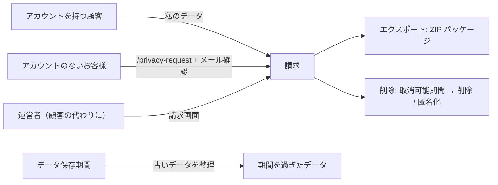
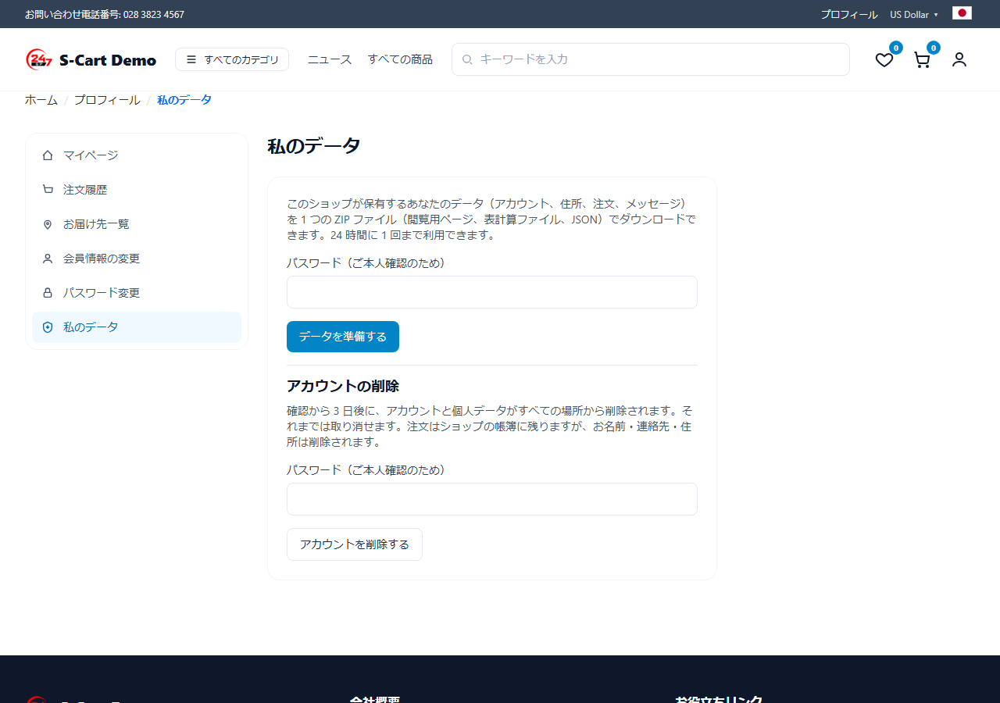
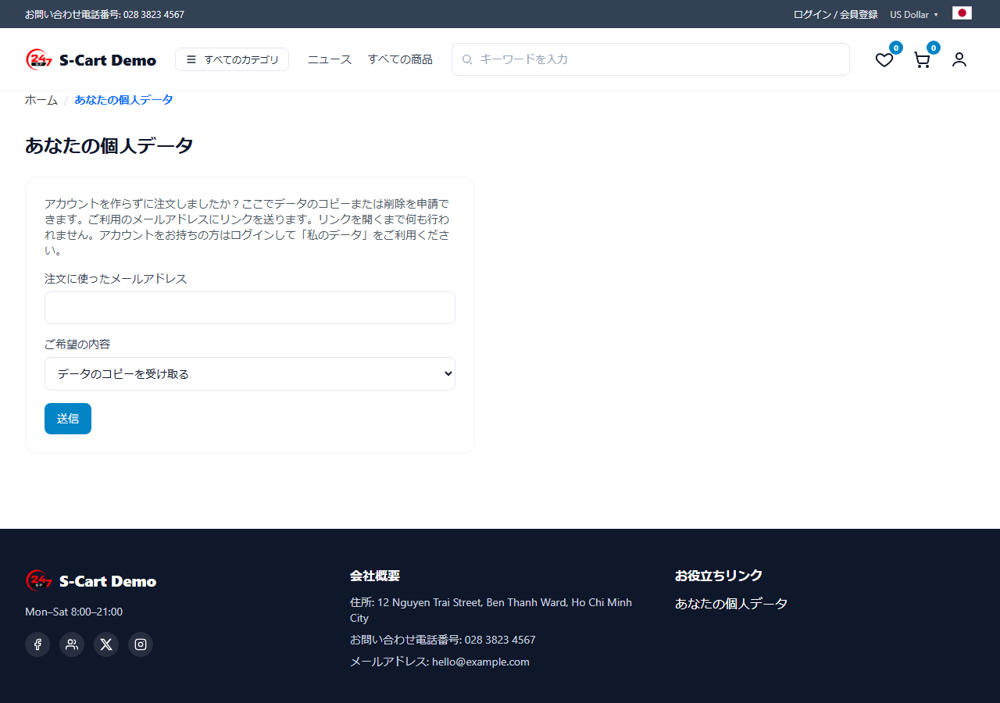
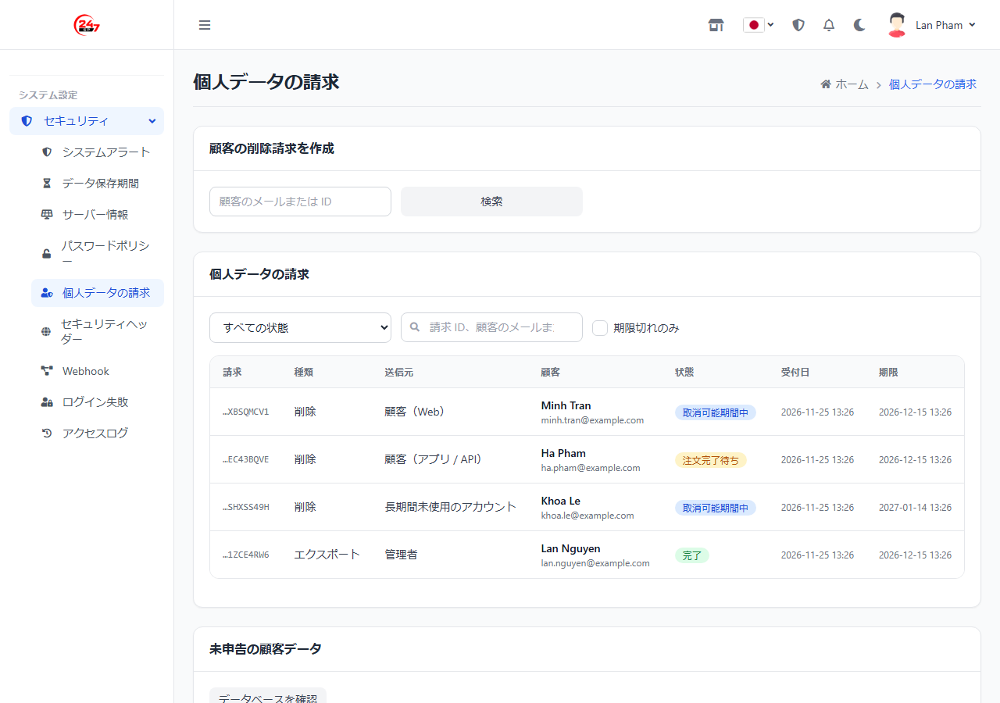
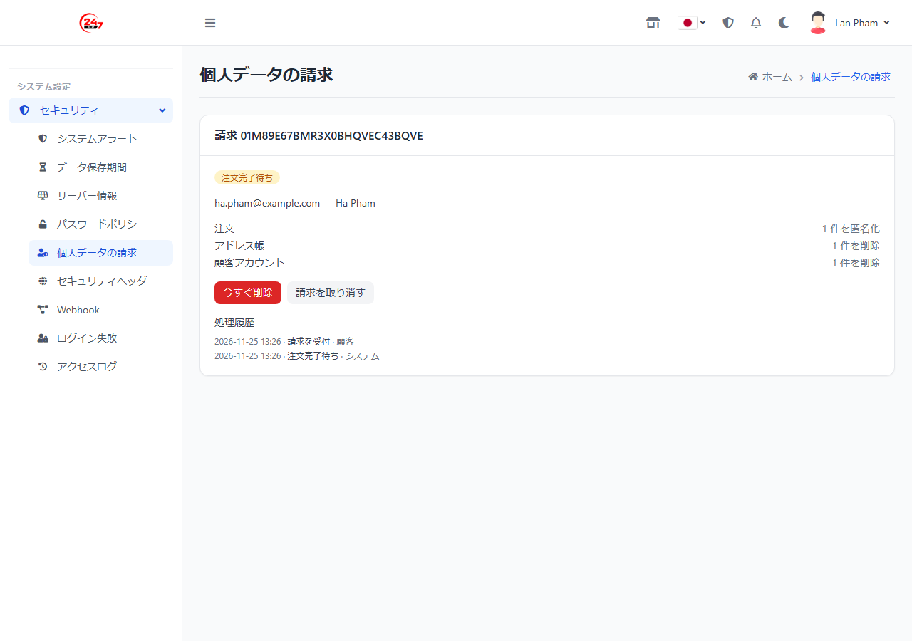
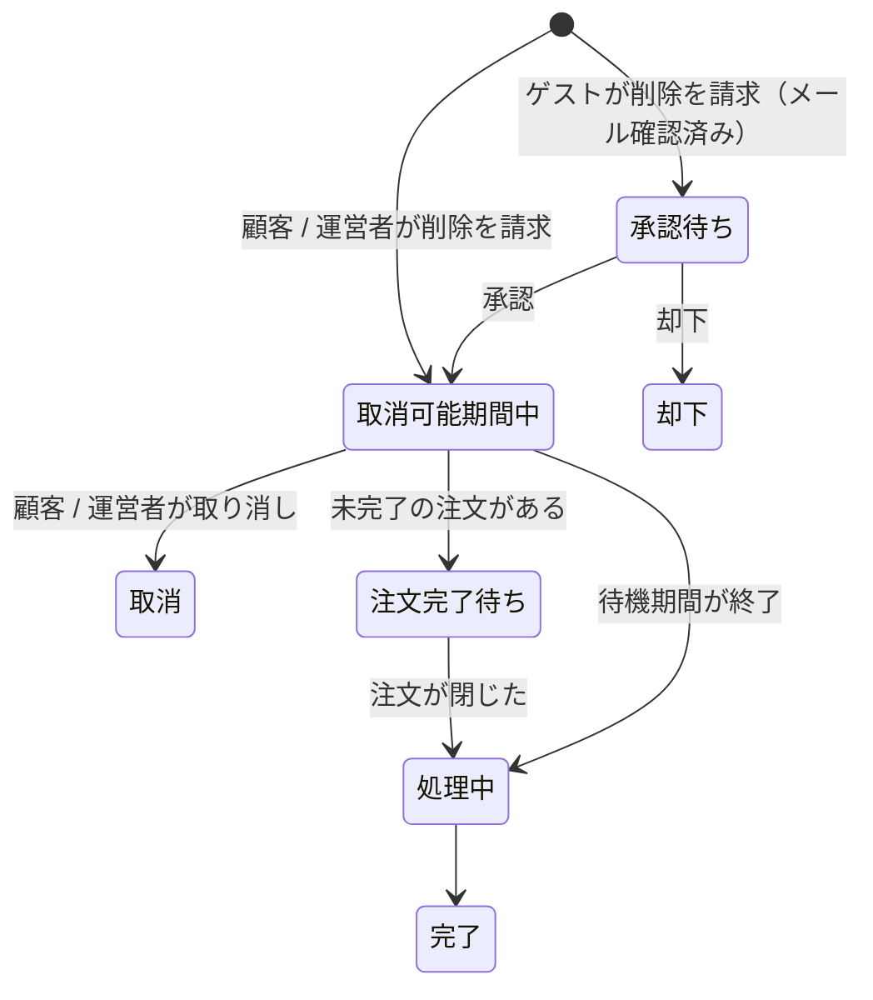
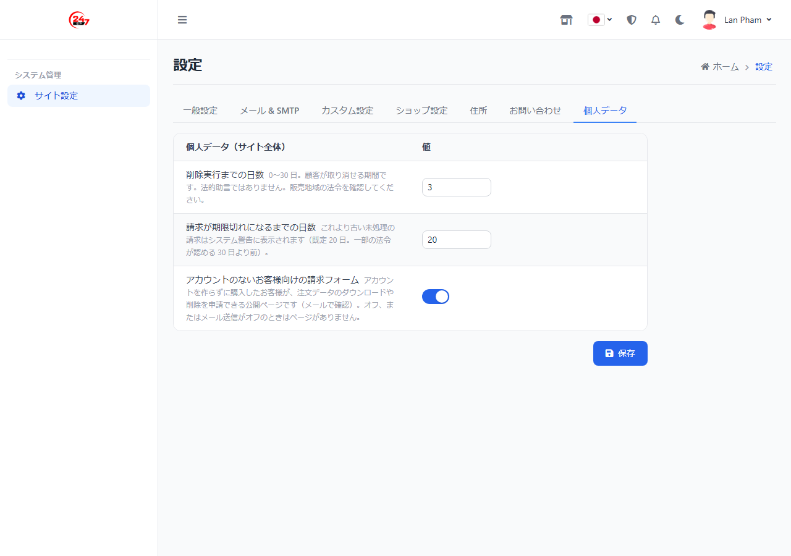
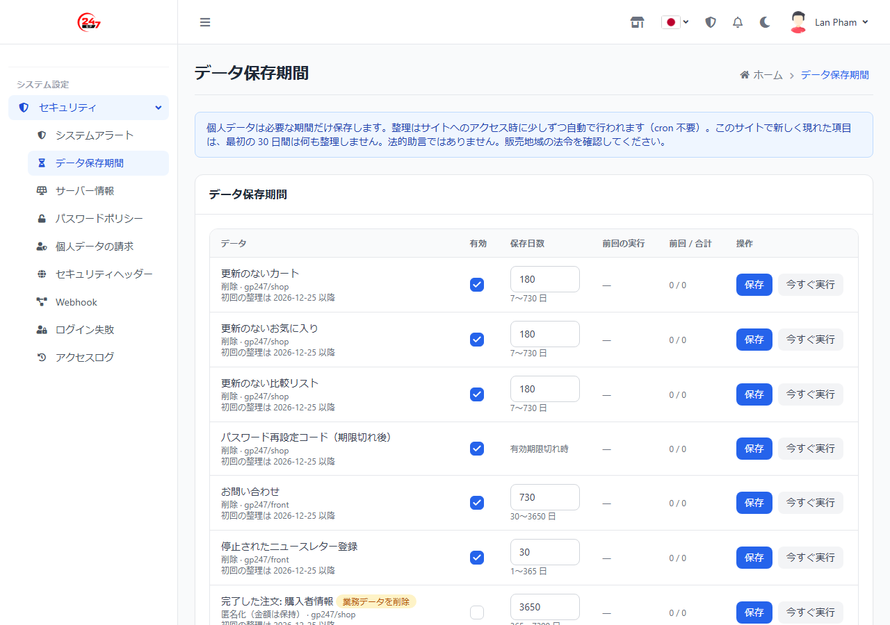

> 🌐 **言語:** [🇻🇳 Tiếng Việt](./personal-data_vi.md) · [🇬🇧 English](./personal-data.md) · 🇯🇵 日本語（現在）

# S-Cart の顧客の個人データ — ダウンロード、削除、保存期間

## はじめに

このガイドはショップ運営者向けです。顧客には、ショップが保有する自分の個人データを**確認・ダウンロード・削除**する
権利があります。多くの国（ベトナム、日本、EU など）の個人データ保護法は、期限内の対応と、必要以上に長くデータを持たない
ことをショップに求めています。S-Cart は最初からこれに対応しています。顧客はアカウントでデータをダウンロード・削除でき、
アカウントのないお客様は専用ページから請求でき、運営者はすべての請求をひとつの画面で処理し、古いデータは cron なしで
**データ保存期間**に従って整理されます。読み終えると、顧客に何が見えるか、運営者が何をするか、期間をどう決めるかが分かり、
ショップのプライバシーポリシーに使える「S-Cart が保存するデータ」の一覧も手に入ります。

> ⚠️ **法的助言ではありません。** 請求への回答期限や帳簿の保存期間などは国によって異なり、改正もあります。販売地域の
> 現行の法令を確認し、S-Cart の数値をそれに合わせてください。

---

## 概要

| 作業 | 誰が | どこで |
|---|---|---|
| データのコピーをダウンロード（ZIP ファイル） | アカウントを持つ顧客 | マイページ → **私のデータ**（Web またはアプリ） |
| アカウントの削除 | アカウントを持つ顧客 | マイページ → **私のデータ** → **アカウントの削除** |
| アカウントなしでコピー / 削除を請求 | アカウントのないお客様 | **あなたの個人データ**ページ（`/privacy-request`） |
| すべての請求の確認・処理、顧客の代わりに作成 | 運営者（Administrator または権限を付与されたロール） | **セキュリティ → 個人データの請求** |
| 待機日数、期限切れの日数、ゲスト用フォームの設定 | Administrator | **サイト設定 → 個人データ** |
| データの種類ごとの保存期間 | Administrator | **セキュリティ → データ保存期間** |

---

## 1. 顧客がマイページで行うこと

顧客はログインして **私のデータ** を開きます。

- **データのダウンロード:** 顧客がパスワード（2 段階認証を使っていればそのコードも）を再入力 → S-Cart が閲覧用ページ、
  表計算ファイル、JSON を含む ZIP ファイルを準備します（アカウント、住所、注文、メッセージなど）。準備ができるまでページが
  自動で更新されます。ダウンロードは 24 時間有効で、パッケージは 24 時間に 1 回作成できます。
- **アカウントの削除:** 顧客がパスワードを再入力 → 気が変わってもよいように、削除は**設定した日数**（既定 3 日）待機します。
  その間マイページに **削除を取り消す** ボタン付きのお知らせが表示され、顧客へのメールにも取り消しボタンがあります（ログイン不要）。
- **完了していない注文**（完了 / キャンセル / 失敗 / 返金以外）があると、削除は注文が閉じるまで**保留**されます — 進行中の
  注文の配送情報が失われることはありません。
- API v2 を使うモバイルアプリでも、同じルールで両方を行えます。

> **アカウント削除**と**未使用アカウント**のお知らせメールは、**確認済み**のアドレスにだけ送られます。ショップを使って他人の
> アドレスにメールを送らせることはできません。

## 2. アカウントのないお客様

アカウントを作らずに注文したお客様は **あなたの個人データ** ページ（`https://<ドメイン>/privacy-request`）を使います。
プライバシーポリシーのページやフッターからリンクしてください。

1. 注文に使ったメールアドレスを入力し、**データのコピーを受け取る** か **データを削除する** を選びます。ページの回答は
   常に同じで、どのメールアドレスがショップにあるかは分かりません。
2. S-Cart がそのアドレスに確認ボタン付きのメールを送ります。押すまで何も起こりません。
3. **コピー:** 確認後、ダウンロードボタンのあるページからパッケージを受け取ります。**削除:** 請求は**運営者の承認**（または
   理由を付けた却下）を待ちます — ゲストのメールによる削除は元に戻せないためです。

このページは、ショップが**メールを送信する設定**で、フォームが有効（4 章）のときだけ存在します。注文のないメールアドレスでも
回答は同じですが、送るものはありません。アカウントのあるメールアドレスには、**ログイン**して **私のデータ** を使うよう案内する
メールが届きます。**24 時間**以内に確認されない請求は自動で取り消されます。

## 3. 運営者が請求を処理する — セキュリティ → 個人データの請求

- すべての請求（Web、アプリ、ゲスト用フォーム、運営者が作成、長期間未使用のアカウント）がひとつの一覧にあり、状態や
  **期限切れのみ**で絞り込めます。**期限** = 受付日 + 設定日数（既定 20 日）。期限切れは赤字になり、**システムアラート**でも通知されます。
- **顧客の削除請求を作成**（電話、手紙などで依頼された場合）: メール / 顧客 ID で検索 → **削除** か **エクスポート** を選択 →
  パスワードで確認。エクスポートのパッケージは画面のボタンからダウンロードし（24 時間以内に最大 3 回）、選んだ方法で顧客に渡します。
- 行をクリックすると詳細が開きます: 削除 / 匿名化されるデータ、処理履歴、**今すぐ削除** / **請求を取り消す** /
  **削除を承認** / **却下** ボタン。

| 状態 | 意味 |
|---|---|
| メール確認待ち | ゲストがメールのリンクをまだ押していない |
| 承認待ち | ゲストの削除請求 — 承認または却下する |
| 取消可能期間中 | 削除前に設定日数待機中。顧客 / 運営者が取り消せる |
| 注文完了待ち | 顧客に未完了の注文がある — 注文が閉じると自動で再実行 |
| 処理中 → 完了 | 削除 / パッケージ作成中、その後完了 |
| 取消 / 却下 / 失敗 | 終了。**失敗** には **再実行** ボタンとシステムアラートがある |

**この画面を使える人:** 既定では **Administrator** のみ。スタッフに任せる場合は、そのロールに **Personal data requests**
権限を付与します。「すべての画面を閲覧」（View.all）ではこの画面は開けません — 顧客の個人データを扱うためです。

**顧客を削除するとデータはどうなるか:**

| データ | 顧客の削除時 |
|---|---|
| アカウント、住所録、カート / お気に入り / 比較リスト、Web とアプリのセッション、パスワード再設定コード、カスタム項目 | **削除** |
| 注文、注文履歴、取引、支払いリクエスト、配送 | **帳簿のために保持**。氏名・連絡先・住所・メモは削除（氏名は `[deleted]`）。金額、日付、注文番号、明細はそのまま |
| お問い合わせのメッセージ、ニュースレター登録（アカウントのメールで） | **削除** |
| ログイン失敗の記録 | 独自の期間まで保持（セキュリティ記録） |

顧客を削除しても、売上レポートや会計の数値は**変わりません**。

## 4. 設定 — サイト設定 → 個人データ

| 設定 | 既定値 | ヒント |
|---|---|---|
| 削除実行までの日数 | 3（0〜30） | 0 = 顧客が確認したらすぐに削除 |
| 請求が期限切れになるまでの日数 | 20 | 販売地域の法定期限より短く設定 |
| アカウントのないお客様向けの請求フォーム | オン | アカウントを持つ顧客だけに販売する場合はオフ |

これらは **Administrator** だけが変更できます — サイト全体（すべてのストア）に適用されます。

## 5. データ保存期間 — セキュリティ → データ保存期間

S-Cart は個人データを永久には保持しません。種類ごとに**保存日数**があり、過ぎたものは自動で整理されます。

| データ | 既定値 | 期間を過ぎると |
|---|---|---|
| 更新のないカート / お気に入り / 比較リスト | 180 日 | 削除 |
| パスワード再設定コード | 期限切れ後 | 削除 |
| お問い合わせのメッセージ | 730 日 | 削除 |
| 停止されたニュースレター登録 | 30 日 | 削除 |
| 管理操作ログ | 365 日 | 古い行を削除（行の内容は変更しない） |
| 完了した注文: 購入者情報 | **無効**（有効時は 10 年） | 顧客の削除と同様に匿名化。金額は保持 |
| 使われていない顧客アカウント | **無効**（有効時は 3 年） | 30 日前に通知し、顧客自身の削除と同様に削除 |
| 個人データの請求と処理履歴 | 5 年（固定） | 削除 — 対応した証拠として保持 |

- **最初の 30 日間は何も整理しません:** サイトに新しく現れた項目（この機能を含むバージョンに更新したばかりのサイトも）と、
  有効にしたばかりの項目は、最初の整理まで 30 日待ちます。**システムアラート**が 7 日前に件数とともに知らせます。早く整理したい
  場合は **今すぐ実行** → 確認 → パスワードを再入力。
- **2 つの項目は既定で無効**です（業務データを消すため）。有効にすると対象件数が表示され、パスワードを再確認し、バックアップが
  有効なら先にそのデータのバックアップを保存します。帳簿の保存期間は法律で決まります — 期間を決める前に確認してください。
- **使われていないアカウント**は、最後のログイン（Web またはアプリ）や注文から数え、**項目を有効にした日より前にはさかのぼり
  ません** — 以前 S-Cart がログインを記録していなかったという理由だけで古いアカウントが「未使用」と判断されることはありません。
  顧客にはメール（確認済みアドレス）が届き、ログインするか **アカウントを残す** を押せば残ります。未完了の注文があるアカウントは
  削除されません。

**動作の仕組み（cron 不要）:** 管理画面が使われるたびに S-Cart が少しずつ整理します（最大で 1 分に 1 種類）。**PHP-FPM** または
**LiteSpeed** のホスティングでは、ストアフロントへのアクセス後にも、ページを訪問者に返した後で実行されます。どちらもない
ホスティングでは管理画面が使われたときだけ実行されるため、管理画面をあまり使わないサイトでは整理がゆっくりになります。

> 💡 **cron（またはスケジュール実行のプラグイン）があるサイト**で定期的に整理したい場合は、コマンド
> `php artisan gp247:personal-data-retention` を追加します（例: 1 日 1 回）。何も変更せずに確認するには
> `php artisan gp247:personal-data-retention --dry-run`。

## 6. バックアップと復元

古いバックアップには、その後に削除した顧客のデータが残っていることがあります。**復元**すると、S-Cart はバックアップの日付より
後に削除した顧客を**再度削除**します（削除台帳は顧客 ID とメールのハッシュだけを保持し、削除したデータは保持しません）。
レコード単位の復元でも、削除済み顧客のレコードは戻りません。[バックアップと復元](../../backup/backup-and-restore_ja.md) も参照してください。

## 7. S-Cart が保存する顧客のデータ（プライバシーポリシー用）

ショップのプライバシーポリシーの「収集する情報」を書くときに使ってください。プラグインがほかのデータを保存する場合があります —
**個人データの請求** 画面の **未申告の顧客データ**（**データベースを確認** ボタン）を確認してください。

| 区分 | データ | 目的 | 保存期間 |
|---|---|---|---|
| アカウント | 氏名、メール、電話、生年月日、性別、会社、住所、最終ログイン | ログイン、配送、連絡 | 顧客が削除するまで（有効にした場合は「未使用アカウント」の項目） |
| 住所録 | 氏名、電話、住所 | 配送の簡略化 | アカウントと同じ |
| 注文 | 氏名、メール、電話、配送先、メモ、IP、ブラウザ。注文履歴、取引、配送 | 販売、会計、不正防止 | 法律の定める期間。顧客の削除時に匿名化（金額は保持） |
| カート / お気に入り / 比較 | 選んだ商品 | 買い物 | 更新なしで 180 日 |
| セッション | Web とアプリのセッション（IP、端末） | ログイン状態の維持 | ログアウト / 期限切れまで。顧客の削除時に削除 |
| パスワード再設定コード | メール、コード | パスワードの再設定 | 期限切れまで |
| お問い合わせ / ニュースレター | 氏名、メール、電話、内容 | 回答、配信 | 730 日 / 停止後 30 日 |
| セキュリティログ | ログイン失敗時に入力されたメール、管理者の操作 | システムの安全 | それぞれの期間。管理操作ログは 365 日 |
| 個人データの請求 | 顧客 ID、メールのハッシュ、処理履歴 | 対応の証明 | 5 年 |

---

## 条件と制約（操作の前に確認）

**削除するとき**
- **削除は元に戻せません。** 待機期間が考え直せる唯一の時間です。その後はバックアップからの復元しかなく、復元しても
  その顧客は再度削除されます。
- **未完了の注文がある顧客:** 待機中の請求で **今すぐ削除** を押すと **注文完了待ち** になります。今すぐ削除を選んで新しく請求を
  作成すると拒否され、画面に未完了の注文が表示されます。
- **メールで見つけたデータは、アカウントのメールが確認済みの場合だけ顧客本人の請求に含まれます** — 同じメールを使う他人の
  データを誤って削除しないためです。

**メール送信 / ゲスト用フォーム**
- **メール送信がオフの場合、`/privacy-request` ページは存在せず**、顧客にお知らせも届きません — **サイト設定 → メール & SMTP**
  で送信をオンにしてください。
- **ゲスト用フォームからのメールはサイト全体で 1 時間に最大 30 通** — 大量送信に悪用されないためです。

**データ保存期間を有効にするとき**
- **PHP-FPM / LiteSpeed も cron もないホスティング:** 整理は管理画面が使われたときだけ実行されます。
- **既定で無効の項目は業務データを削除します** — 先にバックアップを有効にしてください。バックアップが無効のまま有効にすると、
  システムアラートが知らせます。

---

## よくある質問（Q&A）

**Q1: 顧客から電話でデータ削除を依頼されました。どうすればよいですか？**

→ **セキュリティ → 個人データの請求** → **顧客の削除請求を作成** → メールで検索 → 経路「電話」 → パスワードで確認。請求は
設定日数待ってから自動で実行されます。すぐに実行するには **今すぐ削除** を押します。

**Q2: 顧客を削除すると売上レポートが変わりますか？**

→ 変わりません。注文は金額、日付、明細とともに残り、購入者の情報だけが削除されます。

**Q3: 請求が「注文完了待ち」のままです。**

→ 顧客に、完了 / キャンセル / 失敗 / 返金になっていない注文があります。その注文を閉じると、次の確認で請求が実行されます。

**Q4: カートを 180 日より長く残したい。**

→ **セキュリティ → データ保存期間** → **更新のないカート** の日数を変更（7〜730）→ **保存**。整理しない場合は **有効** の
チェックを外します。

**Q5: 更新した直後なのに、古い管理操作ログが整理されないのはなぜですか？**

→ 新しい項目は最初の整理まで 30 日待ちます。その間に内容を確認して期間を変更できます。7 日前にシステムアラートで通知されます。

**Q6: ゲストから削除を求められましたが、法律で請求書を保存する必要があります。**

→ 削除で行われるのは注文の匿名化だけです（金額、注文番号、日付は残る）— 帳簿は残ります。それでも断る必要がある場合は
**却下** を押して理由を書きます。お客様には理由付きのメールが届きます。

**Q7: インストールしたプラグインが顧客データを持っています。一緒に削除されますか？**

→ プラグインが宣言していれば削除されます。宣言のないテーブルは **未申告の顧客データ** に表示されます — プラグインの作者に
宣言を依頼するか、請求があったときにその部分を手作業で対応してください。

## 変更履歴
<!-- ロジック・動作に変更があった場合のみ記録します。最新の行を一番上に。1 日 1 行：同じ日の変更は既存の行にまとめ、新しい行を追加しません。 -->

| 日付 | バージョン | 変更内容 |
| --- | --- | --- |
| 2026-11-25 | S-Cart（core 3.19、shop、front） | 新規ページ: 顧客によるデータのダウンロード / 削除、アカウントのないお客様の請求、請求画面、データ保存期間 |

---

📅 **最終更新:** 2026-11-25 · ✍️ **作成者 (Author):** GP247
