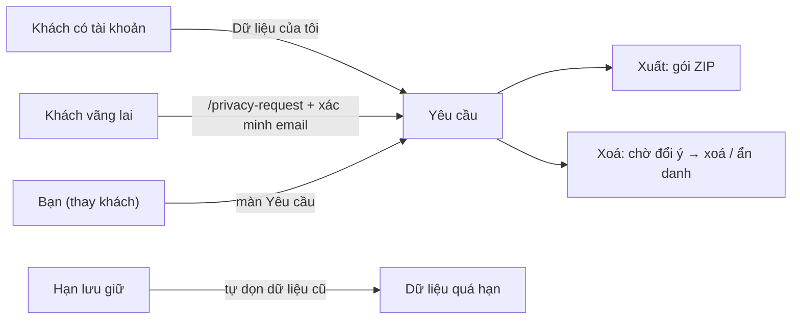
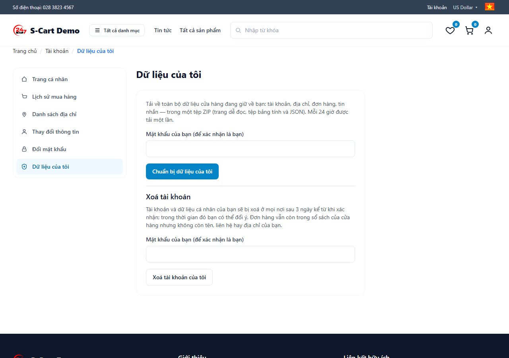
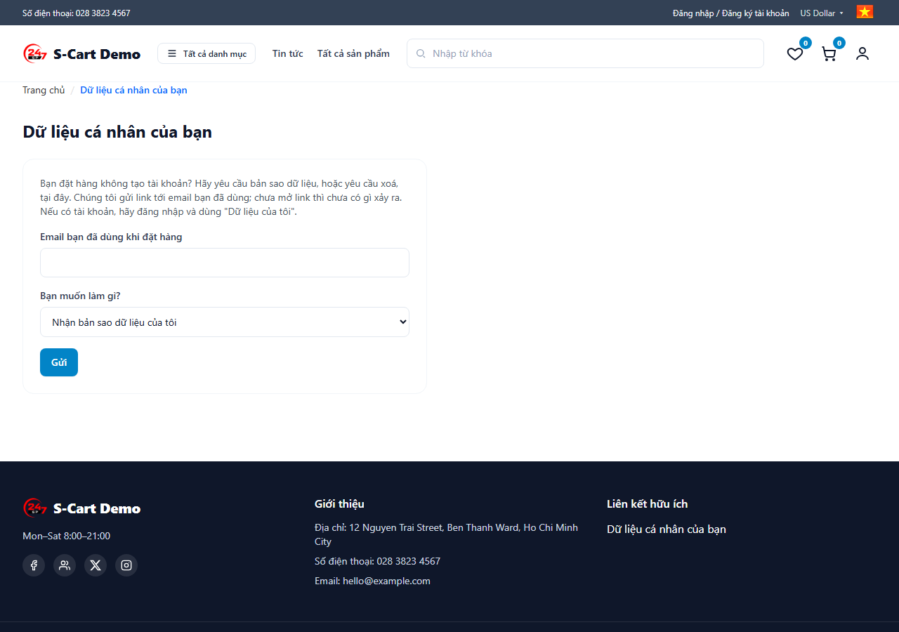
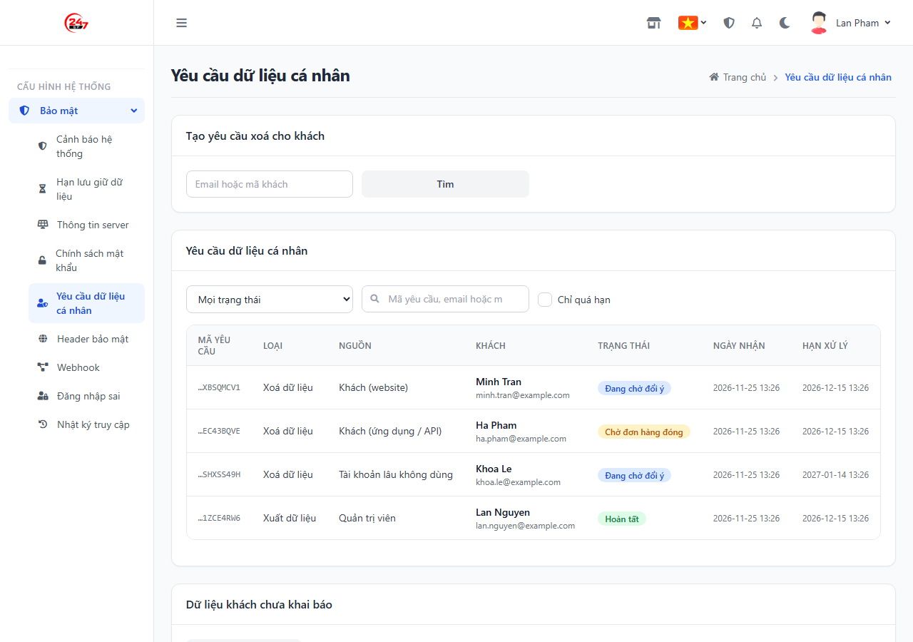
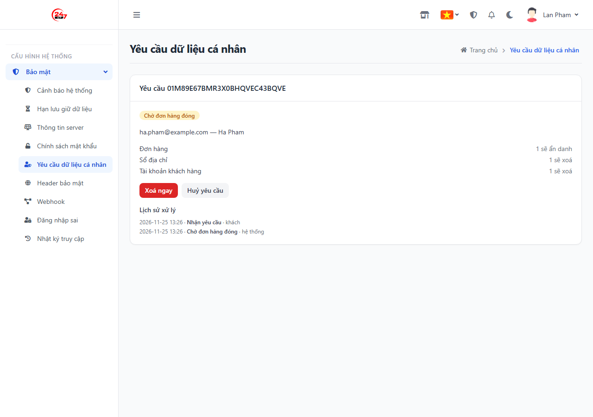
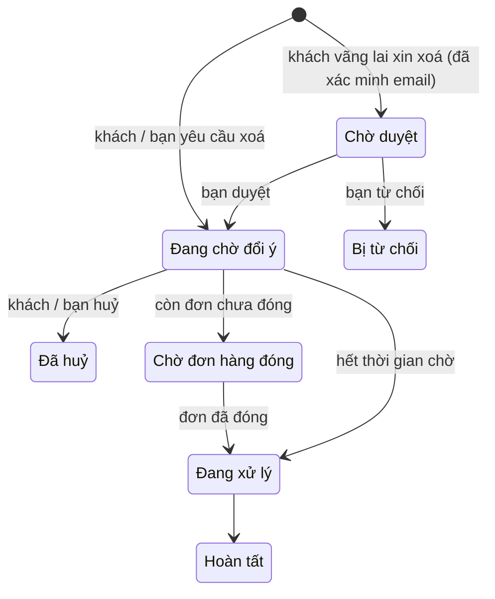
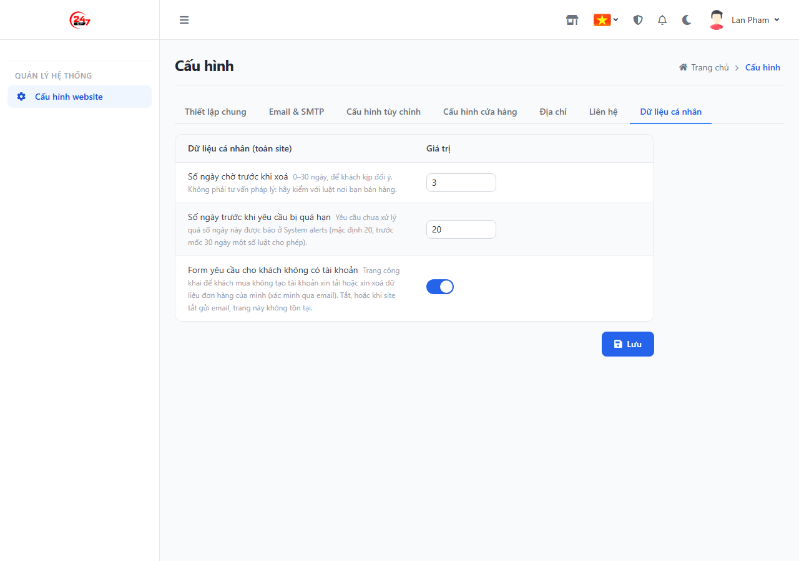
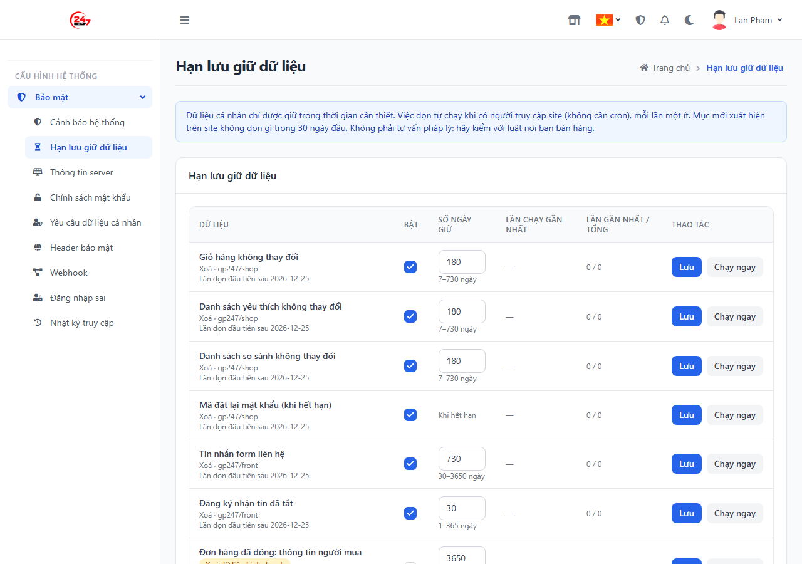

> 🌐 **Ngôn ngữ:** 🇻🇳 Tiếng Việt (hiện tại) · [🇬🇧 English](./personal-data.md) · [🇯🇵 日本語](./personal-data_ja.md)

# Dữ liệu cá nhân của khách trong S-Cart — tải về, xoá, hạn lưu giữ

## Giới thiệu

Tài liệu này dành cho người quản lý cửa hàng. Khách hàng có quyền **xem, tải về và xoá** dữ liệu cá nhân mà cửa hàng giữ về
họ; luật bảo vệ dữ liệu ở nhiều nước (Việt Nam, Nhật Bản, EU…) yêu cầu cửa hàng đáp ứng trong một thời hạn và không giữ dữ
liệu lâu hơn cần thiết. S-Cart làm sẵn các việc đó: khách tự tải / tự xoá trong khu tài khoản, khách không có tài khoản gửi
yêu cầu qua một trang riêng, bạn xử lý mọi yêu cầu trên một màn, và dữ liệu cũ được dọn theo **hạn lưu giữ** mà không cần
cron. Đọc xong, bạn biết khách thấy gì, bạn cần làm gì, nên đặt các thời hạn ra sao, và có sẵn danh sách dữ liệu S-Cart lưu
để đưa vào chính sách bảo mật của cửa hàng.

> ⚠️ **Không phải tư vấn pháp lý.** Thời hạn trả lời yêu cầu, thời gian phải giữ chứng từ… khác nhau theo nước và thay đổi
> theo thời gian — hãy kiểm với văn bản hiện hành nơi bạn bán hàng rồi đặt các con số trong S-Cart cho khớp.

---

## Nhìn nhanh

| Việc | Ai làm | Ở đâu |
|---|---|---|
| Tải bản sao dữ liệu (tệp ZIP) | Khách có tài khoản | Khu tài khoản → **Dữ liệu của tôi** (website hoặc ứng dụng) |
| Xoá tài khoản | Khách có tài khoản | Khu tài khoản → **Dữ liệu của tôi** → **Xoá tài khoản** |
| Xin bản sao / xin xoá khi không có tài khoản | Khách vãng lai | Trang **Dữ liệu cá nhân của bạn** (`/privacy-request`) |
| Xem, xử lý mọi yêu cầu; tạo yêu cầu thay khách | Bạn (Administrator hoặc người được giao quyền) | **Bảo mật → Yêu cầu dữ liệu cá nhân** |
| Đặt số ngày chờ, ngưỡng quá hạn, bật form vãng lai | Administrator | **Cấu hình website → Dữ liệu cá nhân** |
| Đặt dữ liệu nào giữ bao lâu | Administrator | **Bảo mật → Hạn lưu giữ dữ liệu** |

---

## 1. Khách tự làm trong khu tài khoản

Khách đăng nhập, vào **Dữ liệu của tôi**:

- **Tải dữ liệu:** khách nhập lại mật khẩu (và mã xác thực hai bước nếu đang dùng) → S-Cart chuẩn bị một tệp ZIP gồm trang dễ
  đọc, tệp bảng tính và JSON: tài khoản, địa chỉ, đơn hàng, tin nhắn… Trang tự cập nhật tới khi gói sẵn sàng; gói tải được trong
  24 giờ, mỗi 24 giờ tạo được một gói.
- **Xoá tài khoản:** khách nhập lại mật khẩu → yêu cầu xoá **chờ số ngày bạn đặt** (mặc định 3) để khách kịp đổi ý. Trong thời
  gian đó khu tài khoản hiện thông báo kèm nút **Huỷ việc xoá**; email gửi khách cũng có nút huỷ (không cần đăng nhập).
- Đơn hàng **chưa đóng** (chưa hoàn tất / huỷ / thất bại / hoàn tiền) thì việc xoá **tạm hoãn** tới khi đơn đóng — bạn không mất
  thông tin giao hàng của đơn đang chạy.
- Ứng dụng di động dùng API v2 làm được hai việc này với cùng quy tắc.

> Email báo **xoá tài khoản** và báo **tài khoản lâu không dùng** chỉ gửi tới địa chỉ **đã xác minh**: người khác không lợi dụng được
> cửa hàng để gửi thư tới một địa chỉ không phải của họ.

## 2. Khách không có tài khoản

Khách đặt hàng không tạo tài khoản dùng trang **Dữ liệu cá nhân của bạn** (`https://<tên-miền>/privacy-request`). Đặt liên kết
tới trang này trong trang chính sách bảo mật hoặc chân trang của bạn.

1. Khách nhập email đã dùng khi đặt hàng và chọn **Nhận bản sao dữ liệu của tôi** hoặc **Xoá dữ liệu của tôi**. Trang luôn trả lời giống nhau — không lộ email
   nào có trong cửa hàng.
2. S-Cart gửi email có nút xác nhận tới địa chỉ đó; chưa bấm thì chưa có gì xảy ra.
3. **Nhận bản sao:** sau khi xác nhận, khách tải gói qua trang có nút tải. **Xoá:** yêu cầu chờ **bạn duyệt** (hoặc từ chối có
   lý do) — vì xoá theo email của khách vãng lai không hoàn tác được.

Trang chỉ có khi cửa hàng **đã bật gửi email** và form đang bật (mục 4). Email chưa từng đặt hàng: khách vẫn nhận câu trả lời
như mọi người, nhưng không có gì để gửi. Email thuộc một tài khoản: khách nhận email mời **đăng nhập** và dùng **Dữ liệu của tôi**.
Yêu cầu không được xác nhận trong **24 giờ** tự huỷ.

## 3. Bạn xử lý yêu cầu — Bảo mật → Yêu cầu dữ liệu cá nhân

- Mọi yêu cầu (website, ứng dụng, form vãng lai, bạn tạo thay khách, tài khoản lâu không dùng) nằm trong một danh sách, lọc theo
  trạng thái hoặc **chỉ quá hạn**. **Hạn xử lý** = ngày nhận + số ngày bạn đặt (mặc định 20); quá hạn hiện chữ đỏ và có cảnh báo
  ở **Cảnh báo hệ thống**.
- **Tạo yêu cầu xoá cho khách** (khách gọi điện, gửi thư): tìm theo email / mã khách → chọn **Xoá dữ liệu** hoặc **Xuất dữ liệu** →
  xác nhận mật khẩu. Gói xuất bạn tải bằng nút trên màn (tối đa 3 lần, trong 24 giờ), rồi gửi cho khách theo kênh bạn chọn.
- Bấm một dòng để xem chi tiết: dữ liệu nào sẽ bị xoá / ẩn danh, lịch sử xử lý, nút **Xoá ngay** / **Huỷ yêu cầu** / **Duyệt xoá** /
  **Từ chối**.

| Trạng thái | Ý nghĩa |
|---|---|
| Chờ xác minh email | Khách vãng lai chưa bấm link trong email |
| Chờ duyệt | Yêu cầu xoá của khách vãng lai — bạn duyệt hoặc từ chối |
| Đang chờ đổi ý | Chờ hết số ngày đặt trước khi xoá; khách / bạn huỷ được |
| Chờ đơn hàng đóng | Khách còn đơn chưa đóng — tự chạy lại khi đơn đóng |
| Đang xử lý → Hoàn tất | Đang xoá / dựng gói, rồi xong |
| Đã huỷ / Bị từ chối / Lỗi | Kết thúc; **Lỗi** có nút **Chạy lại** và cảnh báo hệ thống |

**Ai dùng được màn này:** mặc định chỉ **Administrator**. Muốn giao cho nhân viên: gán quyền **Personal data requests** cho vai trò
của họ. Quyền "xem mọi màn" (View.all) **không** mở màn này — đây là dữ liệu cá nhân của khách.

**Xoá khách làm gì với dữ liệu:**

| Dữ liệu | Khi xoá khách |
|---|---|
| Tài khoản, sổ địa chỉ, giỏ / yêu thích / so sánh, phiên đăng nhập web và ứng dụng, mã đặt lại mật khẩu, trường tuỳ chỉnh | **Xoá** |
| Đơn hàng, lịch sử đơn, giao dịch, yêu cầu thanh toán, vận đơn | **Giữ cho sổ sách**, bỏ tên, liên hệ, địa chỉ, ghi chú (tên thành `[deleted]`); số tiền, ngày, mã đơn, dòng hàng giữ nguyên |
| Tin nhắn form liên hệ, đăng ký nhận tin (theo email tài khoản) | **Xoá** |
| Nhật ký đăng nhập sai | Giữ tới hạn riêng (bản ghi bảo mật) |

Báo cáo doanh thu và số liệu kế toán **không đổi** sau khi xoá khách.

## 4. Cài đặt — Cấu hình website → Dữ liệu cá nhân

| Thiết lập | Mặc định | Gợi ý |
|---|---|---|
| Số ngày chờ trước khi xoá | 3 (0–30) | 0 = xoá ngay khi khách xác nhận |
| Số ngày trước khi yêu cầu bị quá hạn | 20 | Đặt ngắn hơn thời hạn luật nơi bạn bán hàng |
| Form yêu cầu cho khách không có tài khoản | Bật | Tắt nếu cửa hàng chỉ bán cho khách có tài khoản |

Chỉ **Administrator** đổi được các thiết lập này — chúng áp cho cả site (mọi cửa hàng).

## 5. Hạn lưu giữ — Bảo mật → Hạn lưu giữ dữ liệu

S-Cart không giữ dữ liệu cá nhân mãi: mỗi loại có **số ngày giữ**, quá hạn thì tự dọn.

| Dữ liệu | Mặc định | Khi quá hạn |
|---|---|---|
| Giỏ hàng / yêu thích / so sánh không thay đổi | 180 ngày | Xoá |
| Mã đặt lại mật khẩu | Khi hết hạn | Xoá |
| Tin nhắn form liên hệ | 730 ngày | Xoá |
| Đăng ký nhận tin đã tắt | 30 ngày | Xoá |
| Nhật ký thao tác quản trị | 365 ngày | Xoá dòng cũ (không sửa nội dung dòng nào) |
| Đơn hàng đã đóng: thông tin người mua | **Tắt** (10 năm khi bật) | Ẩn danh như khi xoá khách; số tiền giữ nguyên |
| Tài khoản khách lâu không dùng | **Tắt** (3 năm khi bật) | Báo trước 30 ngày, rồi xoá như khách tự xoá |
| Yêu cầu dữ liệu cá nhân và lịch sử xử lý | 5 năm (cố định) | Xoá — giữ làm bằng chứng đã xử lý |

- **30 ngày đầu không dọn gì:** mục mới xuất hiện trên site (kể cả site vừa cập nhật lên bản có tính năng này) và mục bạn vừa bật
  chờ 30 ngày trước lần dọn đầu; **Cảnh báo hệ thống** báo trước 7 ngày số dòng sẽ dọn. Muốn dọn sớm: **Chạy ngay** → xác nhận → nhập lại mật khẩu.
- **Hai mục tắt mặc định** vì xoá dữ liệu kinh doanh. Bật chúng: màn hiện số bản ghi bị ảnh hưởng, hỏi lại mật khẩu và — nếu
  bạn bật sao lưu — chụp bản sao lưu nhóm dữ liệu đó trước. Thời gian giữ chứng từ kế toán do luật quy định: kiểm trước khi đặt.
- **Tài khoản lâu không dùng** tính từ lần cuối khách đăng nhập (website hoặc ứng dụng), đặt hàng, và **không sớm hơn ngày bạn bật
  mục** — tài khoản cũ không bị coi là "không dùng" chỉ vì trước đây S-Cart chưa ghi lần đăng nhập. Khách nhận email (địa chỉ đã
  xác minh), đăng nhập hoặc bấm **Giữ tài khoản của tôi** là giữ; tài khoản còn đơn chưa đóng không bị xoá.

**Chạy thế nào (không cần cron):** mỗi lần có người dùng trang quản trị, S-Cart dọn một ít (tối đa một loại mỗi phút). Trên hosting
chạy **PHP-FPM** hoặc **LiteSpeed**, việc này chạy cả sau lượt truy cập storefront, sau khi trang đã trả về cho khách. Hosting không
có hai loại đó: việc dọn chỉ chạy khi có người dùng trang quản trị — site ít người quản trị sẽ dọn chậm.

> 💡 **Site có cron** (hoặc plugin lịch chạy) muốn dọn đều đặn: thêm lệnh
> `php artisan gp247:personal-data-retention` (ví dụ mỗi ngày một lần). Xem trước, không đổi gì:
> `php artisan gp247:personal-data-retention --dry-run`.

## 6. Sao lưu và khôi phục

Bản sao lưu cũ có thể còn dữ liệu của khách đã xoá. Khi **khôi phục**, S-Cart tự **xoá lại** những khách đã xoá sau ngày của bản
sao lưu (sổ xoá chỉ giữ mã khách và dấu băm của email, không giữ dữ liệu đã xoá). Bản ghi của khách đã xoá cũng không được thêm lại
khi khôi phục từng bản ghi. Xem thêm [Sao lưu & phục hồi](../../backup/backup-and-restore_vi.md).

## 7. Dữ liệu S-Cart lưu về khách (cho chính sách bảo mật)

Danh sách dưới đây giúp bạn viết mục "chúng tôi thu thập gì" trong chính sách bảo mật của cửa hàng. Plugin có thể lưu thêm — xem
mục **Dữ liệu khách chưa khai báo** trên màn **Yêu cầu dữ liệu cá nhân** (nút **Kiểm tra cơ sở dữ liệu**).

| Nhóm | Dữ liệu | Mục đích | Giữ bao lâu |
|---|---|---|---|
| Tài khoản | Họ tên, email, điện thoại, ngày sinh, giới tính, công ty, địa chỉ, lần đăng nhập cuối | Đăng nhập, giao hàng, liên hệ | Tới khi khách xoá (hoặc mục "tài khoản lâu không dùng" nếu bạn bật) |
| Sổ địa chỉ | Họ tên, điện thoại, địa chỉ | Giao hàng nhanh | Như tài khoản |
| Đơn hàng | Họ tên, email, điện thoại, địa chỉ giao, ghi chú, IP, trình duyệt; lịch sử đơn, giao dịch, vận đơn | Bán hàng, sổ sách, chống gian lận | Theo luật chứng từ; ẩn danh khi khách xoá (số tiền giữ) |
| Giỏ / yêu thích / so sánh | Sản phẩm khách chọn | Mua sắm | 180 ngày không đổi |
| Phiên đăng nhập | Phiên website, phiên ứng dụng (IP, thiết bị) | Giữ khách đăng nhập | Tới khi đăng xuất / hết hạn; xoá khi xoá khách |
| Mã đặt lại mật khẩu | Email, mã | Lấy lại mật khẩu | Tới khi hết hạn |
| Liên hệ / nhận tin | Tên, email, điện thoại, nội dung | Trả lời khách, gửi tin | 730 ngày / 30 ngày sau khi tắt |
| Nhật ký bảo mật | Email gõ khi đăng nhập sai; thao tác của quản trị viên | An toàn hệ thống | Theo hạn riêng; nhật ký thao tác 365 ngày |
| Yêu cầu dữ liệu cá nhân | Mã khách, dấu băm email, lịch sử xử lý | Chứng minh đã xử lý | 5 năm |

---

## Điều kiện & ràng buộc (hiểu trước khi thao tác)

**Khi xoá**
- **Xoá không hoàn tác được.** Thời gian chờ là lúc duy nhất để đổi ý; sau đó chỉ khôi phục từ bản sao lưu — và khôi phục lại xoá
  lại khách đó.
- **Khách còn đơn chưa đóng:** yêu cầu đang chờ mà bạn bấm **Xoá ngay** thì chuyển sang **Chờ đơn hàng đóng**; tạo yêu cầu mới có
  chọn xoá ngay thì bị từ chối và màn liệt kê đơn đang mở.
- **Dữ liệu tìm theo email chỉ được gom khi email tài khoản đã xác minh** (khách tự yêu cầu) — tránh xoá nhầm dữ liệu của người
  khác dùng chung email.

**Khi gửi email / form vãng lai**
- **Cửa hàng chưa bật gửi email thì không có trang `/privacy-request`** và khách không nhận email báo trước — bật gửi email trong
  **Cấu hình website → Email & SMTP**.
- **Mỗi giờ tối đa 30 email** từ form vãng lai cho cả site — chống bị lợi dụng gửi thư hàng loạt.

**Khi bật hạn lưu giữ**
- **Hosting không có PHP-FPM / LiteSpeed và không có cron:** việc dọn chỉ chạy khi có người dùng trang quản trị.
- **Mục tắt mặc định xoá dữ liệu kinh doanh** — bật sao lưu trước; cảnh báo hệ thống nhắc nếu bạn bật mục đó khi sao lưu đang tắt.

---

## Hỏi & Đáp (Q&A)

**Câu 1: Khách gọi điện xin xoá dữ liệu, tôi làm gì?**

→ **Bảo mật → Yêu cầu dữ liệu cá nhân** → **Tạo yêu cầu xoá cho khách** → tìm theo email → chọn kênh "Điện thoại" → xác nhận
mật khẩu. Yêu cầu chờ số ngày đặt rồi tự chạy, hoặc bấm **Xoá ngay**.

**Câu 2: Xoá khách có làm sai báo cáo doanh thu không?**

→ Không. Đơn hàng được giữ với số tiền, ngày, dòng hàng; chỉ thông tin người mua bị bỏ.

**Câu 3: Yêu cầu nằm ở "Chờ đơn hàng đóng" mãi?**

→ Khách còn đơn chưa hoàn tất / huỷ / thất bại / hoàn tiền. Xử lý xong đơn đó, yêu cầu tự chạy ở lượt kiểm tra sau.

**Câu 4: Tôi muốn giữ giỏ hàng lâu hơn 180 ngày?**

→ **Bảo mật → Hạn lưu giữ dữ liệu** → đổi số ngày của dòng **Giỏ hàng không thay đổi** (7–730) → **Lưu**. Tắt hẳn: bỏ chọn **Bật**.

**Câu 5: Vì sao vừa cập nhật mà nhật ký thao tác cũ chưa bị dọn?**

→ Mục mới chờ 30 ngày trước lần dọn đầu, để bạn kịp xem và đổi số ngày. Cảnh báo hệ thống báo trước 7 ngày.

**Câu 6: Khách vãng lai xin xoá nhưng tôi phải giữ hoá đơn theo luật?**

→ Xoá chỉ ẩn danh đơn hàng (số tiền, mã đơn, ngày giữ nguyên) — chứng từ vẫn còn. Nếu vẫn cần từ chối, bấm **Từ chối** và ghi lý
do; khách nhận email có lý do đó.

**Câu 7: Plugin tôi cài có dữ liệu khách — có được xoá cùng không?**

→ Có, nếu plugin đã khai báo. Bảng chưa khai báo hiện ở **Dữ liệu khách chưa khai báo** — nhờ tác giả plugin khai báo, hoặc tự xử lý
phần đó khi có yêu cầu.

## Lịch sử thay đổi
<!-- Chỉ ghi khi có thay đổi về logic/hành vi. Dòng mới nhất ở trên cùng. Mỗi ngày một dòng: cùng ngày thì gộp vào dòng có sẵn, không tách dòng mới. -->

| Ngày | Phiên bản | Thay đổi |
| --- | --- | --- |
| 2026-11-25 | S-Cart 3.12.0 | Trang mới: khách tự tải / xoá dữ liệu, yêu cầu của khách vãng lai, màn xử lý yêu cầu, hạn lưu giữ |

---

📅 **Cập nhật lần cuối:** 2026-11-25 · ✍️ **Tác giả (Author):** GP247
