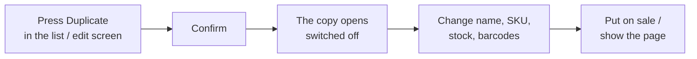
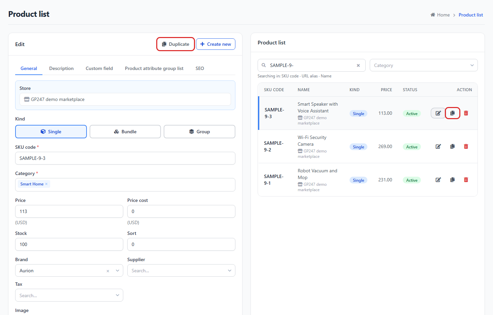
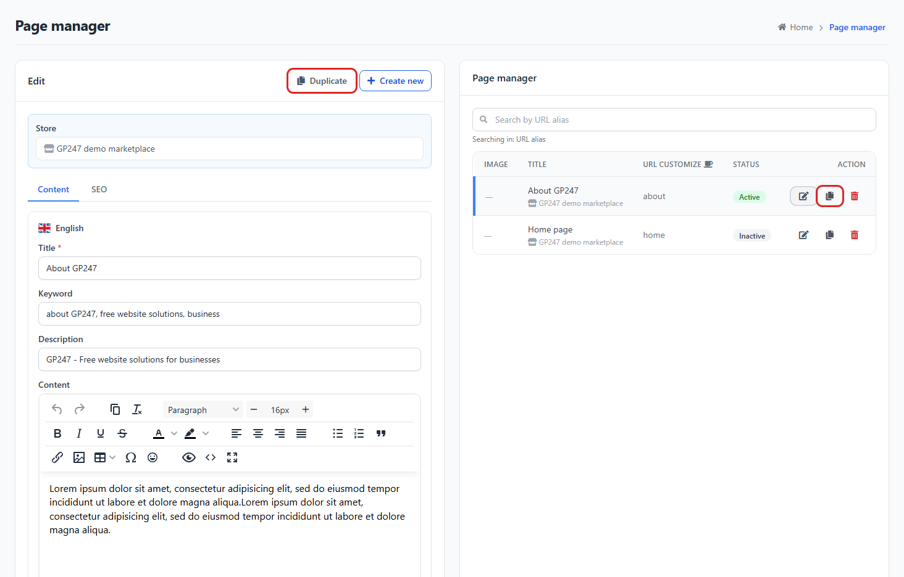

> 🌐 **Language:** [🇻🇳 Tiếng Việt](./product-duplicate_vi.md) · 🇬🇧 English (current) · [🇯🇵 日本語](./product-duplicate_ja.md)

# Duplicating products and pages

## Introduction
This page shows how to **duplicate** a product or a content page (about us, policies, how to order…) in the admin:
press one button to get a copy, then change only what differs instead of typing everything again. It is for store owners and
the staff who enter data. After reading it you will know what the copy carries over, what you must fill in again, and how to
put the copy on sale safely.

## At a glance

- **One button, one copy** — the **Duplicate** button is on every row of the list and at the top of the edit screen.
- **The copy is always switched off** — customers do not see it until you check it and turn it on.
- **A product copy carries almost everything** — except stock, units sold, views, reviews and barcodes.
- **No clash with the original** — the name gets "(copy)", the SKU and the URL get `-copy`.
- **The saved version is copied** — text you are still typing on the edit screen does not go into the copy.

> ℹ️ **Available since:** gp247/shop 3.13.0 (products); gp247/front 3.12.0 (content pages)

## On this page
- [Duplicating a product](#duplicating-a-product)
- [What a product copy carries over](#what-a-product-copy-carries-over) — copied, not copied, changed
- [Before you put the copy on sale](#before-you-put-the-copy-on-sale)
- [Duplicating a content page](#duplicating-a-content-page)
- [When a duplicate fails](#when-a-duplicate-fails)
- [Conditions & constraints](#conditions--constraints-read-before-you-start)

## Duplicating a product
1. Open **Product & category** → **Products**.
2. Press the **Duplicate** icon (two stacked sheets) on the row of the product to copy. Or open the product's edit screen and press
   the **Duplicate** button at the top of the form.
3. The confirmation asks "Create a copy (switched off, stock 0) from the saved version of this product?" — press **OK**.

If it works, the edit screen of the **copy** opens right away with the message "Copy created — it is switched off; check it, then
put it on sale." The original does not change.

## What a product copy carries over

| | Includes |
| --- | --- |
| **Copied** | Name, description and content in **every language**; price, cost, promotion price with its start / end dates; tax; attributes (colour, size…) and their surcharges; main and extra images; downloadable files; categories, brand, supplier, keyword tags, custom fields; product kind, weight, dimensions, minimum quantity, available date, sort order, approval status; the product's store |
| **Not copied** | Stock (the copy starts at 0); units sold, views; customer reviews; flash sales; UPC / EAN / JAN / ISBN / MPN barcodes; the **SEO** tab content (title, description, canonical, no-index setting, sharing image — the copy starts with an empty SEO tab); a plugin's own data (unless the plugin copies it) |
| **Changed** | Status: **off**; each language's name gets the label of that language: "(bản sao)", "(copy)", "(コピー)"; the SKU and the URL get `-copy`, then `-copy-2`, `-copy-3`… until nothing in the store clashes |

- **Images and downloadable files share the original's files** — no extra disk space. To change an image of the copy, upload a new
  one; do not edit the old file.
- **Bundles and groups** keep their links to **the same component products** as the original; the components are not duplicated.
- **The copy stays in the original's store** (sites with several stores).

## Before you put the copy on sale
The copy is switched off, so you can edit it freely. Before you turn **Status** on, check in this order:

1. **Name** — remove the "(copy)" label and set the right name for **each language**.
2. **SKU and URL** — change `…-copy` to the code and URL you want to keep.
3. **Stock** — enter the real quantity (the copy starts at 0).
4. **Barcodes** — enter the new item's codes, if you use them.
5. **Images, prices, attributes** — change whatever differs from the original.
6. **SEO tab** — it is empty on the copy, so the page uses the product's own name, description and image. Fill it in if you want a separate title / description for search engines. If the original was set to noindex, the copy does not carry it — set it again if needed.
7. Turn **Status** on and press **Save**.

## Duplicating a content page
1. Open **Content manager** → **Page manager**.
2. Press the **Duplicate** icon on the row of the page to copy, or the **Duplicate** button at the top of the page's edit screen.
3. The confirmation asks "Create a copy (switched off) from the saved version of this page?" — press **OK**.

If it works, the edit screen of the copy opens right away with the message "Copy created — it is switched off; check it, then turn it on."

| | Includes |
| --- | --- |
| **Copied** | Title, description and content in every language; the image (shared file); the page's store |
| **Not copied** | The **SEO** tab content (the copy starts with an empty SEO tab); the original's 301 redirects; custom field values |
| **Changed** | Status: **off**; each language's title gets that language's "(copy)" label; the URL gets `-copy`, `-copy-2`… |

Once the title, URL and content are changed, turn the page on and press **Save**.

## When a duplicate fails
When something goes wrong, **no copy is created** and the original stays as it was — there is no half-made copy to clean up.

| Message | Reason | What to do |
| --- | --- | --- |
| "Could not duplicate: the plugin … failed to copy its data…" (product) | A plugin copies its own data to the copy and hit an error | Try again; if it still fails, contact the provider of the plugin named in the message |
| A "no permission" message when you press **Duplicate** | Your account may not create products / pages | Ask an administrator for the right to create them |

## Conditions & constraints (read before you start)

**When duplicating**
- **You need the right to create products / pages** — duplicating is a way of creating, so it uses that same right.
- **An administrator of one store can only duplicate that store's products / pages** — so data of other stores cannot be read.
- **Each press creates exactly one copy** — for three copies, press three times.
- **The saved version is copied, not text being typed** — save your changes first if you want them in the copy.
- **All or nothing** — an error at any step cancels the whole duplicate, so there is never a copy with half its data.

**About the copy**
- **Always off, stock 0** — so customers cannot buy an item nobody has checked yet.
- **Barcodes are not copied** — each barcode identifies one item; two products with the same code break scanning and reconciliation.
- **SKU up to 50 characters, URL up to 100 characters** — a long original code is shortened at the end so the `-copy` suffix still fits.

## Q&A
**Q1: Does the copy show in the store right away?**

→ No. The copy is always switched off; you check it, edit it and turn **Status** on yourself.

**Q2: If I change the copy's image, does the original's image change too?**

→ No, if you upload a new image for the copy. The two products only share the old image **file**; replacing the image on the copy
does not touch the original. Both change only if you overwrite that very file in the file manager.

**Q3: Why does the copy have no stock and no reviews?**

→ Stock and reviews belong to the real item already sold; the copy is a new item that has no stock and no buyers yet.

**Q4: I am in the middle of editing a product. If I press Duplicate, do my unsaved edits go into the copy?**

→ No. The copy is made from the **saved version**. To include your edits, press **Save** first, then **Duplicate**.

**Q5: Does duplicating a bundle duplicate the products inside it?**

→ No. The new bundle points to the same component products as the original bundle.

**Q6: What happens to the SKU when I duplicate a product several times?**

→ The first copy gets `-copy`, the next ones `-copy-2`, `-copy-3`… so nothing clashes. Change the SKU to the real code before
putting the copy on sale.

**Q7: Does duplicating create duplicate content for search engines?**

→ The copy is switched off, so search engines do not see it yet, and its SEO tab starts empty — it does not carry the original's SEO
title or description. Before you turn it on, change the name and description so the two pages differ.

**Q8: If a duplicate fails, is a half-made copy left in the list?**

→ No. An error at any step cancels the whole duplicate; no new row appears in the list.

---

📅 **Last updated:** 2026-11-23 · ✍️ **Author:** GP247
