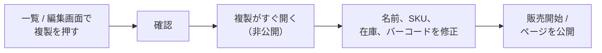
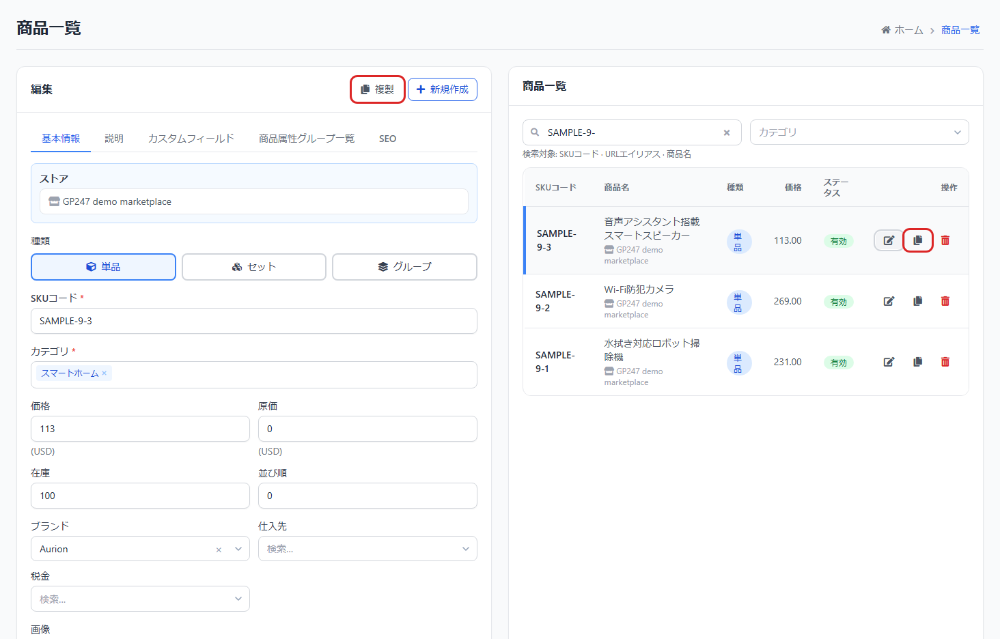
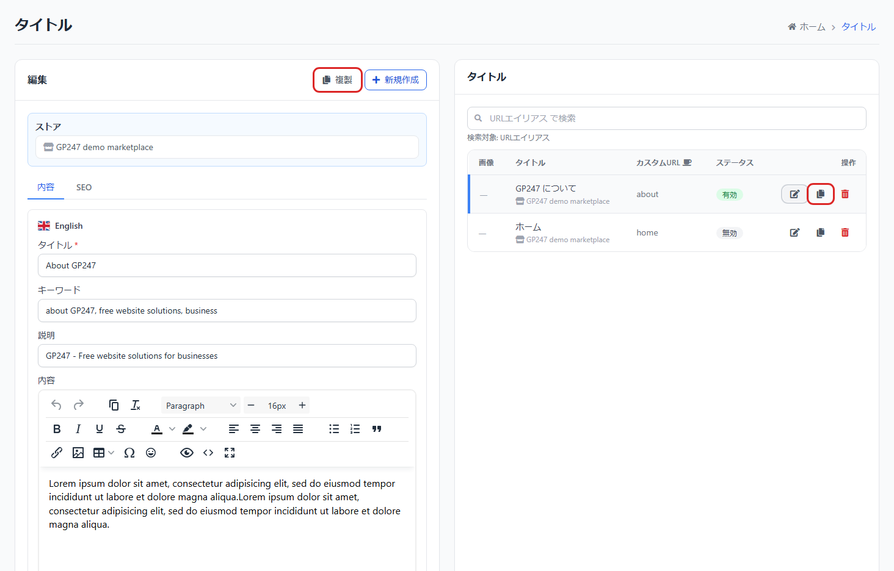

> 🌐 **言語:** [🇻🇳 Tiếng Việt](./product-duplicate_vi.md) · [🇬🇧 English](./product-duplicate.md) · 🇯🇵 日本語（現在）

# 商品とページの複製

## はじめに
このページでは、管理画面で商品やコンテンツページ（会社概要、各種ポリシー、ご利用ガイドなど）を**複製**する方法を説明します。
ボタン 1 つで複製を作り、最初から入力し直す代わりに、違う部分だけを直します。ストアのオーナーとデータ入力担当者向けです。
読み終えると、複製に何が引き継がれるか、何を入力し直す必要があるか、複製を安全に販売開始する方法がわかります。

## ひと目でわかる

- **ボタン 1 つで複製 1 件** — **複製** ボタンは一覧の各行と、編集画面の上部にあります。
- **複製は必ず非公開** — 確認して公開するまで、お客様には表示されません。
- **商品の複製はほぼすべてを引き継ぎます** — 在庫、販売数、閲覧数、レビュー、バーコードを除きます。
- **元の商品と重複しません** — 名前に「(コピー)」、SKU と URL に `-copy` が付きます。
- **保存済みの内容を複製します** — 編集画面で入力途中の内容は複製に含まれません。

> ℹ️ **対応バージョン:** gp247/shop 3.13.0（商品）、gp247/front 3.12.0（コンテンツページ）

## このページの内容
- [商品を複製する](#商品を複製する)
- [商品の複製に引き継がれるもの](#商品の複製に引き継がれるもの) — コピーされるもの、されないもの、変わるもの
- [販売を始める前に確認すること](#販売を始める前に確認すること)
- [コンテンツページを複製する](#コンテンツページを複製する)
- [複製できないとき](#複製できないとき)
- [条件と制約](#条件と制約操作の前に確認)

## 商品を複製する
1. **商品・カテゴリ** → **商品** を開きます。
2. 複製したい商品の行で **複製** アイコン（2 枚重なった紙）を押します。または、商品の編集画面を開き、フォーム上部の **複製** ボタンを押します。
3. 「この商品の保存済みの内容から複製を作成しますか？（非公開・在庫0）」と確認されたら **OK** を押します。

成功すると、**複製** の編集画面がすぐに開き、「複製を作成しました。非公開のため、確認してから販売を開始してください。」と表示されます。
元の商品は何も変わりません。

## 商品の複製に引き継がれるもの

| | 内容 |
| --- | --- |
| **コピーされる** | **すべての言語** の名前、説明、本文；価格、原価、開始日 / 終了日付きのセール価格；税；属性（色、サイズなど）とその追加料金；メイン画像と追加画像；ダウンロードファイル；カテゴリ、ブランド、仕入先、キーワードタグ、カスタムフィールド；商品の種類、重量、寸法、最小購入数量、販売開始日、表示順、承認状態；商品のストア |
| **コピーされない** | 在庫（複製は 0 から）；販売数、閲覧数；お客様のレビュー；フラッシュセール；UPC / EAN / JAN / ISBN / MPN のバーコード；**SEO** タブの内容（タイトル、説明、canonical、インデックス除外の設定、共有用画像 — 複製の SEO タブは空から始まります）；プラグイン独自のデータ（プラグインがコピーする場合を除く） |
| **変わる** | ステータス：**非公開**；各言語の名前にその言語のラベル「(bản sao)」「(copy)」「(コピー)」が付く；SKU と URL に `-copy`、続いて `-copy-2`、`-copy-3`… がストア内で重複しなくなるまで付く |

- **画像とダウンロードファイルは元の商品とファイルを共有します** — 容量は増えません。複製の画像を変えるときは新しい画像をアップロードし、古いファイルは編集しないでください。
- **セット商品とグループ商品** は、元と **同じ構成商品** へのリンクを保ちます。構成商品自体は複製されません。
- **複製は元の商品と同じストアに作られます**（複数ストアのサイト）。

## 販売を始める前に確認すること
複製は非公開なので、自由に編集できます。**ステータス** を有効にする前に、順に確認してください：

1. **名前** — 「(コピー)」を消し、**言語ごと** に正しい名前を付けます。
2. **SKU と URL** — `…-copy` を、今後使い続けるコードと URL に変えます。
3. **在庫** — 実際の数量を入力します（複製は 0 から始まります）。
4. **バーコード** — 使っている場合は、新しい商品のコードを入力します。
5. **画像、価格、属性** — 元の商品と違う部分を直します。
6. **SEO タブ** — 複製では空なので、ページは商品自身の名前、説明、画像を使います。検索エンジン向けに別のタイトル / 説明が必要なら、ここに入力します。元の商品にインデックス除外（noindex）を設定していた場合、複製には引き継がれないので、必要なら設定し直してください。
7. **ステータス** を有効にして **保存** を押します。

## コンテンツページを複製する
1. **コンテンツ管理** → **ページ管理** を開きます。
2. 複製したいページの行で **複製** アイコンを押すか、ページ編集画面上部の **複製** ボタンを押します。
3. 「このページの保存済みの内容から複製を作成しますか？（非公開）」と確認されたら **OK** を押します。

成功すると複製の編集画面がすぐに開き、「複製を作成しました。非公開のため、確認してから公開してください。」と表示されます。

| | 内容 |
| --- | --- |
| **コピーされる** | すべての言語のタイトル、説明、本文；画像（ファイルを共有）；ページのストア |
| **コピーされない** | **SEO** タブの内容（複製の SEO タブは空から始まります）；元のページの 301 リダイレクト；カスタムフィールドの値 |
| **変わる** | ステータス：**非公開**；各言語のタイトルにその言語の「(コピー)」が付く；URL に `-copy`、`-copy-2`… が付く |

タイトル、URL、本文を直したら、ページを公開して **保存** を押します。

## 複製できないとき
問題が起きたときは **複製は作成されず**、元のデータもそのままです。作りかけの複製を片付ける必要はありません。

| メッセージ | 理由 | 対処 |
| --- | --- | --- |
| 「複製できませんでした。プラグイン … がデータのコピーに失敗したため…」（商品） | プラグインが独自のデータを複製へコピーする途中でエラーになった | もう一度試してください。直らない場合は、メッセージに表示されたプラグインの提供元に連絡してください |
| **複製** を押すと権限がないと表示される | アカウントに商品 / ページを作成する権限がない | 管理者に作成権限を付けてもらいます |

## 条件と制約（操作の前に確認）

**複製するとき**
- **商品 / ページを作成する権限が必要です** — 複製は新規作成の一つの方法なので、同じ権限を使います。
- **1 つのストアの管理者は、そのストアの商品 / ページだけを複製できます** — 他のストアのデータを読めないようにするためです。
- **1 回押すと複製は 1 件だけ作られます** — 3 件ほしいときは 3 回押します。
- **保存済みの内容を複製し、入力途中の内容は複製しません** — 変更を複製に含めたいときは、先に保存してください。
- **すべて成功するか、何も作らないか** — どの段階でエラーが起きても複製全体を取り消すため、データが半分だけの複製はできません。

**複製について**
- **必ず非公開・在庫 0** — 誰も確認していない商品をお客様が誤って購入しないようにするためです。
- **バーコードはコピーされません** — バーコードは 1 つの商品を識別します。同じコードの商品が 2 つあると、スキャンや照合が狂います。
- **SKU は最大 50 文字、URL は最大 100 文字** — 元のコードが長い場合は末尾が短くなり、`-copy` が必ず入るようにします。

## よくある質問（Q&A）
**Q1: 複製はすぐにストアに表示されますか？**

→ いいえ。複製は必ず非公開です。確認・修正してから、ご自身で **ステータス** を有効にしてください。

**Q2: 複製の画像を変えると、元の商品の画像も変わりますか？**

→ 複製に新しい画像をアップロードした場合は変わりません。2 つの商品は古い画像の **ファイル** を共有しているだけで、複製側で画像を差し替えても元の商品には影響しません。ファイルマネージャーでそのファイル自体を上書きした場合だけ、両方が変わります。

**Q3: 複製に在庫とレビューがないのはなぜですか？**

→ 在庫とレビューは、すでに販売している実際の商品のものです。複製は新しい商品で、まだ在庫も購入者もありません。

**Q4: 商品を編集している途中で複製を押すと、保存していない変更は複製に入りますか？**

→ 入りません。複製は **保存済みの内容** から作られます。変更を含めたいときは、先に **保存** してから **複製** を押してください。

**Q5: セット商品を複製すると、中の商品も複製されますか？**

→ いいえ。新しいセット商品は、元のセット商品と同じ構成商品を指します。

**Q6: 同じ商品を何度も複製すると、SKU はどうなりますか？**

→ 1 回目は `-copy`、その後は `-copy-2`、`-copy-3`… が付き、重複しません。販売開始の前に SKU を実際のコードに変えてください。

**Q7: 複製すると、検索エンジンに重複コンテンツと見なされますか？**

→ 複製は非公開なので、検索エンジンにはまだ見えません。また複製の SEO タブは空から始まり、元の SEO タイトルや説明は引き継がれません。公開する前に、名前と説明を変えて 2 つのページを違うものにしてください。

**Q8: 複製に失敗したとき、作りかけの複製が一覧に残りますか？**

→ 残りません。どの段階でエラーが起きても複製全体が取り消され、一覧に新しい行は増えません。

---

📅 **最終更新:** 2026-11-23 · ✍️ **作成者 (Author):** GP247
