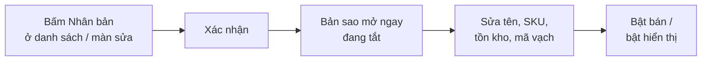
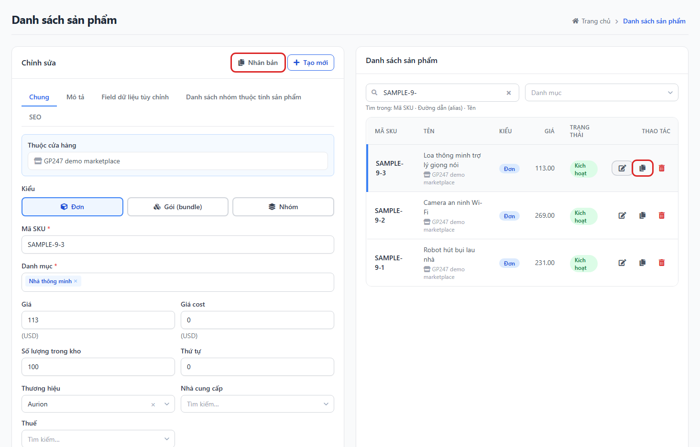
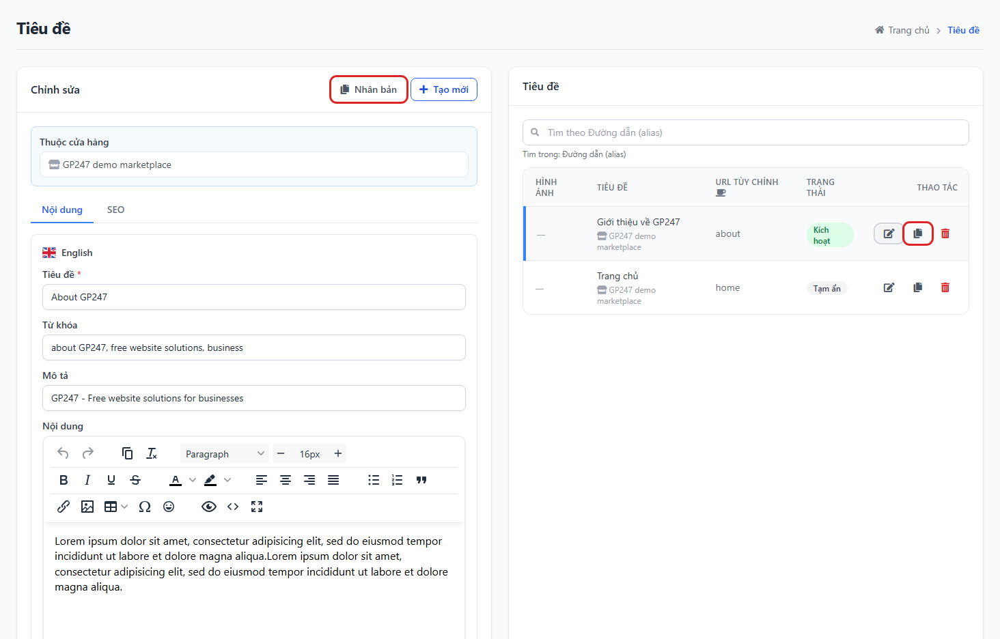

> 🌐 **Ngôn ngữ:** 🇻🇳 Tiếng Việt (hiện tại) · [🇬🇧 English](./product-duplicate.md) · [🇯🇵 日本語](./product-duplicate_ja.md)

# Nhân bản sản phẩm và trang

## Giới thiệu
Trang này hướng dẫn **nhân bản** một sản phẩm hoặc một trang nội dung (giới thiệu, chính sách, hướng dẫn mua hàng…) trong trang quản trị:
bấm một nút để có bản sao, rồi chỉ sửa những chỗ khác nhau thay vì nhập lại từ đầu. Dành cho chủ cửa hàng và nhân viên nhập liệu.
Đọc xong, bạn biết bản sao mang theo những gì, những gì phải tự điền lại, và cách đưa bản sao lên bán an toàn.

## Nhìn nhanh

- **Một nút, một bản sao** — nút **Nhân bản** có ở mỗi dòng của danh sách và ở đầu màn sửa.
- **Bản sao luôn đang tắt** — khách chưa thấy cho tới khi bạn kiểm tra và bật.
- **Sản phẩm chép gần như đủ** — trừ tồn kho, số đã bán, lượt xem, đánh giá và mã vạch.
- **Không trùng với bản gốc** — tên thêm "(bản sao)", SKU và đường dẫn thêm `-copy`.
- **Chép bản đã lưu** — chữ đang gõ dở trên màn sửa không đi theo bản sao.

> ℹ️ **Có từ:** gp247/shop 3.13.0 (sản phẩm); gp247/front 3.12.0 (trang nội dung)

## Trong trang này
- [Nhân bản một sản phẩm](#nhân-bản-một-sản-phẩm)
- [Bản sao sản phẩm mang theo những gì](#bản-sao-sản-phẩm-mang-theo-những-gì) — chép, không chép, đổi
- [Việc cần làm trước khi bật bán](#việc-cần-làm-trước-khi-bật-bán)
- [Nhân bản một trang nội dung](#nhân-bản-một-trang-nội-dung)
- [Khi không nhân bản được](#khi-không-nhân-bản-được)
- [Điều kiện & ràng buộc](#điều-kiện--ràng-buộc-hiểu-trước-khi-thao-tác)

## Nhân bản một sản phẩm
1. Mở **Sản phẩm & danh mục** → **Sản phẩm**.
2. Bấm biểu tượng **Nhân bản** (hai tờ giấy chồng nhau) ở dòng sản phẩm muốn chép. Hoặc mở màn sửa sản phẩm rồi bấm nút **Nhân bản** ở đầu form.
3. Hộp xác nhận hỏi "Tạo một bản sao (đang tắt, tồn kho 0) từ bản đã lưu của sản phẩm này?" — bấm **OK**.

Nếu thành công, màn sửa của **bản sao** mở ngay, kèm thông báo "Đã tạo bản sao — sản phẩm đang tắt, hãy kiểm tra rồi bật bán."
Bản gốc không thay đổi gì.

## Bản sao sản phẩm mang theo những gì

| | Gồm |
| --- | --- |
| **Chép sang bản sao** | Tên, mô tả, nội dung của **mọi ngôn ngữ**; giá, giá vốn, giá khuyến mãi kèm ngày bắt đầu / kết thúc; thuế; thuộc tính (màu, cỡ…) và phụ phí của chúng; ảnh chính và ảnh phụ; file tải về; danh mục, thương hiệu, nhà cung cấp, thẻ từ khóa, trường tuỳ chỉnh; loại sản phẩm, cân nặng, kích thước, số lượng mua tối thiểu, ngày bán, thứ tự, trạng thái duyệt; cửa hàng của sản phẩm; nội dung tab **SEO** của mọi ngôn ngữ |
| **Không chép** | Tồn kho (bản sao bắt đầu ở 0); số đã bán, lượt xem; đánh giá của khách; flash sale; mã vạch UPC / EAN / JAN / ISBN / MPN; canonical đang trỏ về chính trang của sản phẩm gốc; dữ liệu riêng của plugin (trừ khi plugin tự chép) |
| **Đổi** | Trạng thái: **tắt**; tên mỗi ngôn ngữ thêm nhãn của chính ngôn ngữ đó: "(bản sao)", "(copy)", "(コピー)"; SKU và đường dẫn (URL) thêm `-copy`, rồi `-copy-2`, `-copy-3`… cho tới khi không trùng trong cửa hàng |

- **Ảnh và file tải về dùng chung file với bản gốc** — không tốn thêm dung lượng. Đổi ảnh của bản sao bằng cách tải ảnh mới lên, không sửa file cũ.
- **Combo và nhóm sản phẩm** giữ liên kết tới **đúng các sản phẩm thành phần** của bản gốc; các sản phẩm thành phần không bị nhân bản theo.
- **Bản sao nằm cùng cửa hàng với bản gốc** (site nhiều cửa hàng).

## Việc cần làm trước khi bật bán
Bản sao đang tắt nên bạn sửa thoải mái. Trước khi bật **Trạng thái**, kiểm lần lượt:

1. **Tên** — xoá nhãn "(bản sao)" và đặt tên đúng cho **từng ngôn ngữ**.
2. **SKU và đường dẫn** — đổi `…-copy` thành mã và đường dẫn bạn muốn dùng lâu dài.
3. **Tồn kho** — nhập số lượng thật (bản sao bắt đầu ở 0).
4. **Mã vạch** — nhập mã của mặt hàng mới, nếu bạn dùng.
5. **Ảnh, giá, thuộc tính** — sửa những gì khác với bản gốc.
6. **Tab SEO** — tiêu đề và mô tả SEO đang giống bản gốc; viết lại để hai trang không bị máy tìm kiếm coi là trùng nội dung.
7. Bật **Trạng thái** rồi bấm **Lưu**.

## Nhân bản một trang nội dung
1. Mở **Quản lý nội dung** → **Quản lý trang**.
2. Bấm biểu tượng **Nhân bản** ở dòng trang muốn chép, hoặc nút **Nhân bản** ở đầu màn sửa trang.
3. Hộp xác nhận hỏi "Tạo một bản sao (đang tắt) từ bản đã lưu của trang này?" — bấm **OK**.

Nếu thành công, màn sửa của bản sao mở ngay, kèm thông báo "Đã tạo bản sao — trang đang tắt, hãy kiểm tra rồi bật hiển thị."

| | Gồm |
| --- | --- |
| **Chép sang bản sao** | Tiêu đề, mô tả, nội dung của mọi ngôn ngữ; ảnh (dùng chung file); cửa hàng của trang; nội dung tab **SEO** |
| **Không chép** | Canonical đang trỏ về chính trang gốc; chuyển hướng 301 của trang gốc; giá trị trường tuỳ chỉnh |
| **Đổi** | Trạng thái: **tắt**; tiêu đề mỗi ngôn ngữ thêm "(bản sao)" của ngôn ngữ đó; đường dẫn thêm `-copy`, `-copy-2`… |

Sửa tiêu đề, đường dẫn và nội dung xong thì bật hiển thị rồi bấm **Lưu**.

## Khi không nhân bản được
Khi có lỗi, **không có bản sao nào được tạo** và bản gốc giữ nguyên — bạn không phải dọn bản sao dở.

| Thông báo | Lý do | Cách xử lý |
| --- | --- | --- |
| "Không nhân bản được: plugin … báo lỗi khi chép dữ liệu…" (sản phẩm) | Một plugin chép dữ liệu riêng của nó sang bản sao và gặp lỗi | Thử lại; còn lỗi thì báo nhà cung cấp plugin có tên trong thông báo |
| "Không nhân bản được: một số giá trị đã lưu của trang (vd SEO) không còn hợp lệ…" (trang) | Trang gốc lưu từ trước, có giá trị không còn qua được kiểm tra hiện nay | Mở trang gốc, bấm **Lưu** lại (sửa chỗ màn báo lỗi), rồi nhân bản lại |
| Báo không có quyền khi bấm **Nhân bản** | Tài khoản của bạn không có quyền tạo sản phẩm / trang | Nhờ quản trị viên cấp quyền tạo |

## Điều kiện & ràng buộc (hiểu trước khi thao tác)

**Khi nhân bản**
- **Phải có quyền tạo sản phẩm / tạo trang** — nhân bản là một cách tạo mới, nên dùng chung quyền đó.
- **Quản trị viên của một cửa hàng chỉ nhân bản được sản phẩm / trang của cửa hàng mình** — để không đọc được dữ liệu cửa hàng khác.
- **Mỗi lần bấm tạo đúng một bản sao** — muốn ba bản thì bấm ba lần.
- **Chép bản đã lưu, không chép chữ đang gõ** — lưu thay đổi trước rồi mới nhân bản nếu muốn bản sao có chúng.
- **Toàn bộ hoặc không gì cả** — lỗi ở bất kỳ bước nào thì huỷ cả lần nhân bản, để không có bản sao thiếu nửa dữ liệu.

**Về bản sao**
- **Luôn tắt, tồn kho 0** — để khách không mua nhầm một sản phẩm chưa được kiểm tra.
- **Mã vạch không được chép** — mỗi mã vạch định danh một mặt hàng; hai sản phẩm cùng mã sẽ làm sai việc quét mã và đối soát.
- **SKU tối đa 50 ký tự, đường dẫn tối đa 100 ký tự** — mã gốc dài bị cắt bớt phần cuối để vẫn giữ được hậu tố `-copy`.

## Hỏi & Đáp (Q&A)
**Câu 1: Bản sao có hiện ngoài cửa hàng ngay không?**

→ Không. Bản sao luôn ở trạng thái tắt; bạn kiểm tra, sửa rồi tự bật **Trạng thái**.

**Câu 2: Tôi sửa ảnh của bản sao thì ảnh của sản phẩm gốc có đổi theo không?**

→ Không, nếu bạn tải ảnh mới lên cho bản sao. Hai sản phẩm chỉ dùng chung **file** ảnh cũ; thay ảnh ở bản sao không đụng tới bản gốc. Chỉ khi bạn sửa đè chính file đó trong trình quản lý file thì cả hai mới cùng đổi.

**Câu 3: Vì sao bản sao không có tồn kho và đánh giá?**

→ Tồn kho và đánh giá thuộc về mặt hàng thật đã bán; bản sao là mặt hàng mới, chưa nhập kho và chưa có khách mua.

**Câu 4: Tôi đang sửa dở sản phẩm, bấm Nhân bản thì phần đang sửa có vào bản sao không?**

→ Không. Bản sao lấy từ **bản đã lưu**. Muốn bản sao có phần đang sửa, bấm **Lưu** trước rồi mới **Nhân bản**.

**Câu 5: Nhân bản combo có nhân bản luôn các sản phẩm bên trong không?**

→ Không. Combo mới trỏ tới đúng các sản phẩm thành phần của combo gốc.

**Câu 6: Nhân bản nhiều lần một sản phẩm thì SKU ra sao?**

→ Lần đầu thêm `-copy`, các lần sau `-copy-2`, `-copy-3`… để không trùng. Hãy đổi SKU thành mã thật trước khi bật bán.

**Câu 7: Nhân bản có tạo trùng nội dung với máy tìm kiếm không?**

→ Bản sao đang tắt nên máy tìm kiếm chưa thấy. Trước khi bật, viết lại tiêu đề, mô tả và nội dung SEO để hai trang khác nhau.

**Câu 8: Nhân bản lỗi thì có để lại bản sao dở trong danh sách không?**

→ Không. Lỗi ở bất kỳ bước nào thì cả lần nhân bản bị huỷ; danh sách không có thêm dòng nào.

---

📅 **Cập nhật lần cuối:** 2026-11-20 · ✍️ **Tác giả (Author):** GP247
