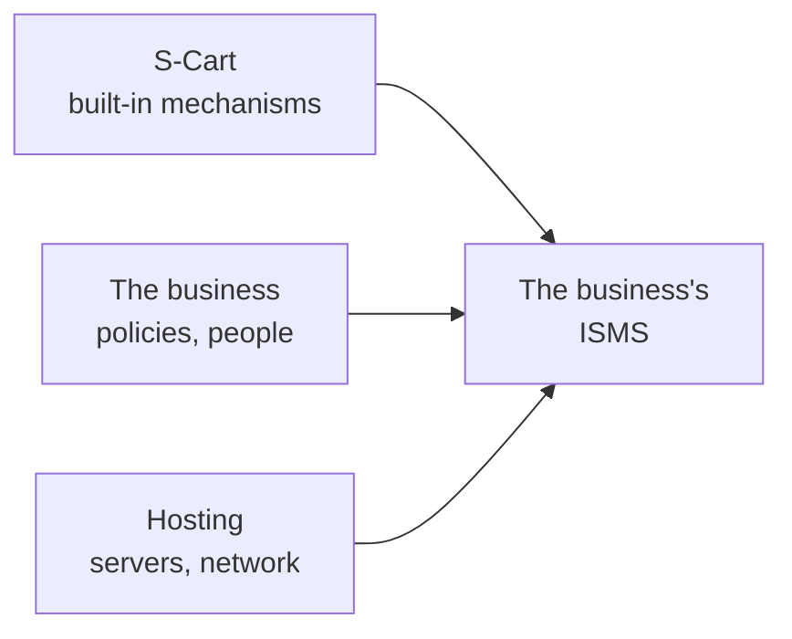

> 🌐 **Language:** [🇻🇳 Tiếng Việt](./security-iso27001_vi.md) · 🇬🇧 English (current) · [🇯🇵 日本語](./security-iso27001_ja.md)

# S-Cart and ISO/IEC 27001

## Introduction
ISO/IEC 27001 is the international standard for an information security management system (ISMS). This page is for business
owners, information security officers and auditors looking at S-Cart: it shows which built-in mechanisms of S-Cart match the
control groups of the standard, which part the business and the hosting provider must handle, and which evidence you can take from
S-Cart for an audit.

> ⚠️ **Note:** ISO/IEC 27001 certifies **organizations**, not software. S-Cart helps your business meet the part that e-commerce
> software touches; the certification itself remains the business's own.

## At a glance
An ISMS stands on three legs; S-Cart covers the software, the rest belongs to the business and the hosting.



- **S-Cart has built-in mechanisms** for seven control groups: access, authentication, logging, cryptography, personal data,
  backup, secure updates.
- **The business sets policies and runs them**: who may do what, how long data is kept, staff training, periodic reviews.
- **The hosting covers infrastructure**: HTTPS, servers, PHP, network.
- **S-Cart records the evidence** (logs, self-check results) to hand to the auditor.

## On this page
- [Control groups S-Cart supports](#control-groups-s-cart-supports) — what S-Cart has, mapped to which clauses
- [What the business and the hosting handle](#what-the-business-and-the-hosting-handle) — work S-Cart does not do for you
- [Evidence S-Cart provides for an audit](#evidence-s-cart-provides-for-an-audit) — what to show the auditor
- [Where to start — 6 steps](#where-to-start--6-steps) — do right after installing
- [Scope of this page](#scope-of-this-page) — which part of the site it covers

## Control groups S-Cart supports
The table below maps S-Cart's built-in features to the clauses of ISO/IEC 27001:2022 Annex A. Clause numbers are for auditors to
look up; details of each feature are on the linked page.

| Control group | Annex A | Built into S-Cart | Read more |
| --- | --- | --- | --- |
| **Access control** | 5.15 · 5.18 · 8.2 · 8.3 | Permissions by role and by action; a view-only role; store managers see only their own store (multi-store plugin); the API and AI agents get no wider access than the admin screens | [Accounts & permissions](./security-accounts-and-access.md) |
| **Authentication** | 5.17 · 8.5 | One password policy for every account group; failed sign-in limits; passwords stored as hashes; two-factor authentication through the free MFA plugin | [Accounts & permissions](./security-accounts-and-access.md) |
| **Logging & monitoring** | 8.15 · 8.16 · 5.33 | Activity log for the admin screens, the API and AI agents (secrets masked); failed sign-in log; backup log; adjustable retention; System alerts page | [What the system protects](./security-built-in.md) |
| **Cryptography** | 8.24 | SMTP passwords, payment keys and licenses encrypted with a dedicated key; key rotation without data loss; signed webhooks | [Encryption keys & backup](./security-keys-and-backup.md) |
| **Personal data & deletion** | 5.34 · 8.10 · 8.11 | Customers download and delete their own data; requests with due dates; erasing a customer deletes or anonymises the data everywhere while keeping the money figures; old data cleaned on a retention schedule; AI agents mask customer details | [Customers' personal data](../s-cart/personal-data/personal-data.md) |
| **Backup & business continuity** | 8.13 · 5.30 | Automatic encrypted backups, no cron needed; automatic snapshots before risky changes; copies to S3 / SFTP; backups checked by themselves; partial restore | [Backup & restore](../backup/backup-and-restore.md) |
| **Secure updates & development** | 8.8 · 8.19 · 8.26 · 8.28 · 8.32 | Security fixes released right away; published support lifecycle; updates that never destroy data; extension packages checked before installing; form forgery protection, output encoding, security headers; public automated tests | [Updates & incidents](./security-updates-and-incidents.md) |

- **Each row is a built-in mechanism**, not a level of conformity — the business assesses conformity within its own ISMS.
- **Most mechanisms are on after installing**; two-factor authentication, backups and retention need you to turn them on or set them.

## What the business and the hosting handle
S-Cart does not do the work below for you; without it the ISMS is incomplete even though the software has the mechanisms.

| Work | Who | Why S-Cart does not do it |
| --- | --- | --- |
| **Security policy, responsibilities, staff training** | The business | These are the organization's rules and people |
| **HTTPS, servers, PHP, network, time synchronization** | Hosting / server admin | Outside the software — see [Safe production configuration](./security-production-config.md) |
| **Turn on two-factor authentication and require it for administrators** | The business | The MFA plugin is there but must be installed and turned on — see [Turn on two-factor authentication](./security-accounts-and-access.md#turn-on-two-factor-authentication-mfa) |
| **Review permissions regularly, revoke them when staff leave** | The business | S-Cart does exactly what you grant — see [When a staff member leaves](./security-accounts-and-access.md#when-a-staff-member-leaves) |
| **Feed logs into a central monitoring system** (if the business has one) | Server admin | Logging is configured on the server; S-Cart keeps its logs in the database and in log files |
| **Restore drills, recovery time targets** | The business | Depends on business needs — see [Test a restore](./security-keys-and-backup.md#test-a-restore--the-step-many-people-skip) |
| **Retention periods and response times that match the law where you sell** | The business | Laws differ by country; S-Cart lets you set the days |
| **Choose plugins and themes from trusted sources** | The business | Third-party code runs with the full rights of the site |

## Evidence S-Cart provides for an audit
Auditors often ask "how do you prove it?". The following come straight from S-Cart:

- **Activity log** — who opened which screen, saved what, called the API or an AI agent and when (the **Log access** screen).
- **Failed sign-in log** — every failed sign-in and every block (the **Login failures** screen).
- **Backup and restore log** — who created, downloaded or restored a backup, including refused attempts.
- **Personal data request log** — every request from a customer to see or delete data and how it was handled, kept 5 years.
- **Configuration self-check results** — the **System alerts** page or the `php artisan gp247:doctor` command.
- **Release history and support lifecycle** — [S-Cart releases and security](../release/release.md).

## Where to start — 6 steps
Do these in order after installing, or today if the site is already running:

1. **Update to the latest S-Cart** — see [Updates & incidents](./security-updates-and-incidents.md).
2. **Run the configuration self-check** in the site folder and fix every reported item:

   ```bash
   php artisan gp247:doctor
   ```

3. **Grant each staff member only what they need**; keep the Administrator role to few people.
4. **Turn on two-factor authentication** with the MFA plugin and require it for administrators.
5. **Turn on backups** with a backup password, and keep one copy outside the server.
6. **Set data retention** on the **Data retention** screen to match the business's policy.

Full list by timing: [Security checklist](./security-checklist.md).

## Scope of this page
This page describes **S-Cart and its official plugins** in the latest release.

- **Third-party plugins and themes** are out of scope — assess them separately like any other supplier.
- **Older S-Cart releases** may lack some mechanisms; the version of each feature is noted on its detail page.
- **This page is not legal or certification advice** — the ISMS scope and level of conformity are decided by the business and its
  certification body.

## Q&A
**Q1: Is S-Cart certified to ISO/IEC 27001?**

→ No. The standard certifies organizations, not software. S-Cart provides mechanisms that help a business meet the part related to
e-commerce software.

**Q2: Does using S-Cart make a business ISO/IEC 27001 compliant?**

→ Not on its own. The business also needs policies, people, infrastructure and operating procedures — see
[What the business and the hosting handle](#what-the-business-and-the-hosting-handle).

**Q3: Does S-Cart help with personal data protection laws?**

→ It provides the mechanisms: customers download and delete their own data, requests have due dates, old data is cleaned by
itself. The exact periods are set by the law where you sell — see [Customers' personal data](../s-cart/personal-data/personal-data.md).

**Q4: Do these mechanisms work on shared hosting?**

→ Yes. Backups, data retention and system alerts run without cron.

**Q5: Are third-party plugins covered?**

→ No. Third-party plugins run with the full rights of the site; assess that supplier separately.

**Q6: Where does the auditor find the logs?**

→ In the admin: the **Log access**, **Login failures**, backup and personal data request screens — see
[Evidence S-Cart provides for an audit](#evidence-s-cart-provides-for-an-audit).

---

<sub>📅 **Last updated:** 2026-11-26 · ✍️ **Author:** GP247</sub>
