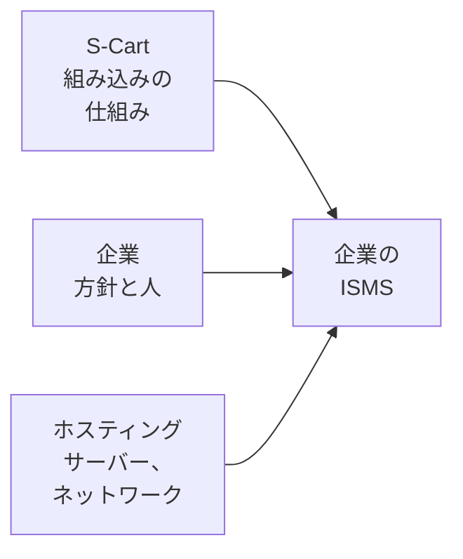

> 🌐 **言語:** [🇻🇳 Tiếng Việt](./security-iso27001_vi.md) · [🇬🇧 English](./security-iso27001.md) · 🇯🇵 日本語（現在）

# S-Cart と ISO/IEC 27001

## はじめに
ISO/IEC 27001 は情報セキュリティマネジメントシステム（ISMS）の国際規格です。このページは、S-Cart を検討している経営者、
情報セキュリティ担当者、審査員の方を対象に、規格の管理策のグループに対応する S-Cart の組み込みの仕組み、企業とホスティング
事業者が担う部分、審査のときに S-Cart から取り出せる証跡を説明します。

> ⚠️ **注意:** ISO/IEC 27001 の認証対象は**組織**であり、ソフトウェアではありません。S-Cart は EC ソフトウェアが関わる
> 部分への対応を支援します。認証そのものは企業が取得するものです。

## ひと目でわかる
ISMS は 3 本の柱で成り立ちます。S-Cart はソフトウェアの部分を担い、残りは企業とホスティングが担います。



- **S-Cart には 7 つの管理策グループの仕組みがあります**：アクセス、認証、ログ、暗号、個人情報、バックアップ、安全な更新。
- **企業は方針を決めて運用します**：誰が何をできるか、データをどのくらい保存するか、従業員教育、定期的な見直し。
- **ホスティングはインフラを担います**：HTTPS、サーバー、PHP、ネットワーク。
- **S-Cart は証跡を記録します**（ログ、自己診断の結果）。審査員に提示できます。

## このページの内容
- [S-Cart が支援する管理策のグループ](#s-cart-が支援する管理策のグループ) — S-Cart にあるものと対応する箇条
- [企業とホスティングが担うこと](#企業とホスティングが担うこと) — S-Cart が代わりに行わないこと
- [審査で S-Cart から出せる証跡](#審査で-s-cart-から出せる証跡) — 審査員に見せるもの
- [どこから始めるか — 6 つの手順](#どこから始めるか--6-つの手順) — インストール直後に行うこと
- [このページの対象範囲](#このページの対象範囲) — サイトのどの部分が対象か

## S-Cart が支援する管理策のグループ
次の表は、S-Cart の組み込み機能を ISO/IEC 27001:2022 附属書 A（Annex A）の箇条に対応させたものです。箇条番号は審査員が
参照するためのもので、各機能の詳細はリンク先のページにあります。

| 管理策のグループ | Annex A | S-Cart に組み込み | 詳しく |
| --- | --- | --- | --- |
| **アクセス制御** | 5.15 · 5.18 · 8.2 · 8.3 | ロールと操作ごとの権限、閲覧専用ロール、ストア管理者は自分のストアのみ表示（マルチストアプラグイン）、API と AI エージェントの権限は管理画面より広くならない | [アカウントと権限](./security-accounts-and-access_ja.md) |
| **認証** | 5.17 · 8.5 | すべてのアカウント種別に共通のパスワードポリシー、ログイン失敗回数の制限、パスワードはハッシュで保存、無料の MFA プラグインによる二要素認証 | [アカウントと権限](./security-accounts-and-access_ja.md) |
| **ログと監視** | 8.15 · 8.16 · 5.33 | 管理画面・API・AI エージェントの操作ログ（秘密情報はマスク）、ログイン失敗の記録、バックアップのログ、保存期間の設定、システムアラートのページ | [システムが守るもの](./security-built-in_ja.md) |
| **暗号** | 8.24 | SMTP パスワード、決済キー、ライセンスを専用キーで暗号化、データを失わずにキーを変更、署名付き Webhook | [暗号化キーとバックアップ](./security-keys-and-backup_ja.md) |
| **個人情報と情報の削除** | 5.34 · 8.10 · 8.11 | 顧客自身によるデータのダウンロードと削除、期限付きの請求、顧客の削除ですべての場所のデータを削除または匿名化（金額は保持）、保存期間に応じた古いデータの自動整理、AI エージェントは顧客情報をマスク | [S-Cart の顧客の個人データ](../s-cart/personal-data/personal-data_ja.md) |
| **バックアップと事業継続** | 8.13 · 5.30 | cron 不要の自動暗号化バックアップ、リスクのある変更の前に自動スナップショット、S3 / SFTP へのコピー、バックアップの自動検証、部分的な復元 | [バックアップと復元](../backup/backup-and-restore_ja.md) |
| **安全な更新と開発** | 8.8 · 8.19 · 8.26 · 8.28 · 8.32 | セキュリティ修正の即時リリース、公開されたサポート期間、データを壊さない更新、インストール前に拡張機能パッケージを検証、フォーム偽造対策、出力のエスケープ、セキュリティヘッダー、公開された自動テスト | [更新とインシデント対応](./security-updates-and-incidents_ja.md) |

- **各行は組み込みの仕組みであり、適合レベルではありません** — 適合レベルは企業が自社の ISMS の中で評価します。
- **ほとんどの仕組みはインストール直後から有効です**。二要素認証、バックアップ、保存期間は有効化や設定が必要です。

## 企業とホスティングが担うこと
次の作業は S-Cart が代わりに行いません。ソフトウェアに仕組みがあっても、これらがなければ ISMS は完成しません。

| 作業 | 担当 | S-Cart が代わりに行わない理由 |
| --- | --- | --- |
| **セキュリティ方針、責任の割り当て、従業員教育** | 企業 | 組織のルールと人に関わることです |
| **HTTPS、サーバー、PHP、ネットワーク、時刻同期** | ホスティング / サーバー管理者 | ソフトウェアの外側です — [安全な本番環境の設定](./security-production-config_ja.md)を参照 |
| **二要素認証を有効にし、管理者に必須化する** | 企業 | MFA プラグインはありますが、インストールと有効化が必要です — [二要素認証（MFA）を有効にする](./security-accounts-and-access_ja.md#二要素認証mfaを有効にする)を参照 |
| **権限の定期的な見直し、退職時の権限の取り消し** | 企業 | S-Cart は付与された権限どおりに動きます — [従業員が退職したとき](./security-accounts-and-access_ja.md#従業員が退職したとき)を参照 |
| **ログを集中監視システムに取り込む**（企業に仕組みがある場合） | サーバー管理者 | ログ出力はサーバー側で設定します。S-Cart はログをデータベースとログファイルに記録します |
| **復元訓練、復旧時間の目標設定** | 企業 | 事業の要件によります — [復元テスト](./security-keys-and-backup_ja.md#復元テスト--多くの人が飛ばす手順)を参照 |
| **販売地域の法律に合わせた保存期間と回答期限** | 企業 | 法律は国ごとに異なります。S-Cart では日数を設定できます |
| **信頼できる提供元のプラグインとテーマを選ぶ** | 企業 | 第三者のコードはサイトの全権限で動作します |

## 審査で S-Cart から出せる証跡
審査員はよく「どう証明しますか？」と尋ねます。次のものは S-Cart からすぐに取り出せます。

- **操作ログ** — 誰がどの画面を開き、何を保存し、いつ API や AI エージェントを呼んだか（「**アクセスログ**」画面）。
- **ログイン失敗の記録** — ログイン失敗とブロックのすべて（「**ログイン失敗**」画面）。
- **バックアップと復元のログ** — 誰がバックアップを作成、ダウンロード、復元したか（拒否された試行を含む）。
- **個人データの請求のログ** — 顧客からの開示・削除の請求と処理の履歴。5 年間保存されます。
- **設定の自己診断の結果** — 「**システムアラート**」ページ、または `php artisan gp247:doctor` コマンド。
- **リリース履歴とサポート期間** — [S-Cart のリリースとセキュリティ](../release/release_ja.md)。

## どこから始めるか — 6 つの手順
インストール後に、またはサイトが稼働中なら今日、順番に行ってください。

1. **最新の S-Cart に更新します** — [更新とインシデント対応](./security-updates-and-incidents_ja.md)を参照。
2. **サイトのフォルダーで設定の自己診断を実行し**、指摘された項目をすべて直します。

   ```bash
   php artisan gp247:doctor
   ```

3. **従業員ごとに必要な権限だけを与えます**。Administrator ロールを持つ人は最小限にします。
4. **MFA プラグインで二要素認証を有効にし**、管理者に必須化します。
5. **バックアップを有効にし**、バックアップ用パスワードを設定して、1 つのコピーをサーバーの外に保管します。
6. 「**データ保存期間**」画面で、企業の方針に合わせて**データの保存期間を設定します**。

時期ごとの全項目：[セキュリティチェックリスト](./security-checklist_ja.md)。

## このページの対象範囲
このページは、最新リリースの **S-Cart と公式プラグイン**を対象としています。

- **第三者のプラグインとテーマ**は対象外です — ほかの仕入先と同じように個別に評価してください。
- **古いバージョンの S-Cart** には一部の仕組みがない場合があります。各機能の対応バージョンは詳細ページに記載しています。
- **このページは法律や認証に関する助言ではありません** — ISMS の適用範囲と適合レベルは、企業と認証機関が判断します。

## よくある質問（Q&A）
**Q1: S-Cart は ISO/IEC 27001 の認証を受けていますか？**

→ いいえ。この規格の認証対象は組織であり、ソフトウェアではありません。S-Cart は、EC ソフトウェアに関わる部分への企業の対応を
支援する仕組みを提供します。

**Q2: S-Cart を使えば、企業は ISO/IEC 27001 に適合しますか？**

→ それだけでは足りません。方針、人、インフラ、運用手順も必要です — [企業とホスティングが担うこと](#企業とホスティングが担うこと)を
参照してください。

**Q3: S-Cart は個人情報保護法への対応に役立ちますか？**

→ 仕組みの面で役立ちます。顧客自身によるデータのダウンロードと削除、期限付きの請求、古いデータの自動整理があります。具体的な
期間は販売地域の法律で決まります — [S-Cart の顧客の個人データ](../s-cart/personal-data/personal-data_ja.md)を参照してください。

**Q4: 共有レンタルサーバーでもこれらの仕組みは使えますか？**

→ はい。バックアップ、データ保存期間、システムアラートは cron なしで動作します。

**Q5: 第三者のプラグインも対象になりますか？**

→ いいえ。第三者のプラグインはサイトの全権限で動作します。その提供元を個別に評価してください。

**Q6: 審査員がログを確認するにはどこを見ればよいですか？**

→ 管理画面の「**アクセスログ**」、「**ログイン失敗**」、バックアップの画面、個人データの請求の画面です —
[審査で S-Cart から出せる証跡](#審査で-s-cart-から出せる証跡)を参照してください。

---

<sub>📅 **最終更新:** 2026-11-26 · ✍️ **作成者 (Author):** GP247</sub>
