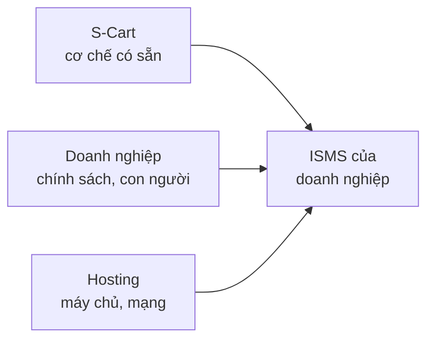

> 🌐 **Ngôn ngữ:** 🇻🇳 Tiếng Việt (hiện tại) · [🇬🇧 English](./security-iso27001.md) · [🇯🇵 日本語](./security-iso27001_ja.md)

# S-Cart và ISO/IEC 27001

## Giới thiệu
ISO/IEC 27001 là tiêu chuẩn quốc tế về hệ thống quản lý an ninh thông tin (ISMS). Trang này dành cho chủ doanh nghiệp, người
phụ trách an ninh thông tin và đánh giá viên đang xem xét S-Cart: nó cho biết S-Cart có sẵn cơ chế nào ứng với các nhóm kiểm soát
của tiêu chuẩn, phần nào doanh nghiệp và nhà cung cấp hosting phải tự làm, và bằng chứng nào lấy được từ S-Cart khi đánh giá.

> ⚠️ **Lưu ý:** ISO/IEC 27001 chứng nhận **tổ chức**, không chứng nhận phần mềm. S-Cart giúp doanh nghiệp của bạn đáp ứng phần
> việc mà phần mềm bán hàng chạm tới; việc chứng nhận vẫn là của doanh nghiệp.

## Nhìn nhanh
Một ISMS đứng trên ba chân; S-Cart lo phần phần mềm, phần còn lại thuộc doanh nghiệp và hosting.



- **S-Cart có sẵn cơ chế** cho bảy nhóm kiểm soát: truy cập, xác thực, nhật ký, mật mã, dữ liệu cá nhân, sao lưu, cập nhật an toàn.
- **Doanh nghiệp đặt chính sách và vận hành**: ai được làm gì, giữ dữ liệu bao lâu, đào tạo nhân viên, rà soát định kỳ.
- **Hosting lo hạ tầng**: HTTPS, máy chủ, PHP, mạng.
- **S-Cart ghi lại bằng chứng** (nhật ký, kết quả tự kiểm) để đưa cho đánh giá viên.

## Trong trang này
- [Các nhóm kiểm soát S-Cart hỗ trợ](#các-nhóm-kiểm-soát-s-cart-hỗ-trợ) — S-Cart có gì, ứng với điều khoản nào
- [Phần doanh nghiệp và hosting tự đảm nhận](#phần-doanh-nghiệp-và-hosting-tự-đảm-nhận) — việc S-Cart không làm thay
- [Bằng chứng S-Cart cung cấp khi đánh giá](#bằng-chứng-s-cart-cung-cấp-khi-đánh-giá) — đưa gì cho đánh giá viên
- [Bắt đầu từ đâu — 6 bước](#bắt-đầu-từ-đâu--6-bước) — làm ngay sau khi cài
- [Phạm vi của trang này](#phạm-vi-của-trang-này) — áp cho phần nào của site

## Các nhóm kiểm soát S-Cart hỗ trợ
Bảng dưới đây đối chiếu tính năng có sẵn của S-Cart với các điều khoản của ISO/IEC 27001:2022 Annex A. Số điều khoản để đánh giá
viên tra cứu; chi tiết từng tính năng ở trang được dẫn tới.

| Nhóm kiểm soát | Annex A | S-Cart có sẵn | Đọc thêm |
| --- | --- | --- | --- |
| **Kiểm soát truy cập** | 5.15 · 5.18 · 8.2 · 8.3 | Quyền theo vai trò và từng thao tác; vai trò chỉ xem; quản lý cửa hàng chỉ thấy cửa hàng mình (plugin nhiều cửa hàng); API và AI agent không rộng quyền hơn màn quản trị | [Tài khoản & phân quyền](./security-accounts-and-access_vi.md) |
| **Xác thực** | 5.17 · 8.5 | Một chính sách mật khẩu cho mọi nhóm tài khoản; giới hạn đăng nhập sai; mật khẩu lưu dạng băm; xác thực hai lớp qua plugin miễn phí MFA | [Tài khoản & phân quyền](./security-accounts-and-access_vi.md) |
| **Nhật ký & giám sát** | 8.15 · 8.16 · 5.33 | Nhật ký thao tác cho màn quản trị, API và AI agent (che bí mật); nhật ký đăng nhập sai; nhật ký sao lưu; hạn giữ đặt được; trang Cảnh báo hệ thống | [Hệ thống bảo vệ những gì](./security-built-in_vi.md) |
| **Mật mã** | 8.24 | Mật khẩu SMTP, khoá thanh toán, license được mã hoá bằng khoá riêng; đổi khoá không mất dữ liệu; webhook có chữ ký | [Khoá mã hoá & sao lưu](./security-keys-and-backup_vi.md) |
| **Dữ liệu cá nhân & xoá thông tin** | 5.34 · 8.10 · 8.11 | Khách tự tải và tự xoá dữ liệu; yêu cầu có hạn xử lý; xoá khách là xoá hoặc ẩn danh ở mọi nơi, giữ số liệu tiền; dữ liệu cũ tự dọn theo hạn lưu giữ; AI agent che thông tin khách | [Dữ liệu cá nhân của khách](../s-cart/personal-data/personal-data_vi.md) |
| **Sao lưu & liên tục kinh doanh** | 8.13 · 5.30 | Sao lưu mã hoá tự động, không cần cron; tự chụp trước thay đổi rủi ro; chép ra S3 / SFTP; tự kiểm bản sao lưu; phục hồi từng phần | [Sao lưu & phục hồi](../backup/backup-and-restore_vi.md) |
| **Cập nhật & phát triển an toàn** | 8.8 · 8.19 · 8.26 · 8.28 · 8.32 | Bản vá bảo mật phát hành ngay; vòng đời hỗ trợ công bố; cập nhật không phá dữ liệu; gói extension được kiểm trước khi cài; chống giả mạo form, mã hoá đầu ra, header bảo mật; kiểm thử tự động công khai | [Cập nhật & xử lý sự cố](./security-updates-and-incidents_vi.md) |

- **Mỗi dòng là cơ chế có sẵn**, không phải mức đáp ứng — mức đáp ứng do doanh nghiệp tự đánh giá trong ISMS của mình.
- **Phần lớn cơ chế bật sẵn khi cài**; xác thực hai lớp, sao lưu, hạn lưu giữ cần bạn bật hoặc đặt thông số.

## Phần doanh nghiệp và hosting tự đảm nhận
Các việc dưới đây S-Cart không làm thay; thiếu chúng thì ISMS không đủ dù phần mềm có sẵn cơ chế.

| Việc | Ai làm | Vì sao S-Cart không làm thay |
| --- | --- | --- |
| **Chính sách an ninh, phân công trách nhiệm, đào tạo nhân viên** | Doanh nghiệp | Là quy định và con người của tổ chức |
| **HTTPS, máy chủ, PHP, mạng, đồng bộ giờ** | Hosting / quản trị máy chủ | Nằm ngoài phần mềm — xem [Cấu hình production an toàn](./security-production-config_vi.md) |
| **Bật xác thực hai lớp và bắt buộc cho quản trị viên** | Doanh nghiệp | Plugin MFA có sẵn nhưng phải cài và bật — xem [Bật xác thực hai lớp](./security-accounts-and-access_vi.md#bật-xác-thực-hai-lớp-mfa) |
| **Rà soát quyền định kỳ, thu hồi khi nhân viên nghỉ** | Doanh nghiệp | S-Cart làm đúng như quyền bạn cấp — xem [Khi nhân viên nghỉ việc](./security-accounts-and-access_vi.md#khi-nhân-viên-nghỉ-việc) |
| **Đưa log vào hệ thống giám sát tập trung** (nếu doanh nghiệp có) | Quản trị máy chủ | Cấu hình ghi log ở máy chủ; S-Cart ghi nhật ký trong cơ sở dữ liệu và file log |
| **Diễn tập phục hồi, đặt mục tiêu thời gian phục hồi** | Doanh nghiệp | Tuỳ yêu cầu kinh doanh — xem [Thử khôi phục](./security-keys-and-backup_vi.md#thử-khôi-phục--bước-nhiều-người-bỏ-qua) |
| **Thời hạn lưu giữ và trả lời yêu cầu khớp luật nơi bán hàng** | Doanh nghiệp | Luật mỗi nước khác nhau; S-Cart cho đặt số ngày |
| **Chọn plugin và giao diện từ nguồn tin cậy** | Doanh nghiệp | Mã bên thứ ba chạy với toàn quyền của site |

## Bằng chứng S-Cart cung cấp khi đánh giá
Đánh giá viên thường hỏi "làm sao chứng minh?". Những thứ sau lấy được ngay từ S-Cart:

- **Nhật ký thao tác** — ai mở màn nào, lưu gì, gọi API hay AI agent lúc nào (màn **Nhật ký truy cập**).
- **Nhật ký đăng nhập sai** — mỗi lần đăng nhập sai và mỗi đợt bị chặn (màn **Đăng nhập sai**).
- **Nhật ký sao lưu và phục hồi** — ai tạo, tải, phục hồi bản sao lưu, kể cả lần bị từ chối.
- **Nhật ký yêu cầu dữ liệu cá nhân** — mỗi yêu cầu xem / xoá của khách và lịch sử xử lý, giữ 5 năm.
- **Kết quả tự kiểm cấu hình** — trang **Cảnh báo hệ thống** hoặc lệnh `php artisan gp247:doctor`.
- **Lịch sử phát hành và vòng đời hỗ trợ** — [Phát hành và bảo mật S-Cart](../release/release_vi.md).

## Bắt đầu từ đâu — 6 bước
Làm lần lượt sau khi cài, hoặc ngay hôm nay nếu site đang chạy:

1. **Cập nhật lên bản S-Cart mới nhất** — xem [Cập nhật & xử lý sự cố](./security-updates-and-incidents_vi.md).
2. **Chạy tự kiểm cấu hình** trong thư mục site, sửa hết mục báo lỗi:

   ```bash
   php artisan gp247:doctor
   ```

3. **Cấp quyền vừa đủ** cho từng nhân viên; hạn chế số người giữ vai trò Administrator.
4. **Bật xác thực hai lớp** bằng plugin MFA, bắt buộc cho quản trị viên.
5. **Bật sao lưu** với mật khẩu sao lưu, chép thêm một bản ra ngoài máy chủ.
6. **Đặt hạn lưu giữ dữ liệu** trên màn **Hạn lưu giữ dữ liệu** cho khớp chính sách của doanh nghiệp.

Danh sách đầy đủ theo thời điểm: [Checklist bảo mật](./security-checklist_vi.md).

## Phạm vi của trang này
Trang này mô tả **S-Cart và các plugin chính thức** ở bản mới nhất.

- **Plugin và giao diện của bên thứ ba** nằm ngoài phạm vi — hãy đánh giá riêng như mọi nhà cung cấp khác.
- **Bản S-Cart cũ** có thể thiếu một số cơ chế; mốc phiên bản của từng tính năng ghi ở trang chi tiết.
- **Trang này không phải tư vấn pháp lý hay tư vấn chứng nhận** — phạm vi ISMS và mức đáp ứng do doanh nghiệp và tổ chức chứng
  nhận quyết định.

## Hỏi & Đáp (Q&A)
**Câu 1: S-Cart có chứng nhận ISO/IEC 27001 không?**

→ Không. Tiêu chuẩn này chứng nhận tổ chức, không chứng nhận phần mềm. S-Cart cung cấp cơ chế giúp doanh nghiệp đáp ứng phần việc
liên quan tới phần mềm bán hàng.

**Câu 2: Dùng S-Cart thì doanh nghiệp có đạt ISO/IEC 27001 không?**

→ Chưa đủ. Doanh nghiệp còn cần chính sách, con người, hạ tầng và quy trình vận hành — xem
[Phần doanh nghiệp và hosting tự đảm nhận](#phần-doanh-nghiệp-và-hosting-tự-đảm-nhận).

**Câu 3: S-Cart có giúp đáp ứng luật bảo vệ dữ liệu cá nhân không?**

→ Có phần cơ chế: khách tự tải và tự xoá dữ liệu, yêu cầu có hạn xử lý, dữ liệu cũ tự dọn. Thời hạn cụ thể do luật nơi bạn bán
hàng quy định — xem [Dữ liệu cá nhân của khách](../s-cart/personal-data/personal-data_vi.md).

**Câu 4: Site chạy trên shared host có dùng được các cơ chế này không?**

→ Được. Sao lưu, hạn lưu giữ và cảnh báo hệ thống chạy không cần cron.

**Câu 5: Plugin của bên thứ ba có được tính không?**

→ Không. Plugin bên thứ ba chạy với toàn quyền của site; hãy đánh giá nhà cung cấp đó riêng.

**Câu 6: Đánh giá viên muốn xem nhật ký thì lấy ở đâu?**

→ Trong trang quản trị: màn **Nhật ký truy cập**, **Đăng nhập sai**, màn sao lưu và màn yêu cầu dữ liệu cá nhân — xem
[Bằng chứng S-Cart cung cấp khi đánh giá](#bằng-chứng-s-cart-cung-cấp-khi-đánh-giá).

---

<sub>📅 **Cập nhật lần cuối:** 2026-11-26 · ✍️ **Tác giả (Author):** GP247</sub>
