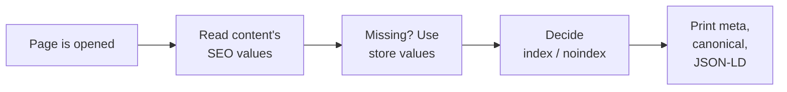

> 🌐 **Language:** [🇻🇳 Tiếng Việt](./seo-automatic_vi.md) · 🇬🇧 English (current) · [🇯🇵 日本語](./seo-automatic_ja.md)

# What GP247 does automatically for SEO

## Introduction
This page lists the SEO tasks GP247 **does automatically for every page** of your store, with no configuration needed. It is for site owners who want to know "what the system already handles and what is left for me", and for SEO reviewers who need to know where each tag comes from. After reading it, you will know why the cart page does not appear on Google, how the sitemap is built and what the JSON-LD contains.

## At a glance
Whenever a visitor or Google opens a page, GP247 builds the top of the page (`<head>`) with the same process, whichever template you use.

- **Works with every template** — the top of the page is built by a shared gp247/front component, independent of the design.
- **Fills gaps automatically** — content with no description or image uses the store's description and image; empty tags are never printed.
- **Private pages and filter pages are hidden** from Google automatically (`noindex`).
- **Sitemap and robots.txt are generated** per store, no cron needed.

## On this page
- [Titles, descriptions and share images](#titles-descriptions-and-share-images) — where the title, description, Open Graph and Twitter tags come from
- [Canonical and paginated pages](#canonical-and-paginated-pages) — preventing duplicate content
- [Which pages are hidden from Google](#which-pages-are-hidden-from-google) — cart, account, filter pages
- [Multilingual websites](#multilingual-websites) — per-language URLs and hreflang
- [Structured data (JSON-LD)](#structured-data-json-ld) — Organization, Product, Breadcrumb, Article
- [Sitemap.xml and robots.txt](#sitemapxml-and-robotstxt) — generated automatically, split into files when large
- [Missing pages return a real 404 error](#missing-pages-return-a-real-404-error) — so Google drops dead links

## Titles, descriptions and share images
Every page has a `<title>`, meta description, keywords, Open Graph tags (Facebook, Zalo…) and a Twitter card. Values are taken in the priority order below; if one is empty, the next one is used.

| Tag | Priority 1 | Priority 2 | Priority 3 |
| --- | --- | --- | --- |
| Title | SEO title entered in the SEO tab | Content name, wrapped in the **title template** | Store name |
| Description | SEO description in the SEO tab | Content description | Store description (Website information) |
| Share image | Social share image in the SEO tab | Content image | Store's social share image |

- **A value with only spaces counts as empty** — `content=""` is never printed.
- **No image at all means no image tag** — social networks pick an image themselves, instead of showing one generic default image.
- **`og:type`** is `website`; article pages of the news plugin are `article`.
- **Verification codes** for Google / Bing (if you entered them) are printed on every page.

## Canonical and paginated pages
The canonical tag tells Google "this is the official address of the page", so variants with parameters are not treated as duplicate content.

- **The canonical points to the page itself**, with all URL parameters removed.
- **Pages 2, 3… of a list keep the `page` parameter** (`?page=2` has canonical `?page=2`) — so Google can read the products on later pages.
- **`og:url` always equals the canonical**, so links shared from a page with tracking parameters stay clean.
- You can set a custom canonical for a piece of content in the SEO tab — see [SEO for each piece of content](./seo-content.md).

## Which pages are hidden from Google
Pages that have no value in search results automatically carry the `noindex, follow` tag: Google does not list the page in results but still follows the links on it.

| Page type | Examples |
| --- | --- |
| Customer's private pages | Cart, wishlist, compare, checkout, orders, account, login, register |
| Internal search results | `/search?keyword=…` |
| Filter and sort pages | URLs with the `filter_sort`, `price`, `brand`, `keyword` parameters |
| Pages you choose to hide | Content with "Do not let search engines index this page" ticked in the SEO tab |

Product, category, brand, content pages, the home page and news pages are **not** hidden when they have no filter parameters. Hidden content is also removed from the sitemap automatically.

## Multilingual websites
When language-based addresses are on (`/vi/…`, `/en/…`) and more than one language is active, GP247 takes care of the multilingual side for Google.

- **`hreflang` tags** on each page point to the same page in the other languages, plus `x-default` set to the store's default language.
- **The sitemap** lists one URL per language, each with the list of its translations.
- Hidden (`noindex`) pages do not print `hreflang`.

## Structured data (JSON-LD)
JSON-LD is hidden information in the page that helps Google understand the content and may show extra details such as price, stock status and the category path in search results. GP247 prints the following types out of the box:

| Type | Appears on | Main content |
| --- | --- | --- |
| Organization | Every page | Store name, logo, website address |
| Product | Product pages | Name, image, final price, stock status; SKU, brand, GTIN/MPN codes and sale end date when available |
| BreadcrumbList | Pages with a navigation path | Parent categories → current page |
| Article | Article pages of the news plugin | Title, image, published/modified dates, description, publisher |

- **The rating score** (`aggregateRating`) appears only when a product review plugin supplies the figures and the product has at least one review.
- You can **turn off all JSON-LD** on the Meta & JSON-LD screen when debugging — see [Store-wide SEO settings](./seo-settings.md).

> 💡 **Tip:** paste the address of a product page into Google's "Rich Results Test" tool to see what Google can read.

## Sitemap.xml and robots.txt
These two files help search engines find your pages; GP247 generates them per store (per domain).

- **`/sitemap.xml`** includes the home page, content pages, products, categories and URLs added by plugins (e.g. news), only for content that is **active** in that store.
- **Split into files automatically when large**: above 50,000 URLs, `/sitemap.xml` becomes an index that points to the sub-files.
- **No cron needed**: the sitemap is built on a visit and cached; saving content with SEO changes refreshes it automatically.
- **Easy to read in a browser** — the sitemap is displayed as a numbered list.
- **`/robots.txt`** uses the content you write on the Meta & JSON-LD screen and always points to the sitemap.

## Missing pages return a real 404 error
Deleted products, categories, brands, content pages, tags and articles, or mistyped addresses, return **HTTP code 404** with the template's "not found" page (which still has the menu so visitors can keep browsing). Thanks to this, Google drops dead links instead of treating them as real empty pages.

> ℹ️ **Info:** to find out which 404 pages visitors are hitting, turn on the **404 log** — see [Monitoring & fixing SEO problems](./seo-monitoring.md).

## Q&A
**Q1: Why does my cart page have a noindex tag?**

→ That is intentional: cart, account and checkout pages have no value on Google, and letting them into results would only dilute the ranking of your product pages.

**Q2: Will my SEO tags be lost if I change templates?**

→ No, as long as the template follows the GP247 standard (it uses the shared page-head component). The three templates GP247Front, GP247EC and GP247MKP all follow this standard.

**Q3: My sitemap doesn't include a product I just added?**

→ The sitemap is cached. Go to **SEO › Sitemap.xml** and click **Rebuild sitemap now**, or wait for the next refresh.

**Q4: Can a category page with a price filter still appear on Google?**

→ The base category page can; variants with filter/sort parameters are hidden and have a canonical pointing to the base page, so Google does not treat them as duplicates.

**Q5: A product has no image. What image appears when it is shared on Facebook?**

→ The store's social share image (on Website information). If the store has none either, the page prints no image tag and Facebook picks an image from the page itself.

**Q6: Does JSON-LD slow down the page?**

→ Not noticeably: it is a small piece of text printed in the page, with no extra files to load.

**Q7: Why does my product have no review stars in the JSON-LD?**

→ The rating score appears only when a review plugin supplies the figures and the product already has at least one review.

---

📅 **Last updated:** 2026-11-17 · ✍️ **Author:** GP247
