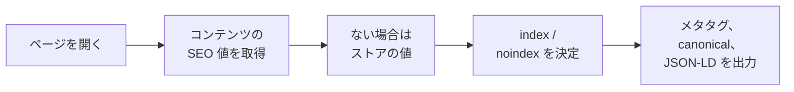

> 🌐 **言語:** [🇻🇳 Tiếng Việt](./seo-automatic_vi.md) · [🇬🇧 English](./seo-automatic.md) · 🇯🇵 日本語（現在）

# GP247 が SEO のために自動で行うこと

## はじめに
このページでは、GP247 がストアの**すべてのページで自動的に行う** SEO の作業を一覧にします。あなたが設定する必要はありません。「システムが何を担い、自分は何をすべきか」を知りたいサイトオーナーと、どのタグがどこから来るのかを知りたい SEO の確認担当者を対象としています。読み終えると、カートページが Google に表示されない理由、サイトマップの作られ方、JSON-LD の中身がわかります。

## ひと目でわかる
訪問者や Google がページを開くたびに、GP247 はどのテンプレートを使っていても、同じ手順でページの先頭部分（`<head>`）を組み立てます。

- **どのテンプレートでも同じ** — ページの先頭部分は gp247/front の共通コンポーネントが組み立てるため、デザインに左右されません。
- **足りない値は自動で補う** — 説明や画像がないコンテンツには、ストアの説明と画像を使います。空のタグは出力しません。
- **非公開ページと絞り込みページは自動で隠す** — Google から隠します（`noindex`）。
- **サイトマップと robots.txt は自動で生成** — ストアごとに作られ、cron は不要です。

## このページの内容
- [タイトル、説明、シェア画像](#タイトル説明シェア画像) — title、description、Open Graph、Twitter のタグはどこから来るか
- [カノニカルとページ分割](#カノニカルとページ分割) — 重複コンテンツを防ぐ
- [Google から隠されるページ](#google-から隠されるページ) — カート、アカウント、絞り込みページ
- [多言語サイト](#多言語サイト) — 言語ごとの URL と hreflang
- [構造化データ（JSON-LD）](#構造化データjson-ld) — Organization、Product、Breadcrumb、Article
- [Sitemap.xml と robots.txt](#sitemapxml-と-robotstxt) — 自動で生成し、大きくなったらファイルを分割
- [存在しないページは本当の 404 エラーを返す](#存在しないページは本当の-404-エラーを返す) — Google にリンク切れを削除してもらうため

## タイトル、説明、シェア画像
すべてのページに `<title>`、meta description、keywords、Open Graph タグ（Facebook、Zalo など）と Twitter カードが付きます。値は下の優先順で決まり、空の項目は次の項目に進みます。

| タグ | 優先 1 | 優先 2 | 優先 3 |
| --- | --- | --- | --- |
| タイトル | SEO タブで入力した SEO タイトル | コンテンツ名を**タイトルテンプレート**で包んだもの | ストア名 |
| 説明 | SEO タブの SEO ディスクリプション | コンテンツの説明 | ストアの説明（サイト情報） |
| シェア画像 | SEO タブの SNS シェア用画像 | コンテンツの画像 | ストアのシェア画像 |

- **空白だけの値は空とみなします** — `content=""` を出力することはありません。
- **画像が 1 つもなければ画像タグを出力しません** — 共通のデフォルト画像を表示する代わりに、SNS が自分で画像を選びます。
- **`og:type`** は `website` です。ニュースプラグインの記事ページでは `article` です。
- Google / Bing の**確認コード**（入力済みの場合）は、すべてのページに出力されます。

## カノニカルとページ分割
カノニカルタグは、Google に「これがこのページの正式な URL です」と伝えます。これにより、パラメーター付きのバリエーションが重複コンテンツとみなされません。

- **カノニカルはページ自身を指し**、URL のパラメーターはすべて取り除きます。
- **一覧の 2 ページ目、3 ページ目… は `page` パラメーターを残します**（`?page=2` のカノニカルは `?page=2`）。後ろのページの商品も Google が読めるようにするためです。
- **`og:url` は常にカノニカルと同じ**です。そのため、トラッキング用パラメーター付きのページからシェアしたリンクもすっきりします。
- SEO タブで、コンテンツごとに独自のカノニカルを設定できます。[コンテンツごとの SEO](./seo-content_ja.md) を参照してください。

## Google から隠されるページ
検索結果に出しても価値のないページには、自動で `noindex, follow` タグが付きます。Google はそのページを検索結果に出しませんが、ページ内のリンクはたどります。

| ページの種類 | 例 |
| --- | --- |
| 顧客の非公開ページ | カート、お気に入り、比較、チェックアウト、注文、アカウント、ログイン、会員登録 |
| サイト内検索の結果 | `/search?keyword=…` |
| 絞り込み、並べ替えのページ | `filter_sort`、`price`、`brand`、`keyword` パラメーターを含む URL |
| あなたが隠すと決めたページ | SEO タブで「検索エンジンにこのページをインデックスさせない」にチェックしたコンテンツ |

商品、カテゴリ、ブランド、コンテンツページ、トップページ、ニュースページは、絞り込みパラメーターがなければ隠され**ません**。隠されているコンテンツは、サイトマップからも自動で外れます。

## 多言語サイト
言語別の URL（`/vi/…`、`/en/…`）をオンにして、有効な言語が 2 つ以上あると、GP247 が Google 向けの多言語対応を自動で行います。

- **`hreflang` タグ** — 各ページに、他の言語の同じページを指すタグを付けます。ストアのデフォルト言語を `x-default` として加えます。
- **サイトマップ** — 言語ごとに 1 つの URL を出力し、各 URL に翻訳版の一覧を付けます。
- 隠されたページ（`noindex`）には `hreflang` を出力しません。

## 構造化データ（JSON-LD）
JSON-LD はページに埋め込まれた見えない情報です。Google が内容を理解するのを助け、検索結果に価格、在庫状況、カテゴリの階層が追加表示されることがあります。GP247 は次の種類を標準で出力します。

| 種類 | 出力されるページ | 主な内容 |
| --- | --- | --- |
| Organization | すべてのページ | ストアの名前、ロゴ、サイトの URL |
| Product | 商品ページ | 名前、画像、最終価格、在庫状況。あれば SKU、ブランド、GTIN/MPN コード、セールの終了日 |
| BreadcrumbList | パンくずリストのあるページ | 親カテゴリ → 現在のページ |
| Article | ニュースプラグインの記事ページ | タイトル、画像、公開日 / 更新日、説明、発行元 |

- **評価点**（`aggregateRating`）は、商品レビューのプラグインが数値を提供し、その商品にレビューが 1 件以上ある場合だけ表示されます。
- 問題を調べる必要があるときは、Meta & JSON-LD 画面で **JSON-LD 全体をオフ**にできます。[ストア全体の SEO 設定](./seo-settings_ja.md) を参照してください。

> 💡 **ヒント:** 商品ページの URL を Google の「リッチリザルト テスト」（Rich Results Test）に貼り付けると、Google が何を読み取れるか確認できます。

## Sitemap.xml と robots.txt
この 2 つのファイルは、検索エンジンがあなたのページを見つけるのを助けます。GP247 はストアごと（ドメインごと）に生成します。

- **`/sitemap.xml`** には、トップページ、コンテンツページ、商品、カテゴリ、プラグインが追加する URL（例：ニュース）が含まれます。対象はそのストアの**有効な**コンテンツだけです。
- **大きくなると自動で分割** — URL が 50,000 件を超えると、`/sitemap.xml` は子ファイルを指す目次になります。
- **cron は不要** — サイトマップはアクセス時に作られ、一時保存されます。SEO に関わる変更を保存すると自動で更新されます。
- **ブラウザで開くと読みやすい** — サイトマップは番号付きの一覧で表示されます。
- **`/robots.txt`** は Meta & JSON-LD 画面で入力した内容を使い、常にサイトマップを指します。

## 存在しないページは本当の 404 エラーを返す
削除された商品、カテゴリ、ブランド、コンテンツページ、タグ、記事や、打ち間違えた URL は、テンプレートの「見つかりません」ページとともに **HTTP 404 コード**を返します（メニューは表示されるので、訪問者はそのまま移動できます）。これにより Google は、中身のない実在ページとみなさずに、リンク切れを削除します。

> ℹ️ **情報:** 訪問者がどの 404 ページに当たっているか知りたい場合は、**404ログ** をオンにしてください。[SEO の監視と問題の修正](./seo-monitoring_ja.md) を参照してください。

## よくある質問（Q&A）
**Q1: カートページに noindex タグが付いているのはなぜですか？**

→ 意図的な設定です。カート、アカウント、チェックアウトのページは Google 上で価値がありません。検索結果に出ると、商品ページの順位を薄めるだけです。

**Q2: テンプレートを変えると SEO のタグは消えますか？**

→ いいえ。テンプレートが GP247 の標準（ページ先頭の共通コンポーネントを使う）に従っていれば消えません。GP247Front、GP247EC、GP247MKP の 3 つのテンプレートはすべてこの標準に従っています。

**Q3: 追加したばかりの商品がサイトマップにないのはなぜですか？**

→ サイトマップは一時保存されています。**SEO › Sitemap.xml** で **今すぐサイトマップを再生成** を押すか、次の更新を待ってください。

**Q4: 価格で絞り込んだカテゴリページも Google に表示されますか？**

→ 元のカテゴリページは表示されます。絞り込み / 並べ替えのパラメーター付きのバリエーションは隠され、カノニカルが元のページを指すため、Google は重複とみなしません。

**Q5: 画像のない商品を Facebook でシェアすると、どの画像が表示されますか？**

→ ストアのシェア画像（サイト情報）です。ストアにも画像がない場合、ページは画像タグを出力せず、Facebook がページ内の画像を自分で選びます。

**Q6: JSON-LD でページが遅くなりますか？**

→ ほとんど影響しません。ページに埋め込まれた小さなテキストで、追加のファイルは読み込みません。

**Q7: 商品の JSON-LD に評価の星がないのはなぜですか？**

→ 評価点は、レビューのプラグインが数値を提供し、その商品にレビューが 1 件以上ある場合だけ出力されます。

---

📅 **最終更新:** 2026-11-17 · ✍️ **作成者 (Author):** GP247
