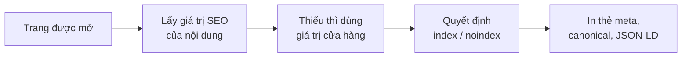

> 🌐 **Ngôn ngữ:** 🇻🇳 Tiếng Việt (hiện tại) · [🇬🇧 English](./seo-automatic.md) · [🇯🇵 日本語](./seo-automatic_ja.md)

# Những gì GP247 tự làm cho SEO

## Giới thiệu
Trang này liệt kê những việc SEO mà GP247 **tự làm cho mọi trang** của cửa hàng, không cần bạn cấu hình. Dành cho chủ site muốn biết "hệ thống đã lo gì, mình còn phải lo gì", và cho người kiểm tra SEO cần biết thẻ nào đến từ đâu. Đọc xong, bạn biết vì sao trang giỏ hàng không lên Google, sitemap được tạo thế nào và JSON-LD chứa gì.

## Nhìn nhanh
Mỗi khi khách hoặc Google mở một trang, GP247 dựng phần đầu trang (`<head>`) theo cùng một quy trình, bất kể bạn dùng template nào.

- **Mọi template đều được** — phần đầu trang do một thành phần chung của gp247/front dựng, không phụ thuộc giao diện.
- **Thiếu thì tự bù** — nội dung chưa có mô tả, ảnh thì dùng mô tả, ảnh của cửa hàng; không in thẻ rỗng.
- **Trang riêng tư và trang lọc tự giấu** khỏi Google (`noindex`).
- **Sitemap, robots.txt tự sinh** theo từng cửa hàng, không cần cron.

## Trong trang này
- [Tiêu đề, mô tả và ảnh chia sẻ](#tiêu-đề-mô-tả-và-ảnh-chia-sẻ) — thẻ title, description, Open Graph, Twitter lấy từ đâu
- [Canonical và trang phân trang](#canonical-và-trang-phân-trang) — chống trùng lặp nội dung
- [Trang nào bị giấu khỏi Google](#trang-nào-bị-giấu-khỏi-google) — giỏ hàng, tài khoản, trang lọc
- [Website nhiều ngôn ngữ](#website-nhiều-ngôn-ngữ) — URL theo ngôn ngữ và hreflang
- [Dữ liệu có cấu trúc (JSON-LD)](#dữ-liệu-có-cấu-trúc-json-ld) — Organization, Product, Breadcrumb, Article
- [Sitemap.xml và robots.txt](#sitemapxml-và-robotstxt) — tự sinh, chia file khi lớn
- [Trang không tồn tại trả lỗi 404 thật](#trang-không-tồn-tại-trả-lỗi-404-thật) — để Google gỡ link chết

## Tiêu đề, mô tả và ảnh chia sẻ
Mỗi trang có đủ `<title>`, meta description, keywords, thẻ Open Graph (Facebook, Zalo…) và Twitter card. Giá trị lấy theo thứ tự ưu tiên dưới đây; mục nào trống thì xuống mục sau.

| Thẻ | Ưu tiên 1 | Ưu tiên 2 | Ưu tiên 3 |
| --- | --- | --- | --- |
| Tiêu đề | Tiêu đề SEO nhập ở tab SEO | Tên nội dung, bọc theo **mẫu tiêu đề** | Tên cửa hàng |
| Mô tả | Mô tả SEO ở tab SEO | Mô tả của nội dung | Mô tả cửa hàng (Thông tin website) |
| Ảnh chia sẻ | Ảnh chia sẻ ở tab SEO | Ảnh của nội dung | Ảnh chia sẻ của cửa hàng |

- **Giá trị chỉ có khoảng trắng coi như trống** — không bao giờ in `content=""`.
- **Không có ảnh nào thì không in thẻ ảnh** — mạng xã hội tự chọn ảnh, thay vì hiện một ảnh mặc định chung.
- **`og:type`** là `website`; trang bài viết của plugin tin tức là `article`.
- **Mã xác minh** Google / Bing (nếu bạn đã nhập) được in trên mọi trang.

## Canonical và trang phân trang
Thẻ canonical cho Google biết "đây là địa chỉ chính thức của trang", để các biến thể có tham số không bị coi là nội dung trùng.

- **Canonical trỏ về chính trang**, bỏ mọi tham số trên URL.
- **Trang 2, 3… của danh sách giữ tham số `page`** (`?page=2` có canonical `?page=2`) — để Google đọc được sản phẩm ở các trang sau.
- **`og:url` luôn bằng canonical**, nên link chia sẻ từ trang có tham số theo dõi vẫn gọn.
- Bạn có thể đặt canonical riêng cho một nội dung ở tab SEO — xem [SEO cho từng nội dung](./seo-content_vi.md).

## Trang nào bị giấu khỏi Google
Những trang không có giá trị trên kết quả tìm kiếm tự mang thẻ `noindex, follow`: Google không đưa trang lên kết quả nhưng vẫn đi theo các link trên trang.

| Loại trang | Ví dụ |
| --- | --- |
| Trang riêng tư của khách | Giỏ hàng, yêu thích, so sánh, thanh toán, đơn hàng, tài khoản, đăng nhập, đăng ký |
| Kết quả tìm kiếm nội bộ | `/search?keyword=…` |
| Trang lọc, sắp xếp | URL có tham số `filter_sort`, `price`, `brand`, `keyword` |
| Trang bạn chọn giấu | Nội dung tick "Không cho công cụ tìm kiếm index" ở tab SEO |

Trang sản phẩm, danh mục, thương hiệu, trang nội dung, trang chủ và trang tin **không** bị giấu khi không có tham số lọc. Nội dung đang bị giấu cũng tự rời khỏi sitemap.

## Website nhiều ngôn ngữ
Khi bật đường dẫn theo ngôn ngữ (`/vi/…`, `/en/…`) và có hơn một ngôn ngữ đang hoạt động, GP247 tự lo phần đa ngôn ngữ cho Google.

- **Thẻ `hreflang`** trên mỗi trang trỏ tới bản cùng trang ở các ngôn ngữ khác, kèm `x-default` là ngôn ngữ mặc định của cửa hàng.
- **Sitemap** phát một URL cho từng ngôn ngữ, mỗi URL kèm danh sách bản dịch.
- Trang bị giấu (`noindex`) không in `hreflang`.

## Dữ liệu có cấu trúc (JSON-LD)
JSON-LD là thông tin ẩn trong trang giúp Google hiểu nội dung và có thể hiển thị thêm giá, tình trạng hàng, đường dẫn danh mục trên kết quả tìm kiếm. GP247 in sẵn các loại sau:

| Loại | Có trên trang | Nội dung chính |
| --- | --- | --- |
| Organization | Mọi trang | Tên, logo, địa chỉ website của cửa hàng |
| Product | Trang sản phẩm | Tên, ảnh, giá cuối cùng, tình trạng còn hàng; SKU, thương hiệu, mã GTIN/MPN và hạn khuyến mãi khi có |
| BreadcrumbList | Trang có đường dẫn điều hướng | Danh mục cha → trang hiện tại |
| Article | Trang bài viết của plugin tin tức | Tiêu đề, ảnh, ngày đăng/sửa, mô tả, đơn vị đăng |

- **Điểm đánh giá** (`aggregateRating`) chỉ xuất hiện khi có plugin đánh giá sản phẩm cung cấp số liệu và sản phẩm có ít nhất một đánh giá.
- Có thể **tắt toàn bộ JSON-LD** ở màn Meta & JSON-LD khi cần gỡ lỗi — xem [Cài đặt SEO toàn cửa hàng](./seo-settings_vi.md).

> 💡 **Mẹo:** dán địa chỉ một trang sản phẩm vào công cụ "Rich Results Test" của Google để xem Google đọc được những gì.

## Sitemap.xml và robots.txt
Hai tệp này giúp công cụ tìm kiếm tìm thấy trang của bạn; GP247 sinh chúng theo từng cửa hàng (từng tên miền).

- **`/sitemap.xml`** gồm trang chủ, trang nội dung, sản phẩm, danh mục và URL do plugin bổ sung (vd tin tức), chỉ nội dung **đang bật** của cửa hàng đó.
- **Tự chia file khi lớn**: quá 50.000 URL thì `/sitemap.xml` thành bản mục lục trỏ tới các file con.
- **Không cần cron**: sitemap tạo khi có lượt truy cập và được lưu tạm; lưu nội dung có thay đổi SEO tự làm mới.
- **Mở trên trình duyệt dễ đọc** — sitemap hiển thị thành danh sách đánh số.
- **`/robots.txt`** lấy nội dung bạn soạn ở màn Meta & JSON-LD và luôn trỏ tới sitemap.

## Trang không tồn tại trả lỗi 404 thật
Sản phẩm, danh mục, thương hiệu, trang nội dung, tag, bài viết đã xoá hoặc gõ sai đường dẫn trả **mã HTTP 404** kèm trang "không tìm thấy" của template (vẫn có menu để khách đi tiếp). Google nhờ đó gỡ link chết thay vì coi đó là trang thật rỗng.

> ℹ️ **Thông tin:** muốn biết khách đang gặp những trang 404 nào, bật **Nhật ký 404** — xem [Theo dõi & sửa lỗi SEO](./seo-monitoring_vi.md).

## Hỏi & Đáp (Q&A)
**Câu 1: Vì sao trang giỏ hàng của tôi có thẻ noindex?**

→ Đó là chủ ý: trang giỏ hàng, tài khoản, thanh toán không có giá trị trên Google, để chúng lên kết quả chỉ làm loãng thứ hạng các trang sản phẩm.

**Câu 2: Tôi đổi template thì các thẻ SEO có mất không?**

→ Không, nếu template theo chuẩn của GP247 (dùng thành phần đầu trang chung). Ba template GP247Front, GP247EC, GP247MKP đều theo chuẩn này.

**Câu 3: Sitemap của tôi không có sản phẩm vừa thêm?**

→ Sitemap được lưu tạm. Vào **SEO › Sitemap.xml** bấm **Build lại sitemap ngay**, hoặc đợi lượt làm mới kế tiếp.

**Câu 4: Trang danh mục có lọc giá vẫn lên Google được không?**

→ Trang danh mục gốc thì có; các biến thể có tham số lọc/sắp xếp bị giấu và có canonical về trang gốc, để Google không coi là trùng lặp.

**Câu 5: Sản phẩm không có ảnh thì khi chia sẻ lên Facebook hiện ảnh gì?**

→ Ảnh chia sẻ của cửa hàng (ở Thông tin website). Nếu cửa hàng cũng chưa có, trang không in thẻ ảnh và Facebook tự chọn ảnh trên trang.

**Câu 6: JSON-LD có làm chậm trang không?**

→ Không đáng kể: đó là một đoạn văn bản nhỏ in sẵn trong trang, không tải thêm tệp nào.

**Câu 7: Vì sao sản phẩm của tôi không có sao đánh giá trong JSON-LD?**

→ Điểm đánh giá chỉ có khi một plugin đánh giá cung cấp số liệu và sản phẩm đã có ít nhất một đánh giá.

---

📅 **Cập nhật lần cuối:** 2026-11-17 · ✍️ **Tác giả (Author):** GP247
