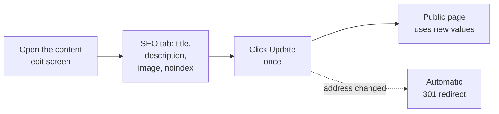
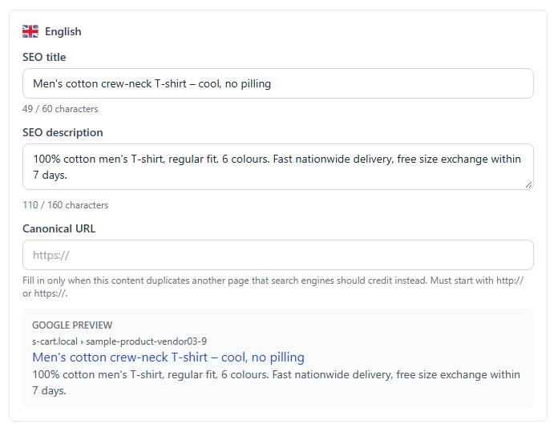
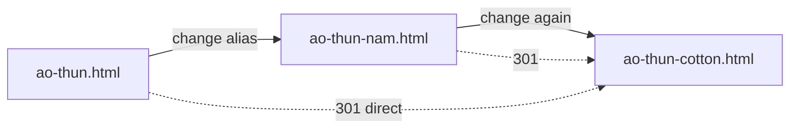
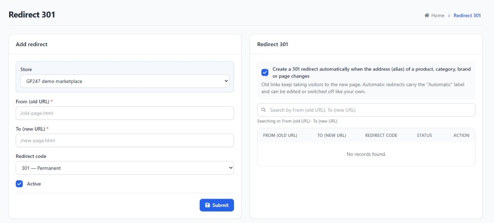

> 🌐 **Language:** [🇻🇳 Tiếng Việt](./seo-content_vi.md) · 🇬🇧 English (current) · [🇯🇵 日本語](./seo-content_ja.md)

# SEO for each piece of content

## Introduction
This page explains how to adjust SEO for **each** product, category, brand, content page or article: a custom title and description on Google, a share image, hiding a page from Google, and changing an address without losing visitors. It is for site owners and editors. After reading it, you can use the **SEO** tab on content edit screens and the **Redirect 301** screen.

## At a glance
Each piece of content has an **SEO** tab that is saved with the screen's save button (**Update**, or **Submit** when creating); when you change an address, the system keeps the old link working automatically.

- **Leaving it empty is safe** — any empty box means the page uses the content's name, description and image as before.
- **Save once** — the content and its SEO values are saved together; if there is an error, nothing is saved.
- **Changing an address doesn't lose visitors** — the old link forwards (301) to the new one automatically.
- **Deleting content also deletes its SEO values.**

## Where to find the SEO tab
The **SEO** tab is on the edit screen of:

| Content | Screen |
| --- | --- |
| Products, Categories | **SEO** tab next to the General, Description… tabs |
| Content pages | **SEO** tab next to the Content tab |
| Brands | Collapsed **SEO** section in the form, click to open |
| Articles, news categories | News plugin (**SEO** tab) |
| Content of other plugins | When that plugin registers with the SEO system |

## Setting a custom title, description and share image
Use this when the product name in your store differs from how customers search on Google (for example, the name is "Shirt AT-02" but customers search for "men's cotton t-shirt").

1. Open the content's edit screen and switch to the **SEO** tab.
2. For each language, enter an **SEO title** (best under 60 characters) and an **SEO description** (best 120–160 characters).
3. Look at the **Google preview** box just below — it updates as you type and is cut off the way Google does.
4. (Optional) choose a **Social share image** — the image shown when the link is shared on Facebook or Zalo.
5. Click **Update** (the screen's save button; **Submit** when creating).

If it worked, open the public page and look at the title on the browser tab: it is the SEO title you just entered (not wrapped in the title template).

## Hiding a page from Google (noindex, nofollow)
Use this for temporary pages, internal promotion pages, thank-you pages… that you don't want customers to find on Google.

- **Do not let search engines index this page** — the page leaves search results and sitemap.xml. Visitors can still open it with the link.
- **Do not let search engines follow the links on this page** — Google does not follow the links on the page. Rarely needed.

When you tick noindex, the tab shows a colored warning so you can be sure it is intentional. The **SEO check** screen also lists all hidden content so you can review it.

> ⚠️ **Note:** ticking noindex by mistake on a best-selling product makes it **leave Google** after a few days. Double-check before saving.

## Setting a custom canonical
The **Canonical URL** is only used when this content **duplicates** another page (for example, the same product listed in two categories with two addresses) and you want Google to credit the other page.

1. In the **SEO** tab, enter the full address of the main page in **Canonical URL**, for example `https://shop.vn/ao-thun-nam.html`.
2. Click **Update**.

If you leave it empty (recommended for most content), the canonical points to the page itself. When the canonical points to another page, the tab shows a warning: this page may stop appearing on Google.

## Changing an address without losing visitors (automatic 301 redirect)
When you change the **address (alias)** of a product, category, brand or page, the system automatically creates a **301 redirect** from the old address to the new one. Visitors clicking the old link (from Google, Facebook, bookmarks) still reach the right page, and Google moves the ranking to the new address.

- **One single hop** — if you change it several times, every old link points straight to the latest address, without going through several hops.
- **One redirect per language** when the website uses language-based addresses.
- **Real content always wins** — if you change back to an old address, or create new content at an address that has a redirect, that redirect is automatically **switched off** (not deleted).
- **Deleting content does not create a redirect** — that address returns a 404 error as usual.
- The switch **Create a 301 redirect automatically when the address (alias) … changes** is on the **SEO › Redirect 301** screen and is **on** by default.

## Managing redirects by hand (Redirect 301 screen)
The **SEO › Redirect 301** screen lists all redirects, both those created automatically (labelled **Automatic**) and those you added yourself.

1. Use the **Add redirect** form on the left of the screen (a multi-store site also shows a **Store** field).
2. Enter **From (old URL)**, starting with `/`, for example `/khuyen-mai-tet.html`.
3. Enter **To (new URL)** — an address within the website (`/khuyen-mai.html`) or a full address.
4. Choose the **Redirect code**: **301 — Permanent** (most cases) or **302 — Temporary** (when the old page will come back). Keep **Active** ticked.
5. Click **Submit**.

If it worked, opening the old address in a browser takes you to the new address. Automatic redirects can also be edited, switched off and deleted like manual ones (editing one by hand turns it into a manual redirect).

## Conditions & Rules (know before you act)

**When filling in the SEO tab**
- **SEO title at most 255 characters, SEO description at most 500 characters** — Google only shows about 60 and 160 characters; the limits stop you pasting a long paragraph by mistake.
- **The Canonical URL must be a full address starting with `http://` or `https://`, at most 500 characters** — Google does not understand relative addresses or plain text as a canonical.
- **If the SEO tab has an error, the whole content is not saved** — so content and SEO always match; the tab with the error is marked in red.
- **Without permission to edit the content, you cannot save its SEO** — SEO follows the permission of the content screen.

**When adding a redirect by hand**
- **"From" starts with `/` and must not duplicate another redirect of the same store** — each old address can forward to only one place.
- **"To" must not be the same as "From"** — to avoid an endless loop.
- **Redirecting the home page (`/`) shows a warning before saving** — every visitor to the home page would be sent elsewhere.

## Q&A
**Q1: Do I have to fill in the SEO tab for every product?**

→ No. If it is empty, the page uses the product name and description. Only fill it in for important products, or when the name differs from how customers search.

**Q2: I entered an SEO title but Google still shows the old title?**

→ Google needs time to re-read the page (a few days to a few weeks). You can request re-indexing in Search Console.

**Q3: My website has two languages. Do I have to fill in both?**

→ You should fill it in for each language you sell in. Any language left empty uses the name and description of that language version.

**Q4: I ticked noindex on a product by mistake. How do I undo it?**

→ Untick it in the SEO tab and click Update. The product goes back into the sitemap; Google will list it again when it re-reads the page.

**Q5: If I turn off the automatic redirect switch, are existing redirects lost?**

→ No. Turning it off only stops new redirects from being created; existing redirects keep working until you switch off or delete each one.

**Q6: Are redirects created automatically when I change addresses through an Excel import or the API?**

→ Yes. Redirects are created on every save path: the admin screens, data import, the REST API and AI agents.

**Q7: Why did one of my redirects switch itself off?**

→ Because its "From" address now belongs to real content (you changed back to the old address, or created a new page at that address). Real content always takes priority.

**Q8: My plugin has no SEO tab?**

→ The plugin needs to register with the SEO system. Point the plugin developer to [SEO hooks for developers](./seo-for-developers.md).

---

📅 **Last updated:** 2026-11-18 · ✍️ **Author:** GP247
