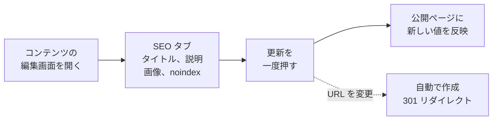
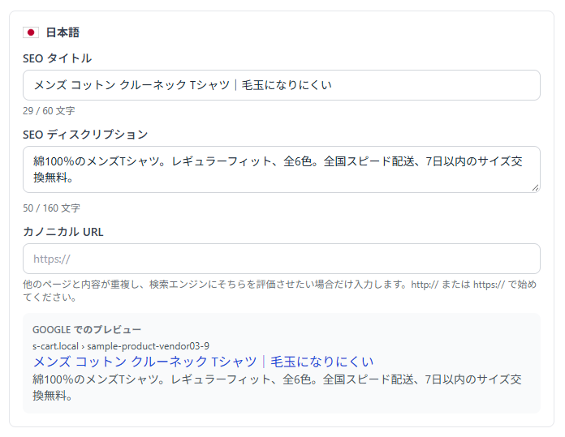
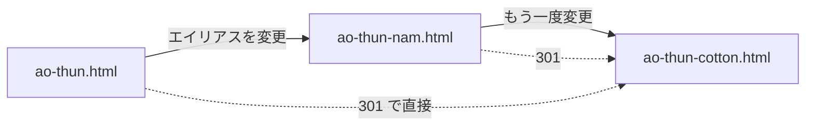
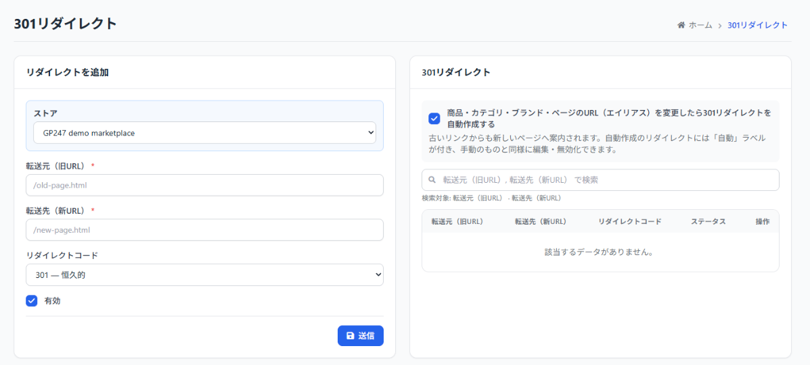

> 🌐 **言語:** [🇻🇳 Tiếng Việt](./seo-content_vi.md) · [🇬🇧 English](./seo-content.md) · 🇯🇵 日本語（現在）

# コンテンツごとの SEO

## はじめに
このページでは、商品、カテゴリ、ブランド、コンテンツページ、記事の**それぞれ**に SEO を設定する方法を説明します。Google 用の独自のタイトルと説明、シェア画像、ページを Google から隠す方法、訪問者を失わずに URL を変える方法です。サイトオーナーと編集者を対象としています。読み終えると、コンテンツ編集画面の **SEO** タブと **301リダイレクト** 画面を使えるようになります。

## ひと目でわかる
各コンテンツには **SEO** タブがあり、画面の保存ボタン（**更新**、新規作成時は **送信**）で一緒に保存されます。URL を変えると、システムが旧リンクを自動で引き継ぎます。

- **空欄のままで安全** — 空の欄には、これまでどおりコンテンツの名前、説明、画像が使われます。
- **保存は 1 回** — コンテンツと SEO の値は一緒に保存されます。エラーがあれば何も保存されません。
- **URL を変えても訪問者を失わない** — 旧リンクは新しいリンクへ自動で転送（301）されます。
- **コンテンツを削除すると、その SEO の値も削除**されます。

## SEO タブの場所
**SEO** タブは、次の編集画面にあります。

| コンテンツ | 画面 |
| --- | --- |
| 商品、カテゴリ | 「基本情報」「説明」などのタブの隣にある **SEO** タブ |
| ブランド、コンテンツページ | フォーム内の折りたたまれた **SEO** セクション（押すと開きます） |
| 記事、ニュースカテゴリ | ニュースプラグイン（**SEO** タブ） |
| 他のプラグインのコンテンツ | そのプラグインが SEO システムに登録している場合 |

## 独自のタイトル、説明、シェア画像を設定する
ストアでの商品名が、顧客が Google で検索する言葉と違うときに使います（例：商品名は「AT-02 シャツ」なのに、顧客は「メンズ コットン T シャツ」で検索する）。

1. コンテンツの編集画面を開き、**SEO** タブに切り替えます。
2. 言語ごとに **SEO タイトル**（60 文字未満を推奨）と **SEO ディスクリプション**（120〜160 文字を推奨）を入力します。
3. すぐ下の **Google でのプレビュー** を確認します。入力した文字に合わせて更新され、Google と同じように省略されます。
4. （任意）**SNS シェア用画像** を選びます。Facebook や Zalo でリンクをシェアしたときに表示される画像です。
5. 画面の保存ボタン **更新**（Update）を押します（新規作成時は **送信**（Submit））。

うまくいけば、公開ページを開いたとき、ブラウザのタブに入力した SEO タイトルが表示されます（タイトルテンプレートは適用されません）。

## ページを Google から隠す（noindex、nofollow）
一時的なページ、社内向けのキャンペーンページ、サンクスページなど、顧客に Google で見つけてほしくないページに使います。

- **検索エンジンにこのページをインデックスさせない** — ページが検索結果と sitemap.xml から外れます。訪問者はリンクから引き続き開けます。
- **このページのリンクを検索エンジンにたどらせない** — Google はページ内のリンクをたどりません。必要になることはまれです。

noindex にチェックを入れると、意図した操作か確認できるよう、タブに色付きの警告が表示されます。**SEOチェック** 画面にも、隠されているすべてのコンテンツが一覧表示されるので、見直すことができます。

> ⚠️ **注意:** 売れ筋の商品に誤って noindex を付けると、数日後にその商品は **Google から消えます**。保存する前に確認してください。

## 独自のカノニカルを設定する
**カノニカル URL** は、このコンテンツが別のページと**重複**している場合（例：同じ商品を 2 つのカテゴリに、2 つの URL で掲載している）に、Google にもう一方のページを評価させたいときだけ使います。

1. **SEO** タブで、メインのページの完全な URL を **カノニカル URL** に入力します。例：`https://shop.vn/ao-thun-nam.html`。
2. **更新** を押します。

空欄（ほとんどのコンテンツで推奨）なら、カノニカルはページ自身を指します。カノニカルが別のページを指していると、このページが Google に表示されなくなる可能性があるという警告がタブに表示されます。

## URL を変えても訪問者を失わない（自動 301 リダイレクト）
商品、カテゴリ、ブランド、ページの **URL（エイリアス）** を変更すると、システムは旧 URL から新 URL への **301 リダイレクト** を自動で作成します。旧リンク（Google、Facebook、ブックマークから）を押した訪問者も正しいページに着き、Google は順位を新しい URL に引き継ぎます。

- **1 ステップだけ** — 何度変更しても、すべての旧リンクは最新の URL へ直接つながります。複数のステップを経由しません。
- **言語ごとに 1 つのリダイレクト** — サイトが言語別の URL を使っている場合です。
- **実在するコンテンツが常に優先** — 旧 URL に戻した場合や、リダイレクトがある URL に新しいコンテンツを作った場合、そのリダイレクトは自動で**無効**になります（削除はされません）。
- **コンテンツを削除してもリダイレクトは作られません** — その URL は通常どおり 404 エラーを返します。
- **SEO › 301リダイレクト** 画面のスイッチ **商品・カテゴリ・ブランド・ページのURL（エイリアス）を変更したら301リダイレクトを自動作成する** で制御します。初期状態は**オン**です。

## リダイレクトを手動で管理する（301リダイレクト画面）
**SEO › 301リダイレクト** 画面には、すべてのリダイレクトが一覧表示されます。自動で作成されたもの（**自動** ラベル付き）も、手動で追加したものも含まれます。

1. 画面左側の **リダイレクトを追加** フォームを使います。マルチストアのサイトでは **ストア** 欄も表示されます。
2. **転送元（旧URL）** を `/` で始めて入力します。例：`/khuyen-mai-tet.html`。
3. **転送先（新URL）** を入力します。サイト内のパス（`/khuyen-mai.html`）または完全な URL です。
4. **リダイレクトコード** を選びます。**301 — 恒久的**（ほとんどの場合はこちら）または **302 — 一時的**（旧ページが戻ってくる場合）です。**有効** のチェックは入れたままにします。
5. **送信** を押します。

うまくいけば、ブラウザで旧 URL を開くと、新しい URL へ自動で転送されます。自動のリダイレクトも、手動のものと同じように編集、無効化、削除できます（手動で編集すると、手動のリダイレクトになります）。

## 条件と制約（操作の前に確認）

**SEO タブに入力するとき**
- **SEO タイトルは最大 255 文字、SEO ディスクリプションは最大 500 文字** — Google が表示するのは約 60 文字と 160 文字です。この上限は、長い文章を丸ごと誤って貼り付けるのを防ぎます。
- **カノニカル URL は `http://` または `https://` で始まる完全な URL で、最大 500 文字** — 相対パスやただの文字列は、Google がカノニカルとして理解しません。
- **SEO タブにエラーがあると、コンテンツ全体が保存されません** — コンテンツと SEO を常に一致させるためです。エラーのあるタブは赤く表示されます。
- **コンテンツの編集権限がなければ、その SEO も保存できません** — SEO はコンテンツ画面の権限に従います。

**手動でリダイレクトを追加するとき**
- **「転送元」は `/` で始め、同じストアの他のリダイレクトと重複しないこと** — 1 つの旧 URL の転送先は 1 か所だけです。
- **「転送先」は「転送元」と同じにできません** — 無限ループを防ぐためです。
- **トップページ（`/`）のリダイレクトは、保存前に警告が表示されます** — トップページへのすべての訪問者が転送されるためです。

## よくある質問（Q&A）
**Q1: すべての商品で SEO タブを入力する必要がありますか？**

→ いいえ。空欄なら、ページには商品名と説明が使われます。重要な商品や、商品名が顧客の検索の仕方と違う場合だけ入力してください。

**Q2: SEO タイトルを入力したのに、Google に古いタイトルが表示されるのはなぜですか？**

→ Google がページを読み直すまで時間がかかります（数日から数週間）。Search Console でインデックス登録を再リクエストすることもできます。

**Q3: 2 言語のサイトでは、両方の言語を入力する必要がありますか？**

→ 販売している言語ごとに入力することをおすすめします。空欄の言語には、その言語版の名前と説明が使われます。

**Q4: 商品に誤って noindex を付けてしまいました。どう戻せばよいですか？**

→ SEO タブでチェックを外し、**更新** を押します。商品はサイトマップに戻り、Google がページを読み直すと検索結果にも戻ります。

**Q5: 自動作成のスイッチをオフにすると、既存のリダイレクトは消えますか？**

→ いいえ。オフにすると新しいリダイレクトの作成が止まるだけです。既存のリダイレクトは、1 つずつ無効化または削除するまで動作し続けます。

**Q6: Excel や API で URL を変更した場合も、リダイレクトは自動で作られますか？**

→ はい。リダイレクトはすべての保存経路で作られます。管理画面、データのインポート、REST API、AI エージェントです。

**Q7: リダイレクトが自動で無効になったのはなぜですか？**

→ その「転送元」の URL が、実在するコンテンツのものになったためです（旧 URL に戻した、またはその URL で新しいページを作った）。実在するコンテンツが常に優先されます。

**Q8: プラグインに SEO タブがないのはなぜですか？**

→ プラグインは SEO システムに登録する必要があります。プラグインの開発者に [開発者向け SEO フック](./seo-for-developers_ja.md) を見てもらってください。

---

📅 **最終更新:** 2026-11-17 · ✍️ **作成者 (Author):** GP247
