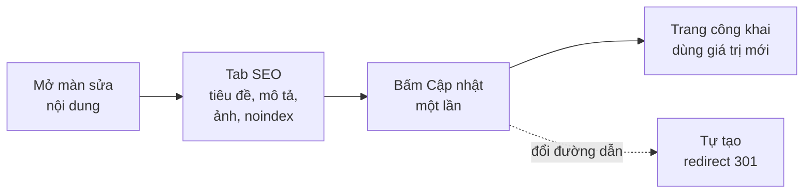
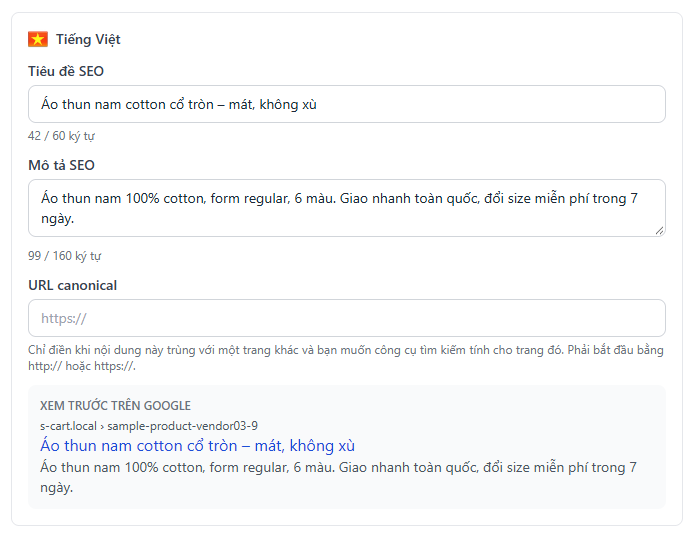
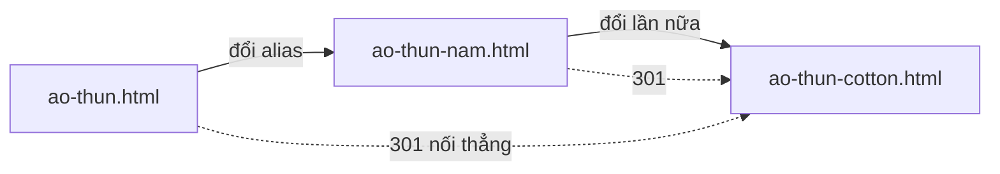
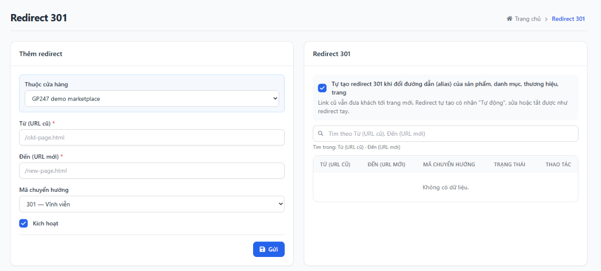

> 🌐 **Ngôn ngữ:** 🇻🇳 Tiếng Việt (hiện tại) · [🇬🇧 English](./seo-content.md) · [🇯🇵 日本語](./seo-content_ja.md)

# SEO cho từng nội dung

## Giới thiệu
Trang này hướng dẫn chỉnh SEO cho **từng** sản phẩm, danh mục, thương hiệu, trang nội dung hay bài viết: tiêu đề và mô tả riêng trên Google, ảnh chia sẻ, giấu một trang khỏi Google, và đổi đường dẫn mà không mất khách. Dành cho chủ site và biên tập viên. Đọc xong, bạn dùng được tab **SEO** ở màn sửa nội dung và màn **Redirect 301**.

## Nhìn nhanh
Mỗi nội dung có một tab **SEO** lưu cùng nút lưu của màn (**Cập nhật**, hoặc **Gửi** khi tạo mới); khi bạn đổi đường dẫn, hệ thống tự giữ link cũ.

- **Để trống là an toàn** — ô nào trống thì trang dùng tên, mô tả, ảnh của nội dung như trước.
- **Lưu một lần** — nội dung và giá trị SEO lưu cùng nhau; có lỗi thì không lưu gì.
- **Đổi đường dẫn không mất khách** — link cũ tự chuyển (301) sang link mới.
- **Xoá nội dung thì xoá luôn giá trị SEO** của nó.

## Tab SEO có ở đâu
Tab **SEO** có trên màn sửa của:

| Nội dung | Màn |
| --- | --- |
| Sản phẩm, Danh mục | Tab **SEO** cạnh các tab Chung, Mô tả… |
| Trang nội dung | Tab **SEO** cạnh tab Nội dung |
| Thương hiệu | Mục **SEO** thu gọn trong form, bấm để mở |
| Bài viết, danh mục tin | Plugin Tin tức (tab **SEO**) |
| Nội dung của plugin khác | Khi plugin đó đăng ký với hệ thống SEO |

## Đặt tiêu đề, mô tả và ảnh chia sẻ riêng
Dùng khi tên sản phẩm trên cửa hàng khác với cách khách tìm trên Google (ví dụ tên "Áo AT-02" nhưng khách tìm "áo thun nam cotton").

1. Mở màn sửa nội dung, chuyển sang tab **SEO**.
2. Ở từng ngôn ngữ, nhập **Tiêu đề SEO** (nên dưới 60 ký tự) và **Mô tả SEO** (nên 120–160 ký tự).
3. Xem khung **Xem trước trên Google** ngay bên dưới — khung cập nhật theo chữ bạn gõ, cắt như Google.
4. (Tuỳ chọn) chọn **Ảnh chia sẻ mạng xã hội** — ảnh hiện khi chia sẻ link lên Facebook, Zalo.
5. Bấm **Cập nhật** (nút lưu của màn; khi tạo mới là **Gửi**).

Nếu thành công, mở trang công khai và xem tiêu đề trên tab trình duyệt: đó là tiêu đề SEO vừa nhập (không bị bọc mẫu tiêu đề).

## Giấu một trang khỏi Google (noindex, nofollow)
Dùng cho trang tạm, trang khuyến mãi nội bộ, trang cảm ơn… mà bạn không muốn khách tìm thấy trên Google.

- **Không cho công cụ tìm kiếm index trang này** — trang rời khỏi kết quả tìm kiếm và sitemap.xml. Khách vẫn mở được bằng link.
- **Không cho công cụ tìm kiếm đi theo liên kết trên trang này** — Google không đi theo các link trên trang. Hiếm khi cần.

Khi tick noindex, tab hiện cảnh báo màu để bạn chắc mình chủ ý. Màn **Kiểm tra SEO** cũng liệt kê mọi nội dung đang bị giấu để bạn rà lại.

> ⚠️ **Lưu ý:** tick nhầm noindex trên sản phẩm bán chạy làm nó **rời khỏi Google** sau vài ngày. Kiểm tra lại trước khi lưu.

## Đặt canonical riêng
**URL canonical** chỉ dùng khi nội dung này **trùng** với một trang khác (ví dụ cùng một sản phẩm đăng ở hai danh mục với hai đường dẫn) và bạn muốn Google tính thứ hạng cho trang kia.

1. Ở tab **SEO**, nhập địa chỉ đầy đủ của trang chính vào **URL canonical**, ví dụ `https://shop.vn/ao-thun-nam.html`.
2. Bấm **Cập nhật**.

Để trống (khuyến nghị cho hầu hết nội dung) thì canonical trỏ về chính trang. Khi canonical trỏ sang trang khác, tab hiện cảnh báo: trang này có thể không còn xuất hiện trên Google.

## Đổi đường dẫn mà không mất khách (Redirect 301 tự động)
Khi bạn đổi **đường dẫn (alias)** của sản phẩm, danh mục, thương hiệu hay trang, hệ thống tự tạo một **redirect 301** từ địa chỉ cũ sang địa chỉ mới. Khách bấm link cũ (từ Google, Facebook, bookmark) vẫn tới đúng trang, và Google chuyển thứ hạng sang địa chỉ mới.

- **Một bước duy nhất** — đổi nhiều lần thì mọi link cũ đều nối thẳng tới địa chỉ mới nhất, không đi vòng qua nhiều bước.
- **Mỗi ngôn ngữ một redirect** khi website dùng đường dẫn theo ngôn ngữ.
- **Nội dung thật luôn thắng** — nếu bạn đổi về một địa chỉ cũ, hoặc tạo nội dung mới đúng địa chỉ đang có redirect, redirect đó tự **tắt** (không xoá).
- **Xoá nội dung không tạo redirect** — địa chỉ đó trả lỗi 404 như bình thường.
- Công tắc **Tự tạo redirect 301 khi đổi đường dẫn** ở màn **SEO › Redirect 301**, mặc định **bật**.

## Quản lý redirect bằng tay (màn Redirect 301)
Màn **SEO › Redirect 301** liệt kê mọi redirect, cả redirect tự tạo (nhãn **Tự động**) lẫn redirect bạn tự thêm.

1. Dùng form **Thêm redirect** bên trái màn (site nhiều cửa hàng có thêm ô **Thuộc cửa hàng**).
2. Nhập **Từ (URL cũ)**, bắt đầu bằng `/`, ví dụ `/khuyen-mai-tet.html`.
3. Nhập **Đến (URL mới)** — đường dẫn trong website (`/khuyen-mai.html`) hoặc địa chỉ đầy đủ.
4. Chọn **Mã chuyển hướng**: **301 — Vĩnh viễn** (dùng cho hầu hết trường hợp) hoặc **302 — Tạm thời** (khi trang cũ sẽ quay lại). Giữ tick **Kích hoạt**.
5. Bấm **Gửi**.

Nếu thành công, mở địa chỉ cũ trên trình duyệt sẽ tự chuyển sang địa chỉ mới. Redirect tự động cũng sửa, tắt, xoá được như redirect tay (sửa tay thì nó thành redirect tay).

## Điều kiện & ràng buộc (hiểu trước khi thao tác)

**Khi nhập tab SEO**
- **Tiêu đề SEO tối đa 255 ký tự, Mô tả SEO tối đa 500 ký tự** — Google chỉ hiện khoảng 60 và 160 ký tự; giới hạn chặn việc dán nhầm cả đoạn văn dài.
- **URL canonical phải là địa chỉ đầy đủ bắt đầu bằng `http://` hoặc `https://`, tối đa 500 ký tự** — địa chỉ tương đối hay chữ thường không được Google hiểu là canonical.
- **Có lỗi ở tab SEO thì cả nội dung không được lưu** — để nội dung và SEO luôn khớp nhau; tab có lỗi được đánh dấu đỏ.
- **Không có quyền sửa nội dung thì không lưu được SEO của nó** — SEO đi theo quyền của màn nội dung.

**Khi thêm redirect tay**
- **"Từ" bắt đầu bằng `/` và không trùng một redirect khác của cùng cửa hàng** — mỗi địa chỉ cũ chỉ chuyển về một nơi.
- **"Đến" không được trùng "Từ"** — tránh vòng lặp vô tận.
- **Redirect trang chủ (`/`) có cảnh báo trước khi lưu** — mọi khách vào trang chủ sẽ bị chuyển đi.

## Hỏi & Đáp (Q&A)
**Câu 1: Có bắt buộc điền tab SEO cho mọi sản phẩm không?**

→ Không. Để trống thì trang dùng tên và mô tả sản phẩm. Chỉ điền cho sản phẩm quan trọng hoặc khi tên không giống cách khách tìm.

**Câu 2: Tôi điền tiêu đề SEO nhưng Google vẫn hiện tiêu đề cũ?**

→ Google cần thời gian đọc lại trang (vài ngày tới vài tuần). Bạn có thể yêu cầu lập chỉ mục lại trong Search Console.

**Câu 3: Website hai ngôn ngữ, tôi phải điền cả hai?**

→ Nên điền cho từng ngôn ngữ đang bán. Ngôn ngữ nào để trống thì dùng tên, mô tả của bản ngôn ngữ đó.

**Câu 4: Tôi lỡ tick noindex cho sản phẩm, làm sao gỡ?**

→ Bỏ tick ở tab SEO và bấm Cập nhật. Sản phẩm quay lại sitemap; Google sẽ đưa lại lên kết quả khi đọc lại trang.

**Câu 5: Tắt công tắc tự tạo redirect thì redirect cũ có mất không?**

→ Không. Tắt chỉ ngừng tạo redirect mới; các redirect đã có vẫn hoạt động cho tới khi bạn tắt hay xoá từng cái.

**Câu 6: Đổi đường dẫn nhập qua Excel hay API có tự tạo redirect không?**

→ Có. Redirect được tạo ở mọi đường lưu: màn quản trị, nhập dữ liệu, REST API, AI agent.

**Câu 7: Vì sao một redirect của tôi tự chuyển sang trạng thái tắt?**

→ Vì địa chỉ "Từ" của nó đang thuộc về một nội dung thật (bạn đổi về đường dẫn cũ hoặc tạo trang mới đúng địa chỉ đó). Nội dung thật luôn được ưu tiên.

**Câu 8: Plugin của tôi không có tab SEO?**

→ Plugin cần đăng ký với hệ thống SEO. Báo nhà phát triển plugin xem [Hook SEO cho lập trình viên](./seo-for-developers_vi.md).

---

📅 **Cập nhật lần cuối:** 2026-11-18 · ✍️ **Tác giả (Author):** GP247
