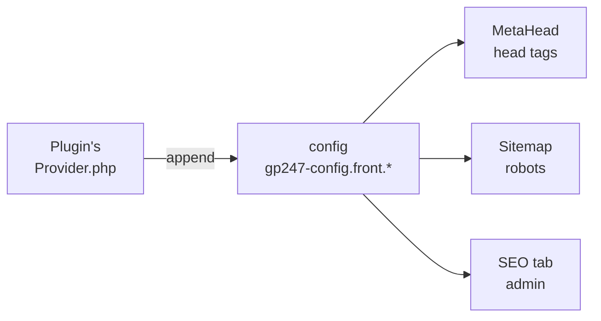
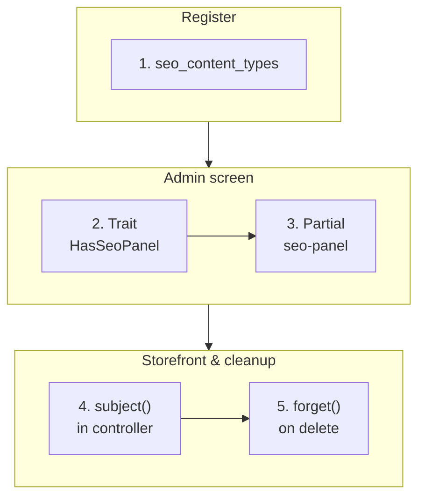

> 🌐 **Language:** [🇻🇳 Tiếng Việt](./seo-for-developers_vi.md) · 🇬🇧 English (current) · [🇯🇵 日本語](./seo-for-developers_ja.md)

# SEO hooks for plugin and template developers

## Introduction
This page is for **developers** writing plugins or templates for GP247. It lists every SEO extension point (hook) that gp247/front provides — registering content types with an SEO tab, sitemap, noindex, `og:type`, JSON-LD, review ratings, automatic 301s, system alerts — with copy-ready code samples. After reading it, your plugin's content gets the same SEO as products and categories without editing core or the template.

## At a glance
Every hook follows one pattern: the plugin **appends** to a registry in `Provider.php` while the plugin is active; gp247/front reads the registry when needed and **never** knows the plugin's name.



- **No core edits, no template edits** — register from the plugin only.
- **Always wrap in `gp247_extension_check_active()`** — a disabled plugin registers nothing.
- **Soft dependency** — check `class_exists` / `trait_exists` so the plugin still runs on older gp247/front versions that lack a given hook.
- **Reference plugin**: the **News** plugin (free, open source) uses nearly every hook on this page.

## On this page
- [Registry summary](#registry-summary) — config keys, data shapes, effects
- [Registering from Provider.php](#registering-from-providerphp) — the common pattern
- [Give plugin content its own SEO tab](#give-plugin-content-its-own-seo-tab) — 5 steps
- [Automatic 301 on alias change and IndexNow](#automatic-301-on-alias-change-and-indexnow) — `route` + `SeoUrlLifecycle::watch()`
- [Adding URLs to the sitemap](#adding-urls-to-the-sitemap) — `seo_sitemap_providers`
- [Hiding private and filter pages](#hiding-private-and-filter-pages) — `seo_noindex_routes`, `seo_noindex_query_params`
- [og:type, JSON-LD and review ratings](#ogtype-json-ld-and-review-ratings) — `seo_og_types`, `@push('jsonld')`, `seo_product_rating_resolvers`
- [Not-found pages return 404](#not-found-pages-return-404) — `itemNotFound()`
- [The template SEO contract](#the-template-seo-contract) — `<x-gp247-front::meta-head>`, tracking code & cookie banner, shop pages copied into a template
- [Adding a check to System alerts](#adding-a-check-to-system-alerts) — `AdminAlertRegistry`

## Registry summary
Everything lives under `config('gp247-config.front.*')`; gp247/front and gp247/shop register their own parts, and plugins add theirs.

| Key | Shape of each item | Effect |
| --- | --- | --- |
| `seo_content_types` | `'<type>' => ['label' => '<language key>', 'route' => '<route name>']` (`route` optional) | Content with its own SEO values: SEO tab, title template box, head tags; with `route` you also get automatic 301 + IndexNow |
| `seo_sitemap_providers` | `['key' => '<ConfigKey>', 'label' => '<name>', 'callback' => [Class::class, 'method']]` | Adds URLs to `/sitemap.xml`; switched on/off per plugin on the Sitemap.xml screen |
| `seo_noindex_routes` | route name, a trailing `*` matches a prefix (`'myplugin.account.*'`) | Matching pages get `noindex, follow` |
| `seo_noindex_query_params` | query parameter name (`'filter_color'`) | URLs with this parameter get `noindex, follow`, canonical to the base page |
| `seo_og_types` | `'<route or prefix*>' => '<og type>'` | `og:type` of the route (default `website`) |
| `seo_product_rating_resolvers` | callable `(string $productId, $storeId): ?array` | `aggregateRating` in the Product JSON-LD |
| `seo_jsonld_extenders` | `Product`, `Offer`, `Organization` => list of callables `(array $context): array` | Adds schema.org fields to the existing JSON-LD block without overwriting fields already there — since front 3.12.1 |
| `seo_redirect_sources` | `'<source>' => ['label' => '<language key>']` (source `[a-z0-9_-]{1,10}`, not `manual`, `auto`, `import`) | A plugin writes 301 redirects under its own source name, its label shown on the Redirect 301 screen — since front 3.12.1 |

Since front 3.12.1, a `seo_content_types` entry also takes an optional **`source`** key — where the content lives, so the **SEO check**
and SEO plugins can cover a plugin's content type: `table`, `class` (model), `name` (label column), `desc` + `fk` (per-language table),
`text` (long text columns), `edit_route` (edit route taking `id`). Example: the `page` type in gp247/front's `config.php`.

## Registering from Provider.php
Every registry uses the same pattern: read the current array, add the plugin's part, write it back. A shortened example from the News plugin:

```php
// app/GP247/Plugins/<Key>/Provider.php — inside the gp247_extension_check_active(...) block
$providers = (array) config('gp247-config.front.seo_sitemap_providers', []);
$providers[] = [
    'key'      => $config['configKey'],          // used for the switch on the Sitemap.xml screen
    'label'    => $config['name'],
    'callback' => [\App\GP247\Plugins\News\Seo::class, 'sitemapUrls'],
];
config(['gp247-config.front.seo_sitemap_providers' => $providers]);

config(['gp247-config.front.seo_noindex_query_params' => array_values(array_unique(array_merge(
    (array) config('gp247-config.front.seo_noindex_query_params', []),
    ['filter_sort']
)))]);

$ogTypes = (array) config('gp247-config.front.seo_og_types', []);
$ogTypes['news.content'] = 'article';
config(['gp247-config.front.seo_og_types' => $ogTypes]);
```

- **Always `array_merge` / append items**, never overwrite the whole array — overwriting wipes out the registrations of shop and other plugins.
- If a gp247/front version does not have a registry yet, **that key is simply ignored** — extra registrations cause no errors.

## Give plugin content its own SEO tab
The five steps below give your plugin's content (articles, projects, courses…) the full treatment products get: an SEO tab on the edit screen, its own values on the public page, and cleanup on delete.



### Step 1 — Register the content type
```php
config(['gp247-config.front.seo_content_types' => array_merge(
    (array) config('gp247-config.front.seo_content_types', []),
    [
        'news'          => ['label' => 'Plugins/News::lang.seo_type_news'],
        'news_category' => ['label' => 'Plugins/News::lang.seo_type_news_category'],
    ]
)]);
```

A type key may only contain `a-z 0-9 _ -`, at most 50 characters, and should carry the plugin's name so it does not clash with another plugin's type. The type immediately gets a box under **Title templates** (Meta & JSON-LD screen), shown with its `label`.

### Step 2 — Add the trait to the Livewire screen
The edit screen must be a `GP247\Core\AdminShell\Infrastructure\ResourcePanel` (with `baseQuery()` and `editingId`). Use the trait `GP247\Front\Admin\Livewire\Concerns\HasSeoPanel`:

```php
use GP247\Front\Admin\Livewire\Concerns\HasSeoPanel;

class ArticleManager extends ResourcePanel
{
    use HasSeoPanel;

    protected function seoType(): string { return 'news'; }

    protected function fillForm($model): array
    {
        $this->fillSeo($model->id);          // load the SEO tab when a record is opened
        // ... return the form fields as before
    }

    public function resetForm(): void
    {
        parent::resetForm();
        $this->fillSeo(null);                // create form
    }

    protected function rules(): array
    {
        return array_merge([/* the screen's rules */], $this->seoRules());
    }

    public function validationAttributes(): array
    {
        return $this->seoValidationAttributes();   // translated error labels
    }

    protected function persist(array $data): void
    {
        // Save content and SEO in ONE transaction; on error nothing is saved.
        $this->persistWithSeo(fn () => $this->persistContent($data));
    }
}
```

`persistWithSeo()` only writes SEO for a record that the screen's `baseQuery()` can load — someone without permission for that store cannot write its SEO.

> 💡 **Tip — still running on older gp247/front:** `use HasSeoPanel;` on a front version without the trait breaks the whole screen. The News plugin solves this with a bridge trait: the file `Concerns/NewsSeoPanel.php` only contains `class_alias(trait_exists(HasSeoPanel::class) ? HasSeoPanel::class : NewsSeoPanelFallback::class, NewsSeoPanel::class);`, where `NewsSeoPanelFallback` has the same method names but does nothing (`persistWithSeo` just calls the save function back). The screen uses `use NewsSeoPanel;`.

### Step 3 — Add the tab to the view
```blade
@include('gp247-front-admin::partials.seo-panel', [
    'nameField'        => 'desc.{code}.title',        // Livewire path of the name, {code} = language code
    'descriptionField' => 'desc.{code}.description',  // null if the content has no description
    'aliasField'       => 'form.alias',
    'imageType'        => 'content',                  // image folder of the image picker
])
```

The partial comes with per-language title/description boxes, share image, noindex, nofollow, canonical, the Google preview box, warnings, labels in three languages and `data-testid` attributes (`seo-panel`, `seo-title-<lang>`…). Validation errors use `seo.*` keys — feed them into the screen's error-tab marking.

### Step 4 — Declare the displayed content in the controller
```php
\GP247\Front\Library\SeoContentMeta::subject('news', $article->id);
return view($view, [...]);
```

Call it right before returning the detail page view (only when the real page is shown, not in the 404 branch). `<x-gp247-front::meta-head>` reads the content's own SEO values automatically — no template changes needed.

### Step 5 — Delete SEO values with the content
```php
protected static function boot()
{
    parent::boot();
    static::deleted(function ($article) {
        \GP247\Front\Library\SeoContentMeta::forget('news', $article->id);
    });
}
```

Use the `deleted` event (not `deleting`) so that a cancelled delete does not lose the SEO. A plugin that drops its tables on uninstall should call `forget()` for each id **before** dropping the tables — the SEO check screen only cleans up orphaned data of the built-in types (pages, products, categories, brands).

Other `SeoContentMeta` functions: `types()`, `isRegistered($type)`, `for($type, $id, $lang)` (read), `save($type, $id, $data, $storeId)` (validated write — use it for bulk data imports).

## Automatic 301 on alias change and IndexNow
Add a `route` key to the content type and watch the model to get the same behavior as products: changing the alias creates a 301 redirect automatically, and saving/deleting notifies IndexNow (when the site owner has turned it on).

```php
'project' => ['label' => 'Plugins/Portfolio::lang.seo_type_project', 'route' => 'portfolio.project'],
```

```php
// Plugin model
protected static function boot()
{
    parent::boot();
    if (class_exists(\GP247\Front\Library\SeoUrlLifecycle::class)) {
        \GP247\Front\Library\SeoUrlLifecycle::watch(static::class, 'project');
    }
}
```

- **The route may only take `alias` (and `lang` when the website uses language-based addresses)** — the system builds the old/new URLs with exactly those two parameters. If the route needs more parameters (e.g. `{category}/{alias}` like News articles), do **not** declare `route`.
- The model needs `alias` and `store_id` columns; if it has a `status` column, inactive content is not sent to IndexNow.

### A plugin writing its own 301 redirects (since front 3.12.1)
A plugin that has to send an old address to content of the site (a new URL structure, merged pages…) declares a source and calls
`SeoUrlLifecycle` — it never writes the redirect table itself:

```php
// Provider.php
config(['gp247-config.front.seo_redirect_sources.myplugin' => ['label' => 'Plugins/MyPlugin::lang.redirect_source']]);

// Check first (preview), then write
$reason = \GP247\Front\Library\SeoUrlLifecycle::checkContentRedirect($storeId, '/old-name', 'product', $alias); // 'ok' or the reason it is skipped
$id = \GP247\Front\Library\SeoUrlLifecycle::redirectToContent($storeId, '/old-name', 'product', $alias, 'myplugin');
```

- `$from` is a path on the site (`/old-name`), never a full URL; the content type needs a `route`.
- The automatic-redirect rules apply: live content and fixed pages are never taken over, an existing redirect is never overwritten,
  chains are flattened. `redirectToContent()` returns `null` when it skips; `checkContentRedirect()` gives the reason (`LEGACY_*` constants).
- A plugin that brings data from another platform uses `checkLegacyPath()` / `redirectLegacyPath()` (source `import`, label **Imported**)
  and `removeImportedRedirect()` to take back the redirects of an import that was undone *(since front 3.11.1)*.

## Adding URLs to the sitemap
The callback receives `$storeId` and returns an array of URLs **for that store only, active content only**:

```php
public static function sitemapUrls($storeId): array
{
    return Article::where('store_id', $storeId)->where('status', 1)->get()
        ->map(fn ($a) => [
            'alias'      => $a->alias,   // required — so the "Exclude from sitemap" list can apply
            'loc'        => gp247_route_front('news.content', ['category' => $a->category_alias, 'alias' => $a->alias]),
            'lastmod'    => $a->updated_at?->format('Y-m-d'),
            'changefreq' => 'weekly',
            'priority'   => '0.7',
        ])->all();
}
```

The site owner can turn off the plugin's whole group of URLs under **SEO › Sitemap.xml › Plugin sitemap** (by `key`).

## Hiding private and filter pages
Register the plugin's private routes (account, cart, checkout) and its filter/sort parameters:

```php
config(['gp247-config.front.seo_noindex_routes' => array_merge(
    (array) config('gp247-config.front.seo_noindex_routes', []),
    ['booking.account.*', 'booking.checkout']
)]);
```

- A `*` **at the end** matches a prefix; a `*` on its own is ignored (and logged) so a plugin cannot accidentally hide the whole website.
- The `page` and `lang` parameters never count as filter parameters.

## og:type, JSON-LD and review ratings
**`og:type`** — `$ogTypes['portfolio.project'] = 'article';` (lowercase `a-z.` only; a prefix like `portfolio.*` also works).

**Per-page JSON-LD** — push into the `jsonld` stack from the plugin's view, using gp247/front's partials and builders (already escaped, already checking the JSON-LD switch):

```blade
@push('jsonld')
    @php
        $jsonldArticle = [
            'headline'      => $article->title,
            'url'           => request()->url(),
            'imageUrl'      => gp247_file($article->getImage()),
            'datePublished' => optional($article->created_at)->toIso8601String(),
            'dateModified'  => optional($article->updated_at)->toIso8601String(),
            'description'   => $description,
        ];
    @endphp
    @include($GP247TemplatePath.'.common.jsonld_article')
    @include($GP247TemplatePath.'.common.jsonld_breadcrumb')
@endpush
```

Builders you can call directly: `SeoMeta::buildArticleJsonLd()`, `buildBreadcrumbJsonLd()`, `buildProductJsonLd()`. **Do not `json_encode` by hand** — the builders already guard against `</script>` injection.

**Product review ratings** — a review plugin registers a resolver:

```php
$resolvers = (array) config('gp247-config.front.seo_product_rating_resolvers', []);
$resolvers[] = [\App\GP247\Plugins\MyReview\Seo::class, 'rating'];
config(['gp247-config.front.seo_product_rating_resolvers' => $resolvers]);

// return null when there are no reviews yet
public static function rating(string $productId, $storeId): ?array
{
    return ['ratingValue' => 4.6, 'reviewCount' => 12, 'bestRating' => 5];
}
```

`aggregateRating` is only printed when `reviewCount` > 0; a resolver that throws an error is skipped and the page still renders.

**Adding fields to an existing JSON-LD block** *(since front 3.12.1)* — to add schema.org fields to Product, Offer or Organization
(e.g. `gtin13`, `sameAs`), register an extender; do **not** print a second block of the same type (search engines read it as a
conflicting entity):

```php
$extenders = (array) config('gp247-config.front.seo_jsonld_extenders.Product', []);
$extenders[] = [\App\GP247\Plugins\MyPlugin\Seo::class, 'productFields'];
config(['gp247-config.front.seo_jsonld_extenders.Product' => $extenders]);

// $context: product_id, store_id, price, currency, url (Organization: store_id, url)
public static function productFields(array $context): array
{
    return ['gtin13' => '8930000000001'];
}
```

Fields already present are never overwritten (the first registered extender wins); values must be numbers, strings or arrays of them; an
extender that throws is skipped.

## Not-found pages return 404
The plugin's storefront controller extends `GP247\Front\Controllers\RootFrontController`. Every "not found" branch (record missing, inactive, belonging to another store) **returns `$this->itemNotFound()`** — the template's notfound page with **HTTP code 404**. Don't `return view(...)` yourself: returning 200 for an empty page makes Google treat it as a real page (soft 404).

## The template SEO contract
A template (including templates customers write themselves) only needs to place the following points correctly in its layout; gp247/front builds all SEO tags.

```blade
<html lang="{{ app()->getLocale() }}" dir="{{ /* rtl or ltr depending on the language */ }}">
<head>
    <x-gp247-front::meta-head :title="$title ?? null" :description="$description ?? null"
        :keyword="$keyword ?? null" :og_image="$og_image ?? null" :canonical="$canonical ?? null"
        :hreflang="$seoHreflang ?? []" />
    @if (\GP247\Front\Library\SeoMeta::jsonldEnabled())
        @stack('jsonld')
    @endif
    {!! gp247_render_block('header', ...) !!}
</head>
```

| `meta-head` prop | Use when |
| --- | --- |
| `title`, `og_image` | The page's values; when empty, the store's values are used |
| `description`, `keyword` | The page's values; when empty, no tag is printed (the store's values are not used, so pages do not share one description) |
| `canonical` | Forcing a different canonical (rare) |
| `hreflang` | List of translations; when empty, computed from the route |
| `robots` | Forcing the robots tag for a special page |
| `ogType` | Forcing `og:type` (usually the registry is used instead of the prop) |

- **Do not write your own** title, description, canonical, Open Graph, Twitter or Organization JSON-LD tags in the layout — hand-written tags drift and miss new tags (verification codes, robots, hreflang).
- **Avoid overriding** the `gp247_components/meta-head` and `common/jsonld_*` views — there is no design reason to copy them, and a copy stays frozen when gp247/front is updated.

### Tracking code and the cookie banner
`meta-head` also prints the tracking code the site owner enters on **SEO › Tracking code & cookies** (GA4, GTM, Meta Pixel, custom code), the cookie consent loader and the cookie banner. Calling `meta-head` in the layout is enough; a layout that does not call it has neither the code nor the banner, and **System alerts** reports it. How site owners use it: [Tracking code & cookie banner](./tracking-and-cookies.md).

- **A "Cookie settings" link in the footer (recommended)** — an element with `data-gp247-consent-open` and the `hidden` attribute; the loader shows it while the banner is on and opens the settings panel when clicked. Without such an element the loader adds a small floating button in the corner. Wrap it in `class_exists` so the template still runs on an older gp247/front:

```blade
@if (class_exists(\GP247\Front\TemplateComponents\ConsentBanner::class))
    <button type="button" data-gp247-consent-open hidden>{{ gp247_language_render('front.consent.settings') }}</button>
@endif
```

- **Changing colours does not need an override** — the banner uses seven CSS variables: `--gp247-consent-bg` (background), `--gp247-consent-fg` (main text), `--gp247-consent-muted` (secondary text), `--gp247-consent-border` (borders), `--gp247-consent-btn-bg` / `--gp247-consent-btn-fg` (background / text of the three buttons), `--gp247-consent-focus` (outline when chosen with the keyboard). Set them in the template's CSS with a selector stronger than `.gp247-consent` — the banner's styles come after the template's CSS in the page — and keep enough contrast between text and background:

```css
body .gp247-consent {
    --gp247-consent-btn-bg: #ea580c;
    --gp247-consent-btn-fg: #fff;
    --gp247-consent-focus: #ea580c;
}
```

- **Override `gp247_components/consent-banner` only when the design really has to change** — keep every `data-gp247-consent-*` attribute (banner, settings panel, the `analytics` / `marketing` boxes, save, close) and keep the three buttons **Accept all / Reject / Customise** the same size and style.
- **Do not put tracking code in the `header` layout block** — code there runs outside the cookie banner; System alerts reports layout HTML blocks that hold a `<script>`.

### When you copy shop pages into the template
A shop page copied into the template no longer receives gp247/shop fixes on its own. Three pages carry rules of their own:

- **`screen/shop_product_detail`** — keep the package's `@push('jsonld')` block as it is (SKU, brand, UPC/EAN/JAN, MPN, promotion end date, the product id used for ratings); restyle only around it. A template that must run on a gp247/shop older than 3.11.3 checks `method_exists($product, 'promotionValidUntil')`.
- **`livewire/shop_product-filter`** — keep the Livewire bindings (`wire:model.live="sort"`, shown in the URL as `filter_sort`, `priceMin`, `priceMax`, `applyPrice`, `clearFilters`, `toggleBrand`) and offer only the sort values of `ShopProduct::storefrontSort()`: empty (Featured), `id_desc`, `sold_desc`, `price_asc`, `price_desc`, `name_asc`.
- **Sales events** (view item, add to cart, begin checkout, purchase) are sent by the shop's controllers and Livewire; views need nothing for them — as long as adding to the cart goes through the shop's own button / action, not a hand-made form or `fetch`.

## Adding a check to System alerts
A plugin can add a line to the **System alerts** block and the `gp247:doctor` command (the way gp247/front adds the `seo_audit` line):

```php
use GP247\Core\AdminShell\Domain\AdminAlertCheck;
use GP247\Core\AdminShell\Infrastructure\AdminAlert;

class FeedHealthCheck implements AdminAlertCheck
{
    public function key(): string { return 'myplugin_feed'; }
    public function ttl(): int { return 600; }   // seconds to keep the result
    public function evaluate(): AdminAlert
    {
        return $ok
            ? AdminAlert::ok($this->key(), 'Feed is up to date')
            : AdminAlert::warning($this->key(), 'Feed is 3 days old', '', $fixUrl, 'Open feed settings');
    }
}

// Provider.php
if (class_exists(\GP247\Core\AdminShell\Support\AdminAlertRegistry::class)) {
    \GP247\Core\AdminShell\Support\AdminAlertRegistry::register(FeedHealthCheck::class);
}
```

`evaluate()` should **only read saved results** (no scanning of large database tables), because it runs when the admin is opened.

## Conditions & Rules (know before you act)

**When registering**
- **Register only while the plugin is active** (`gp247_extension_check_active`) — a disabled plugin that still registers makes the sitemap and robots point to pages that do not exist.
- **Append to registries, never overwrite them** — overwriting deletes the registrations of shop and other plugins.
- **Content type keys `[a-z0-9_-]`, at most 50 characters** — types with an invalid pattern are ignored; for an unregistered type, `save()` writes nothing (it only logs a warning).

**When declaring `route` for automatic 301**
- **The route takes only `alias` (+ `lang`)** — if the URL cannot be built correctly, the system creates no redirect, which avoids broken redirects.

**Current limits**
- **The SEO check screen and orphaned-data cleanup only cover pages, products, categories and brands** — plugins clean up their own SEO values (Step 5).
- **The MCP tools `get_seo` / `update_seo` only accept the built-in types** — plugin types return "type not supported".

> 💡 **Working with an AI agent?** The `gp247-template-create` skill already applies the template SEO contract. For a plugin, scaffold it with the `gp247-plugin-create` skill, then give this page to the agent with the request "add an SEO tab for the plugin's content".

## Q&A
**Q1: My plugin has to support older gp247/front versions that have no SEO tab?**

→ Check `class_exists` / `trait_exists` before each call and use a bridge trait like the News plugin; no need to raise the required version.

**Q2: Do I need to create a table to store SEO values?**

→ No. Values are stored in gp247/front's shared SEO table, keyed by `(type, id)`.

**Q3: My content uses string ids (UUID)?**

→ That works. `content_id` is stored as a string.

**Q4: Why doesn't my plugin's page title follow the title template?**

→ Check that the controller calls `SeoContentMeta::subject()` with the correct registered type, and that the layout uses `<x-gp247-front::meta-head>`.

**Q5: My route looks like `/blog/{category}/{alias}`. Can it get automatic 301s?**

→ Not yet: the `route` contract only passes `alias` (+ `lang`). Don't declare `route`; the site owner creates a manual redirect on the Redirect 301 screen when changing an alias.

**Q6: My template wants to add its own meta tags?**

→ Use the `header` position block (`gp247_render_block('header')`) or add tags after `<x-gp247-front::meta-head>`; don't rewrite the tags the component already prints.

**Q7: What should I check when testing?**

→ Open a detail page and view its source: `<title>`, `<meta name="robots">` and `<link rel="canonical">` follow the values you entered; `/sitemap.xml` contains the plugin's URLs; after deleting a record, `SeoContentMeta::for()` returns `null`.

**Q8: What must my template do for tracking code, the cookie banner and sales events to work?**

→ Only call `<x-gp247-front::meta-head>` in the layout. Adding a "Cookie settings" link in the footer is recommended; for shop pages you copied, follow [When you copy shop pages into the template](#when-you-copy-shop-pages-into-the-template).

---

<sub>📅 **Last updated:** 2026-11-22 · ✍️ **Author:** GP247</sub>
