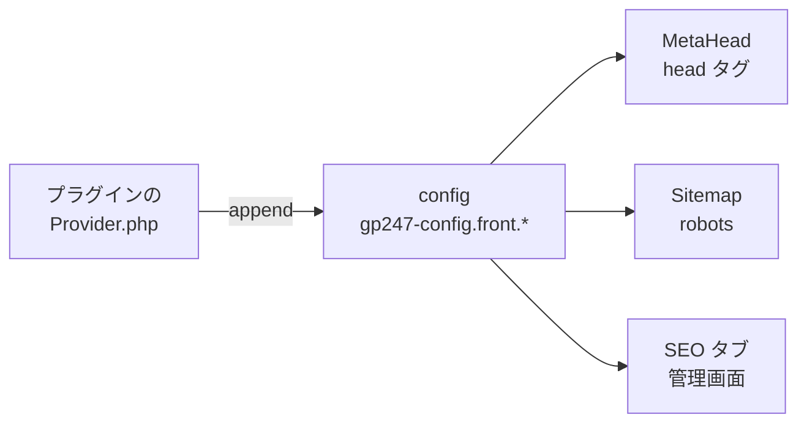
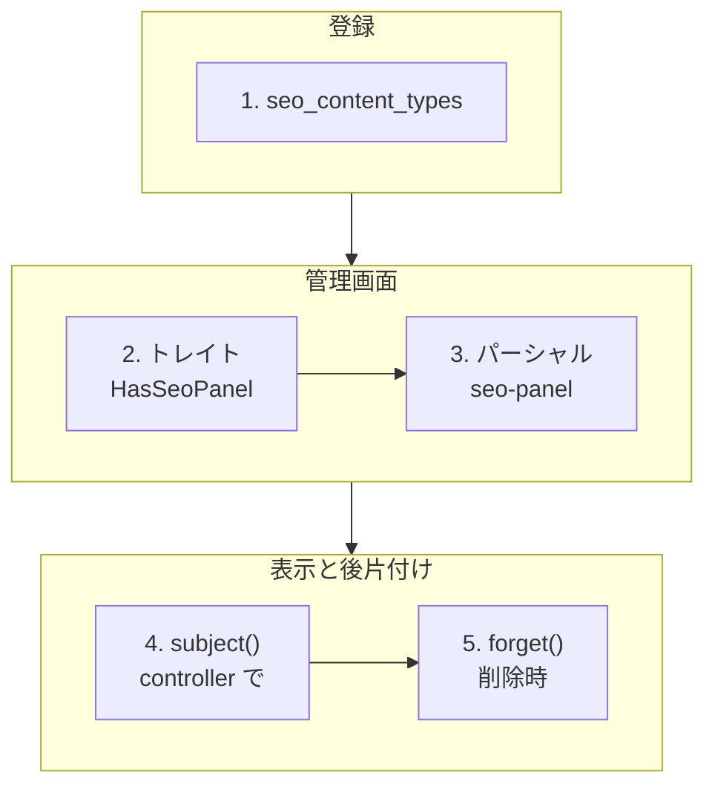

> 🌐 **言語:** [🇻🇳 Tiếng Việt](./seo-for-developers_vi.md) · [🇬🇧 English](./seo-for-developers.md) · 🇯🇵 日本語（現在）

# プラグイン / テンプレート開発者向け SEO フック

## はじめに
このページは、GP247 / S-Cart のプラグインやテンプレートを作る**開発者**向けです。gp247/front が標準で提供する SEO の接続ポイント（フック）をすべて一覧にします。SEO タブを持つコンテンツ種別の登録、サイトマップ、noindex、`og:type`、JSON-LD、評価点、自動 301、システムアラートです。コピーして使えるサンプルコードも付いています。読み終えると、コアやテンプレートを修正せずに、プラグインのコンテンツに商品やカテゴリと同等の SEO を持たせられます。

## ひと目でわかる
すべてのフックは同じ型に従います。プラグインが有効なとき、プラグインは `Provider.php` でレジストリに**追加（append）**します。gp247/front は必要なときにレジストリを読み、プラグインの名前を知ることは**決してありません**。



- **コアもテンプレートも修正しない** — プラグインから登録するだけです。
- **必ず `gp247_extension_check_active()` で囲む** — プラグインが無効なら何も登録しません。
- **ソフトな依存** — `class_exists` / `trait_exists` で確認し、そのフックがまだない古い gp247/front でもプラグインが動くようにします。
- **参考プラグイン** — **News** プラグイン（無料、オープンソース）が、このページのほぼすべてのフックを使っています。

## このページの内容
- [レジストリ一覧](#レジストリ一覧) — config のキー、データの形式、効果
- [Provider.php からの登録方法](#providerphp-からの登録方法) — 共通の型
- [プラグインのコンテンツに専用の SEO タブを付ける](#プラグインのコンテンツに専用の-seo-タブを付ける) — 5 ステップ
- [エイリアス変更時の自動 301 と IndexNow](#エイリアス変更時の自動-301-と-indexnow) — `route` + `SeoUrlLifecycle::watch()`
- [サイトマップに URL を追加する](#サイトマップに-url-を追加する) — `seo_sitemap_providers`
- [非公開ページと絞り込みページを隠す](#非公開ページと絞り込みページを隠す) — `seo_noindex_routes`、`seo_noindex_query_params`
- [og:type、JSON-LD、評価点](#ogtypejson-ld評価点) — `seo_og_types`、`@push('jsonld')`、`seo_product_rating_resolvers`
- [見つからないページは 404 を返す](#見つからないページは-404-を返す) — `itemNotFound()`
- [テンプレートの SEO 契約](#テンプレートの-seo-契約) — `<x-gp247-front::meta-head>`、トラッキングコードと Cookie バナー、テンプレートにコピーしたショップのページ
- [システムアラートにチェックを追加する](#システムアラートにチェックを追加する) — `AdminAlertRegistry`

## レジストリ一覧
すべて `config('gp247-config.front.*')` の下にあります。gp247/front と gp247/shop は自分の分を自分で登録し、プラグインはプラグインの分を追加します。

| キー | 各要素の形式 | 効果 |
| --- | --- | --- |
| `seo_content_types` | `'<type>' => ['label' => '<言語キー>', 'route' => '<ルート名>']`（`route` は任意） | 専用の SEO 値を持つコンテンツ：SEO タブ、タイトルテンプレートの欄、head タグ。`route` があれば自動 301 + IndexNow も追加 |
| `seo_sitemap_providers` | `['key' => '<ConfigKey>', 'label' => '<名前>', 'callback' => [Class::class, 'method']]` | `/sitemap.xml` に URL を追加。Sitemap.xml 画面でプラグインごとにオン / オフ |
| `seo_noindex_routes` | ルート名。末尾の `*` は前方一致（`'myplugin.account.*'`） | 一致するページに `noindex, follow` |
| `seo_noindex_query_params` | クエリパラメーター名（`'filter_color'`） | このパラメーターを含む URL に `noindex, follow`、カノニカルは元のページへ |
| `seo_og_types` | `'<ルートまたはプレフィックス*>' => '<og type>'` | ルートの `og:type`（デフォルトは `website`） |
| `seo_product_rating_resolvers` | callable `(string $productId, $storeId): ?array` | Product の JSON-LD の `aggregateRating` |

## Provider.php からの登録方法
どのレジストリも同じ型を使います。既存の配列を読み、プラグインの分を追加して、書き戻します。News プラグインから抜粋した例です。

```php
// app/GP247/Plugins/<Key>/Provider.php — gp247_extension_check_active(...) ブロックの中
$providers = (array) config('gp247-config.front.seo_sitemap_providers', []);
$providers[] = [
    'key'      => $config['configKey'],          // Sitemap.xml 画面のスイッチに使用
    'label'    => $config['name'],
    'callback' => [\App\GP247\Plugins\News\Seo::class, 'sitemapUrls'],
];
config(['gp247-config.front.seo_sitemap_providers' => $providers]);

config(['gp247-config.front.seo_noindex_query_params' => array_values(array_unique(array_merge(
    (array) config('gp247-config.front.seo_noindex_query_params', []),
    ['filter_sort']
)))]);

$ogTypes = (array) config('gp247-config.front.seo_og_types', []);
$ogTypes['news.content'] = 'article';
config(['gp247-config.front.seo_og_types' => $ogTypes]);
```

- **必ず `array_merge` / 要素の追加を使い**、配列全体を上書きしないでください。上書きすると、shop や他のプラグインの登録が消えます。
- gp247/front にまだないレジストリは、**そのキーを無視**します。余分に登録してもエラーにはなりません。

## プラグインのコンテンツに専用の SEO タブを付ける
次の 5 ステップで、プラグインのコンテンツ（記事、プロジェクト、講座…）に商品と同等の機能を持たせます。編集画面の SEO タブ、公開ページでの専用の値、削除時のデータの後片付けです。



### ステップ 1 — コンテンツ種別を登録する
```php
config(['gp247-config.front.seo_content_types' => array_merge(
    (array) config('gp247-config.front.seo_content_types', []),
    [
        'news'          => ['label' => 'Plugins/News::lang.seo_type_news'],
        'news_category' => ['label' => 'Plugins/News::lang.seo_type_news_category'],
    ]
)]);
```

種別のキーは `a-z 0-9 _ -` のみ、最大 50 文字です。他のプラグインの種別と重ならないよう、プラグイン名を含めることをおすすめします。登録した種別には、**タイトルテンプレート**（Meta & JSON-LD 画面）にすぐ専用の欄ができ、`label` で表示されます。

### ステップ 2 — Livewire 画面にトレイトを追加する
編集画面は `GP247\Core\AdminShell\Infrastructure\ResourcePanel`（`baseQuery()` と `editingId` を持つ）である必要があります。トレイト `GP247\Front\Admin\Livewire\Concerns\HasSeoPanel` を使います。

```php
use GP247\Front\Admin\Livewire\Concerns\HasSeoPanel;

class ArticleManager extends ResourcePanel
{
    use HasSeoPanel;

    protected function seoType(): string { return 'news'; }

    protected function fillForm($model): array
    {
        $this->fillSeo($model->id);          // レコードを開いたときに SEO タブを読み込む
        // ... これまでどおりフォームの項目を返す
    }

    public function resetForm(): void
    {
        parent::resetForm();
        $this->fillSeo(null);                // 新規作成フォーム
    }

    protected function rules(): array
    {
        return array_merge([/* 画面のルール */], $this->seoRules());
    }

    public function validationAttributes(): array
    {
        return $this->seoValidationAttributes();   // 翻訳済みのエラーラベル
    }

    protected function persist(array $data): void
    {
        // コンテンツと SEO を 1 つのトランザクションで保存。エラーなら何も保存しない。
        $this->persistWithSeo(fn () => $this->persistContent($data));
    }
}
```

`persistWithSeo()` は、画面の `baseQuery()` で読み込めるレコードにだけ SEO を書き込みます。そのストアの権限を持たないユーザーは、そのレコードの SEO を書き込めません。

> 💡 **ヒント — 古い gp247/front でも動かす:** トレイトがない古い front で `use HasSeoPanel;` と書くと、画面全体がエラーになります。News プラグインは橋渡し用のトレイトで解決しています。ファイル `Concerns/NewsSeoPanel.php` には `class_alias(trait_exists(HasSeoPanel::class) ? HasSeoPanel::class : NewsSeoPanelFallback::class, NewsSeoPanel::class);` だけが書かれています。`NewsSeoPanelFallback` は同じ名前のメソッドを持ちますが何もしません（`persistWithSeo` は保存処理を呼び出すだけ）。画面では `use NewsSeoPanel;` を使います。

### ステップ 3 — ビューにタブを追加する
```blade
@include('gp247-front-admin::partials.seo-panel', [
    'nameField'        => 'desc.{code}.title',        // 名前の Livewire パス、{code} = 言語コード
    'descriptionField' => 'desc.{code}.description',  // コンテンツに説明がなければ null
    'aliasField'       => 'form.alias',
    'imageType'        => 'content',                  // 画像選択の画像フォルダー
])
```

このパーシャルには、言語ごとのタイトル / 説明の欄、シェア画像、noindex、nofollow、カノニカル、Google のプレビュー枠、警告、3 言語のラベル、`data-testid`（`seo-panel`、`seo-title-<lang>`…）が揃っています。バリデーションエラーのキーは `seo.*` です。画面のエラータブの表示処理に加えてください。

### ステップ 4 — コントローラーで表示中のコンテンツを宣言する
```php
\GP247\Front\Library\SeoContentMeta::subject('news', $article->id);
return view($view, [...]);
```

詳細ページのビューを返す直前に呼び出します（実際のページを表示するときだけで、404 の分岐では呼びません）。`<x-gp247-front::meta-head>` がコンテンツ専用の SEO 値を自動で読み込むため、テンプレートの修正は不要です。

### ステップ 5 — コンテンツと一緒に SEO の値を削除する
```php
protected static function boot()
{
    parent::boot();
    static::deleted(function ($article) {
        \GP247\Front\Library\SeoContentMeta::forget('news', $article->id);
    });
}
```

`deleting` ではなく `deleted` イベントを使うと、削除を取り消した場合に SEO が失われません。アンインストール時にテーブルを削除するプラグインは、テーブルを drop する**前に**、各 id について `forget()` を呼んでください。SEOチェック画面が片付けるのは、標準の種別（ページ、商品、カテゴリ、ブランド）の孤立データだけです。

`SeoContentMeta` の他の関数：`types()`、`isRegistered($type)`、`for($type, $id, $lang)`（読み取り）、`save($type, $id, $data, $storeId)`（バリデーション付きの書き込み。データの一括インポートで使用）。

## エイリアス変更時の自動 301 と IndexNow
コンテンツ種別に `route` キーを追加してモデルを監視すると、商品と同じ動作になります。エイリアスを変えると 301 リダイレクトを自動で作成し、保存 / 削除すると IndexNow に通知します（サイトオーナーがオンにしている場合）。

```php
'project' => ['label' => 'Plugins/Portfolio::lang.seo_type_project', 'route' => 'portfolio.project'],
```

```php
// プラグインのモデル
protected static function boot()
{
    parent::boot();
    if (class_exists(\GP247\Front\Library\SeoUrlLifecycle::class)) {
        \GP247\Front\Library\SeoUrlLifecycle::watch(static::class, 'project');
    }
}
```

- **ルートが受け取れるのは `alias`（サイトが言語別 URL を使う場合は `lang` も）だけ** — システムはこの 2 つのパラメーターだけで旧 URL / 新 URL を組み立てます。他のパラメーターが必要なルート（例：News の記事のような `{category}/{alias}`）では、`route` を宣言**しない**でください。
- モデルには `alias` と `store_id` の列が必要です。`status` 列があれば、無効なコンテンツは IndexNow に送られません。

## サイトマップに URL を追加する
コールバックは `$storeId` を受け取り、**そのストアの、有効なコンテンツだけ**の URL の配列を返します。

```php
public static function sitemapUrls($storeId): array
{
    return Article::where('store_id', $storeId)->where('status', 1)->get()
        ->map(fn ($a) => [
            'alias'      => $a->alias,   // 必須 —「サイトマップから除外」リストを適用するため
            'loc'        => gp247_route_front('news.content', ['category' => $a->category_alias, 'alias' => $a->alias]),
            'lastmod'    => $a->updated_at?->format('Y-m-d'),
            'changefreq' => 'weekly',
            'priority'   => '0.7',
        ])->all();
}
```

サイトオーナーは、**SEO › Sitemap.xml › プラグイン別サイトマップ** で、プラグインの URL をまとめてオフにできます（`key` ごと）。

## 非公開ページと絞り込みページを隠す
非公開のルート（プラグインのアカウント、カート、チェックアウト）と、プラグインの絞り込み / 並べ替えのパラメーターを登録します。

```php
config(['gp247-config.front.seo_noindex_routes' => array_merge(
    (array) config('gp247-config.front.seo_noindex_routes', []),
    ['booking.account.*', 'booking.checkout']
)]);
```

- **末尾の** `*` は前方一致です。`*` だけの指定は無視され（ログに記録されます）、1 つのプラグインが誤ってサイト全体を隠すことを防ぎます。
- `page` と `lang` のパラメーターは、絞り込みパラメーターとして扱われることはありません。

## og:type、JSON-LD、評価点
**`og:type`** — `$ogTypes['portfolio.project'] = 'article';`（小文字の `a-z.` のみ。プレフィックス `portfolio.*` も使えます）。

**ページごとの JSON-LD** — プラグインのビューからスタック `jsonld` に push します。gp247/front のパーシャルとビルダーを使ってください（エスケープ済みで、JSON-LD のスイッチも確認済みです）。

```blade
@push('jsonld')
    @php
        $jsonldArticle = [
            'headline'      => $article->title,
            'url'           => request()->url(),
            'imageUrl'      => gp247_file($article->getImage()),
            'datePublished' => optional($article->created_at)->toIso8601String(),
            'dateModified'  => optional($article->updated_at)->toIso8601String(),
            'description'   => $description,
        ];
    @endphp
    @include($GP247TemplatePath.'.common.jsonld_article')
    @include($GP247TemplatePath.'.common.jsonld_breadcrumb')
@endpush
```

ビルダーを直接使う場合：`SeoMeta::buildArticleJsonLd()`、`buildBreadcrumbJsonLd()`、`buildProductJsonLd()`。**`json_encode` を手で書かないでください** — ビルダーは `</script>` の挿入を防いでいます。

**商品の評価点** — レビューのプラグインがリゾルバーを登録します。

```php
$resolvers = (array) config('gp247-config.front.seo_product_rating_resolvers', []);
$resolvers[] = [\App\GP247\Plugins\MyReview\Seo::class, 'rating'];
config(['gp247-config.front.seo_product_rating_resolvers' => $resolvers]);

// レビューがまだなければ null を返す
public static function rating(string $productId, $storeId): ?array
{
    return ['ratingValue' => 4.6, 'reviewCount' => 12, 'bestRating' => 5];
}
```

`aggregateRating` は `reviewCount` > 0 のときだけ出力されます。リゾルバーが例外を投げた場合は無視され、ページはそのまま表示されます。

## 見つからないページは 404 を返す
プラグインのストアフロント用コントローラーは `GP247\Front\Controllers\RootFrontController` を継承します。「見つからない」すべての分岐（レコードがない、無効、別のストアのもの）では、**`$this->itemNotFound()` を返してください**。テンプレートの notfound ページを **HTTP 404 コード**で返します。自分で `return view(...)` しないでください。空のページに 200 を返すと、Google はそれを実在のページとみなします（soft 404）。

## テンプレートの SEO 契約
テンプレート（顧客が自分で作るテンプレートも含む）は、レイアウトに次のポイントを正しく置くだけです。SEO のタグはすべて gp247/front が組み立てます。

```blade
<html lang="{{ app()->getLocale() }}" dir="{{ /* 言語に応じて rtl または ltr */ }}">
<head>
    <x-gp247-front::meta-head :title="$title ?? null" :description="$description ?? null"
        :keyword="$keyword ?? null" :og_image="$og_image ?? null" :canonical="$canonical ?? null"
        :hreflang="$seoHreflang ?? []" />
    @if (\GP247\Front\Library\SeoMeta::jsonldEnabled())
        @stack('jsonld')
    @endif
    {!! gp247_render_block('header', ...) !!}
</head>
```

| `meta-head` の prop | 使う場面 |
| --- | --- |
| `title`、`description`、`keyword`、`og_image` | ページの値。空ならストアの値を使う |
| `canonical` | 別のカノニカルを強制する（まれ） |
| `hreflang` | 翻訳版の一覧。空ならルートから自動で計算 |
| `robots` | 特別なページで robots タグを強制する |
| `ogType` | `og:type` を強制する（通常は prop ではなくレジストリを使う） |

- title、description、canonical、Open Graph、Twitter、Organization の JSON-LD のタグを、レイアウトに**自分で書かないでください** — 手書きのタグはずれが生じ、新しいタグ（確認コード、robots、hreflang）が抜け落ちます。
- ビュー `gp247_components/meta-head` と `common/jsonld_*` の**上書きは控えてください** — デザイン上コピーする理由がなく、コピーしたものは gp247/front が更新されても古いまま残ります。

### トラッキングコードと Cookie バナー
`meta-head` は、サイト運営者が **SEO › トラッキングコードとCookie** 画面で入力したトラッキングコード（GA4、GTM、Meta ピクセル、カスタムコード）、Cookie の同意ローダー、Cookie バナーも出力します。レイアウトで `meta-head` を呼び出せば十分です。呼び出さないレイアウトではコードもバナーも動かず、**システムアラート** が知らせます。サイト運営者向けの使い方：[トラッキングコードと Cookie バナー](./tracking-and-cookies_ja.md)。

- **フッターの「Cookie 設定」リンク（推奨）** — `data-gp247-consent-open` と `hidden` 属性を持つ要素です。バナーが有効なときにローダーが表示し、クリックで設定パネルを開きます。この要素がない場合、ローダーが画面の隅に小さなボタンを追加します。古い gp247/front でもテンプレートが動くよう、`class_exists` で囲みます：

```blade
@if (class_exists(\GP247\Front\TemplateComponents\ConsentBanner::class))
    <button type="button" data-gp247-consent-open hidden>{{ gp247_language_render('front.consent.settings') }}</button>
@endif
```

- **色を変えるだけならビューの上書きは不要です** — バナーは 7 つの CSS 変数を使います：`--gp247-consent-bg`（背景）、`--gp247-consent-fg`（本文の文字）、`--gp247-consent-muted`（補足の文字）、`--gp247-consent-border`（枠線）、`--gp247-consent-btn-bg` / `--gp247-consent-btn-fg`（3 つのボタンの背景 / 文字）、`--gp247-consent-focus`（キーボードで選んだときの枠）。バナーのスタイルはページ内でテンプレートの CSS より後に置かれるため、`.gp247-consent` より強いセレクターでテンプレートの CSS に設定し、文字と背景のコントラストを十分に保ってください：

```css
body .gp247-consent {
    --gp247-consent-btn-bg: #ea580c;
    --gp247-consent-btn-fg: #fff;
    --gp247-consent-focus: #ea580c;
}
```

- **`gp247_components/consent-banner` の上書きは、デザインを本当に変える必要があるときだけにしてください** — `data-gp247-consent-*` 属性（バナー、設定パネル、`analytics` / `marketing` のチェックボックス、保存、閉じる）をすべて残し、**すべて許可・拒否・カスタマイズ** の 3 つのボタンを同じ大きさ・同じスタイルに保ちます。
- **トラッキングコードを `header` のレイアウトブロックに入れないでください** — そこのコードは Cookie バナーと無関係に動きます。`<script>` を含むレイアウト HTML ブロックはシステムアラートが知らせます。

### ショップのページをテンプレートにコピーするとき
テンプレートにコピーしたショップのページは、gp247/shop の修正を自動では受け取りません。次の 3 つのページには独自のルールがあります：

- **`screen/shop_product_detail`** — パッケージの `@push('jsonld')` ブロック（SKU、ブランド、UPC/EAN/JAN、MPN、セールの終了日、評価に使う商品 ID）はそのまま残し、周りのデザインだけを変えます。gp247/shop 3.11.3 より古い版でも動かす必要があるテンプレートは、`method_exists($product, 'promotionValidUntil')` で確認します。
- **`livewire/shop_product-filter`** — Livewire のバインディング（URL では `filter_sort` と表示される `wire:model.live="sort"`、`priceMin`、`priceMax`、`applyPrice`、`clearFilters`、`toggleBrand`）を残し、並び替えの値は `ShopProduct::storefrontSort()` のもの（空＝おすすめ、`id_desc`、`sold_desc`、`price_asc`、`price_desc`、`name_asc`）だけを使います。
- **販売イベント**（商品の閲覧、カートへの追加、購入手続きの開始、購入）はショップのコントローラーと Livewire が送信するため、ビューでは何もする必要はありません。ただし、カートへの追加はショップの既存のボタンやアクションを使い、独自のフォームや `fetch` を書かないでください。

## システムアラートにチェックを追加する
プラグインは、**システムアラート** ブロックと `gp247:doctor` コマンドに行を追加できます（gp247/front が `seo_audit` の行を追加しているのと同じ方法です）。

```php
use GP247\Core\AdminShell\Domain\AdminAlertCheck;
use GP247\Core\AdminShell\Infrastructure\AdminAlert;

class FeedHealthCheck implements AdminAlertCheck
{
    public function key(): string { return 'myplugin_feed'; }
    public function ttl(): int { return 600; }   // 結果を保持する秒数
    public function evaluate(): AdminAlert
    {
        return $ok
            ? AdminAlert::ok($this->key(), 'Feed is up to date')
            : AdminAlert::warning($this->key(), 'Feed is 3 days old', '', $fixUrl, 'Open feed settings');
    }
}

// Provider.php
if (class_exists(\GP247\Core\AdminShell\Support\AdminAlertRegistry::class)) {
    \GP247\Core\AdminShell\Support\AdminAlertRegistry::register(FeedHealthCheck::class);
}
```

`evaluate()` は管理画面を開くたびに実行されるため、**保存済みの結果を読むだけ**にしてください（大きなデータベースをスキャンしない）。

## 条件と制約（操作の前に確認）

**登録するとき**
- **プラグインが有効なときだけ登録する**（`gp247_extension_check_active`）— プラグインが無効なのに登録すると、サイトマップや robots が存在しないページを指します。
- レジストリには**追加し、上書きしない** — 上書きすると、shop や他のプラグインの登録が消えます。
- **コンテンツ種別のキーは `[a-z0-9_-]`、最大 50 文字** — 形式に合わない種別は無視されます。未登録の種別では、`save()` は何も書き込みません（警告をログに記録するだけ）。

**自動 301 のために `route` を宣言するとき**
- **ルートが受け取るのは `alias`（+ `lang`）だけ** — URL を正しく組み立てられない場合、壊れたリダイレクトを避けるため、システムはリダイレクトを作りません。

**現在の制限**
- **SEOチェック画面と孤立データの片付けの対象は、ページ、商品、カテゴリ、ブランドだけ** — プラグインは自分の SEO の値を自分で片付けます（ステップ 5）。
- **MCP ツール `get_seo` / `update_seo` は標準の種別だけを受け付ける** — プラグインの種別には「サポートされていない種別」が返ります。

> 💡 **AI エージェントと作業していますか？** スキル `gp247-template-create` には、テンプレートの SEO 契約があらかじめ組み込まれています。プラグインの場合は、スキル `gp247-plugin-create` で作成してから、このページを「プラグインのコンテンツに SEO タブを追加して」という依頼と一緒にエージェントに渡してください。

## よくある質問（Q&A）
**Q1: プラグインで、SEO タブがない古い gp247/front もサポートする必要がありますか？**

→ 呼び出しのたびに `class_exists` / `trait_exists` を確認し、News プラグインのように橋渡し用のトレイトを使ってください。要求するバージョンを上げる必要はありません。

**Q2: SEO の値を保存するテーブルを作る必要がありますか？**

→ いいえ。値は gp247/front の共通の SEO テーブルに、`(種別, id)` のキーで保存されます。

**Q3: コンテンツの id が文字列（UUID）でも使えますか？**

→ 使えます。`content_id` は文字列として保存されます。

**Q4: プラグインのページのタイトルがタイトルテンプレートに従わないのはなぜですか？**

→ コントローラーが登録済みの正しい種別で `SeoContentMeta::subject()` を呼んでいるか、レイアウトが `<x-gp247-front::meta-head>` を使っているかを確認してください。

**Q5: ルートが `/blog/{category}/{alias}` の形式です。自動 301 は使えますか？**

→ まだ使えません。`route` の契約は `alias`（+ `lang`）だけを渡します。`route` は宣言せず、エイリアスを変えたときはサイトオーナーが 301リダイレクト画面で手動でリダイレクトを作成します。

**Q6: テンプレートに独自のメタタグを追加したい場合はどうすればよいですか？**

→ 位置 `header` のブロック（`gp247_render_block('header')`）を使うか、`<x-gp247-front::meta-head>` の後にタグを追加してください。コンポーネントがすでに出力しているタグは書き直さないでください。

**Q7: テストでは何を確認すればよいですか？**

→ 詳細ページを開いてソースを確認します。`<title>`、`<meta name="robots">`、`<link rel="canonical">` が入力した値どおりか、`/sitemap.xml` にプラグインの URL があるか、レコードを削除すると `SeoContentMeta::for()` が `null` を返すかを確認します。

**Q8: トラッキングコード、Cookie バナー、販売イベントを動かすために、テンプレートは何をすればよいですか？**

→ レイアウトで `<x-gp247-front::meta-head>` を呼び出すだけです。フッターに「Cookie 設定」リンクを置くことをおすすめします。コピーしたショップのページは [ショップのページをテンプレートにコピーするとき](#ショップのページをテンプレートにコピーするとき) に従ってください。

---

<sub>📅 **最終更新:** 2026-11-20 · ✍️ **作成者 (Author):** GP247</sub>
