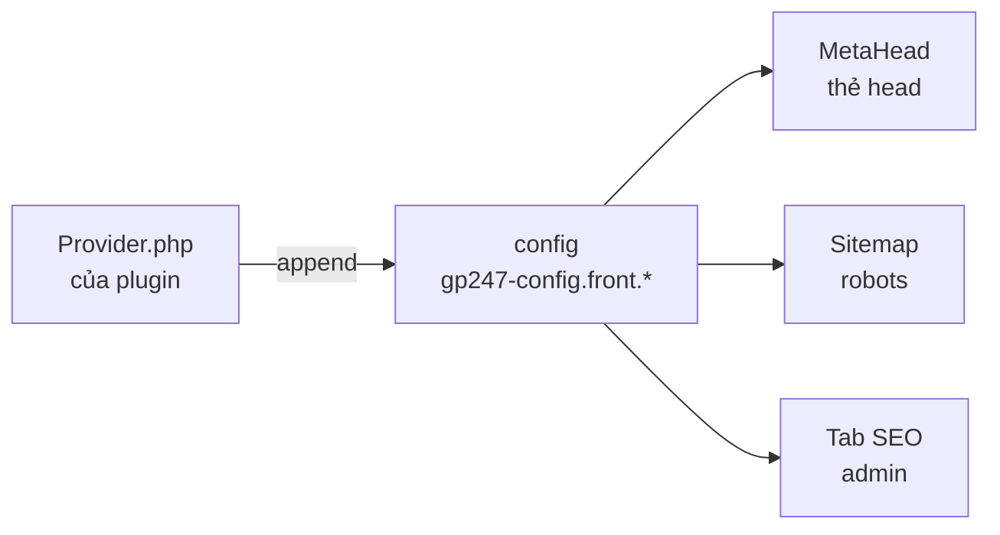
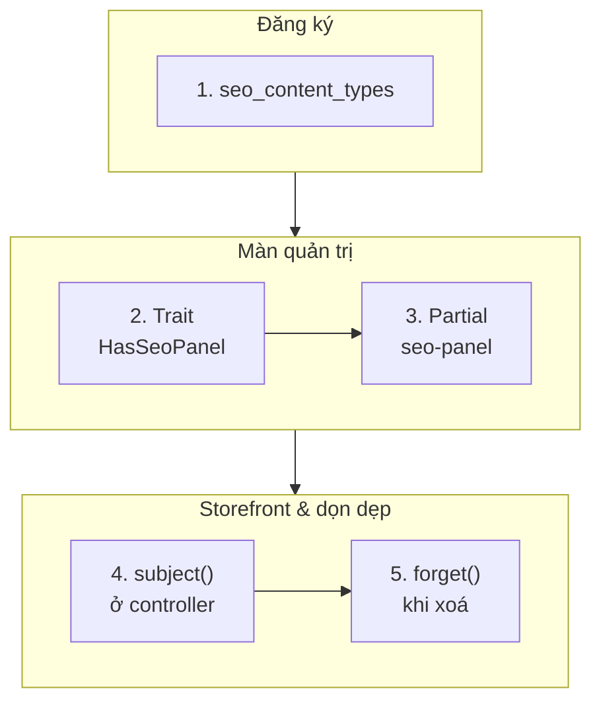

> 🌐 **Ngôn ngữ:** 🇻🇳 Tiếng Việt (hiện tại) · [🇬🇧 English](./seo-for-developers.md) · [🇯🇵 日本語](./seo-for-developers_ja.md)

# Hook SEO cho lập trình viên plugin và template

## Giới thiệu
Trang này dành cho **lập trình viên** viết plugin hoặc template cho GP247. Nó liệt kê mọi điểm cắm (hook) SEO mà gp247/front mở sẵn — đăng ký loại nội dung có tab SEO, sitemap, noindex, `og:type`, JSON-LD, điểm đánh giá, tự 301, cảnh báo hệ thống — kèm đoạn code mẫu copy được. Đọc xong, nội dung của plugin bạn có SEO ngang sản phẩm, danh mục mà không phải sửa core hay template.

## Nhìn nhanh
Mọi hook đều theo một khuôn: plugin **thêm (append)** vào một registry trong `Provider.php` khi plugin đang bật; gp247/front đọc registry khi cần, **không bao giờ** biết tên plugin.



- **Không sửa core, không sửa template** — chỉ đăng ký từ plugin.
- **Luôn bọc trong `gp247_extension_check_active()`** — plugin tắt thì không đăng ký gì.
- **Phụ thuộc mềm** — kiểm `class_exists` / `trait_exists` để plugin vẫn chạy trên bản gp247/front cũ chưa có hook đó.
- **Plugin tham chiếu**: plugin **News** (miễn phí, mã nguồn mở) dùng gần như mọi hook trong trang này.

## Trong trang này
- [Bảng tổng hợp các registry](#bảng-tổng-hợp-các-registry) — khoá config, dạng dữ liệu, tác dụng
- [Cách đăng ký từ Provider.php](#cách-đăng-ký-từ-providerphp) — khuôn chung
- [Cho nội dung của plugin có tab SEO riêng](#cho-nội-dung-của-plugin-có-tab-seo-riêng) — 5 bước
- [Tự 301 khi đổi alias và IndexNow](#tự-301-khi-đổi-alias-và-indexnow) — `route` + `SeoUrlLifecycle::watch()`
- [Thêm URL vào sitemap](#thêm-url-vào-sitemap) — `seo_sitemap_providers`
- [Giấu trang riêng tư và trang lọc](#giấu-trang-riêng-tư-và-trang-lọc) — `seo_noindex_routes`, `seo_noindex_query_params`
- [og:type, JSON-LD và điểm đánh giá](#ogtype-json-ld-và-điểm-đánh-giá) — `seo_og_types`, `@push('jsonld')`, `seo_product_rating_resolvers`
- [Trang không tìm thấy trả 404](#trang-không-tìm-thấy-trả-404) — `itemNotFound()`
- [Hợp đồng SEO của template](#hợp-đồng-seo-của-template) — `<x-gp247-front::meta-head>`, mã đo lường & banner cookie, trang shop chép vào template
- [Thêm một kiểm tra vào Cảnh báo hệ thống](#thêm-một-kiểm-tra-vào-cảnh-báo-hệ-thống) — `AdminAlertRegistry`

## Bảng tổng hợp các registry
Tất cả nằm dưới `config('gp247-config.front.*')`; gp247/front và gp247/shop tự đăng ký phần của mình, plugin thêm phần của plugin.

| Khoá | Dạng mỗi phần tử | Tác dụng |
| --- | --- | --- |
| `seo_content_types` | `'<type>' => ['label' => '<khoá ngôn ngữ>', 'route' => '<tên route>']` (`route` tuỳ chọn) | Nội dung có giá trị SEO riêng: tab SEO, ô mẫu tiêu đề, thẻ head; có `route` thì thêm tự 301 + IndexNow |
| `seo_sitemap_providers` | `['key' => '<ConfigKey>', 'label' => '<tên>', 'callback' => [Class::class, 'method']]` | Thêm URL vào `/sitemap.xml`; bật/tắt theo plugin ở màn Sitemap.xml |
| `seo_noindex_routes` | tên route, `*` ở cuối khớp tiền tố (`'myplugin.account.*'`) | Trang khớp có `noindex, follow` |
| `seo_noindex_query_params` | tên tham số query (`'filter_color'`) | URL có tham số này có `noindex, follow`, canonical về trang gốc |
| `seo_og_types` | `'<route hoặc tiền tố*>' => '<og type>'` | `og:type` của route (mặc định `website`) |
| `seo_product_rating_resolvers` | callable `(string $productId, $storeId): ?array` | `aggregateRating` trong JSON-LD Product |

## Cách đăng ký từ Provider.php
Mọi registry dùng cùng một khuôn: đọc mảng hiện có, thêm phần của plugin, ghi lại. Ví dụ rút gọn từ plugin News:

```php
// app/GP247/Plugins/<Key>/Provider.php — trong khối gp247_extension_check_active(...)
$providers = (array) config('gp247-config.front.seo_sitemap_providers', []);
$providers[] = [
    'key'      => $config['configKey'],          // dùng cho công tắc ở màn Sitemap.xml
    'label'    => $config['name'],
    'callback' => [\App\GP247\Plugins\News\Seo::class, 'sitemapUrls'],
];
config(['gp247-config.front.seo_sitemap_providers' => $providers]);

config(['gp247-config.front.seo_noindex_query_params' => array_values(array_unique(array_merge(
    (array) config('gp247-config.front.seo_noindex_query_params', []),
    ['filter_sort']
)))]);

$ogTypes = (array) config('gp247-config.front.seo_og_types', []);
$ogTypes['news.content'] = 'article';
config(['gp247-config.front.seo_og_types' => $ogTypes]);
```

- **Luôn `array_merge` / thêm phần tử**, không gán đè cả mảng — gán đè làm mất đăng ký của shop và plugin khác.
- Bản gp247/front chưa có một registry thì **bỏ qua khoá đó** — đăng ký thừa không gây lỗi.

## Cho nội dung của plugin có tab SEO riêng
Năm bước dưới đây cho nội dung của plugin (bài viết, dự án, khoá học…) đầy đủ như sản phẩm: tab SEO ở màn sửa, giá trị riêng trên trang công khai, dọn dữ liệu khi xoá.



### Bước 1 — Đăng ký loại nội dung
```php
config(['gp247-config.front.seo_content_types' => array_merge(
    (array) config('gp247-config.front.seo_content_types', []),
    [
        'news'          => ['label' => 'Plugins/News::lang.seo_type_news'],
        'news_category' => ['label' => 'Plugins/News::lang.seo_type_news_category'],
    ]
)]);
```

Khoá loại chỉ gồm `a-z 0-9 _ -`, tối đa 50 ký tự, và nên mang tên plugin để không trùng loại của plugin khác. Loại có ngay một ô ở **Mẫu tiêu đề** (màn Meta & JSON-LD), hiển thị bằng `label`.

### Bước 2 — Thêm trait vào màn Livewire
Màn sửa phải là `GP247\Core\AdminShell\Infrastructure\ResourcePanel` (có `baseQuery()` và `editingId`). Dùng trait `GP247\Front\Admin\Livewire\Concerns\HasSeoPanel`:

```php
use GP247\Front\Admin\Livewire\Concerns\HasSeoPanel;

class ArticleManager extends ResourcePanel
{
    use HasSeoPanel;

    protected function seoType(): string { return 'news'; }

    protected function fillForm($model): array
    {
        $this->fillSeo($model->id);          // nạp tab SEO khi mở bản ghi
        // ... trả về các trường của form như cũ
    }

    public function resetForm(): void
    {
        parent::resetForm();
        $this->fillSeo(null);                // form tạo mới
    }

    protected function rules(): array
    {
        return array_merge([/* rule của màn */], $this->seoRules());
    }

    public function validationAttributes(): array
    {
        return $this->seoValidationAttributes();   // nhãn lỗi đã dịch
    }

    protected function persist(array $data): void
    {
        // Lưu nội dung và SEO trong MỘT giao dịch; lỗi thì không lưu gì.
        $this->persistWithSeo(fn () => $this->persistContent($data));
    }
}
```

`persistWithSeo()` chỉ ghi SEO cho bản ghi mà `baseQuery()` của màn tải được — người không có quyền cửa hàng đó không ghi được SEO của nó.

> 💡 **Mẹo — vẫn chạy trên gp247/front cũ:** `use HasSeoPanel;` trên bản front chưa có trait làm cả màn lỗi. Plugin News giải bằng một trait cầu nối: tệp `Concerns/NewsSeoPanel.php` chỉ chứa `class_alias(trait_exists(HasSeoPanel::class) ? HasSeoPanel::class : NewsSeoPanelFallback::class, NewsSeoPanel::class);`, trong đó `NewsSeoPanelFallback` có cùng tên phương thức nhưng không làm gì (`persistWithSeo` chỉ gọi lại hàm lưu). Màn dùng `use NewsSeoPanel;`.

### Bước 3 — Thêm tab vào view
```blade
@include('gp247-front-admin::partials.seo-panel', [
    'nameField'        => 'desc.{code}.title',        // đường dẫn Livewire của tên, {code} = mã ngôn ngữ
    'descriptionField' => 'desc.{code}.description',  // null nếu nội dung không có mô tả
    'aliasField'       => 'form.alias',
    'imageType'        => 'content',                  // thư mục ảnh của trình chọn ảnh
])
```

Partial có sẵn ô tiêu đề/mô tả theo ngôn ngữ, ảnh chia sẻ, noindex, nofollow, canonical, khung xem trước Google, cảnh báo, nhãn ba ngôn ngữ và `data-testid` (`seo-panel`, `seo-title-<lang>`…). Lỗi validate có khoá `seo.*` — đưa vào phần đánh dấu tab lỗi của màn.

### Bước 4 — Khai nội dung đang hiển thị ở controller
```php
\GP247\Front\Library\SeoContentMeta::subject('news', $article->id);
return view($view, [...]);
```

Gọi ngay trước khi trả view của trang chi tiết (chỉ khi trang thật được hiển thị, không gọi ở nhánh 404). `<x-gp247-front::meta-head>` tự đọc giá trị SEO riêng của nội dung — template không cần sửa.

### Bước 5 — Xoá giá trị SEO cùng nội dung
```php
protected static function boot()
{
    parent::boot();
    static::deleted(function ($article) {
        \GP247\Front\Library\SeoContentMeta::forget('news', $article->id);
    });
}
```

Dùng sự kiện `deleted` (không phải `deleting`) để huỷ xoá thì không mất SEO. Plugin xoá bảng khi gỡ thì gọi `forget()` cho từng id **trước** khi drop bảng — màn Kiểm tra SEO chỉ dọn dữ liệu mồ côi của các loại có sẵn (trang, sản phẩm, danh mục, thương hiệu).

Các hàm khác của `SeoContentMeta`: `types()`, `isRegistered($type)`, `for($type, $id, $lang)` (đọc), `save($type, $id, $data, $storeId)` (ghi có validate — dùng khi nhập dữ liệu hàng loạt).

## Tự 301 khi đổi alias và IndexNow
Thêm khoá `route` vào loại nội dung và theo dõi model để có cùng hành vi như sản phẩm: đổi alias thì tự tạo redirect 301, lưu/xoá thì báo IndexNow (khi chủ site bật).

```php
'project' => ['label' => 'Plugins/Portfolio::lang.seo_type_project', 'route' => 'portfolio.project'],
```

```php
// Model của plugin
protected static function boot()
{
    parent::boot();
    if (class_exists(\GP247\Front\Library\SeoUrlLifecycle::class)) {
        \GP247\Front\Library\SeoUrlLifecycle::watch(static::class, 'project');
    }
}
```

- **Route chỉ được nhận `alias` (và `lang` khi website dùng đường dẫn theo ngôn ngữ)** — hệ thống dựng URL cũ/mới bằng đúng hai tham số đó. Route cần thêm tham số (vd `{category}/{alias}` như bài viết của News) thì **không** khai `route`.
- Model cần cột `alias` và `store_id`; có cột `status` thì nội dung tắt không được gửi IndexNow.

## Thêm URL vào sitemap
Callback nhận `$storeId` và trả mảng URL **chỉ của cửa hàng đó, chỉ nội dung đang bật**:

```php
public static function sitemapUrls($storeId): array
{
    return Article::where('store_id', $storeId)->where('status', 1)->get()
        ->map(fn ($a) => [
            'alias'      => $a->alias,   // bắt buộc — để danh sách "Loại trừ khỏi sitemap" áp được
            'loc'        => gp247_route_front('news.content', ['category' => $a->category_alias, 'alias' => $a->alias]),
            'lastmod'    => $a->updated_at?->format('Y-m-d'),
            'changefreq' => 'weekly',
            'priority'   => '0.7',
        ])->all();
}
```

Chủ site tắt được cả nhóm URL của plugin ở **SEO › Sitemap.xml › Sitemap theo plugin** (theo `key`).

## Giấu trang riêng tư và trang lọc
Đăng ký route riêng tư (tài khoản, giỏ, thanh toán của plugin) và tham số lọc/sắp xếp của plugin:

```php
config(['gp247-config.front.seo_noindex_routes' => array_merge(
    (array) config('gp247-config.front.seo_noindex_routes', []),
    ['booking.account.*', 'booking.checkout']
)]);
```

- `*` **ở cuối** khớp tiền tố; `*` đứng một mình bị bỏ qua (và ghi log) để một plugin không lỡ giấu cả website.
- Tham số `page` và `lang` không bao giờ tính là tham số lọc.

## og:type, JSON-LD và điểm đánh giá
**`og:type`** — `$ogTypes['portfolio.project'] = 'article';` (chỉ chữ thường `a-z.`; có thể dùng tiền tố `portfolio.*`).

**JSON-LD theo trang** — đẩy vào stack `jsonld` từ view của plugin, dùng partial và builder của gp247/front (đã escape, đã kiểm công tắc JSON-LD):

```blade
@push('jsonld')
    @php
        $jsonldArticle = [
            'headline'      => $article->title,
            'url'           => request()->url(),
            'imageUrl'      => gp247_file($article->getImage()),
            'datePublished' => optional($article->created_at)->toIso8601String(),
            'dateModified'  => optional($article->updated_at)->toIso8601String(),
            'description'   => $description,
        ];
    @endphp
    @include($GP247TemplatePath.'.common.jsonld_article')
    @include($GP247TemplatePath.'.common.jsonld_breadcrumb')
@endpush
```

Builder dùng trực tiếp: `SeoMeta::buildArticleJsonLd()`, `buildBreadcrumbJsonLd()`, `buildProductJsonLd()`. **Không `json_encode` tay** — builder đã chống chèn `</script>`.

**Điểm đánh giá sản phẩm** — plugin đánh giá đăng ký resolver:

```php
$resolvers = (array) config('gp247-config.front.seo_product_rating_resolvers', []);
$resolvers[] = [\App\GP247\Plugins\MyReview\Seo::class, 'rating'];
config(['gp247-config.front.seo_product_rating_resolvers' => $resolvers]);

// trả null khi chưa có đánh giá
public static function rating(string $productId, $storeId): ?array
{
    return ['ratingValue' => 4.6, 'reviewCount' => 12, 'bestRating' => 5];
}
```

`aggregateRating` chỉ in khi `reviewCount` > 0; resolver ném lỗi thì bị bỏ qua, trang vẫn hiển thị.

## Trang không tìm thấy trả 404
Controller storefront của plugin kế thừa `GP247\Front\Controllers\RootFrontController`. Mọi nhánh "không tìm thấy" (bản ghi không có, đã tắt, thuộc cửa hàng khác) **trả về `$this->itemNotFound()`** — trang notfound của template với **mã HTTP 404**. Đừng tự `return view(...)`: trả 200 cho trang rỗng làm Google coi đó là trang thật (soft 404).

## Hợp đồng SEO của template
Template (kể cả template khách tự viết) chỉ cần đặt đúng các điểm sau trong layout; mọi thẻ SEO do gp247/front dựng.

```blade
<html lang="{{ app()->getLocale() }}" dir="{{ /* rtl hoặc ltr theo ngôn ngữ */ }}">
<head>
    <x-gp247-front::meta-head :title="$title ?? null" :description="$description ?? null"
        :keyword="$keyword ?? null" :og_image="$og_image ?? null" :canonical="$canonical ?? null"
        :hreflang="$seoHreflang ?? []" />
    @if (\GP247\Front\Library\SeoMeta::jsonldEnabled())
        @stack('jsonld')
    @endif
    {!! gp247_render_block('header', ...) !!}
</head>
```

| Prop của `meta-head` | Dùng khi |
| --- | --- |
| `title`, `og_image` | Giá trị của trang; trống thì dùng giá trị cửa hàng |
| `description`, `keyword` | Giá trị của trang; trống thì không in thẻ (không lấy giá trị cửa hàng, để mọi trang không cùng một mô tả) |
| `canonical` | Ép canonical khác (hiếm) |
| `hreflang` | Danh sách bản dịch; trống thì tự tính theo route |
| `robots` | Ép thẻ robots cho một trang đặc biệt |
| `ogType` | Ép `og:type` (thường dùng registry thay vì prop) |

- **Không tự viết** thẻ title, description, canonical, Open Graph, Twitter, JSON-LD Organization trong layout — viết tay sẽ lệch và thiếu các thẻ mới (mã xác minh, robots, hreflang).
- **Hạn chế ghi đè** view `gp247_components/meta-head` và `common/jsonld_*` — không có lý do giao diện để chép chúng, và bản chép sẽ đứng yên khi gp247/front cập nhật.

### Mã đo lường và banner cookie
`meta-head` cũng in mã đo lường chủ site nhập ở màn **SEO › Mã đo lường & cookie** (GA4, GTM, Meta Pixel, mã tự do), bộ nạp đồng ý cookie và banner cookie. Layout gọi `meta-head` là đủ; layout không gọi thì cửa hàng không có mã lẫn banner, và **Cảnh báo hệ thống** báo điều đó. Cách chủ site dùng: [Mã đo lường & banner cookie](./tracking-and-cookies_vi.md).

- **Link "Cài đặt cookie" ở chân trang (nên có)** — phần tử có `data-gp247-consent-open` và thuộc tính `hidden`; bộ nạp cho hiện khi banner bật và mở bảng tuỳ chỉnh khi khách bấm. Không có phần tử này thì bộ nạp tự thêm một nút nhỏ nổi ở góc. Bọc bằng `class_exists` để template vẫn chạy trên gp247/front cũ:

```blade
@if (class_exists(\GP247\Front\TemplateComponents\ConsentBanner::class))
    <button type="button" data-gp247-consent-open hidden>{{ gp247_language_render('front.consent.settings') }}</button>
@endif
```

- **Chỉ đổi màu thì không cần ghi đè view** — banner dùng bảy biến CSS: `--gp247-consent-bg` (nền), `--gp247-consent-fg` (chữ chính), `--gp247-consent-muted` (chữ phụ), `--gp247-consent-border` (viền), `--gp247-consent-btn-bg` / `--gp247-consent-btn-fg` (nền / chữ của ba nút), `--gp247-consent-focus` (viền khi chọn bằng bàn phím). Đặt lại trong CSS của template bằng bộ chọn mạnh hơn `.gp247-consent` — style của banner nằm sau CSS của template trong trang — và giữ chữ đủ tương phản với nền:

```css
body .gp247-consent {
    --gp247-consent-btn-bg: #ea580c;
    --gp247-consent-btn-fg: #fff;
    --gp247-consent-focus: #ea580c;
}
```

- **Chỉ ghi đè `gp247_components/consent-banner` khi thật cần đổi giao diện** — giữ đủ mọi thuộc tính `data-gp247-consent-*` (banner, bảng tuỳ chỉnh, ô `analytics` / `marketing`, nút lưu, nút đóng) và giữ ba nút **Chấp nhận tất cả / Từ chối / Tuỳ chỉnh** cùng cỡ, cùng kiểu.
- **Không đặt mã đo lường vào khối layout `header`** — mã ở đó chạy ngoài banner cookie; Cảnh báo hệ thống báo khối layout HTML có `<script>`.

### Khi chép trang shop vào template
Trang shop chép vào template không tự nhận bản sửa của gp247/shop. Ba trang có ràng buộc riêng:

- **`screen/shop_product_detail`** — giữ nguyên khối `@push('jsonld')` của package (mã SKU, thương hiệu, UPC/EAN/JAN, MPN, hạn khuyến mãi, id sản phẩm cho điểm đánh giá); chỉ sửa giao diện xung quanh. Template cần chạy trên gp247/shop cũ hơn 3.11.3 thì kiểm `method_exists($product, 'promotionValidUntil')`.
- **`livewire/shop_product-filter`** — giữ các liên kết Livewire (`wire:model.live="sort"` hiện trên URL là `filter_sort`, `priceMin`, `priceMax`, `applyPrice`, `clearFilters`, `toggleBrand`) và chỉ đưa ra giá trị sắp xếp của `ShopProduct::storefrontSort()`: trống (Nổi bật), `id_desc`, `sold_desc`, `price_asc`, `price_desc`, `name_asc`.
- **Sự kiện bán hàng** (xem sản phẩm, thêm giỏ, bắt đầu thanh toán, mua hàng) do controller và Livewire của shop gửi, view không cần làm gì — miễn là thêm vào giỏ qua nút / action có sẵn của shop, không tự viết form hay `fetch`.

## Thêm một kiểm tra vào Cảnh báo hệ thống
Plugin có thể thêm dòng vào khối **Cảnh báo hệ thống** và lệnh `gp247:doctor` (cách gp247/front thêm dòng `seo_audit`):

```php
use GP247\Core\AdminShell\Domain\AdminAlertCheck;
use GP247\Core\AdminShell\Infrastructure\AdminAlert;

class FeedHealthCheck implements AdminAlertCheck
{
    public function key(): string { return 'myplugin_feed'; }
    public function ttl(): int { return 600; }   // giây giữ kết quả
    public function evaluate(): AdminAlert
    {
        return $ok
            ? AdminAlert::ok($this->key(), 'Feed is up to date')
            : AdminAlert::warning($this->key(), 'Feed is 3 days old', '', $fixUrl, 'Open feed settings');
    }
}

// Provider.php
if (class_exists(\GP247\Core\AdminShell\Support\AdminAlertRegistry::class)) {
    \GP247\Core\AdminShell\Support\AdminAlertRegistry::register(FeedHealthCheck::class);
}
```

`evaluate()` nên **chỉ đọc kết quả đã lưu** (không quét cơ sở dữ liệu lớn), vì nó chạy khi trang quản trị mở.

## Điều kiện & ràng buộc (hiểu trước khi thao tác)

**Khi đăng ký**
- **Chỉ đăng ký khi plugin đang bật** (`gp247_extension_check_active`) — plugin tắt mà vẫn đăng ký thì sitemap, robots trỏ tới trang không tồn tại.
- **Thêm vào, không gán đè** registry — gán đè xoá đăng ký của shop và plugin khác.
- **Khoá loại nội dung `[a-z0-9_-]`, tối đa 50 ký tự** — loại sai mẫu bị bỏ qua; loại chưa đăng ký thì `save()` không ghi gì (chỉ log cảnh báo).

**Khi khai `route` cho tự 301**
- **Route chỉ nhận `alias` (+ `lang`)** — URL dựng sai thì hệ thống không tạo redirect, tránh redirect hỏng.

**Giới hạn hiện có**
- **Màn Kiểm tra SEO và dọn dữ liệu mồ côi chỉ xét trang, sản phẩm, danh mục, thương hiệu** — plugin tự dọn giá trị SEO của mình (Bước 5).
- **Công cụ MCP `get_seo` / `update_seo` chỉ nhận các loại có sẵn** — loại của plugin trả "loại không hỗ trợ".

> 💡 **Làm việc với AI agent?** Skill `gp247-template-create` đã áp sẵn hợp đồng SEO của template. Với plugin, dựng bằng skill `gp247-plugin-create` rồi đưa trang này cho agent kèm yêu cầu "thêm tab SEO cho nội dung của plugin".

## Hỏi & Đáp (Q&A)
**Câu 1: Plugin của tôi phải hỗ trợ bản gp247/front cũ chưa có tab SEO?**

→ Kiểm `class_exists` / `trait_exists` trước mỗi lời gọi và dùng trait cầu nối như plugin News; không cần nâng phiên bản yêu cầu.

**Câu 2: Tôi có cần tạo bảng để lưu giá trị SEO không?**

→ Không. Giá trị lưu trong bảng SEO chung của gp247/front, theo khoá `(loại, id)`.

**Câu 3: Nội dung của tôi dùng id dạng chuỗi (UUID)?**

→ Được. `content_id` lưu dạng chuỗi.

**Câu 4: Vì sao tiêu đề trang plugin của tôi không theo mẫu tiêu đề?**

→ Kiểm tra controller đã gọi `SeoContentMeta::subject()` với đúng loại đã đăng ký, và layout dùng `<x-gp247-front::meta-head>`.

**Câu 5: Route của tôi có dạng `/blog/{category}/{alias}`, có tự 301 được không?**

→ Chưa: hợp đồng `route` chỉ truyền `alias` (+ `lang`). Không khai `route`; chủ site tạo redirect tay ở màn Redirect 301 khi đổi alias.

**Câu 6: Template của tôi muốn thêm thẻ meta riêng?**

→ Dùng block vị trí `header` (`gp247_render_block('header')`) hoặc thêm thẻ sau `<x-gp247-front::meta-head>`; không viết lại các thẻ mà component đã in.

**Câu 7: Muốn kiểm thử, tôi kiểm gì?**

→ Mở trang chi tiết và xem mã nguồn: `<title>`, `<meta name="robots">`, `<link rel="canonical">` theo giá trị đã nhập; `/sitemap.xml` có URL của plugin; xoá bản ghi thì `SeoContentMeta::for()` trả `null`.

**Câu 8: Template của tôi phải làm gì để mã đo lường, banner cookie và sự kiện bán hàng chạy?**

→ Chỉ cần layout gọi `<x-gp247-front::meta-head>`. Nên thêm link "Cài đặt cookie" ở chân trang; trang shop đã chép thì theo [Khi chép trang shop vào template](#khi-chép-trang-shop-vào-template).

---

<sub>📅 **Cập nhật lần cuối:** 2026-11-22 · ✍️ **Tác giả (Author):** GP247</sub>
