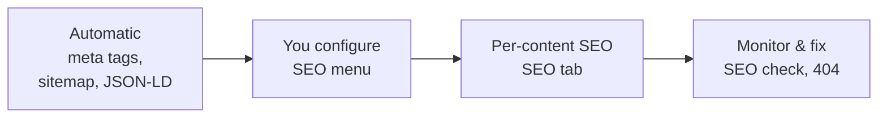

> 🌐 **Language:** [🇻🇳 Tiếng Việt](./seo-introduction_vi.md) · 🇬🇧 English (current) · [🇯🇵 日本語](./seo-introduction_ja.md)

# SEO in S-Cart

## Introduction
This is the main page of the S-Cart SEO (search engine optimization) guide. It is for **store owners** who want their products, categories and articles to do better on Google, and for **developers** writing plugins or templates who want their content to benefit from the built-in SEO features. After reading this page, you will know what GP247 takes care of on its own, what you need to do, and which page to open next.

## At a glance
SEO in GP247 has three parts: the system **does things automatically** for every page, you **adjust** settings in the **SEO** menu and on each piece of content, and then you **monitor** and fix problems.

- **Nothing extra to install** — every feature in this guide is built into gp247/front and gp247/shop.
- **Safe by default** — cart, account and filter pages are hidden from Google automatically; deleted pages return a proper 404 error.
- **You only need to do a few things once** — verify with Google, enter a store description and a share image (see [Start in 15 minutes](#start-in-15-minutes)).
- **Plugins and templates can plug in** — the same SEO tab, sitemap, JSON-LD and alerts (see the developer page).

## Pages in this guide
Each sub-page answers one question; pick the page that matches what you need to do.

| Page | Answers the question | For |
| --- | --- | --- |
| [What GP247 does automatically](./seo-automatic.md) | Which tags does the system generate, how is the sitemap built, which pages are hidden from Google? | Site owners |
| [Store-wide SEO settings](./seo-settings.md) | How do I use the Meta & JSON-LD, Sitemap.xml and Website information screens? | Site owners |
| [SEO for each piece of content](./seo-content.md) | How do I set a custom title and description for one product, or change an address without losing visitors? | Site owners, editors |
| [Monitoring & fixing SEO problems](./seo-monitoring.md) | What SEO problems does my website have; which 404 pages do visitors hit; how can an AI agent help? | Site owners |
| [Tracking code & cookie banner](./tracking-and-cookies.md) | How do I add GA4, GTM, Meta Pixel and other code, ask visitors for cookie consent and see revenue from ads? | Site owners |
| [SEO hooks for developers](./seo-for-developers.md) | How does a plugin / template plug into the SEO tab, sitemap, JSON-LD and alerts? | Developers |

## The SEO menu in the admin
All SEO screens are in the **SEO** menu group of the admin; each screen has its own permission, so you can hand each task to a different person.

| Screen | What it does |
| --- | --- |
| **Meta & JSON-LD** | robots.txt, turning JSON-LD on/off, Google/Bing verification codes, IndexNow, title templates |
| **Sitemap.xml** | Choose which products/categories/plugins are in the sitemap, exclude addresses, refresh the sitemap |
| **Redirect 301** | Send old links to new ones; switch to create them automatically when an address changes |
| **404 log** | See which non-existent addresses visitors are opening (off by default) |
| **SEO check** | Scan the store for SEO problems and list items "To fix" and "To review" |
| **Tracking code & cookies** | GA4, GTM, Meta Pixel, custom code, cookie banner (Administrators only) |
| **SEO** tab on content edit screens | Custom title, description, share image, noindex and canonical for each product, category, brand, page and article |

The store name, description, keywords and **default** share image for the whole website are on the **Website information** screen (not in the SEO menu).

## Start in 15 minutes
For a new store, doing the five tasks below in order gives you a good SEO foundation; the system handles everything else.

1. Go to **Website information**, fill in the **store description** (about 150 characters) and choose a **social share image** — these are the fallback values for every page that has no description or image of its own.
2. Go to **SEO › Meta & JSON-LD**, paste your **Google Search Console verification code** (**How to get the code** is right below the box), click outside the box to save, then go back to Search Console and click **Verify**.
3. In Google Search Console, submit your sitemap address: `https://<your-domain>/sitemap.xml`.
4. If you often change product addresses (aliases), open **SEO › Redirect 301** and keep the switch **Create a 301 redirect automatically when the address (alias) … changes** turned on (it is on by default).
5. Go to **SEO › SEO check** and click **Check**. Fix the items in the **To fix** group first.

If everything worked, after a few days Search Console reports the sitemap as "Success" and the number of indexed pages gradually goes up.

## Q&A
**Q1: Do I need to install an SEO plugin?**

→ No. Every feature in this guide is included when you install S-Cart (gp247/front and gp247/shop).

**Q2: After doing the steps above, how long until I show up on Google?**

→ Nobody can promise a time. Google usually starts reading your pages a few days after the sitemap is submitted; your ranking depends on your content and the competition.

**Q3: My site has several stores (multi-store). Are the SEO settings shared?**

→ No. robots.txt, verification codes, title templates, IndexNow, redirects, the 404 log and SEO check results are all **per store**; each domain has its own sitemap.

**Q4: I can't see the SEO menu?**

→ Your account does not have permission for the SEO screens yet. Ask the main administrator to grant it (each screen has its own permission).

**Q5: Are multilingual websites supported?**

→ Yes. The sitemap lists URLs for every active language with hreflang tags; SEO titles and descriptions are entered separately for each language. See [What GP247 does automatically](./seo-automatic.md).

**Q6: I'm a developer writing a news plugin. How do I get an SEO tab?**

→ Register a content type and use the front SEO panel trait — see [SEO hooks for developers](./seo-for-developers.md).

---

📅 **Last updated:** 2026-11-22 · ✍️ **Author:** GP247
