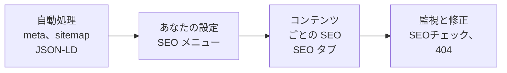

> 🌐 **言語:** [🇻🇳 Tiếng Việt](./seo-introduction_vi.md) · [🇬🇧 English](./seo-introduction.md) · 🇯🇵 日本語（現在）

# S-Cart の SEO

## はじめに
このページは、S-Cart の SEO（検索エンジン最適化）ドキュメントのメインページです。商品・カテゴリ・記事を Google で見つけてもらいやすくしたい**ストアオーナー**と、プラグインやテンプレートを作り、自分のコンテンツでも標準の SEO 機能を使いたい**開発者**を対象としています。このページを読むと、GP247 が自動で行うこと、あなたがすべきこと、次に開くべきページがわかります。

## ひと目でわかる
GP247 の SEO は 3 つの部分に分かれます。システムがすべてのページで**自動で行う**部分、**SEO** メニューと各コンテンツで**あなたが調整する**部分、そして問題を直すための**監視**です。

- **追加のインストールは不要** — このドキュメントの機能はすべて gp247/front と gp247/shop に標準で含まれています。
- **初期状態で安全** — カート、アカウント、絞り込みのページは自動で Google から隠されます。削除したページは正しく 404 エラーを返します。
- **一度だけ行う作業はわずか** — Google での所有権の確認、ストアの説明とシェア画像の入力です（[15 分で始める](#15-分で始める) を参照）。
- **プラグインとテンプレートも接続できる** — 同じ SEO タブ、サイトマップ、JSON-LD、アラートを使えます（開発者向けページを参照）。

## このドキュメントのページ一覧
各ページは 1 つの疑問に答えます。必要な作業に合わせてページを選んでください。

| ページ | 答える疑問 | 対象 |
| --- | --- | --- |
| [GP247 が SEO のために自動で行うこと](./seo-automatic_ja.md) | システムが自動で作るタグは？サイトマップの仕組みは？Google から隠されるページは？ | サイトオーナー |
| [ストア全体の SEO 設定](./seo-settings_ja.md) | Meta & JSON-LD、Sitemap.xml、サイト情報の各画面の使い方は？ | サイトオーナー |
| [コンテンツごとの SEO](./seo-content_ja.md) | 1 つの商品に独自のタイトルと説明を付けるには？URL を変えても訪問者を失わないには？ | サイトオーナー、編集者 |
| [SEO の監視と問題の修正](./seo-monitoring_ja.md) | サイトにどんな SEO の問題があるか？訪問者がどの 404 ページに当たっているか？AI エージェントは何を手伝えるか？ | サイトオーナー |
| [トラッキングコードと Cookie バナー](./tracking-and-cookies_ja.md) | GA4、GTM、Meta ピクセル、他のコードをどう設定するか？Cookie の同意をどう求めるか？広告からの売上をどこで見るか？ | サイトオーナー |
| [開発者向け SEO フック](./seo-for-developers_ja.md) | プラグイン / テンプレートを SEO タブ、サイトマップ、JSON-LD、アラートに接続するには？ | 開発者 |

## 管理画面の SEO メニュー
SEO の画面はすべて、管理画面の **SEO** メニューグループにあります。画面ごとに個別の権限があるため、作業ごとに担当者を分けられます。

| 画面 | できること |
| --- | --- |
| **Meta & JSON-LD** | robots.txt、JSON-LD のオン / オフ、Google / Bing の確認コード、IndexNow、タイトルテンプレート |
| **Sitemap.xml** | サイトマップに含める商品 / カテゴリ / プラグインの選択、URL の除外、サイトマップの再生成 |
| **301リダイレクト** | 旧リンクから新リンクへの転送。URL の変更時に自動作成するスイッチ |
| **404ログ** | 訪問者が開いた、存在しない URL の確認（初期状態はオフ） |
| **SEOチェック** | ストアの SEO の問題をスキャンし、「要修正」と「要確認」の項目を一覧表示 |
| **トラッキングコードとCookie** | GA4、GTM、Meta ピクセル、カスタムコード、Cookie バナー（管理者のみ） |
| コンテンツ編集画面の **SEO** タブ | 商品、カテゴリ、ブランド、ページ、記事ごとのタイトル、説明、シェア画像、noindex、カノニカル |

サイト全体の**デフォルト**のストア名、説明、キーワード、シェア画像は **サイト情報** 画面にあります（SEO メニューではありません）。

## 15 分で始める
新しいストアなら、次の 5 つを順に行えば十分な SEO の土台ができます。それ以外はシステムが自動で行います。

1. **サイト情報** を開き、**ストアの説明**（「説明」欄、約 150 文字）を入力して、**SNS シェア画像**（「OGP画像」欄）を選びます。独自の説明や画像がないすべてのページで、代わりにこの値が使われます。
2. **SEO › Meta & JSON-LD** を開き、**Google Search Console の確認コード** を貼り付けます（取得方法は入力欄のすぐ下にあります）。入力欄の外をクリックして保存し、Search Console に戻って **確認** を押します。
3. Google Search Console で、サイトマップの URL を送信します：`https://<あなたのドメイン>/sitemap.xml`。
4. 商品の URL（エイリアス）をよく変更する場合は、**SEO › 301リダイレクト** を開き、スイッチ **商品・カテゴリ・ブランド・ページのURL（エイリアス）を変更したら301リダイレクトを自動作成する** をオンのままにします（初期状態でオンです）。
5. **SEO › SEOチェック** を開き、**チェック** を押します。**要修正** グループの項目から先に直します。

うまくいけば、数日後に Search Console でサイトマップが「成功しました」と表示され、インデックス登録されたページ数が少しずつ増えていきます。

## よくある質問（Q&A）
**Q1: SEO プラグインをインストールする必要はありますか？**

→ いいえ。このドキュメントの機能はすべて、S-Cart（gp247/front と gp247/shop）をインストールした時点で使えます。

**Q2: 上の手順を終えたら、どのくらいで Google に表示されますか？**

→ 期間は誰にも約束できません。通常、サイトマップを送信してから数日で Google がページを読み始めます。順位はコンテンツと競合の状況によって決まります。

**Q3: 複数のストアがあるサイト（マルチストア）では、SEO 設定は共通ですか？**

→ いいえ。robots.txt、確認コード、タイトルテンプレート、IndexNow、リダイレクト、404ログ、SEOチェックの結果は、すべて**ストアごと**です。ドメインごとに専用のサイトマップがあります。

**Q4: SEO メニューが表示されないのはなぜですか？**

→ あなたのアカウントに SEO 画面の権限がありません。ルート管理者に権限を付与してもらってください（画面ごとに個別の権限があります）。

**Q5: 多言語サイトに対応していますか？**

→ はい。サイトマップは有効なすべての言語の URL を hreflang タグ付きで出力します。SEO のタイトルと説明は言語ごとに入力します。[GP247 が SEO のために自動で行うこと](./seo-automatic_ja.md) を参照してください。

**Q6: ニュースプラグインを作っている開発者です。SEO タブを付けるにはどうすればよいですか？**

→ コンテンツ種別を登録し、front の SEO パネル用トレイトを使います。[開発者向け SEO フック](./seo-for-developers_ja.md) を参照してください。

---

📅 **最終更新:** 2026-11-20 · ✍️ **作成者 (Author):** GP247
