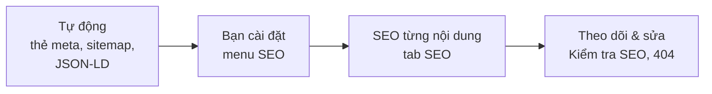

> 🌐 **Ngôn ngữ:** 🇻🇳 Tiếng Việt (hiện tại) · [🇬🇧 English](./seo-introduction.md) · [🇯🇵 日本語](./seo-introduction_ja.md)

# SEO trong S-Cart

## Giới thiệu
Đây là trang chính của bộ tài liệu SEO (tối ưu cho công cụ tìm kiếm) của S-Cart. Tài liệu dành cho **chủ cửa hàng** muốn sản phẩm, danh mục, bài viết lên Google tốt hơn, và cho **lập trình viên** viết plugin, template muốn nội dung của mình được hưởng các chức năng SEO có sẵn. Đọc trang này, bạn biết GP247 tự lo những gì, bạn cần làm gì, và nên mở trang con nào tiếp theo.

## Nhìn nhanh
SEO trong GP247 chia làm ba phần: hệ thống **tự làm** cho mọi trang, bạn **chỉnh** ở menu **SEO** và trên từng nội dung, rồi **theo dõi** để sửa lỗi.

- **Không cần cài thêm gì** — mọi chức năng trong bộ tài liệu này có sẵn trong gp247/front và gp247/shop.
- **Mặc định đã an toàn** — trang giỏ hàng, tài khoản, trang lọc tự được giấu khỏi Google; trang đã xoá trả đúng lỗi 404.
- **Bạn chỉ cần làm vài việc một lần** — xác minh với Google, nhập mô tả cửa hàng, ảnh chia sẻ (xem [Bắt đầu trong 15 phút](#bắt-đầu-trong-15-phút)).
- **Plugin và template cắm vào được** — cùng tab SEO, sitemap, JSON-LD, cảnh báo (xem trang cho lập trình viên).

## Bộ tài liệu gồm những trang nào
Mỗi trang con trả lời một câu hỏi; chọn trang theo việc bạn cần.

| Trang | Trả lời câu hỏi | Dành cho |
| --- | --- | --- |
| [Những gì GP247 tự làm](./seo-automatic_vi.md) | Hệ thống tự sinh thẻ nào, sitemap ra sao, trang nào bị giấu khỏi Google? | Chủ site |
| [Cài đặt SEO toàn cửa hàng](./seo-settings_vi.md) | Màn Meta & JSON-LD, Sitemap.xml, Thông tin website dùng thế nào? | Chủ site |
| [SEO cho từng nội dung](./seo-content_vi.md) | Đặt tiêu đề, mô tả riêng cho một sản phẩm; đổi đường dẫn mà không mất khách? | Chủ site, biên tập viên |
| [Theo dõi & sửa lỗi SEO](./seo-monitoring_vi.md) | Website đang có lỗi SEO gì; khách gặp trang 404 nào; AI agent giúp được gì? | Chủ site |
| [Mã đo lường & banner cookie](./tracking-and-cookies_vi.md) | Gắn GA4, GTM, Meta Pixel, mã khác; hỏi khách đồng ý cookie; xem doanh thu từ quảng cáo? | Chủ site |
| [Hook SEO cho lập trình viên](./seo-for-developers_vi.md) | Plugin / template cắm vào tab SEO, sitemap, JSON-LD, cảnh báo thế nào? | Lập trình viên |

## Menu SEO trong trang quản trị
Mọi màn SEO nằm trong nhóm menu **SEO** của trang quản trị; mỗi màn có quyền riêng nên bạn có thể giao từng việc cho từng người.

| Màn | Làm gì |
| --- | --- |
| **Meta & JSON-LD** | robots.txt, bật/tắt JSON-LD, mã xác minh Google/Bing, IndexNow, mẫu tiêu đề |
| **Sitemap.xml** | Chọn sản phẩm/danh mục/plugin có trong sitemap, loại trừ đường dẫn, làm mới sitemap |
| **Redirect 301** | Chuyển hướng link cũ sang link mới; công tắc tự tạo khi đổi đường dẫn |
| **Nhật ký 404** | Xem khách đang vào những đường dẫn không tồn tại (mặc định tắt) |
| **Kiểm tra SEO** | Quét lỗi SEO của cửa hàng, liệt kê việc "Cần sửa" và "Nên xem" |
| **Mã đo lường & cookie** | GA4, GTM, Meta Pixel, mã tự do, banner cookie (chỉ Quản trị viên) |
| Tab **SEO** ở màn sửa nội dung | Tiêu đề, mô tả, ảnh chia sẻ, noindex, canonical riêng cho từng sản phẩm, danh mục, thương hiệu, trang, bài viết |

Tên cửa hàng, mô tả, từ khoá và ảnh chia sẻ **mặc định** của cả website nằm ở màn **Thông tin website** (không trong menu SEO).

## Bắt đầu trong 15 phút
Với một cửa hàng mới, làm lần lượt năm việc dưới đây là đủ nền SEO tốt; mọi việc khác hệ thống tự làm.

1. Vào **Thông tin website**, điền **mô tả cửa hàng** (khoảng 150 ký tự) và chọn **ảnh chia sẻ mạng xã hội** — đây là giá trị dự phòng cho mọi trang chưa có mô tả, ảnh riêng.
2. Vào **SEO › Meta & JSON-LD**, dán **mã xác minh Google Search Console** (cách lấy mã có ngay dưới ô nhập), bấm ra ngoài ô để lưu, rồi quay lại Search Console bấm **Xác minh**.
3. Trong Google Search Console, gửi địa chỉ sitemap: `https://<tên-miền-của-bạn>/sitemap.xml`.
4. Nếu đổi đường dẫn (alias) sản phẩm thường xuyên, mở **SEO › Redirect 301** và giữ công tắc **Tự tạo redirect 301 khi đổi đường dẫn** đang bật (mặc định đã bật).
5. Vào **SEO › Kiểm tra SEO**, bấm **Kiểm tra**. Sửa các mục ở nhóm **Cần sửa** trước.

Nếu thành công, sau vài ngày Search Console báo sitemap "Thành công" và số trang được lập chỉ mục tăng dần.

## Hỏi & Đáp (Q&A)
**Câu 1: Tôi có cần cài plugin SEO nào không?**

→ Không. Mọi chức năng trong bộ tài liệu này có sẵn khi cài S-Cart (gp247/front và gp247/shop).

**Câu 2: Làm xong các bước trên thì bao lâu lên Google?**

→ Không ai hứa được thời gian. Thường Google bắt đầu đọc trang sau vài ngày khi sitemap đã gửi; thứ hạng phụ thuộc nội dung và mức cạnh tranh.

**Câu 3: Site của tôi có nhiều cửa hàng (multi-store), cài đặt SEO có chung không?**

→ Không. robots.txt, mã xác minh, mẫu tiêu đề, IndexNow, redirect, nhật ký 404 và kết quả Kiểm tra SEO đều **theo từng cửa hàng**; mỗi tên miền có sitemap riêng.

**Câu 4: Tôi không thấy menu SEO?**

→ Tài khoản của bạn chưa có quyền các màn SEO. Nhờ quản trị viên gốc cấp quyền (mỗi màn một quyền riêng).

**Câu 5: Website đa ngôn ngữ có được hỗ trợ không?**

→ Có. Sitemap phát URL cho mọi ngôn ngữ đang bật kèm thẻ hreflang; tiêu đề, mô tả SEO nhập riêng cho từng ngôn ngữ. Xem [Những gì GP247 tự làm](./seo-automatic_vi.md).

**Câu 6: Tôi là lập trình viên viết plugin tin tức, làm sao có tab SEO?**

→ Đăng ký loại nội dung và dùng trait panel SEO của front — xem [Hook SEO cho lập trình viên](./seo-for-developers_vi.md).

---

📅 **Cập nhật lần cuối:** 2026-11-22 · ✍️ **Tác giả (Author):** GP247
