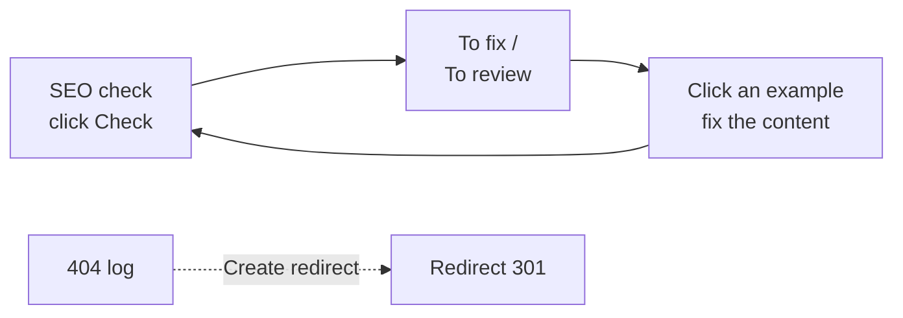
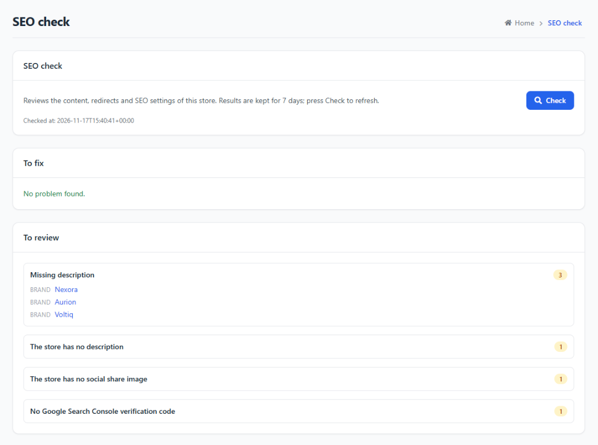
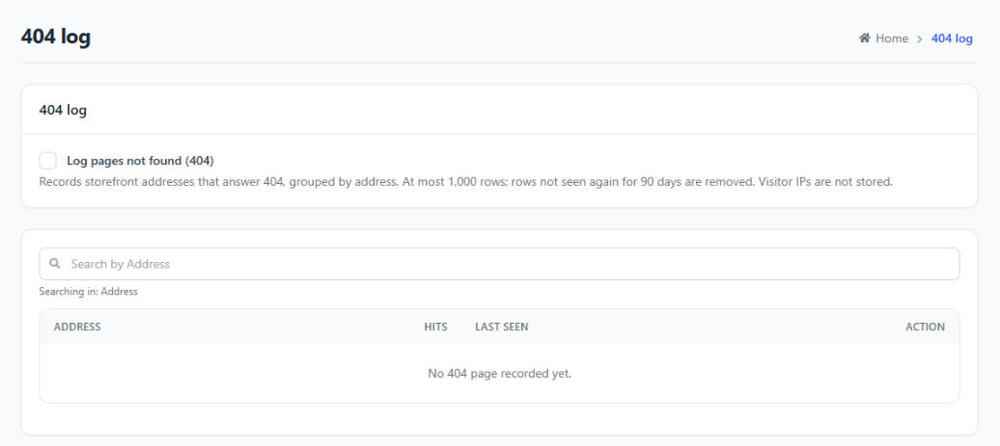

> 🌐 **Language:** [🇻🇳 Tiếng Việt](./seo-monitoring_vi.md) · 🇬🇧 English (current) · [🇯🇵 日本語](./seo-monitoring_ja.md)

# Monitoring & fixing SEO problems

## Introduction
This page explains how to find and fix your store's SEO problems: the **SEO check** screen, alerts in the admin and the `gp247:doctor` command, the **404 log** screen, and asking an **AI agent** to read/fix SEO through MCP. It is for site owners who want regular check-ups without paid external tools. After reading it, you will know what each problem means and where to fix it.

## At a glance
A simple monitoring loop: check → fix → check again; alerts remind you while there is still something to fix.



- **The SEO check runs when you click** — no cron needed, safe for shared hosting.
- **Two levels**: **To fix** (currently hurting your ranking) and **To review** (chances to improve).
- **Alerts remind you automatically** in the System alerts block and in `gp247:doctor` while there are items To fix.
- **The 404 log is off by default** — turn it on when you want to know which broken links visitors are hitting.

## SEO check
Go to **SEO › SEO check** and click **Check**. The system reviews the active content, redirects and SEO settings of the **currently selected store**, in the store's default language.



1. Click **Check**. It usually takes a few seconds; a very large store may take longer.
2. Read the **To fix** group first. Each item shows a count and up to 20 examples.
3. Click the name of an example to open that content's edit screen, fix it, click **Update**.
4. Go back and click **Check** again to confirm the item is gone.

Results are kept for 7 days and show **Checked at …**; you don't need to run it again every time you open the screen.

### Problems that are checked
The table below lists every item and how to fix it.

| Level | Item | Where to fix |
| --- | --- | --- |
| To fix | robots.txt blocks the whole website | Meta & JSON-LD › robots.txt: delete the `Disallow: /` line |
| To fix | Content set to "noindex" (check it is intended) | The content's SEO tab: untick it if it was not intended |
| To fix | Redirect loops | Redirect 301: edit or delete one redirect in the loop |
| To fix | Redirects to pages that returned 404 in the last 7 days | Redirect 301: change "To" to a page that exists; each row shows the last 404. Once the target page works, the item clears within 7 days (only checked when the 404 log is on) |
| To fix | Canonical URL points to another domain | SEO tab: delete or correct the Canonical URL |
| To review | Missing description | SEO tab or the content's description |
| To review | Duplicate titles | Rename, or set a custom SEO title |
| To review | Redirect chains (several hops) | Redirect 301: point straight to the final destination |
| To review | Sitemap has both products and categories switched off | Sitemap.xml: turn them back on |
| To review | The store has no description / no social share image | Website information |
| To review | No Google Search Console verification code | Meta & JSON-LD › Site ownership verification |
| To review | SEO data of deleted content | Click **Clean up** right on the screen |

- **Content checked**: active pages, products, categories and brands.
- **The check stops after 20 seconds** if the store is too large and is marked "incomplete" — click **Check** again.
- **The Clean up button** only deletes SEO data of content that no longer exists, then checks again.

## System alerts and the gp247:doctor command
You don't need to remember to open the SEO check screen: the latest result appears in the **System alerts** block in the admin and in the `gp247:doctor` health-check command.

| Status | Meaning |
| --- | --- |
| Not checked yet | Check has never been clicked — open the screen and run it for the first time |
| Nothing to fix | The latest check found no items To fix |
| N kind(s) of problem to fix | There are still items To fix — click the link to open the SEO check screen |

Server administrators can run this in a terminal (in the website folder):

```
php artisan gp247:doctor
```

The `seo_audit` line shows the status above. The alert only reads the saved result and does not scan the database again, so it does not slow down the admin.

## 404 log
The **404 log** records addresses on your store that visitors opened but that do not exist — broken links in old articles, deleted products, mistyped links. It is **off** by default.



1. Go to **SEO › 404 log** and turn on **Log pages not found (404)**.
2. Wait a few days to collect data, then open the screen again; sort by **Hits** to see the most common broken links.
3. For an address that should be forwarded, click **Create redirect** — the Redirect 301 screen opens with the "From" box already filled in.
4. For junk addresses (bots probing for weaknesses), delete the row or click **Delete all**.

- **Only store pages are logged** — admin pages, the API, images, CSS and JS are ignored.
- **No IP addresses or personal data are stored**; only the address, hit count, first/last seen and the referring page (where the visitor came from).
- **Self-limiting**: at most 1,000 rows per store; rows not seen again for 90 days are deleted automatically — no cron needed.

## Asking an AI agent to read and fix SEO (MCP)
If you have connected an AI agent (Claude, Cursor…) to your store through the MCP server, the agent can use three SEO tools:

| Tool | What it does | Default |
| --- | --- | --- |
| `seo_audit` | Reads the latest SEO check result; can ask for a new check (at most once every 2 minutes) | On |
| `get_seo` | Reads the SEO values of a product, category, brand or page | On |
| `update_seo` | Edits the title, description, canonical, noindex and nofollow of **one** piece of content (not the share image) | **Off** — turn it on in the MCP Server screen |

- **Same permissions as in the admin** — the agent's token needs permission for the SEO check screen and for the screen of the content type (e.g. the Products screen); editing needs write permission.
- **Anything that takes a page off Google always needs your confirmation** — when the agent changes noindex, nofollow or canonical, it must give you a confirmation code and the change only applies once you agree.

How to connect and set permissions for the agent: see [MCP tool catalogue](../mcp/mcp-tools.md) and [MCP security & permissions](../mcp/mcp-security.md).

## Q&A
**Q1: How often should I run the SEO check?**

→ After each round of adding/editing many products, and about once a month. System alerts will remind you if the latest check still has items To fix.

**Q2: The screen reports "Content set to 'noindex'", but I did it on purpose?**

→ This item is there for you to review, not a mandatory fix. If it is intentional, just leave it.

**Q3: The check says "incomplete"?**

→ A large store made the check run past 20 seconds, so it stopped early. Click Check again; the items already checked are still correct.

**Q4: Should I leave the 404 log on forever?**

→ You can, since it limits its own number of rows. If you don't plan to look at it, turn it off to save a few resources.

**Q5: The 404 log is full of strange addresses like `/wp-admin`?**

→ Those are bots probing WordPress websites for weaknesses. No redirect is needed; click Delete all.

**Q6: Is my news plugin included in the SEO check?**

→ Currently the screen checks pages, products, categories and brands. Plugin content still has an SEO tab but is not on the check list.

**Q7: Can an AI agent take a product off Google on its own?**

→ No. The SEO editing tool is off by default, and every noindex, nofollow or canonical change needs your confirmation with a code.

---

<sub>📅 **Last updated:** 2026-11-22 · ✍️ **Author:** GP247</sub>
