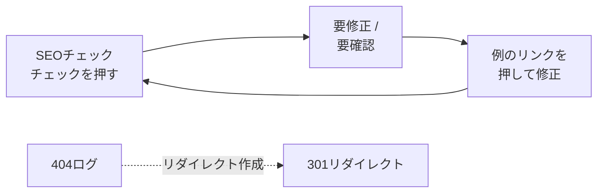
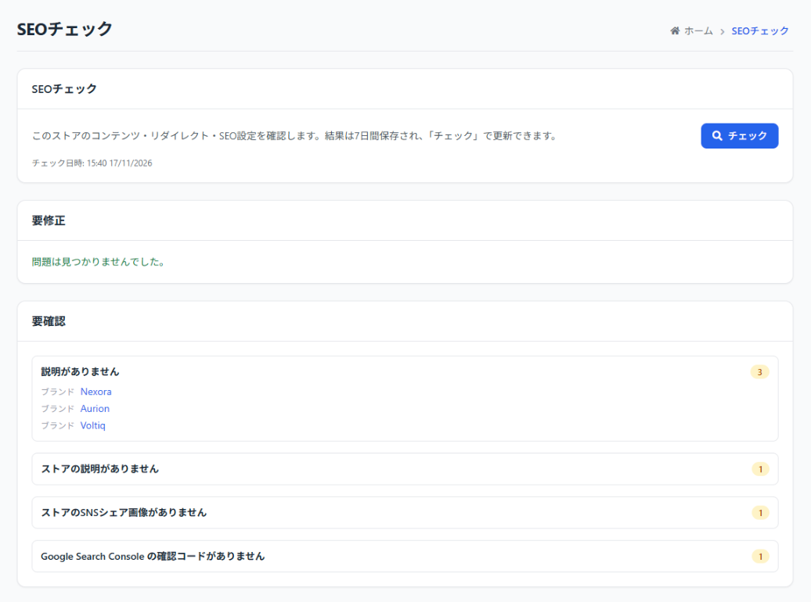
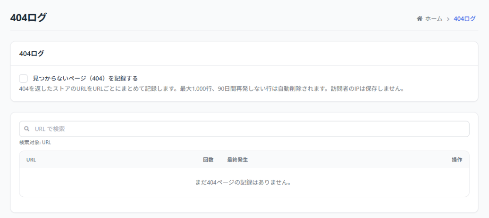

> 🌐 **言語:** [🇻🇳 Tiếng Việt](./seo-monitoring_vi.md) · [🇬🇧 English](./seo-monitoring.md) · 🇯🇵 日本語（現在）

# SEO の監視と問題の修正

## はじめに
このページでは、ストアの SEO の問題を見つけて直す方法を説明します。**SEOチェック** 画面、管理画面のアラートと `gp247:doctor` コマンド、**404ログ** 画面、そして MCP を通じて **AI エージェント**に SEO の確認と修正を任せる方法です。有料の外部ツールを使わずに定期的に見直したいサイトオーナーを対象としています。読み終えると、それぞれの問題の意味と、どこで直すかがわかります。

## ひと目でわかる
シンプルな監視のサイクルです。チェック → 修正 → 再チェック。直すべき項目が残っていると、アラートが知らせます。



- **SEOチェックはあなたが押したときに実行** — cron は不要で、共有サーバーでも安全です。
- **2 つのレベル** — **要修正**（今まさに順位を下げている）と **要確認**（改善の機会）。
- **アラートが自動で知らせる** — 要修正の項目が残っていると、システムアラートのブロックと `gp247:doctor` に表示されます。
- **404ログは初期状態でオフ** — 訪問者がどのリンク切れに当たっているか知りたいときにオンにします。

## SEOチェック
**SEO › SEOチェック** を開き、**チェック** を押します。システムは**選択中のストア**の有効なコンテンツ、リダイレクト、SEO 設定を、ストアのデフォルト言語で確認します。



1. **チェック** を押します。通常は数秒で終わります。非常に大きなストアでは、時間がかかる場合があります。
2. まず **要修正** グループを読みます。各項目に件数と、最大 20 件の例があります。
3. 例の名前を押すと、そのコンテンツの編集画面が開きます。修正して **更新** を押します。
4. 戻って **チェック** を押し、その項目が消えたことを確認します。

結果は 7 日間保存され、**チェック日時** が表示されます。画面を開くたびに実行し直す必要はありません。

### チェックされる項目
下の表に、すべての項目と直し方をまとめます。

| レベル | 項目 | 修正する場所 |
| --- | --- | --- |
| 要修正 | robots.txt がサイト全体をブロックしています | Meta & JSON-LD › robots.txt：`Disallow: /` の行を削除 |
| 要修正 | 「noindex」に設定されたコンテンツ（意図したものか確認） | コンテンツの SEO タブ：意図していなければチェックを外す |
| 要修正 | リダイレクトのループ | 301リダイレクト：ループ内のリダイレクトを 1 つ修正または削除 |
| 要修正 | 過去7日間に404を返したページへのリダイレクト | 301リダイレクト：「転送先」を存在するページに変更。各行に最後の404の日時を表示。転送先のページが直れば、最長7日で表示が消えます（404ログがオンのときだけチェック） |
| 要修正 | カノニカルURLが別ドメインを指しています | SEO タブ：カノニカル URL を削除または修正 |
| 要確認 | 説明がありません | SEO タブ、またはコンテンツの説明欄 |
| 要確認 | タイトルの重複 | 名前を変えるか、独自の SEO タイトルを設定 |
| 要確認 | リダイレクトチェーン（複数ステップ） | 301リダイレクト：最終的な転送先を直接指す |
| 要確認 | サイトマップで商品とカテゴリの両方が無効です | Sitemap.xml：もう一度オンにする |
| 要確認 | ストアの説明がありません / ストアのSNSシェア画像がありません | サイト情報 |
| 要確認 | Google Search Console の確認コードがありません | Meta & JSON-LD › サイト所有権の確認 |
| 要確認 | 削除済みコンテンツのSEOデータ | 画面の **削除** を押す |

- **対象のコンテンツ** — 有効なページ、商品、カテゴリ、ブランド。
- **ストアが大きすぎる場合、チェックは 20 秒で止まり**、「未完了」と表示されます。もう一度 **チェック** を押してください。
- **削除ボタン** は、もう存在しないコンテンツの SEO データだけを削除し、その後もう一度チェックします。

## システムアラートと gp247:doctor コマンド
SEOチェック画面を開くことを覚えておく必要はありません。直近の結果は、管理画面の **システムアラート** ブロックと、ヘルスチェックコマンド `gp247:doctor` に表示されます。

| 状態 | 意味 |
| --- | --- |
| まだチェックしていない | 一度も「チェック」を押していません。画面を開いて初回のチェックを実行してください |
| 問題なし | 直近のチェックで、要修正の項目はありません |
| 要修正の問題が N 種類 | 要修正の項目が残っています。リンクを押して SEOチェック画面を開いてください |

サーバー管理者は、ターミナル（サイトのフォルダー）で実行できます。

```
php artisan gp247:doctor
```

`seo_audit` の行に、上の状態が表示されます。アラートは保存済みの結果を読むだけで、データベースをスキャンし直さないため、管理画面が遅くなることはありません。

## 404ログ
**404ログ** は、訪問者がストアで開いたものの存在しなかった URL を記録します。古い記事のリンク切れ、削除した商品、打ち間違えたリンクなどです。初期状態は**オフ**です。



1. **SEO › 404ログ** を開き、**見つからないページ（404）を記録する** をオンにします。
2. 数日おいてデータがたまったら、画面を開き直します。**回数** で並べ替えると、最も多いリンク切れがわかります。
3. 転送すべき URL には **リダイレクト作成** を押します。「転送元」が入力済みの 301リダイレクト画面が開きます。
4. 意味のない URL（エラーを探るボット）は、行を削除するか **すべて削除** を押します。

- **ストアのページだけを記録** — 管理画面、API、画像、CSS、JS は記録しません。
- **IP や個人データは保存しません** — URL、回数、初回 / 最終の日時、リンク元のページ（参照元）だけです。
- **自動で上限を管理** — ストアごとに最大 1,000 行です。90 日間再発しない行は自動で削除されます。cron は不要です。

## AI エージェントに SEO の確認と修正を任せる（MCP）
AI エージェント（Claude、Cursor など）を MCP サーバー経由でストアに接続している場合、エージェントは 3 つの SEO ツールを使えます。

| ツール | できること | 初期状態 |
| --- | --- | --- |
| `seo_audit` | 直近の SEOチェックの結果を読む。再チェックを依頼することもできる（最大 2 分に 1 回） | オン |
| `get_seo` | 商品、カテゴリ、ブランド、ページの SEO の値を読む | オン |
| `update_seo` | **1 つ**のコンテンツのタイトル、説明、カノニカル、noindex、nofollow を修正（シェア画像は対象外） | **オフ** — MCP Server 画面でオンにする |

- **権限は管理画面と同じ** — エージェントのトークンには、SEOチェック画面の権限と、コンテンツ種別の画面（例：商品画面）の権限が必要です。修正には書き込み権限が必要です。
- **ページを Google から外す操作には、必ずあなたの確認が必要** — エージェントが noindex、nofollow、カノニカルを変更するときは、あなたに確認コードを提示し、あなたが同意した場合だけ適用します。

エージェントの接続方法と権限の設定は、[MCP ツール一覧](../mcp/mcp-tools_ja.md) と [MCP のセキュリティと権限](../mcp/mcp-security_ja.md) を参照してください。

## よくある質問（Q&A）
**Q1: SEOチェックはどのくらいの頻度で実行すればよいですか？**

→ 商品をまとめて追加や編集したあとと、月に 1 回程度です。直近のチェックで要修正の項目が残っていれば、システムアラートが知らせます。

**Q2: 「noindex」に設定されたコンテンツの項目が表示されますが、意図的な設定です。直す必要がありますか？**

→ この項目は見直してもらうためのもので、必ず直すべきエラーではありません。意図したものなら、そのままで構いません。

**Q3: チェックで「未完了」と表示されるのはなぜですか？**

→ ストアが大きく、チェックが 20 秒を超えたため途中で止まりました。もう一度チェックを押してください。チェック済みの項目の結果は正しいままです。

**Q4: 404ログはずっとオンにしておいてもよいですか？**

→ はい。行数は自動で制限されます。見る予定がなければ、少しでもリソースを節約するためにオフにしてください。

**Q5: 404ログが `/wp-admin` のような見慣れない URL でいっぱいなのはなぜですか？**

→ WordPress サイトの弱点を探るボットです。リダイレクトを作る必要はありません。すべて削除を押してください。

**Q6: ニュースプラグインのコンテンツも SEOチェックの対象になりますか？**

→ 現在、この画面の対象はページ、商品、カテゴリ、ブランドです。プラグインのコンテンツにも SEO タブはありますが、チェックの対象には含まれていません。

**Q7: AI エージェントが勝手に商品を Google から外すことはありますか？**

→ いいえ。SEO を修正するツールは初期状態でオフです。また、noindex、nofollow、カノニカルの変更には、必ずあなたによるコードでの確認が必要です。

---

<sub>📅 **最終更新:** 2026-11-22 · ✍️ **作成者 (Author):** GP247</sub>
