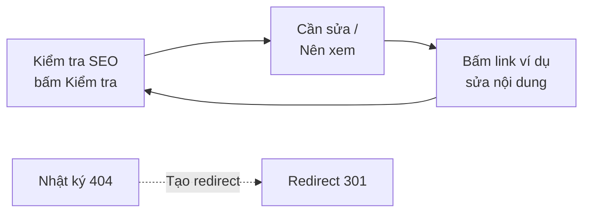
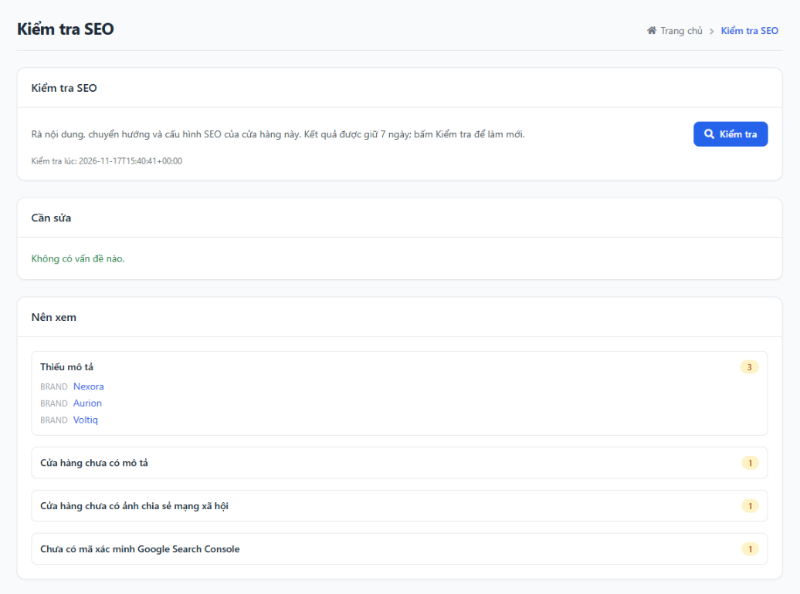
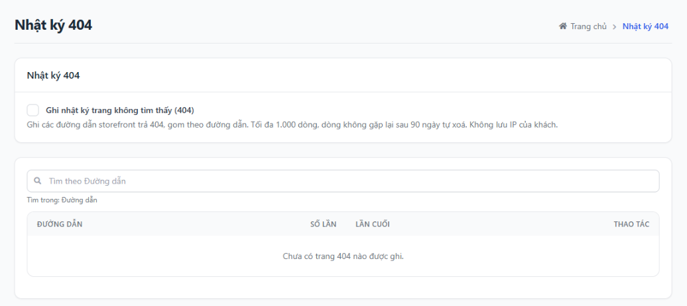

> 🌐 **Ngôn ngữ:** 🇻🇳 Tiếng Việt (hiện tại) · [🇬🇧 English](./seo-monitoring.md) · [🇯🇵 日本語](./seo-monitoring_ja.md)

# Theo dõi & sửa lỗi SEO

## Giới thiệu
Trang này hướng dẫn tìm và sửa lỗi SEO của cửa hàng: màn **Kiểm tra SEO**, cảnh báo trên trang quản trị và lệnh `gp247:doctor`, màn **Nhật ký 404**, và nhờ **AI agent** đọc/sửa SEO qua MCP. Dành cho chủ site muốn rà định kỳ mà không cần công cụ trả phí bên ngoài. Đọc xong, bạn biết mỗi lỗi nghĩa là gì và sửa ở đâu.

## Nhìn nhanh
Một vòng theo dõi đơn giản: kiểm tra → sửa → kiểm tra lại; cảnh báo nhắc bạn khi còn việc cần sửa.



- **Kiểm tra SEO chạy khi bạn bấm** — không cần cron, an toàn cho shared hosting.
- **Hai mức**: **Cần sửa** (đang làm hại thứ hạng) và **Nên xem** (cơ hội cải thiện).
- **Cảnh báo tự nhắc** trên khối Cảnh báo hệ thống và trong `gp247:doctor` khi còn mục Cần sửa.
- **Nhật ký 404 mặc định tắt** — bật khi bạn muốn biết khách đang gặp link hỏng nào.

## Kiểm tra SEO
Vào **SEO › Kiểm tra SEO**, bấm **Kiểm tra**. Hệ thống rà nội dung đang bật, redirect và cấu hình SEO của **cửa hàng đang chọn**, theo ngôn ngữ mặc định của cửa hàng.



1. Bấm **Kiểm tra**. Thường mất vài giây; cửa hàng rất lớn có thể lâu hơn.
2. Đọc nhóm **Cần sửa** trước. Mỗi mục có số lượng và tối đa 20 ví dụ.
3. Bấm tên một ví dụ để mở đúng màn sửa nội dung đó, sửa, bấm **Cập nhật**.
4. Quay lại bấm **Kiểm tra** để xác nhận mục đã hết.

Kết quả được giữ 7 ngày và hiện **Kiểm tra lúc …**; bạn không cần chạy lại mỗi lần mở màn.

### Các lỗi được kiểm tra
Bảng dưới liệt kê mọi mục và cách sửa.

| Mức | Mục | Sửa ở đâu |
| --- | --- | --- |
| Cần sửa | robots.txt đang chặn toàn bộ website | Meta & JSON-LD › robots.txt: xoá dòng `Disallow: /` |
| Cần sửa | Nội dung đang bị đặt "không index" | Tab SEO của nội dung: bỏ tick nếu không chủ ý |
| Cần sửa | Chuyển hướng vòng lặp | Redirect 301: sửa hoặc xoá một redirect trong vòng |
| Cần sửa | Chuyển hướng tới trang còn lỗi 404 trong 7 ngày qua | Redirect 301: đổi "Đến" sang trang còn tồn tại; mỗi dòng ghi lần 404 cuối. Trang đích đã sửa thì tự hết sau tối đa 7 ngày (chỉ kiểm khi Nhật ký 404 bật) |
| Cần sửa | URL canonical trỏ sang domain khác | Tab SEO: xoá hoặc sửa URL canonical |
| Nên xem | Thiếu mô tả | Tab SEO hoặc phần mô tả của nội dung |
| Nên xem | Tiêu đề trùng nhau | Đổi tên hoặc đặt tiêu đề SEO riêng |
| Nên xem | Chuyển hướng nối chuỗi (nhiều bước) | Redirect 301: trỏ thẳng tới đích cuối |
| Nên xem | Sitemap đang tắt cả sản phẩm lẫn danh mục | Sitemap.xml: bật lại |
| Nên xem | Cửa hàng chưa có mô tả / ảnh chia sẻ | Thông tin website |
| Nên xem | Chưa có mã xác minh Google Search Console | Meta & JSON-LD › Xác minh |
| Nên xem | Dữ liệu SEO của nội dung đã xoá | Bấm **Dọn** ngay trên màn |

- **Nội dung được xét**: trang, sản phẩm, danh mục, thương hiệu đang bật.
- **Kiểm tra dừng sau 20 giây** nếu cửa hàng quá lớn và ghi "chưa đầy đủ" — bấm **Kiểm tra** lại.
- **Nút Dọn** chỉ xoá dữ liệu SEO của nội dung đã không còn, rồi kiểm tra lại.

## Cảnh báo hệ thống và lệnh gp247:doctor
Bạn không cần nhớ mở màn Kiểm tra SEO: kết quả gần nhất hiện ở khối **Cảnh báo hệ thống** trên trang quản trị và trong lệnh kiểm tra sức khoẻ `gp247:doctor`.

| Trạng thái | Nghĩa |
| --- | --- |
| Chưa kiểm tra | Chưa từng bấm Kiểm tra — mở màn và chạy lần đầu |
| Không có vấn đề | Lần kiểm gần nhất không có mục Cần sửa |
| Có N loại vấn đề cần sửa | Còn mục Cần sửa — bấm link để mở màn Kiểm tra SEO |

Người quản trị máy chủ có thể chạy trong terminal (ở thư mục website):

```
php artisan gp247:doctor
```

Dòng `seo_audit` cho biết trạng thái trên. Cảnh báo chỉ đọc kết quả đã lưu, không quét lại cơ sở dữ liệu nên không làm chậm trang quản trị.

## Nhật ký 404
**Nhật ký 404** ghi lại các đường dẫn trên cửa hàng mà khách mở nhưng không tồn tại — link hỏng trong bài viết cũ, sản phẩm đã xoá, link gõ sai. Mặc định **tắt**.



1. Vào **SEO › Nhật ký 404**, bật **Ghi nhật ký trang không tìm thấy (404)**.
2. Để vài ngày cho có số liệu, rồi mở lại màn; sắp theo **Số lần** để thấy link hỏng gặp nhiều nhất.
3. Với đường dẫn nên chuyển đi, bấm **Tạo redirect** — màn Redirect 301 mở sẵn ô "Từ".
4. Đường dẫn rác (bot dò lỗi) thì xoá dòng hoặc bấm **Xoá hết**.

- **Chỉ ghi trang của cửa hàng** — bỏ qua trang quản trị, API, ảnh, CSS, JS.
- **Không lưu IP hay dữ liệu cá nhân**; chỉ đường dẫn, số lần, lần đầu/lần cuối và trang dẫn tới (nguồn đến).
- **Tự giới hạn**: tối đa 1.000 dòng mỗi cửa hàng; dòng không gặp lại quá 90 ngày tự xoá — không cần cron.

## Nhờ AI agent đọc và sửa SEO (MCP)
Nếu bạn đã kết nối AI agent (Claude, Cursor…) với cửa hàng qua MCP server, agent dùng được ba công cụ SEO:

| Công cụ | Làm gì | Mặc định |
| --- | --- | --- |
| `seo_audit` | Đọc kết quả Kiểm tra SEO gần nhất; có thể yêu cầu kiểm tra lại (tối đa mỗi 2 phút một lần) | Bật |
| `get_seo` | Đọc giá trị SEO của một sản phẩm, danh mục, thương hiệu hoặc trang | Bật |
| `update_seo` | Sửa tiêu đề, mô tả, canonical, noindex, nofollow của **một** nội dung (không sửa ảnh chia sẻ) | **Tắt** — bật ở màn MCP Server |

- **Quyền như trên trang quản trị** — token của agent cần quyền màn Kiểm tra SEO và quyền màn của loại nội dung (vd màn Sản phẩm); sửa cần quyền ghi.
- **Việc làm trang rời khỏi Google luôn cần bạn xác nhận** — khi agent đổi noindex, nofollow hay canonical, nó phải đưa bạn một mã xác nhận và chỉ áp dụng khi bạn đồng ý.

Cách kết nối và phân quyền agent: xem [Danh mục công cụ MCP](../mcp/mcp-tools_vi.md) và [An toàn & phân quyền MCP](../mcp/mcp-security_vi.md).

## Hỏi & Đáp (Q&A)
**Câu 1: Bao lâu nên chạy Kiểm tra SEO một lần?**

→ Sau mỗi đợt thêm/sửa nhiều sản phẩm, và khoảng mỗi tháng một lần. Cảnh báo hệ thống sẽ nhắc nếu lần gần nhất còn mục Cần sửa.

**Câu 2: Màn báo "Nội dung đang bị đặt không index" nhưng tôi cố ý mà?**

→ Mục này để bạn rà lại, không phải lỗi bắt buộc sửa. Nếu chủ ý, cứ để nguyên.

**Câu 3: Kiểm tra báo "chưa đầy đủ"?**

→ Cửa hàng lớn làm lần kiểm vượt 20 giây nên dừng sớm. Bấm Kiểm tra lại; các mục đã kiểm xong vẫn đúng.

**Câu 4: Có nên bật Nhật ký 404 mãi không?**

→ Có thể, vì nó tự giới hạn số dòng. Nếu không định xem, tắt để tiết kiệm một chút tài nguyên.

**Câu 5: Nhật ký 404 đầy đường dẫn lạ như `/wp-admin`?**

→ Đó là bot dò lỗi các website WordPress. Không cần tạo redirect; bấm Xoá hết.

**Câu 6: Plugin tin tức của tôi có được Kiểm tra SEO xét không?**

→ Hiện màn xét trang, sản phẩm, danh mục và thương hiệu. Nội dung của plugin vẫn có tab SEO nhưng chưa nằm trong danh sách kiểm tra.

**Câu 7: AI agent có tự ý làm sản phẩm rời khỏi Google được không?**

→ Không. Công cụ sửa SEO tắt mặc định, và mọi thay đổi noindex, nofollow, canonical đều cần bạn xác nhận bằng mã.

---

<sub>📅 **Cập nhật lần cuối:** 2026-11-22 · ✍️ **Tác giả (Author):** GP247</sub>
