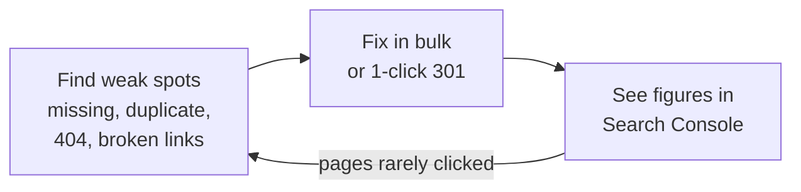
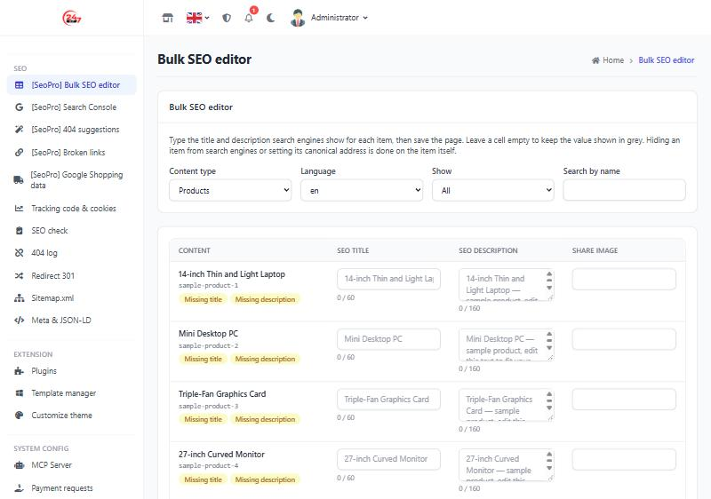
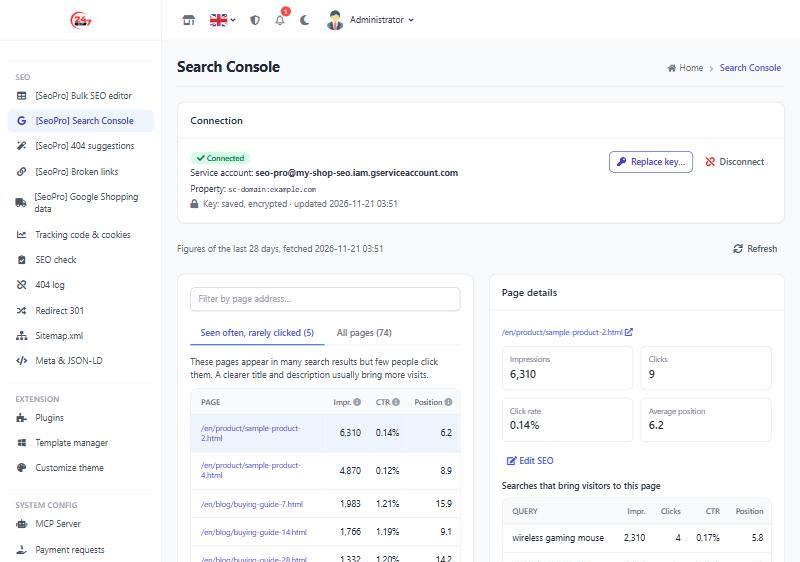
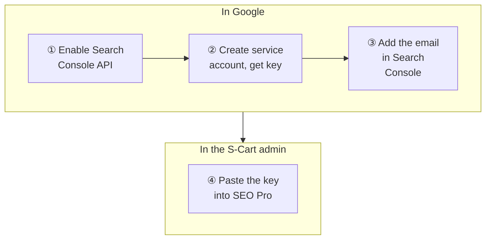
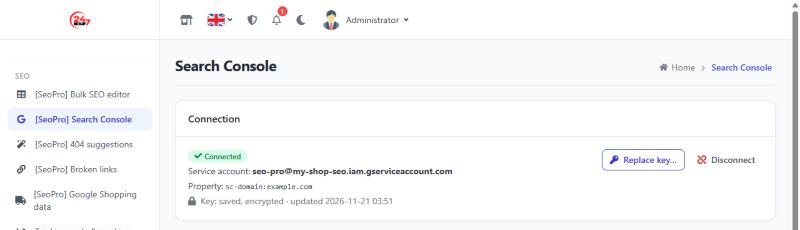
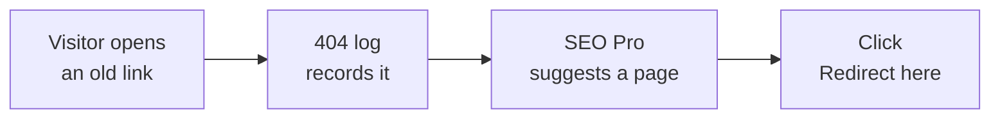
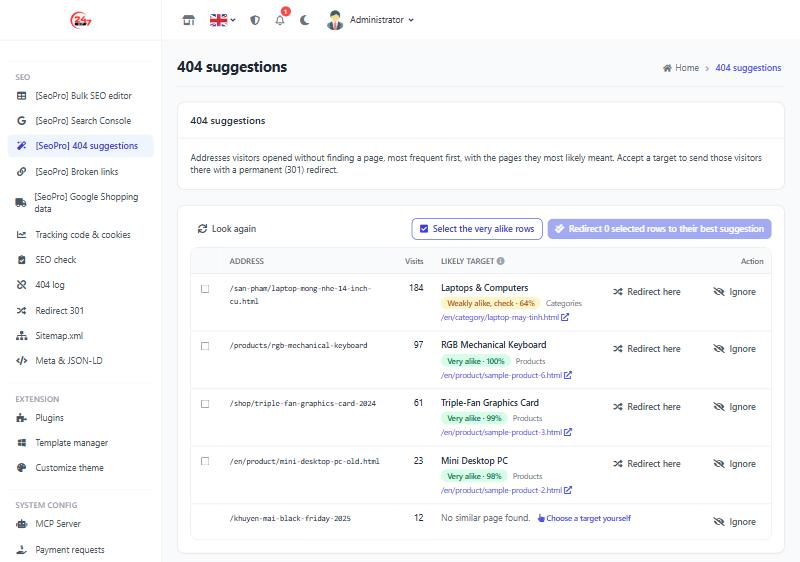
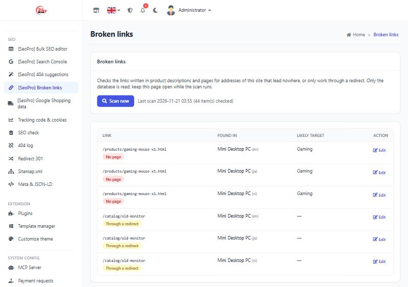
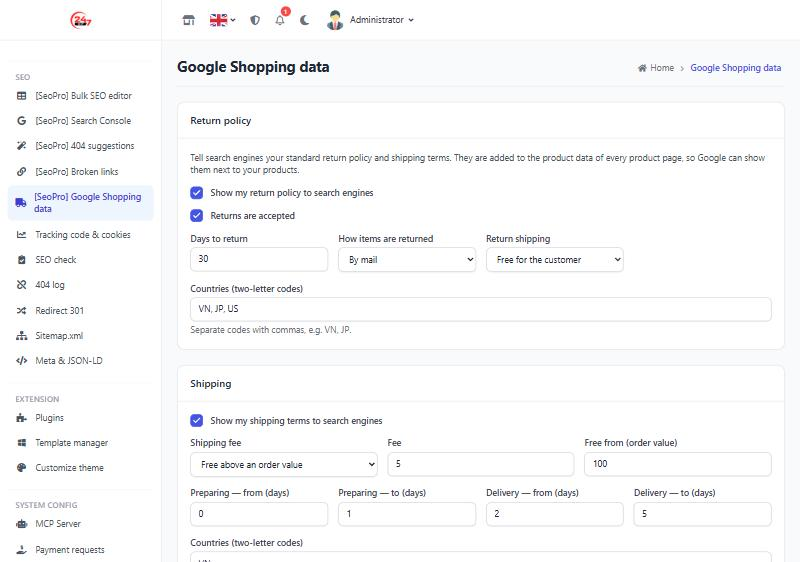

> 🌐 **Language:** [🇻🇳 Tiếng Việt](./seo-pro_vi.md) · 🇬🇧 English (current) · [🇯🇵 日本語](./seo-pro_ja.md)

# SEO Pro — SEO for the whole catalog and Google figures right in the admin

> 🚀 **SEO Pro plugin (paid):** [https://gp247.net/en/product/plugin-seo-pro.html](https://gp247.net/en/product/plugin-seo-pro.html)

## Introduction
SEO Pro is a paid plugin for S-Cart / GP247, for stores with many products that want to do SEO faster and know which pages Google is showing. S-Cart already gets technical SEO right from installation; SEO Pro adds work **at scale** and **Google's own figures**. This page is for site owners and whoever handles SEO: after reading it, you know what SEO Pro does compared with the built-in features, how to connect Search Console, and what to keep in mind before using it.

## At a glance
SEO Pro turns everyday SEO work into one loop: find weak spots, fix them in bulk, then see how Google responds.



- **Five new screens in the SEO menu** — their names start with `[SeoPro]` and sit next to each other.
- **Edit SEO for the whole catalog on one table** — filter missing, duplicate, too long, too short; undo the last save.
- **Search Console figures already linked to products** — see at once which pages are shown often but rarely clicked, and fix them in one click.
- **No cron, queue or Google app needed** — runs on shared hosting.

## On this page
- [When to use SEO Pro](#when-to-use-seo-pro) — compared with the SEO built into S-Cart.
- [Bulk SEO editing](#bulk-seo-editing) — edit titles, descriptions and share images for hundreds of items.
- [Google Search Console figures](#google-search-console-figures) — impressions, clicks and position of each page.
- [Connecting Search Console](#connecting-search-console) — 4 steps, done once.
- [Redirect suggestions for 404 pages](#redirect-suggestions-for-404-pages) — send visitors who hit dead links to the right page.
- [Finding broken links in content](#finding-broken-links-in-content) — links in descriptions pointing to pages that are gone.
- [Data for Google Shopping](#data-for-google-shopping) — return policy and shipping next to your products.
- [Installation and permissions](#installation-and-permissions) — requirements, install command, giving access to staff.

## When to use SEO Pro
The SEO built into S-Cart is enough for a small store: every page already has a title, description, canonical, sitemap, structured data and an automatic redirect when its address changes. SEO Pro is worth it when you have **hundreds of products or more**, or want to **use Google's figures to decide what to fix first**.

| Task | Built into S-Cart | With SEO Pro |
| --- | --- | --- |
| Edit SEO titles and descriptions | One product at a time, SEO tab | The whole catalog on one table, filtered by problem |
| Know which pages are missing / duplicate | SEO audit screen (up to 20 examples per issue) | Filter the full list and fix it right on the table |
| Figures from Google | Open Search Console separately, match URLs yourself | Figures in the admin, linked to products |
| Visitors hitting 404 pages | 404 log + type the target yourself | Suggested target page, 301 in one click |
| Broken links in descriptions | Not available | Scan and list the links, with a suggested target |
| Google Shopping | Basic product data | Adds return policy and shipping |

> ℹ️ **Info:** SEO Pro does not replace the built-in SEO — everything in [SEO in GP247](./seo-introduction.md) keeps working as before, even after SEO Pro is uninstalled.

## Bulk SEO editing
The **SEO › [SeoPro] Bulk SEO editor** screen puts products, categories, brands and pages on one table so you can edit SEO titles, SEO descriptions and share images together.



1. Choose the **content type** (products, categories…) and the **language**.
2. Choose a filter: **Missing title**, **Missing description**, **Duplicate title**, **Duplicate description**, **Too long**, **Too short**.
3. Type straight into the cell you want to change. An empty cell shows grey text — that is what Google sees now (generated from the product name and description).
4. Click **Save changes**. If you make a mistake, click **Undo last save**.

- **Too short / too long** count characters: titles should be 30–60, descriptions 70–160 — the range Google usually shows in full.
- **Safe undo** — a value someone else changed after that save is kept, not overwritten.

## Google Search Console figures
The **SEO › [SeoPro] Search Console** screen shows the impressions, clicks, click-through rate and average position of each page over **28 days**, already linked to the matching product, category or page.



- **Shown often but rarely clicked** — the pages most worth fixing first, each with a button that opens its SEO editor. A page enters the list when it has been shown often enough, ranks in the top 20 results, but its click-through rate is below half the site average.
- **All pages** — every page Google returns, 50 at a time, with a filter by address to find a page quickly.
- **Details in the right-hand column** — click a page in either list: the right-hand column shows its 4 figures, an **Edit SEO** button and the searches that bring visitors (with the click rate and position of each). The column stays in view while you scroll the list.
- **What the figures mean** — hover the ⓘ icon next to a column name. **Average position** is the average rank of the page whenever it was shown: lower is better, 1–10 is usually the first page.
- **Figures refresh by themselves** when you open the screen and the saved copy is older than 12 hours; click **Refresh** to get them now.

> 💡 **Tip:** rewriting the title and description of "rarely clicked" pages is the fastest way to more visits — the page already ranks well, it only needs a more inviting snippet.

## Connecting Search Console
SEO Pro reads figures with a **service account** — a "machine account" you create yourself in Google Cloud that may only **read** the Search Console of the website you allow. No Google app to create, no periodic sign-in, and the figures travel straight from Google to your website.



You need a Google account that is an **Owner** of the website's property in Search Console. It is done once and takes about 10 minutes.

1. Open [Google Cloud Console](https://console.cloud.google.com/), create a new project (for example `my-shop-seo`), go to **APIs & Services › Library**, find **Google Search Console API** and click **Enable**.
2. Go to **IAM & Admin › Service accounts › Create service account**, give it a name (for example `seo-pro`), skip the permissions part and click **Done**.
3. Click the new service account › **Keys** tab › **Add key › Create new key › JSON**. Your browser downloads a `.json` file — that is the **key**. Note the service account's email (like `seo-pro@my-shop-seo.iam.gserviceaccount.com`).
4. Open [Search Console](https://search.google.com/search-console), choose the website's property › **Settings › Users and permissions › Add user**, paste the email from step 3 and choose the **Restricted** permission.
5. In the admin, open **SEO › [SeoPro] Search Console**, open the `.json` file in Notepad, copy **all** of it, paste it into **Service account key (JSON)** and click **Connect**.

If it works, the screen shows a **Connected** label, the service account email, the property and "Key: saved, encrypted · updated …", and the last 28 days of figures load at once. To change the key later, click **Replace key…**.



> ⚠️ **Caution:** treat the key file like a password — do not send it by chat or email or put it in Git. SEO Pro stores the key **encrypted** and never shows it again; once pasted, you can delete the file from your computer.

## Redirect suggestions for 404 pages
The **SEO › [SeoPro] 404 suggestions** screen takes the addresses visitors opened that have no page and suggests the page they most likely wanted.



From then on, visitors opening the old address go straight to the target page, and Google gradually moves the old address's ranking to the new page.



1. Turn on the 404 log if it is off (see [404 log](./seo-monitoring.md#404-log)).
2. Open the screen and read the list — addresses with the most visits come first.
3. Read the suggestion: page name, kind, **target address** (click to open it in a new tab and check it is the right page) and the **level label** (table below).
4. Click **Redirect here**. To do many rows at once: click **Select the very alike rows**, then **Redirect N selected rows to their best suggestion**.
5. For addresses not worth redirecting (bots probing, junk links), click **Ignore**; for rows without a suggestion, click **Choose a target yourself** to create a redirect by hand on the 404 log screen.

**What the % means**: how alike the **words** of the end of the broken address and the name / address of the content are — **not** how sure it is that this is
the page the visitor wanted. One shared word (e.g. a brand name) can already give 60 %+.

| Label | % | What to do |
| --- | --- | --- |
| **Very alike** | 85 and up | Usually right; can be redirected in bulk |
| **Alike** | 70–84 | Open the target to check, then click |
| **Weakly alike, check** | 60–69 | Check carefully; if wrong, **Ignore** or **Choose a target yourself** |

Each row shows its best suggestion; click **+N other suggestions** to see up to 3.

The redirects created are ordinary **301** redirects, shown on the **Redirect 301** screen with source "SEO Pro" — edit or delete them like any other.

## Finding broken links in content
The **SEO › [SeoPro] Broken links** screen checks the links in product descriptions and page content that point to your own website.



- **Link with no page** — points to an address that is gone; visitors who click it get a 404.
- **Link through a redirect** — still works but takes a detour; better to point it straight at the new address.
- **How scanning works** — click **Scan now** and keep the page open; the scan runs in batches right in your browser, reads only your website's data and calls nothing outside.

## Data for Google Shopping
On the **SEO › [SeoPro] Google Shopping data** screen you enter your store's standard return policy and shipping terms once; SEO Pro adds them to the structured data of **every product page** so Google can show them next to your products.



- **Return policy** — whether you accept returns, how many days, how (by mail or in store), who pays the return fee, which countries.
- **Shipping terms** — shipping fee (the same for every order, or free from an order value), handling and transit days, which countries.
- **Uninstalling the plugin** removes this data from the pages; the settings are kept for a reinstall.

## Installation and permissions
SEO Pro is a paid plugin and needs a valid license for the website's domain (buy and renew on the [product page](https://gp247.net/en/product/plugin-seo-pro.html)).

**Requirements:**
- `gp247/core` 3.16 or later and `gp247/front` 3.12.1 or later — otherwise the plugin does not turn on and says an update is needed.
- `gp247/shop` for products and Google Shopping (without the shop it works with content pages only).
- PHP with the `openssl` extension (to connect to Search Console).

**Install** — run in the website's root folder (where the `artisan` file is), replacing `<license code>` with yours:

```
php artisan gp247:ext-install --type=plugin --key=SeoPro --paid --license=<license code>
```

If it works, the **SEO** menu group gets five new entries starting with `[SeoPro]`.

**Permissions** — give staff access on the **Permissions** screen (see [Admin permissions in GP247](../system/permission-and-role.md)). Each screen has its own permission; **connecting / disconnecting Search Console** is a separate one, so only trusted people can paste the key. Administrators always have every permission.

## Conditions & Rules (know before you act)
The limits below are deliberate, so that one wrong action cannot hurt the ranking of the whole website.

**When editing in bulk**
- **At most 100 items per save** — small batches are easy to check and to undo.
- **No "Hide from search engines" (noindex) or "canonical" cells** — one wrong action on the table could drop a whole category out of Google; both are still edited on each product.
- **Only the selected store's content is edited** — a multi-store website never edits another store by mistake.

**When connecting Search Console**
- **The file must be a service account key** (`"type": "service_account"`, email ending in `.iam.gserviceaccount.com`) — an OAuth client `client_secret_….json` file is refused.
- **The service account must be able to read the property of the website's own domain** — so figures of another website are never shown by mistake.
- **Manual refreshes are at least 10 minutes apart** — Google limits the number of calls, and the figures only change a few times a day.
- **Figures lag about 2 days** — Google has not finalised newer figures; SEO Pro shows the 28 days ending two days ago.

**When creating redirects from 404s or broken links**
- **The 404 log must be on** — without the log there are no addresses to suggest.
- **No redirect over an existing page and no loops** — redirects follow the same safety rules as S-Cart's Redirect 301 screen.

**When entering Google Shopping data**
- **Return days 0–365, handling 0–30 days, transit 0–60 days**, and each "to" value is not smaller than its "from".
- **Countries are written as 2-letter codes** (VN, JP, US…), up to 50 countries.
- **Fees are in the store's base currency** — the same currency as the product prices Google reads.

## Q&A
**Q1: My store has only a few dozen products — do I need SEO Pro?**

→ Usually not yet. The built-in SEO and the SEO audit screen are enough. SEO Pro helps when editing products one by one takes too long, or when you want Google's figures right in the admin.

**Q2: Do I need cron, a queue or command-line access on the server?**

→ No, apart from the install command. Google figures are fetched when you open the screen and kept for 12 hours; the link scan runs in your browser. It runs on shared hosting.

**Q3: Does SEO Pro send customer or order data to Google?**

→ No. The connection only **reads** Search Console figures. There is no middle server; your website talks to Google directly.

**Q4: Connecting says "The service account cannot read a Search Console property of the domain …"?**

→ The message names the domain SEO Pro is checking. Either the service account email is not a user of that domain's property, or the website runs on a different domain from the property — for example a local test copy (`*.local`): the real site's key cannot connect there, connect on the real domain instead. Add it again in Search Console, wait 1–2 minutes and click Connect.

**Q5: Why does the Search Console screen say "Google has no figures for this period yet"?**

→ A newly verified property needs a few days before Google has figures. If the website already has impressions, they appear after the next refresh.

**Q6: I saved a hundred wrong titles by mistake — what now?**

→ Click **Undo last save**. Any value changed again after that save is kept, so nobody else's work is lost.

**Q7: Do I lose the titles and descriptions I edited if I uninstall SEO Pro?**

→ No. Titles and descriptions live in S-Cart's SEO data, and the redirects created keep working. Only the Google Shopping data disappears from the pages, and the Search Console key is deleted.

**Q8: How does it work on a multi-store website?**

→ Each store (each domain) connects Search Console and enters Google Shopping data on its own; the bulk editor shows only the selected store's content.

**Q9: If I change `APP_KEY`, does the Search Console key still work?**

→ If the website sets its own `GP247_ENCRYPTION_KEY` in `.env`, yes. If not, the saved key can no longer be decrypted — paste the key file again and click Connect.

**Q10: Does SEO Pro track keyword rankings?**

→ The Search Console screen shows the average position per page and per search query, straight from Google. SEO Pro has no separate rank-tracking tool.

---

<sub>📅 **Last updated:** 2026-11-21 · ✍️ **Author:** GP247</sub>
