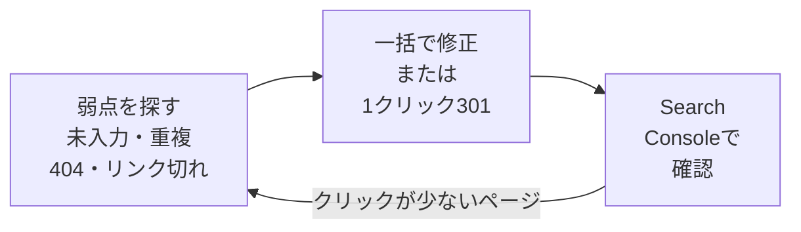
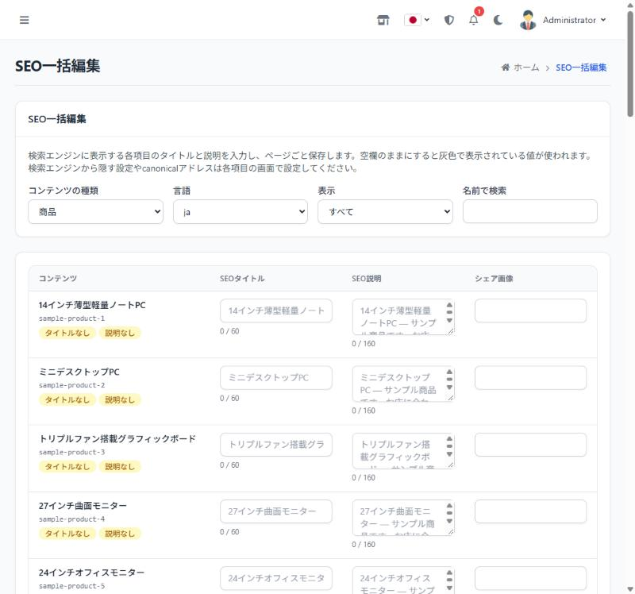
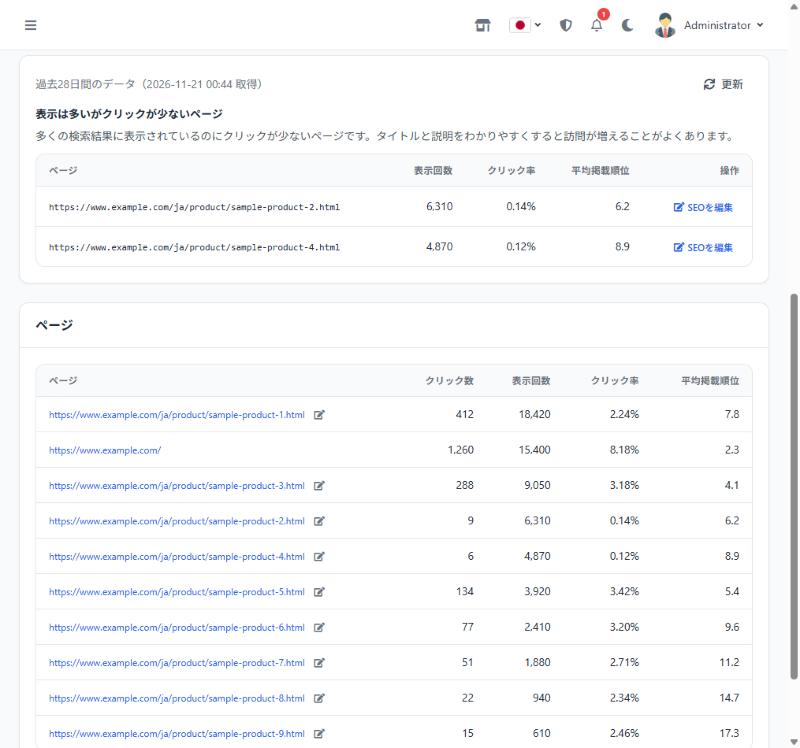
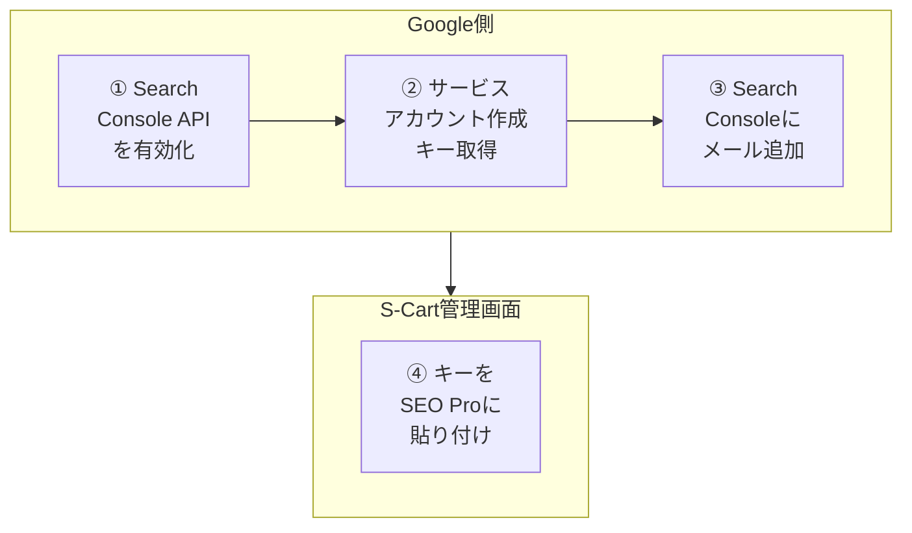
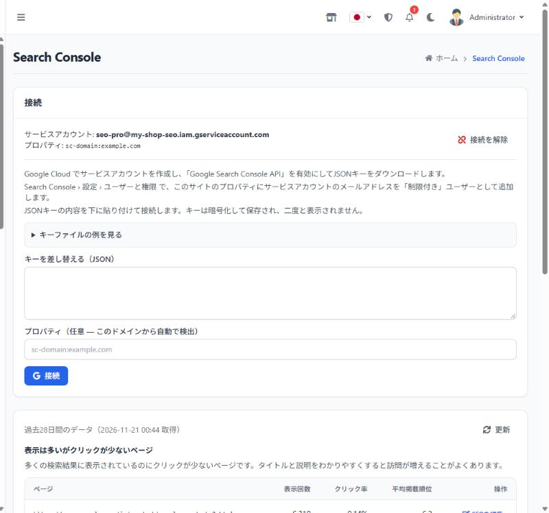
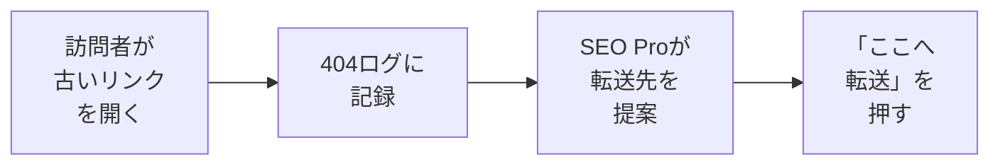
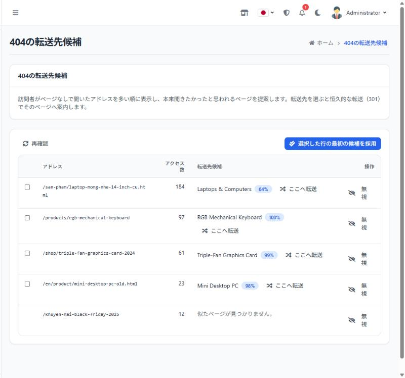
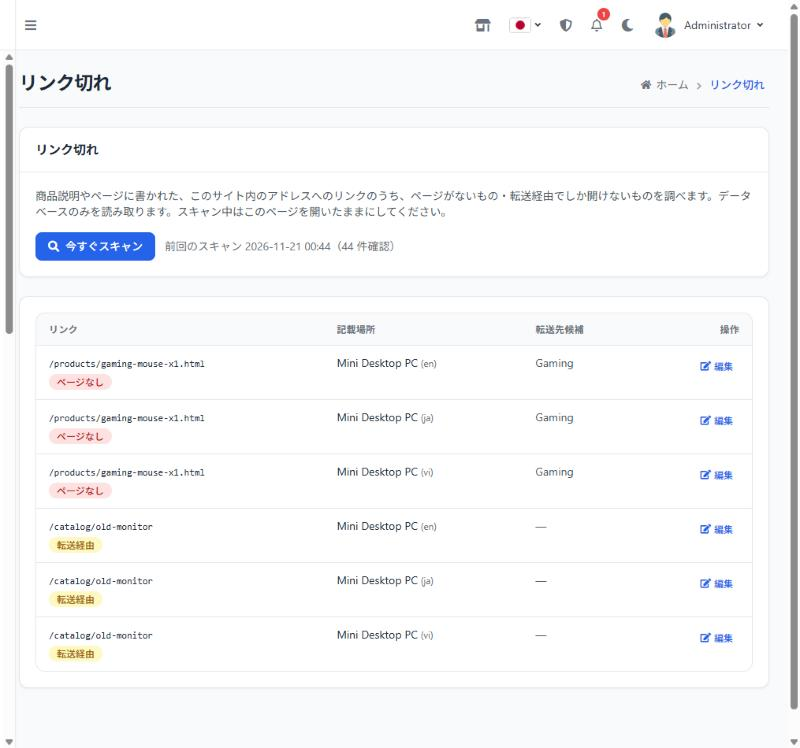
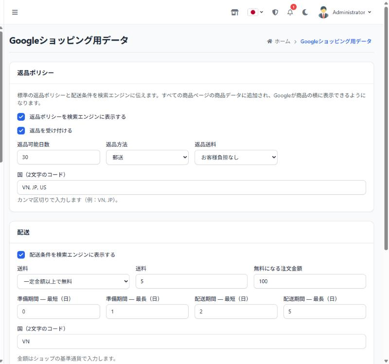

> 🌐 **言語:** [🇻🇳 Tiếng Việt](./seo-pro_vi.md) · [🇬🇧 English](./seo-pro.md) · 🇯🇵 日本語（現在）

# SEO Pro — カタログ全体の SEO と Google のデータを管理画面で

> 🚀 **SEO Pro プラグインのリンク（有料）:** [https://gp247.net/en/product/plugin-seo-pro.html](https://gp247.net/en/product/plugin-seo-pro.html)

## はじめに
SEO Pro は S-Cart / GP247 の有料プラグインです。商品数の多いストアが SEO を速く進め、Google がどのページを表示しているかを把握するためのものです。S-Cart はインストール直後から技術的な SEO を正しく行います。SEO Pro はそこに**大量の一括作業**と **Google のデータ**を加えます。このページはサイトオーナーと SEO 担当者向けです。読み終えると、標準機能との違い、Search Console の接続方法、使う前に知っておくべき点がわかります。

## ひと目でわかる
SEO Pro は日々の SEO 作業を一つのサイクルにまとめます。弱点を見つけ、一括で直し、Google の反応を確認します。



- **SEO メニューに 5 つの新しい画面** — 名前は `[SeoPro]` で始まり、並んで表示されます。
- **カタログ全体の SEO を 1 つの表で編集** — 未入力・重複・長すぎる・短すぎるで絞り込み、直前の保存を取り消せます。
- **Search Console のデータは商品とひも付け済み** — 表示は多いのにクリックが少ないページがすぐわかり、1 クリックで修正画面へ進めます。
- **cron、キュー、Google アプリは不要** — 共有サーバーでも動きます。

## このページの内容
- [SEO Pro を使うべきとき](#seo-pro-を使うべきとき) — S-Cart 標準の SEO との比較。
- [SEO の一括編集](#seo-の一括編集) — 数百件のタイトル、説明、共有画像を編集します。
- [Google Search Console のデータ](#google-search-console-のデータ) — ページごとの表示回数、クリック数、掲載順位。
- [Search Console の接続](#search-console-の接続) — 4 ステップ、一度だけ。
- [404 ページの転送先候補](#404-ページの転送先候補) — リンク切れに当たった訪問者を正しいページへ。
- [コンテンツ内のリンク切れを探す](#コンテンツ内のリンク切れを探す) — 説明文の中の、もう存在しないページへのリンク。
- [Google ショッピング用データ](#google-ショッピング用データ) — 返品ポリシーと配送条件を商品の横に。
- [インストールと権限](#インストールと権限) — 必要環境、インストールコマンド、スタッフへの権限付与。

## SEO Pro を使うべきとき
小さなストアなら S-Cart 標準の SEO で十分です。すべてのページにタイトル、説明、canonical、サイトマップ、構造化データがあり、URL を変えると自動でリダイレクトされます。SEO Pro が役立つのは、商品が**数百件以上**あるとき、または **Google のデータで何から直すかを決めたい**ときです。

| 作業 | S-Cart 標準 | SEO Pro |
| --- | --- | --- |
| SEO タイトル・説明の編集 | 商品ごとに SEO タブで | カタログ全体を 1 つの表で、問題ごとに絞り込み |
| 未入力・重複のページを知る | SEOチェック画面（問題ごとに例は最大 20 件） | 全件を絞り込み、表の上でそのまま修正 |
| Google のデータ | Search Console を別に開き、URL を自分で照合 | 管理画面内に表示、商品とひも付け済み |
| 訪問者が 404 に当たる | 404ログ＋転送先を手入力 | 転送先を提案、1 クリックで 301 |
| 説明文のリンク切れ | なし | スキャンしてリンクを一覧、転送先の候補付き |
| Google ショッピング | 基本の商品データ | 返品ポリシーと配送条件を追加 |

> ℹ️ **情報:** SEO Pro は標準の SEO を置き換えません。[GP247 の SEO](./seo-introduction_ja.md) のすべての機能は、SEO Pro をアンインストールした後もこれまでどおり動きます。

## SEO の一括編集
**SEO › [SeoPro] SEO一括編集** 画面では、商品、カテゴリ、ブランド、ページを 1 つの表に並べ、SEO タイトル、SEO 説明、共有画像をまとめて編集できます。



1. **コンテンツの種類**（商品、カテゴリなど）と**言語**を選びます。
2. 絞り込みを選びます：**タイトルなし**、**説明なし**、**タイトル重複**、**説明重複**、**長すぎる**、**短すぎる**。
3. 直したいセルに直接入力します。空のセルにはグレーの文字が出ます。これは現在 Google に見えている内容です（商品名と説明から自動生成）。
4. **変更を保存** を押します。間違えたら **直前の保存を取り消す** を押します。

- **短すぎる／長すぎる** は文字数で判定します。タイトルは 30〜60 文字、説明は 70〜160 文字が目安です。Google がふつう全文を表示する範囲です。
- **安全な取り消し** — その保存の後にほかの人が変更した値はそのまま残り、上書きされません。

## Google Search Console のデータ
**SEO › [SeoPro] Search Console** 画面には、ページごとの **28 日間**の表示回数、クリック数、クリック率、平均掲載順位が表示されます。各ページは対応する商品、カテゴリ、ページとひも付けられています。



- **表示は多いがクリックが少ない** — 最初に直す価値が高いページの一覧で、SEO 編集画面を開くボタン付きです。十分に表示され、検索結果の上位 20 位以内にあるのに、クリック率がサイト平均の半分未満のページが入ります。
- **ページごとの検索キーワード** — ページを押すと、どんな検索でそのページが表示されたかを確認できます。
- **データは自動で更新** されます。画面を開いたとき、保存済みのデータが 12 時間より古ければ取り直します。すぐに取得するには **更新** を押します。

> 💡 **ヒント:** 「クリックが少ない」ページのタイトルと説明を書き直すのが、訪問を増やすいちばんの近道です。順位はすでに良いので、より魅力的な紹介文にするだけで済みます。

## Search Console の接続
SEO Pro は **サービスアカウント** でデータを読み込みます。これは Google Cloud でご自身が作る「機械用アカウント」で、許可したサイトの Search Console を**読むことだけ**ができます。Google アプリの作成も、定期的なログインも不要で、データは Google からサイトへ直接届きます。



Search Console でサイトのプロパティの**オーナー**になっている Google アカウントが必要です。作業は一度だけで、約 10 分です。

1. [Google Cloud Console](https://console.cloud.google.com/) を開き、新しいプロジェクト（例：`my-shop-seo`）を作ります。**APIs & Services › Library** で **Google Search Console API** を探し、**Enable**（有効にする）を押します。
2. **IAM & Admin › Service accounts › Create service account** で名前（例：`seo-pro`）を付け、権限の設定は飛ばして **Done** を押します。
3. 作成したサービスアカウントを開き、**Keys** タブ › **Add key › Create new key › JSON** を選びます。ブラウザが `.json` ファイルをダウンロードします。これが**キー**です。サービスアカウントのメールアドレス（`seo-pro@my-shop-seo.iam.gserviceaccount.com` のような形）を控えます。
4. [Search Console](https://search.google.com/search-console) でサイトのプロパティを選び、**設定 › ユーザーと権限 › ユーザーを追加** で手順 3 のメールアドレスを貼り付け、権限 **制限付き** を選びます。
5. 管理画面で **SEO › [SeoPro] Search Console** を開きます。`.json` ファイルをメモ帳で開いて**全体**をコピーし、**サービスアカウントキー（JSON）** に貼り付けて **接続** を押します。

成功すると、サービスアカウントのメールアドレスとプロパティが表示され、直近 28 日間のデータがすぐに読み込まれます。



> ⚠️ **注意:** キーのファイルはパスワードと同じように扱ってください。チャットやメールで送ったり、Git に入れたりしないでください。SEO Pro はキーを**暗号化**して保存し、二度と表示しません。貼り付けた後は、パソコン上のファイルを削除してかまいません。

## 404 ページの転送先候補
**SEO › [SeoPro] 404の転送先候補** 画面は、訪問者が開いたもののページがなかった URL を取り出し、訪問者が探していた可能性が高いページを提案します。



それ以降、古い URL を開いた訪問者は転送先のページへ直接移動し、Google も古い URL の評価を少しずつ新しいページへ引き継ぎます。



1. 404ログがオフならオンにします（[404ログ](./seo-monitoring_ja.md#404ログ) を参照）。
2. 画面を開いて一覧を確認します。アクセス数の多い URL が上に並びます。
3. 適切な転送先の横の **ここへ転送** を押すか、複数の行を選んで **選択した行の最初の候補を採用** を押します。
4. 転送する価値のない URL（ボットの探索、迷惑なリンク）は **無視** を押します。

作成されるのは通常の **301** リダイレクトで、**301リダイレクト** 画面に出どころ「SEO Pro」として表示されます。ほかのリダイレクトと同じように編集・削除できます。

## コンテンツ内のリンク切れを探す
**SEO › [SeoPro] リンク切れ** 画面は、商品説明とページ本文の中にある、自分のサイトへのリンクを確認します。



- **ページがないリンク** — もう存在しない URL を指しています。訪問者がクリックすると 404 になります。
- **リダイレクト経由のリンク** — 動きますが遠回りです。新しい URL を直接指すように直すのがおすすめです。
- **スキャンのしかた** — **今すぐスキャン** を押し、ページを開いたままにします。スキャンはブラウザの中で少しずつ進み、サイトのデータを読むだけで、外部には何も送りません。

## Google ショッピング用データ
**SEO › [SeoPro] Googleショッピング用データ** 画面で、ストアの標準の返品ポリシーと配送条件を一度入力します。SEO Pro はそれを**すべての商品ページ**の構造化データに加え、Google が商品の横に表示できるようにします。



- **返品ポリシー** — 返品を受け付けるか、何日以内か、方法（郵送か店頭か）、返送料を誰が負担するか、対象の国。
- **配送条件** — 送料（すべての注文で同じ送料、または一定金額以上で無料）、準備日数と配送日数、配送先の国。
- **プラグインをアンインストールする** と、このデータはページから消えます。設定は再インストールに備えて残ります。

## インストールと権限
SEO Pro は有料プラグインで、サイトのドメインに有効なライセンスが必要です（購入と更新は [商品ページ](https://gp247.net/en/product/plugin-seo-pro.html) で行います）。

**必要環境:**
- `gp247/core` 3.16 以降、`gp247/front` 3.13 以降 — 満たさない場合、プラグインは有効にならず、更新が必要と表示されます。
- 商品と Google ショッピングには `gp247/shop`（ショップがない場合はコンテンツページのみ対象）。
- PHP の `openssl` 拡張（Search Console への接続に使用）。

**インストール** — サイトのルートフォルダ（`artisan` ファイルがある場所）で実行します。`<ライセンスコード>` をご自身のコードに置き換えてください。

```
php artisan gp247:ext-install --type=plugin --key=SeoPro --paid --license=<ライセンスコード>
```

成功すると、**SEO** メニューに `[SeoPro]` で始まる 5 つの項目が追加されます。

**権限** — スタッフへの権限は **権限** 画面で付与します（[GP247 の管理画面の権限管理](../system/permission-and-role_ja.md) を参照）。画面ごとに別の権限があり、**Search Console の接続／接続解除** はさらに別の権限です。信頼できる人だけがキーを貼り付けられるようにするためです。管理者は常にすべての権限を持っています。

## 条件と制約（操作の前に確認）
以下の制限は意図的なものです。一度の誤操作でサイト全体の順位を下げないためです。

**一括編集するとき**
- **1 回の保存は最大 100 件** — 小さな単位なら確認も取り消しも簡単です。
- **「検索エンジンから隠す」（noindex）と「canonical」の欄はありません** — 表の上の誤操作一つでカテゴリ全体が Google から消えるおそれがあるためです。この 2 つは各商品の画面で編集します。
- **選択中のストアのコンテンツだけを編集** — マルチストアのサイトで、ほかのストアを誤って編集することはありません。

**Search Console に接続するとき**
- **ファイルはサービスアカウントキーであること**（`"type": "service_account"`、メールアドレスが `.iam.gserviceaccount.com` で終わる）— OAuth クライアントの `client_secret_….json` は受け付けません。
- **サービスアカウントがサイト自身のドメインのプロパティを読めること** — ほかのサイトのデータを誤って表示しないためです。
- **手動の更新は 10 分以上の間隔が必要** — Google は呼び出し回数を制限しており、データも 1 日に数回しか変わりません。
- **データは約 2 日遅れ** — それより新しいデータは Google でまだ確定していません。SEO Pro は 2 日前までの 28 日間を表示します。

**404 やリンク切れからリダイレクトを作るとき**
- **404ログがオンであること** — ログがなければ提案する URL がありません。
- **既存のページを上書きせず、ループも作らない** — S-Cart の 301リダイレクト 画面と同じ安全ルールに従います。

**Google ショッピング用データを入力するとき**
- **返品日数は 0〜365 日、準備日数は 0〜30 日、配送日数は 0〜60 日**。「まで」の値は「から」の値より小さくできません。
- **国は 2 文字のコードで入力**（VN、JP、US など）、最大 50 か国。
- **料金はストアの基本通貨で入力** — Google が読む商品価格と同じ通貨です。

## よくある質問（Q&A）
**Q1: 商品が数十件しかありません。SEO Pro は必要ですか？**

→ たいていはまだ不要です。標準の SEO と SEOチェック画面で十分です。SEO Pro は、商品を一つずつ直すのに時間がかかりすぎるときや、Google のデータを管理画面で見たいときに役立ちます。

**Q2: cron、キュー、サーバーでのコマンド実行権限は必要ですか？**

→ インストールのコマンド以外は不要です。Google のデータは画面を開いたときに取得して 12 時間保存し、リンクのスキャンはブラウザの中で動きます。共有サーバーでも動きます。

**Q3: SEO Pro はお客様や注文のデータを Google に送りますか？**

→ 送りません。接続は Search Console のデータを**読むだけ**です。中継サーバーはなく、サイトが Google と直接やり取りします。

**Q4: 接続すると「サービスアカウントがこのサイトのSearch Consoleプロパティを読めません」と表示されます。**

→ サービスアカウントのメールアドレスを正しいプロパティに追加していないか、サイトがプロパティとは別のドメインで動いています。Search Console で追加し直し、1〜2 分待ってから **接続** を押してください。

**Q5: Search Console 画面に「この期間のデータはまだGoogleにありません。」と表示されるのはなぜですか？**

→ 確認したばかりのプロパティは、Google にデータがそろうまで数日かかります。サイトにすでに表示回数があれば、次の更新で表示されます。

**Q6: 間違えて 100 件のタイトルを保存してしまいました。どうすればいいですか？**

→ **直前の保存を取り消す** を押します。その保存の後にさらに変更された値はそのまま残るので、ほかの人の作業は失われません。

**Q7: SEO Pro をアンインストールすると、編集したタイトルや説明は消えますか？**

→ 消えません。タイトルと説明は S-Cart の SEO データに保存されており、作成したリダイレクトも動き続けます。ページから消えるのは Google ショッピング用データだけで、Search Console のキーは削除されます。

**Q8: マルチストアのサイトではどう使いますか？**

→ ストアごと（ドメインごと）に Search Console を接続し、Google ショッピング用データを入力します。一括編集の表には選択中のストアのコンテンツだけが表示されます。

**Q9: `APP_KEY` を変えると、Search Console のキーは使えますか？**

→ サイトが `.env` に独自の `GP247_ENCRYPTION_KEY` を設定していれば使えます。設定していない場合、保存済みのキーは復号できなくなるので、キーのファイルを貼り付け直して **接続** を押してください。

**Q10: SEO Pro はキーワードの順位を追跡しますか？**

→ Search Console 画面には、ページごと・検索キーワードごとの平均掲載順位が Google から直接表示されます。SEO Pro に独自の順位追跡ツールはありません。

---

<sub>📅 **最終更新:** 2026-11-21 · ✍️ **作成者 (Author):** GP247</sub>
