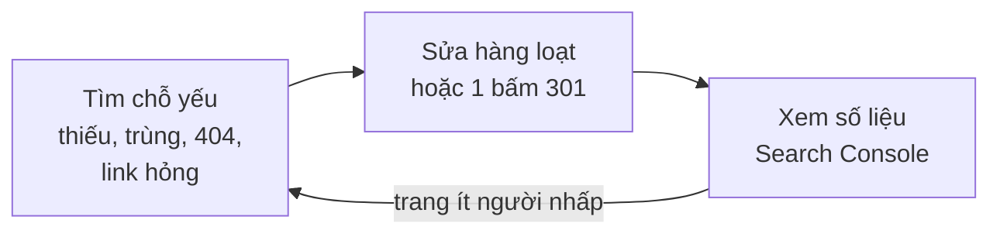
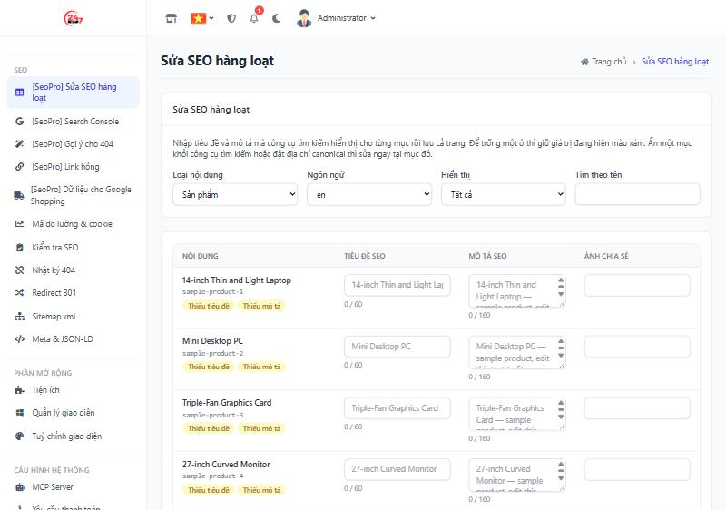
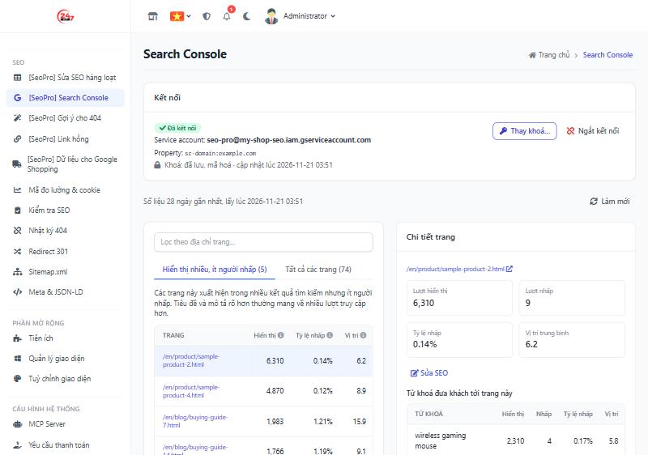
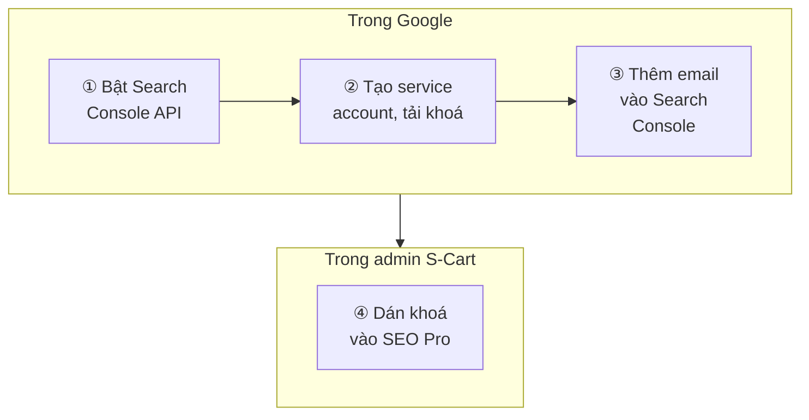
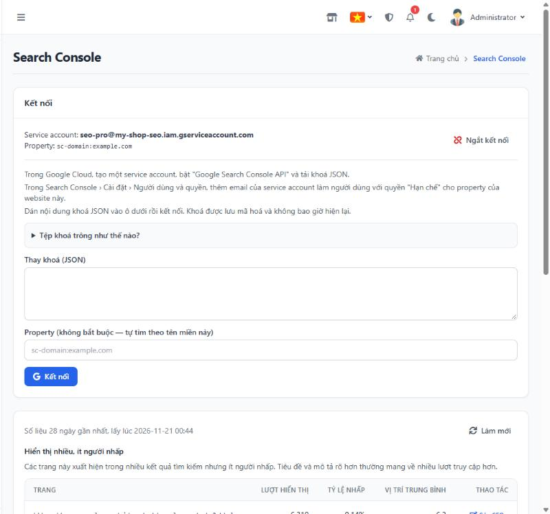
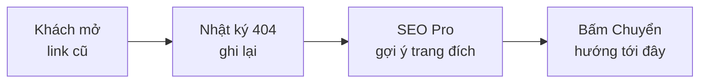
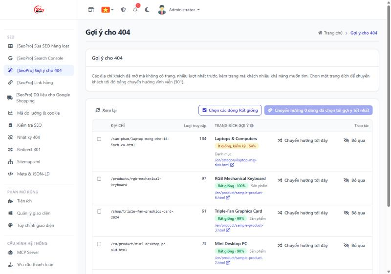
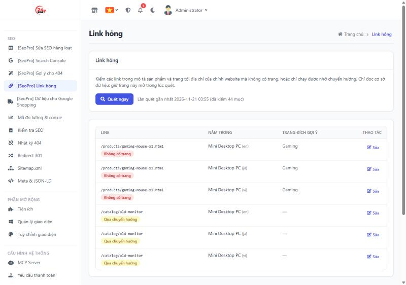
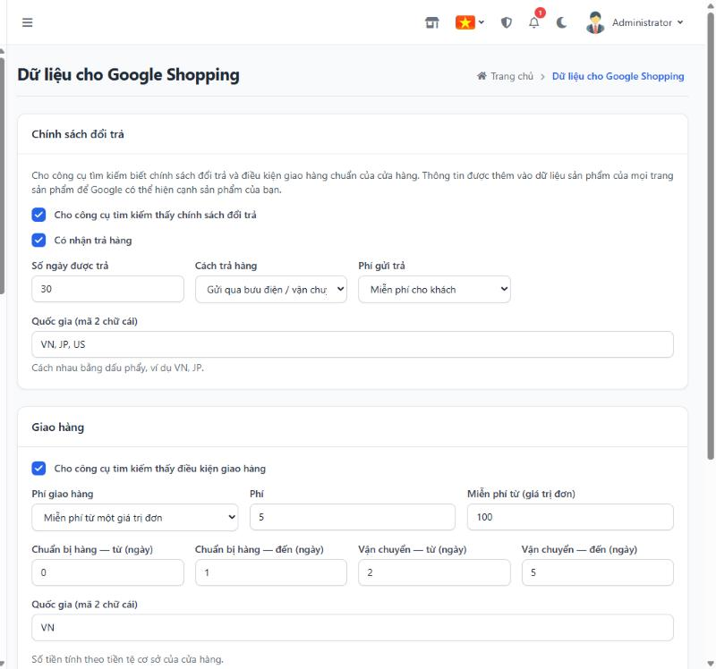

> 🌐 **Ngôn ngữ:** 🇻🇳 Tiếng Việt (hiện tại) · [🇬🇧 English](./seo-pro.md) · [🇯🇵 日本語](./seo-pro_ja.md)

# SEO Pro — làm SEO cho cả catalog và xem số liệu Google ngay trong admin

> 🚀 **Link plugin SEO Pro (trả phí):** [https://gp247.net/vi/product/plugin-seo-pro.html](https://gp247.net/vi/product/plugin-seo-pro.html)

## Giới thiệu
SEO Pro là plugin trả phí cho S-Cart, dành cho cửa hàng có nhiều sản phẩm muốn làm SEO nhanh hơn và biết Google đang hiển thị trang nào. S-Cart đã làm đúng SEO kỹ thuật ngay từ khi cài; SEO Pro thêm phần làm **ở quy mô lớn** và **số liệu của Google**. Trang này dành cho chủ site và người phụ trách SEO: đọc xong, bạn biết SEO Pro làm được gì so với bản có sẵn, kết nối Search Console ra sao và cần lưu ý gì trước khi dùng.

## Nhìn nhanh
SEO Pro gom việc SEO thường ngày thành một vòng: tìm chỗ yếu, sửa hàng loạt, rồi xem Google phản hồi thế nào.



- **Năm màn mới trong menu SEO** — tên bắt đầu bằng `[SeoPro]` và nằm cạnh nhau.
- **Sửa SEO cả catalog trên một bảng** — lọc mục thiếu, trùng, quá dài, quá ngắn; hoàn tác được lần lưu gần nhất.
- **Số liệu Search Console gắn sẵn với sản phẩm** — thấy ngay trang nào hiển thị nhiều mà ít người nhấp, bấm là sửa.
- **Không cần cron, queue hay ứng dụng Google** — chạy được trên shared hosting.

## Trong trang này
- [Khi nào nên dùng SEO Pro](#khi-nào-nên-dùng-seo-pro) — so sánh với SEO có sẵn trong S-Cart.
- [Sửa SEO hàng loạt](#sửa-seo-hàng-loạt) — sửa tiêu đề, mô tả, ảnh chia sẻ cho hàng trăm mục.
- [Xem số liệu Google Search Console](#xem-số-liệu-google-search-console) — lượt hiển thị, lượt nhấp, vị trí của từng trang.
- [Kết nối Search Console](#kết-nối-search-console) — 4 bước, làm một lần.
- [Gợi ý chuyển hướng cho trang 404](#gợi-ý-chuyển-hướng-cho-trang-404) — đưa khách gặp link chết về đúng trang.
- [Tìm link hỏng trong nội dung](#tìm-link-hỏng-trong-nội-dung) — link trong mô tả trỏ tới trang không còn.
- [Dữ liệu cho Google Shopping](#dữ-liệu-cho-google-shopping) — chính sách đổi trả và giao hàng cạnh sản phẩm.
- [Cài đặt và phân quyền](#cài-đặt-và-phân-quyền) — yêu cầu, lệnh cài, giao quyền cho nhân viên.

## Khi nào nên dùng SEO Pro
SEO có sẵn trong S-Cart đủ cho cửa hàng nhỏ: mọi trang đã có tiêu đề, mô tả, canonical, sitemap, dữ liệu có cấu trúc và tự chuyển hướng khi đổi đường dẫn. SEO Pro đáng dùng khi bạn có **hàng trăm sản phẩm trở lên** hoặc muốn **dùng số liệu Google để quyết định sửa gì trước**.

| Việc cần làm | Có sẵn trong S-Cart | Với SEO Pro |
| --- | --- | --- |
| Sửa tiêu đề, mô tả SEO | Từng sản phẩm, tab SEO | Cả catalog trên một bảng, lọc mục có vấn đề |
| Biết trang nào thiếu / trùng | Màn Kiểm tra SEO (tối đa 20 ví dụ mỗi lỗi) | Lọc đủ danh sách và sửa ngay trên bảng |
| Số liệu từ Google | Mở Search Console riêng, tự dò URL | Số liệu nằm trong admin, gắn sẵn với sản phẩm |
| Khách gặp trang 404 | Nhật ký 404 + tự gõ trang đích | Gợi ý trang đích, một bấm tạo 301 |
| Link hỏng trong mô tả | Không có | Quét và chỉ ra link, kèm trang đích gợi ý |
| Google Shopping | Dữ liệu sản phẩm cơ bản | Thêm chính sách đổi trả và giao hàng |

> ℹ️ **Thông tin:** SEO Pro không thay phần SEO có sẵn — mọi tính năng trong [SEO trong S-Cart](./seo-introduction_vi.md) vẫn chạy như cũ, kể cả khi gỡ SEO Pro.

## Sửa SEO hàng loạt
Màn **SEO › [SeoPro] Sửa SEO hàng loạt** đưa sản phẩm, danh mục, thương hiệu và trang lên một bảng để sửa tiêu đề SEO, mô tả SEO và ảnh chia sẻ cùng lúc.



1. Chọn **loại nội dung** (sản phẩm, danh mục…) và **ngôn ngữ**.
2. Chọn bộ lọc: **Thiếu tiêu đề**, **Thiếu mô tả**, **Trùng tiêu đề**, **Trùng mô tả**, **Quá dài**, **Quá ngắn**.
3. Gõ thẳng vào ô cần sửa. Ô để trống hiện chữ xám — đó là giá trị Google đang thấy (tự sinh từ tên và mô tả sản phẩm).
4. Bấm **Lưu thay đổi**. Lỡ tay thì bấm **Hoàn tác lần lưu gần nhất**.

- **Quá ngắn / quá dài** tính theo số ký tự: tiêu đề nên 30–60, mô tả nên 70–160 — khoảng Google thường hiển thị trọn.
- **Hoàn tác an toàn** — giá trị nào đã được người khác sửa sau lần lưu đó thì giữ nguyên, không bị ghi đè.

## Xem số liệu Google Search Console
Màn **SEO › [SeoPro] Search Console** cho thấy lượt hiển thị, lượt nhấp, tỷ lệ nhấp và vị trí trung bình của từng trang trong **28 ngày**, gắn sẵn với sản phẩm, danh mục hay trang tương ứng.



- **Hiển thị nhiều nhưng ít người nhấp** — danh sách trang đáng sửa trước nhất, kèm nút mở thẳng màn sửa SEO. Một trang vào danh sách khi đã được hiển thị đủ nhiều, đứng trong top 20 kết quả nhưng tỷ lệ nhấp chưa bằng nửa mức trung bình của website.
- **Tất cả các trang** — mọi trang Google trả về, 50 trang mỗi lần xem, có ô lọc theo địa chỉ để tìm nhanh một trang.
- **Chi tiết ở cột bên phải** — bấm một trang ở danh sách nào cũng được: cột phải hiện 4 chỉ số, nút **Sửa SEO** và từ khoá đưa khách tới (kèm tỷ lệ nhấp, vị trí của từng từ khoá). Cột này luôn nằm trong tầm nhìn khi bạn cuộn danh sách.
- **Giải thích chỉ số** — rê chuột vào biểu tượng ⓘ cạnh tên cột. **Vị trí trung bình** là trung bình thứ hạng của trang trong các lần được hiển thị: càng nhỏ càng tốt, 1–10 thường là trang đầu.
- **Số liệu tự làm mới** khi bạn mở màn và bản đã lưu cũ hơn 12 giờ; bấm **Làm mới** để lấy ngay.

> 💡 **Mẹo:** sửa tiêu đề và mô tả của các trang "ít người nhấp" là cách tăng lượt vào nhanh nhất — trang đã có vị trí tốt, chỉ cần lời mời hấp dẫn hơn.

## Kết nối Search Console
SEO Pro đọc số liệu bằng **service account** — một "tài khoản máy" bạn tự tạo trong Google Cloud, chỉ được **đọc** Search Console của website bạn cho phép. Không cần tạo ứng dụng Google, không cần đăng nhập lại định kỳ, số liệu đi thẳng từ Google về website của bạn.



Bạn cần tài khoản Google là **chủ sở hữu** (Owner) property của website trong Search Console. Làm một lần, khoảng 10 phút.

1. Mở [Google Cloud Console](https://console.cloud.google.com/), tạo project mới (ví dụ `my-shop-seo`), vào **APIs & Services › Library**, tìm **Google Search Console API** và bấm **Enable**.
2. Vào **IAM & Admin › Service accounts › Create service account**, đặt tên (ví dụ `seo-pro`), bỏ qua phần cấp quyền và bấm **Done**.
3. Bấm vào service account vừa tạo › thẻ **Keys › Add key › Create new key › JSON**. Trình duyệt tải về một tệp `.json` — đó là **khoá**. Ghi lại email của service account (dạng `seo-pro@my-shop-seo.iam.gserviceaccount.com`).
4. Mở [Search Console](https://search.google.com/search-console), chọn property của website › **Cài đặt › Người dùng và quyền › Thêm người dùng**, dán email ở bước 3, chọn quyền **Hạn chế**.
5. Trong admin, mở **SEO › [SeoPro] Search Console**, mở tệp `.json` bằng Notepad, chép **toàn bộ** nội dung, dán vào ô **Khoá service account (JSON)** và bấm **Kết nối**.

Nếu thành công, màn hiện nhãn **Đã kết nối**, email service account, property và dòng "Khoá: đã lưu, mã hoá · cập nhật lúc …"; số liệu 28 ngày được tải ngay. Muốn đổi khoá sau này: bấm **Thay khoá…**.



> ⚠️ **Lưu ý:** giữ tệp khoá như mật khẩu — không gửi qua chat, email hay đưa lên Git. SEO Pro lưu khoá **mã hoá** và không bao giờ hiện lại; dán xong bạn có thể xoá tệp trên máy.

## Gợi ý chuyển hướng cho trang 404
Màn **SEO › [SeoPro] Gợi ý cho 404** lấy các địa chỉ khách đã mở mà không có trang và gợi ý trang khách nhiều khả năng muốn tìm.



Từ đó, khách mở địa chỉ cũ được đưa thẳng tới trang đích, và Google chuyển dần thứ hạng của địa chỉ cũ sang trang mới.



1. Bật nhật ký 404 nếu chưa bật (xem [Nhật ký 404](./seo-monitoring_vi.md#nhật-ký-404)).
2. Mở màn, xem danh sách — địa chỉ nhiều lượt truy cập nhất đứng đầu.
3. Đọc gợi ý: tên trang, loại, **đường dẫn đích** (bấm để mở ở tab mới, xem trước đúng trang) và **nhãn mức độ** (bảng dưới).
4. Bấm **Chuyển hướng tới đây**. Muốn làm nhiều dòng một lúc: bấm **Chọn các dòng Rất giống** rồi **Chuyển hướng N dòng đã chọn tới gợi ý tốt nhất**.
5. Địa chỉ không đáng chuyển (bot dò lỗi, link rác) thì bấm **Bỏ qua**; dòng không có gợi ý thì bấm **Tự chọn trang đích** để tạo redirect bằng tay ở màn Nhật ký 404.

**% nghĩa là gì**: độ giống **chữ** giữa phần cuối địa chỉ lỗi và tên / đường dẫn của nội dung — **không** phải độ chắc chắn đúng trang khách cần. Một từ trùng
(vd tên thương hiệu) đã có thể cho 60 %+.

| Nhãn | % | Nên làm |
| --- | --- | --- |
| **Rất giống** | từ 85 | Thường đúng; có thể chuyển hướng hàng loạt |
| **Gần giống** | 70–84 | Mở trang đích xem trước rồi mới bấm |
| **Ít giống, kiểm kỹ** | 60–69 | Kiểm kỹ; sai thì **Bỏ qua** hoặc **Tự chọn trang đích** |

Mỗi dòng hiện gợi ý tốt nhất; bấm **+N gợi ý khác** để xem tối đa 3 gợi ý.

Chuyển hướng tạo ra là **301** thông thường, hiện ở màn **Redirect 301** với nguồn "SEO Pro" — sửa hay xoá như mọi chuyển hướng khác.

## Tìm link hỏng trong nội dung
Màn **SEO › [SeoPro] Link hỏng** kiểm các link trong mô tả sản phẩm và nội dung trang trỏ tới chính website của bạn.



- **Link không có trang** — trỏ tới địa chỉ đã không còn; khách bấm vào sẽ gặp 404.
- **Link qua chuyển hướng** — vẫn chạy nhưng đi vòng; nên sửa thẳng sang địa chỉ mới.
- **Cách quét** — bấm **Quét ngay** và giữ trang mở; việc quét chạy từng đợt ngay trong trình duyệt, chỉ đọc dữ liệu của website, không gọi ra ngoài.

## Dữ liệu cho Google Shopping
Màn **SEO › [SeoPro] Dữ liệu cho Google Shopping** khai một lần chính sách đổi trả và điều kiện giao hàng chuẩn của cửa hàng; SEO Pro thêm chúng vào dữ liệu có cấu trúc của **mọi trang sản phẩm** để Google có thể hiện cạnh sản phẩm.



- **Chính sách đổi trả** — có nhận trả không, số ngày được trả, cách trả (gửi lại hay mang tới cửa hàng), ai trả phí, áp dụng ở nước nào.
- **Điều kiện giao hàng** — phí giao (cùng một mức cho mọi đơn, hoặc miễn phí từ một giá trị đơn), số ngày chuẩn bị và vận chuyển, giao tới nước nào.
- **Gỡ plugin** thì phần dữ liệu này biến khỏi trang; cấu hình vẫn được giữ nếu cài lại.

## Cài đặt và phân quyền
SEO Pro là plugin trả phí, cần license hợp lệ cho tên miền của website (mua và gia hạn ở [trang sản phẩm](https://gp247.net/vi/product/plugin-seo-pro.html)).

**Yêu cầu:**
- `gp247/core` 3.16 trở lên và `gp247/front` 3.12.1 trở lên — thiếu thì plugin không bật và báo cần cập nhật.
- `gp247/shop` cho phần sản phẩm và Google Shopping (không có shop thì chỉ làm việc với trang nội dung).
- PHP có extension `openssl` (để kết nối Search Console).

**Cài đặt** — chạy ở thư mục gốc website (nơi có tệp `artisan`), thay `<mã license>` bằng mã của bạn:

```
php artisan gp247:ext-install --type=plugin --key=SeoPro --paid --license=<mã license>
```

Nếu thành công, nhóm menu **SEO** có thêm năm mục bắt đầu bằng `[SeoPro]`.

**Phân quyền** — giao quyền cho nhân viên ở màn **Phân quyền** (xem [Phân quyền trong GP247](../system/permission-and-role_vi.md)). Mỗi màn một quyền riêng; **kết nối / ngắt Search Console** là một quyền riêng nữa, để chỉ người tin cậy mới dán được khoá. Quản trị viên luôn có đủ quyền.

## Điều kiện & ràng buộc (hiểu trước khi thao tác)
Các giới hạn dưới đây có chủ đích, để một thao tác nhầm không làm hại thứ hạng của cả website.

**Khi sửa hàng loạt**
- **Mỗi lần lưu tối đa 100 mục** — lô nhỏ dễ kiểm và dễ hoàn tác.
- **Không có ô "Ẩn khỏi công cụ tìm kiếm" (noindex) và "canonical"** — một thao tác sai trên bảng có thể làm cả danh mục biến khỏi Google; hai giá trị này vẫn sửa ở từng sản phẩm.
- **Chỉ sửa nội dung của cửa hàng đang chọn** — website nhiều cửa hàng không sửa nhầm sang cửa hàng khác.

**Khi kết nối Search Console**
- **Tệp phải là khoá service account** (`"type": "service_account"`, email kết thúc bằng `.iam.gserviceaccount.com`) — tệp `client_secret_….json` của OAuth client bị từ chối.
- **Service account phải đọc được property của đúng tên miền website** — tránh hiện nhầm số liệu của website khác.
- **Làm mới thủ công cách nhau ít nhất 10 phút** — Google giới hạn số lần gọi, và số liệu chỉ cập nhật vài lần mỗi ngày.
- **Số liệu trễ khoảng 2 ngày** — Google chưa chốt số liệu mới hơn; SEO Pro hiện 28 ngày kết thúc ở hai ngày trước.

**Khi tạo chuyển hướng từ 404 hoặc link hỏng**
- **Cần bật nhật ký 404** — không có nhật ký thì không có địa chỉ để gợi ý.
- **Không đè lên trang đang có và không tạo vòng lặp** — chuyển hướng đi qua cùng quy tắc an toàn với màn Redirect 301 của S-Cart.

**Khi khai Google Shopping**
- **Số ngày được trả 0–365, chuẩn bị hàng 0–30 ngày, vận chuyển 0–60 ngày**, giá trị "đến" không nhỏ hơn "từ".
- **Nước áp dụng ghi bằng mã 2 chữ cái** (VN, JP, US…), tối đa 50 nước.
- **Phí ghi theo tiền tệ gốc của cửa hàng** — đúng tiền tệ của giá sản phẩm mà Google đọc.

## Hỏi & Đáp (Q&A)
**Câu 1: Cửa hàng tôi chỉ có vài chục sản phẩm, có cần SEO Pro không?**

→ Thường là chưa. SEO có sẵn trong S-Cart và màn Kiểm tra SEO đã đủ. SEO Pro có ích khi sửa từng sản phẩm tốn quá nhiều thời gian, hoặc khi bạn muốn số liệu Google nằm ngay trong admin.

**Câu 2: Có cần cron, queue hay quyền chạy lệnh trên máy chủ không?**

→ Không, ngoài lệnh cài đặt. Số liệu Google lấy khi mở màn và lưu tạm 12 giờ; quét link chạy ngay trong trình duyệt. Chạy được trên shared hosting.

**Câu 3: SEO Pro có gửi dữ liệu khách hàng hay đơn hàng cho Google không?**

→ Không. Kết nối chỉ **đọc** số liệu Search Console. Không có máy chủ trung gian nào; website của bạn nói chuyện thẳng với Google.

**Câu 4: Kết nối báo "Service account chưa đọc được property Search Console nào của tên miền …"?**

→ Câu lỗi nêu đúng tên miền SEO Pro đang so. Hoặc bạn chưa thêm email service account vào property của tên miền đó, hoặc website đang chạy tên miền khác với property — ví dụ chạy thử ở máy local (`*.local`): khoá của site thật không kết nối được ở đó, hãy kết nối trên chính tên miền thật. Thêm lại ở Search Console, đợi 1–2 phút rồi bấm Kết nối.

**Câu 5: Vì sao màn Search Console báo "Google chưa có số liệu cho khoảng thời gian này"?**

→ Property mới xác minh cần vài ngày Google mới có số liệu. Website đã có lượt hiển thị thì sẽ hiện sau lần làm mới kế tiếp.

**Câu 6: Tôi lỡ lưu sai cả trăm tiêu đề thì sao?**

→ Bấm **Hoàn tác lần lưu gần nhất**. Giá trị nào đã bị sửa tiếp sau đó được giữ nguyên để không mất việc của người khác.

**Câu 7: Gỡ SEO Pro có mất tiêu đề, mô tả đã sửa không?**

→ Không. Tiêu đề, mô tả nằm ở dữ liệu SEO của S-Cart; chuyển hướng đã tạo vẫn chạy. Chỉ phần Google Shopping biến khỏi trang và khoá Search Console bị xoá.

**Câu 8: Website nhiều cửa hàng dùng thế nào?**

→ Mỗi cửa hàng (mỗi tên miền) kết nối Search Console và khai Google Shopping riêng; bảng sửa hàng loạt chỉ hiện nội dung của cửa hàng đang chọn.

**Câu 9: Đổi `APP_KEY` thì khoá Search Console có còn dùng được không?**

→ Nếu website đặt `GP247_ENCRYPTION_KEY` riêng trong `.env` thì vẫn dùng được. Nếu không, khoá đã lưu không giải mã được nữa — dán lại tệp khoá và bấm Kết nối.

**Câu 10: SEO Pro có theo dõi thứ hạng từ khoá không?**

→ Màn Search Console có vị trí trung bình theo từng trang và theo từ khoá, lấy từ chính Google. SEO Pro không có công cụ theo dõi thứ hạng riêng.

---

<sub>📅 **Cập nhật lần cuối:** 2026-11-21 · ✍️ **Tác giả (Author):** GP247</sub>
