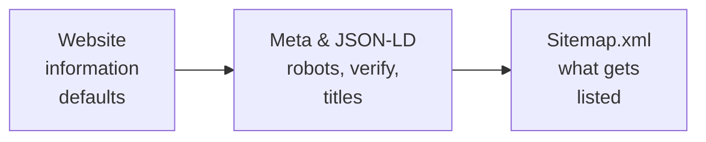
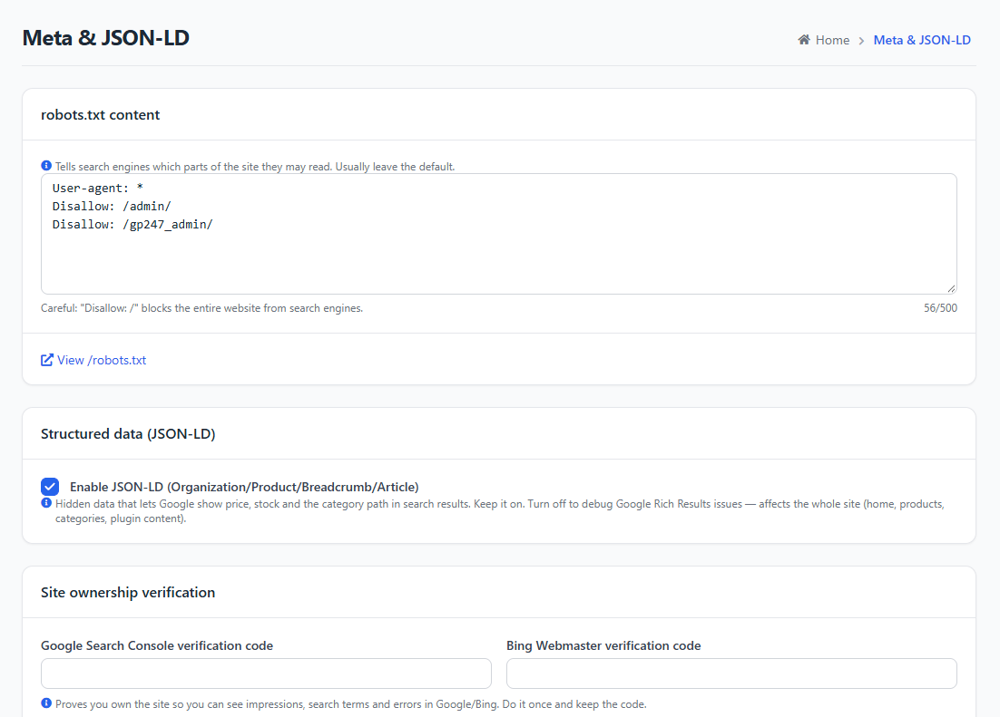

> 🌐 **Language:** [🇻🇳 Tiếng Việt](./seo-settings_vi.md) · 🇬🇧 English (current) · [🇯🇵 日本語](./seo-settings_ja.md)

# Store-wide SEO settings

## Introduction
This page explains the SEO settings that apply to the **whole store**: the **Meta & JSON-LD** screen, the **Sitemap.xml** screen and the default values on the **Website information** screen. It is for site owners and non-technical administrators. After reading it, you can verify your website with Google/Bing and safely adjust robots.txt, the sitemap and title templates.

## At a glance
Three screens, each with its own role; every value is saved **per store**.

- **Website information** — fallback description, keywords and share image for every page.
- **Meta & JSON-LD** — robots.txt, JSON-LD, verification codes, IndexNow, title templates.
- **Sitemap.xml** — choose content groups, exclude addresses, refresh the sitemap.
- **Each block on a screen has a ⓘ hint line** that quickly explains what the block is for.

## Default values on Website information
The **Website information** screen holds the store name, **description**, **keywords** and **social share image** for the whole website. These are fallback values: any page without its own description or image uses the values here.

1. Open **Website information** (or click the **Go to Website info** link at the bottom of the Meta & JSON-LD screen).
2. Fill in the store **description**, about 120–160 characters, saying what you sell and to whom.
3. Choose a **share image** (1200 × 630 px recommended) — the image shown when someone shares a link on Facebook or Zalo.
4. Save your changes.

## The Meta & JSON-LD screen
Go to **SEO › Meta & JSON-LD**. The screen has five blocks; each block saves as soon as you leave a field or flip a switch.

### robots.txt
robots.txt tells search engines which parts of the website they may read. Most stores **leave the default as is**.

- Only add a `Disallow: /path/` line for areas you do not want to appear on Google.
- Click **View /robots.txt** to see the actual file Google receives.

> ⚠️ **Note:** the line `Disallow: /` blocks the **entire** website from Google. The SEO check screen reports a "To fix" problem if it finds this line.

### Structured data (JSON-LD)
The **Enable JSON-LD** switch controls all JSON-LD on the website (Organization, Product, Breadcrumb, Article — see [What GP247 does automatically](./seo-automatic.md#structured-data-json-ld)). **Keep it on**; turn it off only temporarily when a technician needs to debug Rich Results.

### Site ownership verification
Verification proves you own the website, so you can see impressions, the search terms visitors use and errors in Google Search Console / Bing Webmaster Tools. Click **How to get the code** under the two boxes to see the steps.

**Google:**

1. Open Google Search Console → **Add property** → choose **URL prefix** → enter your website address.
2. Choose the **HTML tag** verification method and click copy.
3. Paste it into the **Google Search Console verification code** box (pasting the whole `<meta …>` tag also works — the system extracts the code).
4. Click outside the box to save, then go back to Search Console and click **Verify**.

**Bing:** do the same in Bing Webmaster Tools (**Add a site** → **HTML Meta Tag**) and paste into the **Bing Webmaster verification code** box. If you have already verified with Google, Bing lets you import directly from Google Search Console — no Bing code needed.

If it worked, Search Console reports "Ownership verified". **Keep the code after verifying**: removing it may cancel the verification.

### IndexNow
Turn on **Tell Bing and other IndexNow search engines as soon as content changes** so that every time you add, edit or delete a product, category, brand or page, the website notifies Bing, Yandex… automatically. New pages then get updated sooner. It is **off** by default.

- The first time you turn it on, the system creates a **Verification key** — a public file `/<key>.txt`; it does not need to be kept secret.
- Only click **New key** if you suspect someone is using this key to send fake notifications; the old key stops working immediately.
- Google does **not** use IndexNow (Google reads sitemap.xml), so turning it on or off does not affect Google.
- Notifications are sent after the page has finished saving; if the network fails, your action is not slowed down or broken.

### Title templates
Title templates decide the title shown on Google and on the browser tab. Each content type (Content pages, Products, Categories, Brands, plugin content…) has its own box, plus one **Other pages** box.

- `{title}` is the page name, `{site}` is the store name. For example, the template `{title} | {site}` for the product "Men T-shirt" of "Shop ABC" gives the title "Men T-shirt | Shop ABC".
- **Other pages** applies to search, cart and list pages… and to any content type whose box is empty.
- **Leave empty** = keep titles as they are now. The home page title is the store name, so it is not repeated.
- An SEO title entered for one piece of content (SEO tab) is **not** wrapped in the template.

> 💡 **Tip:** keep titles under about 60 characters — Google cuts off anything longer.

## The Sitemap.xml screen
Go to **SEO › Sitemap.xml** to choose what goes into the sitemap.

1. **Include products in sitemap** / **Include categories in sitemap** — on by default; only turn them off if you have a clear reason.
2. **Exclude from sitemap** — one address (alias) per line, or a pattern with `*`, for example `old-product-*`. Applies to content pages, products and categories.
3. **Plugin sitemap** — turn a plugin off to remove all of that plugin's URLs from the sitemap.
4. Click **Rebuild sitemap now** after making changes, then **View /sitemap.xml** to check.

If it worked, the `/sitemap.xml` page shows a numbered list of URLs; the content you just excluded is no longer in the list.

> ℹ️ **Info:** content set to "noindex" in the SEO tab leaves the sitemap automatically — no need to add it to the exclusion list.

## Conditions & Rules (know before you act)

**When writing robots.txt and the exclusion list**
- **At most 500 characters per box** — enough for common setups; longer content is rejected to avoid pasting a whole large file by mistake.

**When entering verification codes**
- **Letters, digits, hyphens and underscores only, at most 100 characters** — Google/Bing codes always look like this; other characters are rejected so that no stray HTML is printed on every page.

**When setting title templates**
- **`{title}` is required, at most 150 characters** — without `{title}`, every page would have the same title and Google would treat them as duplicates.
- Only `{title}` and `{site}` are replaced; any other text is kept as is.

**About permissions**
- **Each screen has its own permission** (Meta & JSON-LD, Sitemap.xml) — an account without the permission cannot open or save that screen.

## Q&A
**Q1: What if I accidentally wrote `Disallow: /`?**

→ Delete that line and leave the box to save. Google will re-read robots.txt within a few days; you can ask Search Console to re-read it sooner.

**Q2: The verification code I pasted says "invalid"?**

→ You may have pasted extra characters. Paste the whole `<meta name="google-site-verification" content="…">` tag, or only the part inside `content`.

**Q3: Do I need to turn on IndexNow?**

→ It is not required. Turn it on if you care about Bing (and the search engines that use Bing) updating quickly; it does not affect Google.

**Q4: Does the title template apply to products that already have their own SEO title?**

→ No. An SEO title entered in the SEO tab is always used word for word.

**Q5: Will changing the title template hurt my ranking?**

→ Changing titles can make your ranking fluctuate for a while. Choose a template once and avoid changing it often.

**Q6: Should I turn products off in the sitemap?**

→ Almost never. Only turn them off if the website does not sell publicly; to leave out a few products, use **Exclude from sitemap** or tick "noindex" in that product's SEO tab.

**Q7: I have several stores. Which store do the settings here apply to?**

→ The store currently selected in the admin. Each store has its own robots.txt, verification codes, title templates, IndexNow and sitemap.

---

📅 **Last updated:** 2026-11-17 · ✍️ **Author:** GP247
