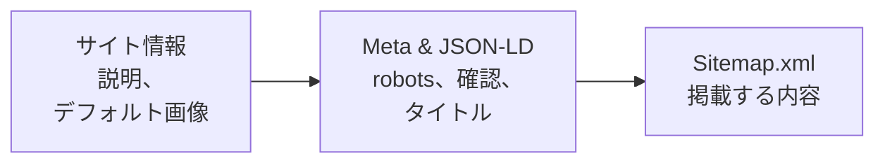
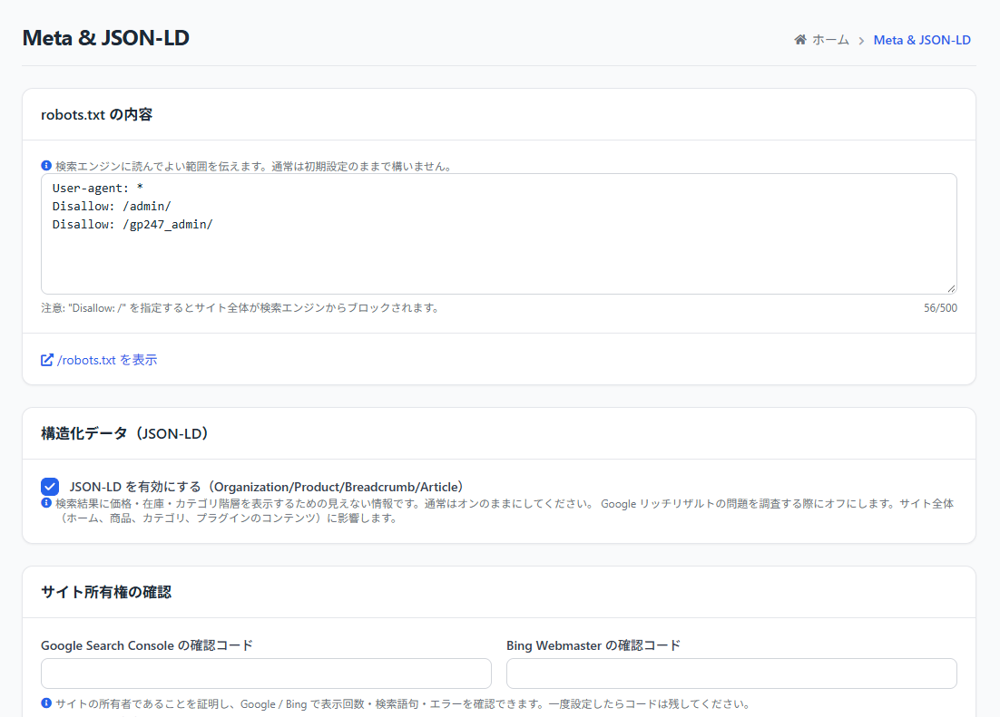

> 🌐 **言語:** [🇻🇳 Tiếng Việt](./seo-settings_vi.md) · [🇬🇧 English](./seo-settings.md) · 🇯🇵 日本語（現在）

# ストア全体の SEO 設定

## はじめに
このページでは、**ストア全体**に適用される SEO の設定を説明します。**Meta & JSON-LD** 画面、**Sitemap.xml** 画面、**サイト情報** 画面のデフォルト値です。技術に詳しくないサイトオーナーと管理者を対象としています。読み終えると、サイトを Google / Bing で確認し、robots.txt、サイトマップ、タイトルテンプレートを安全に調整できるようになります。

## ひと目でわかる
3 つの画面にはそれぞれ役割があります。値はすべて**ストアごと**に保存されます。

- **サイト情報** — すべてのページの代わりに使われる説明、キーワード、シェア画像。
- **Meta & JSON-LD** — robots.txt、JSON-LD、確認コード、IndexNow、タイトルテンプレート。
- **Sitemap.xml** — 含めるコンテンツの選択、URL の除外、サイトマップの再生成。
- **画面の各ブロックに ⓘ のヒント行があり**、そのブロックの用途を簡単に説明しています。

## サイト情報のデフォルト値
**サイト情報** 画面には、サイト全体のストア名、**説明**、**キーワード**、**SNS シェア画像**（「OGP画像」欄）があります。これは代わりに使われる値で、独自の説明や画像がないページはここの値を使います。

1. **サイト情報** を開きます（または、Meta & JSON-LD 画面の下部にある **サイト情報へ移動** リンクを押します）。
2. ストアの **説明** を約 120〜160 文字で入力します。何を、誰に向けて売っているかを書きます。
3. **シェア画像**（推奨 1200 × 630 px）を選びます。誰かが Facebook や Zalo でリンクをシェアしたときに表示される画像です。
4. 変更を保存します。

## Meta & JSON-LD 画面
**SEO › Meta & JSON-LD** を開きます。画面は 5 つのブロックでできています。各ブロックは、入力欄から離れたときやスイッチを押したときに、すぐ保存されます。

### robots.txt
robots.txt は、サイトのどの部分を読んでよいかを検索エンジンに伝えます。ほとんどのストアは**初期設定のまま**で構いません。

- Google に表示したくない範囲にだけ、`Disallow: /パス/` の行を追加します。
- **/robots.txt を表示** を押すと、Google が受け取る実際のファイルを確認できます。

> ⚠️ **注意:** `Disallow: /` の行は**サイト全体**を Google からブロックします。この行があると、SEOチェック画面が「要修正」として報告します。

### 構造化データ（JSON-LD）
スイッチ **JSON-LD を有効にする（Organization/Product/Breadcrumb/Article）** は、サイトの JSON-LD 全体（Organization、Product、Breadcrumb、Article — [GP247 が SEO のために自動で行うこと](./seo-automatic_ja.md#構造化データjson-ld) を参照）を制御します。**常にオンにしておくことをおすすめします**。技術者がリッチリザルトの問題を調べるときだけ、一時的にオフにします。

### サイト所有権の確認
所有権の確認は、あなたがサイトの所有者であることを証明するものです。確認すると、Google Search Console / Bing Webmaster Tools で表示回数、顧客の検索語句、エラーを見られます。2 つの入力欄の下にある **コードの取得方法** を押すと、手順が表示されます。

**Google:**

1. Google Search Console を開き、**プロパティを追加** → **URL プレフィックス** を選んで、サイトの URL を入力します。
2. 確認方法で **HTML タグ** を選び、コピーを押します。
3. **Google Search Console の確認コード** 欄に貼り付けます（`<meta …>` タグ全体を貼り付けても構いません。システムがコードを取り出します）。
4. 欄の外をクリックして保存し、Search Console に戻って **確認** を押します。

**Bing:** Bing Webmaster Tools でも同じように行い（**サイトを追加** → **HTML メタタグ**）、**Bing Webmaster の確認コード** 欄に貼り付けます。Google で確認済みなら、Bing は Google Search Console から直接インポートできるため、Bing のコードは不要です。

うまくいけば、Search Console に「所有権を確認しました」と表示されます。**確認後もコードは残してください**。コードを削除すると、確認が外れる場合があります。

### IndexNow
**コンテンツの変更をBingなどのIndexNow対応検索エンジンにすぐ通知する** をオンにすると、商品、カテゴリ、ブランド、ページを追加、編集、削除するたびに、サイトが Bing や Yandex などへ自動で通知します。これにより、新しいページが早く反映されます。初期状態は**オフ**です。

- 初めてオンにすると、システムが **確認キー** を作ります。公開ファイル `/<キー>.txt` で、秘密にする必要はありません。
- **新しいキーを生成** は、誰かがこのキーで偽の通知を送っている疑いがあるときだけ押してください。古いキーはすぐに使えなくなります。
- Google は IndexNow を**使いません**（Google は sitemap.xml を読みます）。オン / オフは Google に影響しません。
- 通知は、ページの保存が終わってから行われます。ネットワークエラーがあっても、あなたの操作が遅くなったり失敗したりすることはありません。

### タイトルテンプレート
タイトルテンプレートは、Google とブラウザのタブに表示されるタイトルを決めます。コンテンツの種類（コンテンツページ、商品、カテゴリ、ブランド、プラグインのコンテンツ…）ごとに専用の欄があり、さらに **その他のページ** 欄があります。

- `{title}` はページ名、`{site}` はストア名です。たとえば、「Shop ABC」の商品「メンズ T シャツ」にテンプレート `{title} | {site}` を使うと、タイトルは「メンズ T シャツ | Shop ABC」になります。
- **その他のページ** は、検索、カート、一覧などのページと、欄が空のコンテンツ種別に適用されます。
- **空欄**なら、タイトルは現状のままです。トップページのタイトルはストア名なので、重複しません。
- コンテンツごとに入力した SEO タイトル（SEO タブ）には、テンプレートは**適用されません**。

> 💡 **ヒント:** タイトルは約 60 文字以内に収めましょう。Google はそれより長い部分を省略します。

## Sitemap.xml 画面
**SEO › Sitemap.xml** を開き、サイトマップに含める内容を選びます。

1. **サイトマップに商品を含める** / **サイトマップにカテゴリを含める** — 初期状態でオンです。明確な理由がある場合だけオフにします。
2. **サイトマップから除外** — 1 行に 1 つの URL（エイリアス）または `*` を含むパターンを入力します（例：`old-product-*`）。コンテンツページ、商品、カテゴリに適用されます。
3. **プラグイン別サイトマップ** — プラグインをオフにすると、そのプラグインの URL がすべてサイトマップから外れます。
4. 変更したら **今すぐサイトマップを再生成** を押し、**/sitemap.xml を表示** で確認します。

うまくいけば、`/sitemap.xml` に番号付きの URL 一覧が表示され、除外したコンテンツは一覧から消えています。

> ℹ️ **情報:** SEO タブで「インデックスさせない」に設定したコンテンツは、自動でサイトマップから外れます。除外リストに追加する必要はありません。

## 条件と制約（操作の前に確認）

**robots.txt と除外リストを入力するとき**
- **各欄は最大 500 文字** — よくある設定には十分です。それより長い内容は、大きなファイルを丸ごと誤って貼り付けるのを防ぐため、受け付けません。

**確認コードを入力するとき**
- **英数字、ハイフン、アンダースコアのみ、最大 100 文字** — Google / Bing のコードは常にこの形式です。見知らぬ HTML がすべてのページに出力されないよう、それ以外の文字は受け付けません。

**タイトルテンプレートを設定するとき**
- **`{title}` が必須、最大 150 文字** — `{title}` がないと全ページが同じタイトルになり、Google に重複とみなされます。
- 置き換えられるのは `{title}` と `{site}` だけです。それ以外の文字はそのまま残ります。

**権限について**
- **画面ごとに個別の権限**（Meta & JSON-LD、Sitemap.xml）— 権限のないアカウントは、その画面を開くことも保存することもできません。

## よくある質問（Q&A）
**Q1: 誤って `Disallow: /` と書いてしまったらどうなりますか？**

→ その行を削除し、欄から離れて保存してください。Google は数日以内に robots.txt を読み直します。Search Console で早めの再読み込みを依頼することもできます。

**Q2: 確認コードを貼り付けると「無効」と表示されるのはなぜですか？**

→ 余分な文字まで貼り付けた可能性があります。`<meta name="google-site-verification" content="…">` タグ全体か、`content` の中身だけを貼り付けてください。

**Q3: IndexNow はオンにする必要がありますか？**

→ 必須ではありません。Bing（と Bing を使う検索エンジン）に早く反映させたい場合はオンにすることをおすすめします。Google には影響しません。

**Q4: 独自の SEO タイトルがある商品にも、タイトルテンプレートは適用されますか？**

→ いいえ。SEO タブで個別に入力した SEO タイトルは、常にそのまま使われます。

**Q5: タイトルテンプレートを変えると順位が下がりますか？**

→ タイトルを変えると、しばらく順位が変動することがあります。テンプレートは一度決めたら、頻繁に変えないようにしてください。

**Q6: 商品をサイトマップから外したほうがよいですか？**

→ ほとんどの場合、外しません。サイトで商品を公開販売していない場合だけオフにします。一部の商品だけ外したい場合は、**サイトマップから除外** を使うか、その商品の SEO タブで「インデックスさせない」にチェックを入れます。

**Q7: ストアが複数あります。ここでの設定はどのストアに適用されますか？**

→ 管理画面で選択中のストアです。ストアごとに専用の robots.txt、確認コード、タイトルテンプレート、IndexNow、サイトマップがあります。

---

📅 **最終更新:** 2026-11-17 · ✍️ **作成者 (Author):** GP247
