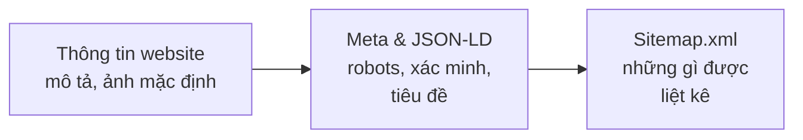
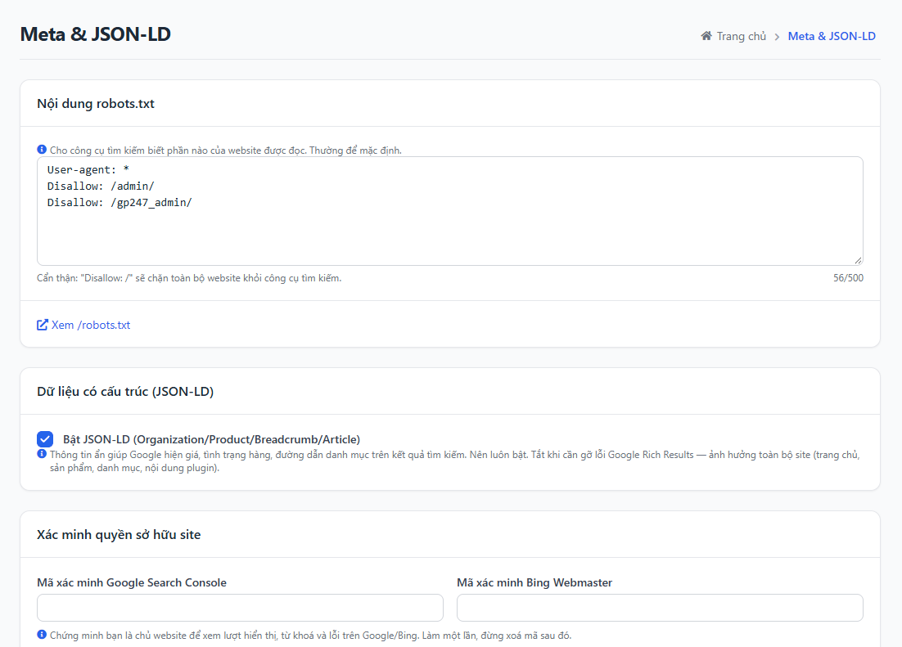

> 🌐 **Ngôn ngữ:** 🇻🇳 Tiếng Việt (hiện tại) · [🇬🇧 English](./seo-settings.md) · [🇯🇵 日本語](./seo-settings_ja.md)

# Cài đặt SEO toàn cửa hàng

## Giới thiệu
Trang này hướng dẫn các cài đặt SEO áp cho **cả cửa hàng**: màn **Meta & JSON-LD**, màn **Sitemap.xml** và các giá trị mặc định ở màn **Thông tin website**. Dành cho chủ site và người quản trị không chuyên kỹ thuật. Đọc xong, bạn xác minh được website với Google/Bing, chỉnh được robots.txt, sitemap và mẫu tiêu đề một cách an toàn.

## Nhìn nhanh
Ba màn, mỗi màn một vai trò; mọi giá trị lưu **theo từng cửa hàng**.

- **Thông tin website** — mô tả, từ khoá và ảnh chia sẻ dự phòng cho mọi trang.
- **Meta & JSON-LD** — robots.txt, JSON-LD, mã xác minh, IndexNow, mẫu tiêu đề.
- **Sitemap.xml** — chọn nhóm nội dung, loại trừ đường dẫn, làm mới sitemap.
- **Mỗi khối trên màn có một dòng gợi ý ⓘ** giải thích nhanh khối đó dùng để làm gì.

## Giá trị mặc định ở Thông tin website
Màn **Thông tin website** chứa tên cửa hàng, **mô tả**, **từ khoá** và **ảnh chia sẻ mạng xã hội** của cả website. Đây là giá trị dự phòng: trang nào chưa có mô tả hay ảnh riêng sẽ dùng giá trị ở đây.

1. Mở **Thông tin website** (hoặc bấm link **Đi tới Thông tin website** ở cuối màn Meta & JSON-LD).
2. Điền **mô tả** cửa hàng, khoảng 120–160 ký tự, nói bạn bán gì và cho ai.
3. Chọn **ảnh chia sẻ** (nên 1200 × 630 px) — ảnh hiện ra khi ai đó chia sẻ link lên Facebook, Zalo.
4. Lưu thay đổi.

## Màn Meta & JSON-LD
Vào **SEO › Meta & JSON-LD**. Màn gồm năm khối; mỗi khối lưu ngay khi bạn rời ô nhập hoặc bấm công tắc.

### robots.txt
robots.txt cho công cụ tìm kiếm biết phần nào của website được đọc. Hầu hết cửa hàng **để nguyên mặc định**.

- Chỉ thêm dòng `Disallow: /đường-dẫn/` cho khu vực bạn không muốn xuất hiện trên Google.
- Bấm **Xem /robots.txt** để xem tệp thật mà Google nhận.

> ⚠️ **Lưu ý:** dòng `Disallow: /` chặn **toàn bộ** website khỏi Google. Màn Kiểm tra SEO báo lỗi "Cần sửa" nếu gặp dòng này.

### Dữ liệu có cấu trúc (JSON-LD)
Công tắc **Bật JSON-LD** điều khiển toàn bộ JSON-LD của website (Organization, Product, Breadcrumb, Article — xem [Những gì GP247 tự làm](./seo-automatic_vi.md#dữ-liệu-có-cấu-trúc-json-ld)). **Nên luôn bật**; chỉ tắt tạm khi kỹ thuật viên cần dò lỗi Rich Results.

### Xác minh quyền sở hữu site
Xác minh chứng minh bạn là chủ website để xem lượt hiển thị, từ khoá khách tìm và lỗi trên Google Search Console / Bing Webmaster Tools. Bấm **Cách lấy mã** dưới hai ô để xem các bước.

**Google:**

1. Mở Google Search Console → **Thêm thuộc tính** → chọn **Tiền tố URL** → nhập địa chỉ website.
2. Chọn cách xác minh **Thẻ HTML**, bấm sao chép.
3. Dán vào ô **Mã xác minh Google Search Console** (dán nguyên thẻ `<meta …>` cũng được — hệ thống tự lấy mã).
4. Bấm ra ngoài ô để lưu, rồi quay lại Search Console bấm **Xác minh**.

**Bing:** làm tương tự ở Bing Webmaster Tools (**Thêm trang web** → **Thẻ meta HTML**), dán vào ô **Mã xác minh Bing Webmaster**. Nếu đã xác minh Google, Bing cho nhập thẳng từ Google Search Console — không cần mã Bing.

Nếu thành công, Search Console báo "Đã xác minh quyền sở hữu". **Giữ nguyên mã sau khi xác minh**: xoá mã có thể làm mất xác minh.

### IndexNow
Bật **Báo ngay cho Bing và các công cụ IndexNow khi nội dung thay đổi** để mỗi lần bạn thêm, sửa, xoá sản phẩm, danh mục, thương hiệu, trang, website tự báo cho Bing, Yandex… Trang mới nhờ đó được cập nhật sớm hơn. Mặc định **tắt**.

- Lần bật đầu tiên hệ thống tạo **Khoá xác minh** — một tệp công khai `/<khoá>.txt`, không cần giữ bí mật.
- Chỉ bấm **Sinh khoá mới** khi nghi có người dùng khoá này để gửi thông báo giả; khoá cũ ngừng hoạt động ngay.
- Google **không** dùng IndexNow (Google đọc sitemap.xml), nên bật/tắt không ảnh hưởng Google.
- Việc báo diễn ra sau khi trang đã lưu xong; nếu mạng lỗi, thao tác của bạn không bị chậm hay hỏng.

### Mẫu tiêu đề
Mẫu tiêu đề quyết định tiêu đề hiện trên Google và trên tab trình duyệt. Mỗi loại nội dung (Trang nội dung, Sản phẩm, Danh mục, Thương hiệu, nội dung của plugin…) có một ô riêng, và một ô **Các trang khác**.

- `{title}` là tên trang, `{site}` là tên cửa hàng. Ví dụ mẫu `{title} | {site}` cho sản phẩm "Áo thun nam" của "Shop ABC" ra tiêu đề "Áo thun nam | Shop ABC".
- **Các trang khác** áp cho trang tìm kiếm, giỏ hàng, danh sách… và cho loại nội dung có ô để trống.
- **Để trống** = giữ tiêu đề như hiện nay. Trang chủ có tiêu đề là tên cửa hàng nên không bị lặp.
- Tiêu đề SEO nhập riêng cho một nội dung (tab SEO) **không** bị bọc mẫu.

> 💡 **Mẹo:** giữ tiêu đề dưới khoảng 60 ký tự — Google cắt phần dài hơn.

## Màn Sitemap.xml
Vào **SEO › Sitemap.xml** để chọn những gì có trong sitemap.

1. **Gồm sản phẩm trong sitemap** / **Gồm danh mục trong sitemap** — mặc định bật; chỉ tắt nếu bạn có lý do rõ ràng.
2. **Loại trừ khỏi sitemap** — mỗi dòng một đường dẫn (alias) hoặc mẫu có `*`, ví dụ `old-product-*`. Áp cho trang nội dung, sản phẩm, danh mục.
3. **Sitemap theo plugin** — tắt một plugin để bỏ toàn bộ URL của plugin đó khỏi sitemap.
4. Bấm **Build lại sitemap ngay** sau khi đổi, rồi **Xem /sitemap.xml** để kiểm tra.

Nếu thành công, trang `/sitemap.xml` hiện danh sách đánh số các URL; nội dung vừa loại trừ không còn trong danh sách.

> ℹ️ **Thông tin:** nội dung đặt "không index" ở tab SEO tự rời khỏi sitemap — không cần thêm vào danh sách loại trừ.

## Điều kiện & ràng buộc (hiểu trước khi thao tác)

**Khi soạn robots.txt và danh sách loại trừ**
- **Tối đa 500 ký tự mỗi ô** — đủ cho cấu hình thường gặp; nội dung dài hơn bị từ chối để tránh dán nhầm cả tệp lớn.

**Khi nhập mã xác minh**
- **Chỉ chữ, số, dấu gạch ngang và gạch dưới, tối đa 100 ký tự** — mã Google/Bing luôn có dạng này; ký tự khác bị từ chối để không in nhầm HTML lạ lên mọi trang.

**Khi đặt mẫu tiêu đề**
- **Bắt buộc có `{title}`, tối đa 150 ký tự** — thiếu `{title}` thì mọi trang cùng một tiêu đề, Google coi là trùng lặp.
- Chỉ `{title}` và `{site}` được thay; chữ khác giữ nguyên văn.

**Về quyền**
- **Mỗi màn một quyền riêng** (Meta & JSON-LD, Sitemap.xml) — tài khoản thiếu quyền không mở hay lưu được màn đó.

## Hỏi & Đáp (Q&A)
**Câu 1: Tôi lỡ ghi `Disallow: /` thì sao?**

→ Xoá dòng đó và rời ô để lưu. Google sẽ đọc lại robots.txt trong vài ngày; có thể yêu cầu Search Console đọc lại sớm hơn.

**Câu 2: Mã xác minh dán vào báo "không hợp lệ"?**

→ Bạn có thể đã dán thừa ký tự. Dán nguyên thẻ `<meta name="google-site-verification" content="…">` hoặc chỉ phần trong `content`.

**Câu 3: Có cần bật IndexNow không?**

→ Không bắt buộc. Nên bật nếu bạn quan tâm Bing (và các công cụ dùng Bing) cập nhật nhanh; không ảnh hưởng Google.

**Câu 4: Mẫu tiêu đề có áp cho sản phẩm đã có tiêu đề SEO riêng không?**

→ Không. Tiêu đề SEO nhập riêng ở tab SEO luôn được dùng nguyên văn.

**Câu 5: Đổi mẫu tiêu đề có làm mất thứ hạng không?**

→ Đổi tiêu đề có thể làm thứ hạng dao động một thời gian. Chọn mẫu một lần, tránh đổi liên tục.

**Câu 6: Có nên tắt sản phẩm khỏi sitemap?**

→ Hầu như không. Chỉ tắt khi website không bán hàng công khai; muốn bỏ vài sản phẩm thì dùng **Loại trừ khỏi sitemap** hoặc tick "không index" ở tab SEO của sản phẩm đó.

**Câu 7: Tôi có nhiều cửa hàng, cài đặt ở đây áp cho cửa hàng nào?**

→ Cửa hàng đang chọn trong trang quản trị. Mỗi cửa hàng có robots.txt, mã xác minh, mẫu tiêu đề, IndexNow và sitemap riêng.

---

📅 **Cập nhật lần cuối:** 2026-11-17 · ✍️ **Tác giả (Author):** GP247
