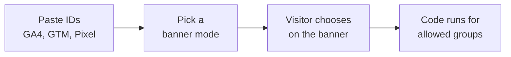
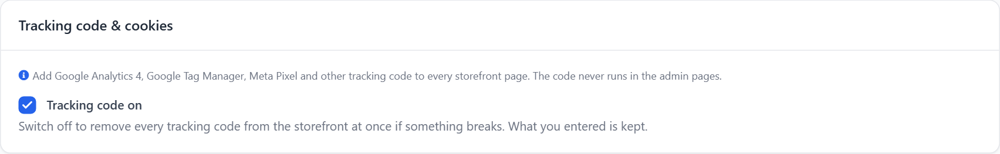
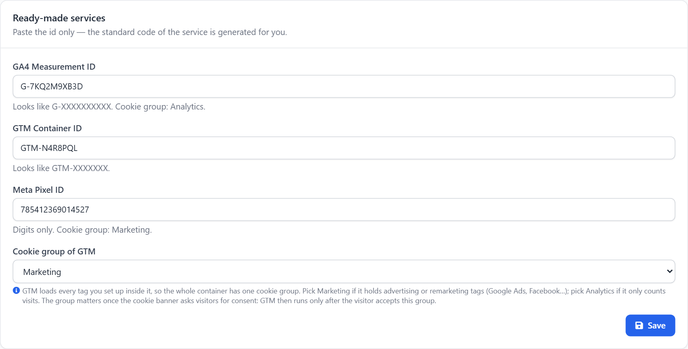
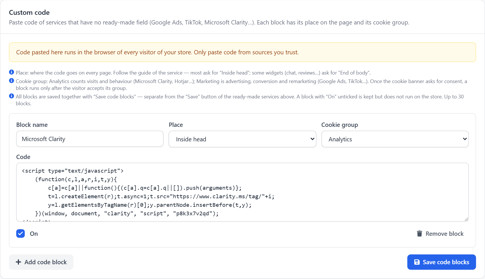
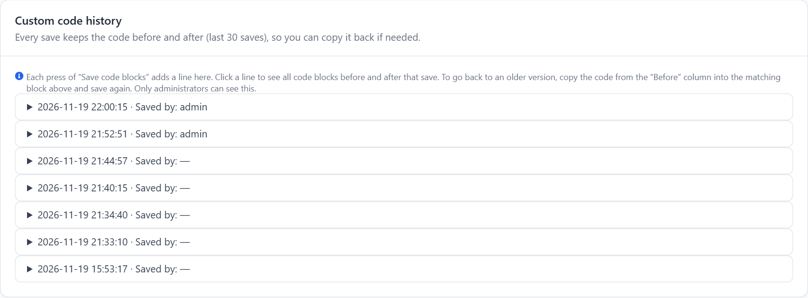
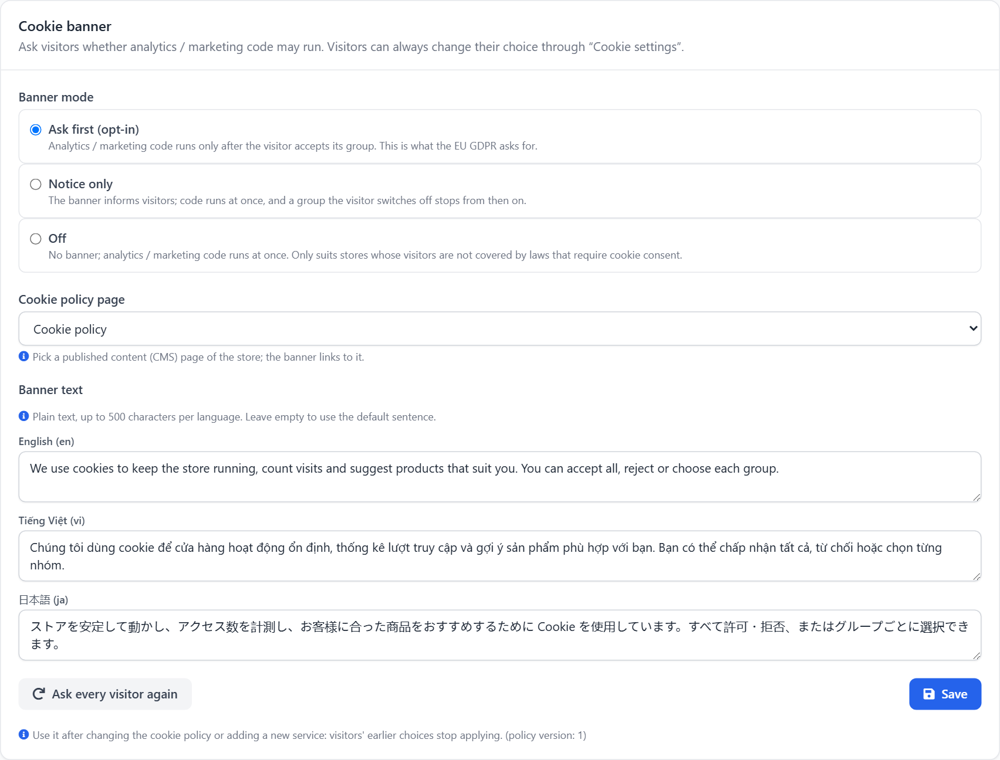
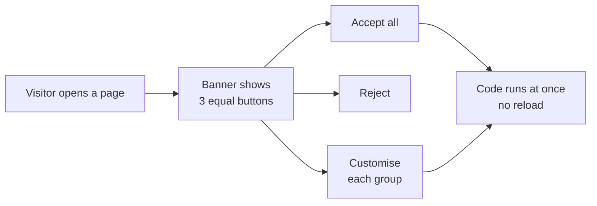

> 🌐 **Language:** [🇻🇳 Tiếng Việt](./tracking-and-cookies_vi.md) · 🇬🇧 English (current) · [🇯🇵 日本語](./tracking-and-cookies_ja.md)

# Tracking code & cookie banner

## Introduction
This page shows how to add **Google Analytics 4 (GA4)**, **Google Tag Manager (GTM)**, **Meta Pixel** and code from other services to your store, then turn on the **cookie banner** so visitors are asked before the code runs. It is written for site owners without a technical background. After reading it, you can add the code just by pasting IDs, pick the right banner mode and see revenue from your ads in GA4 / Meta.

## At a glance
Everything happens on one screen: **SEO › Tracking code & cookies**. Code runs in a visitor's browser only when its cookie group is allowed.

- **Just paste the ID** — the system writes the standard code for GA4, GTM and Meta Pixel for you.
- **Each piece of code belongs to a cookie group**: **Analytics** (visit statistics) or **Marketing** (advertising).
- **Three banner modes**: Off · Notice only · Ask first. The default is **Off**.
- **Sales events are sent automatically**: product view, add to cart, start of checkout, purchase.
- **One switch turns all code off** when something goes wrong; the code you entered is kept.

## On this page
- [Open the Tracking code & cookies screen](#open-the-tracking-code--cookies-screen) — who can open it, which store
- [Add GA4, GTM and Meta Pixel](#add-ga4-gtm-and-meta-pixel) — where to find the ID, where to paste it
- [Add code from other services](#add-code-from-other-services) — Google Ads, TikTok, Microsoft Clarity…
- [Turn on the cookie banner](#turn-on-the-cookie-banner) — three modes, text, policy page, asking visitors again
- [What visitors see on the store](#what-visitors-see-on-the-store) — the banner, Cookie settings
- [Sales events sent to GA4 and Meta](#sales-events-sent-to-ga4-and-meta) — four events, where to see them
- [Switch off all code in an emergency](#switch-off-all-code-in-an-emergency)
- [Warnings in the admin](#warnings-in-the-admin)
- [The banner is not legal advice](#the-banner-is-not-legal-advice)
- [Conditions & Rules](#conditions--rules-know-before-you-act)

## Open the Tracking code & cookies screen
The screen is in the **SEO** menu group, item **Tracking code & cookies**. The **Meta & JSON-LD** screen also has a line that links here.

- **Only Administrator accounts can open and save it.** Code pasted here runs in every visitor's browser, so this permission is not given to other roles.
- **Sites with several stores**: pick the store in **Store being set up**. A sub-store uses the root store's values until you change them for that store; click **Use the root store value** to go back.
- **The admin never runs tracking code** — you can browse the admin freely without skewing your numbers.

## Add GA4, GTM and Meta Pixel
In the **Ready-made services** block you paste only the ID, not the whole code.

| Service | Field | ID looks like | Where to find it | Cookie group |
| --- | --- | --- | --- | --- |
| Google Analytics 4 | **GA4 Measurement ID** | `G-ABC123XYZ9` | GA4 › Admin › Data streams › web stream | Analytics |
| Google Tag Manager | **GTM Container ID** | `GTM-AB12CD3` | Top of the GTM page, next to the container name | You choose |
| Meta Pixel | **Meta Pixel ID** | `123456789012345` | Meta Events Manager › Data sources | Marketing |

1. Open **SEO › Tracking code & cookies**.
2. Paste the ID into its field. Don't worry about upper / lower case or extra spaces; the system fixes them.
3. For GTM, choose **Cookie group of GTM**: **Marketing** if GTM holds advertising / remarketing tags (Google Ads, Facebook…); **Analytics** if GTM only counts visits.
4. Click **Save**. If an ID has the wrong format, that field turns red and nothing is saved.

If it worked, open a store page: the code runs straight away when the banner is Off, or after you click **Accept all** when the banner is on.

> 💡 **Tip:** use GA4 **or** a GTM container that holds a GA4 tag, not both for the same GA4 account — page views would be counted twice.

## Add code from other services
The **Custom code** block is for services without a ready-made field (Google Ads, TikTok, Microsoft Clarity…). Each code block has its own name, place, cookie group and **On** switch.

1. Click **Add code block**.
2. Set a **Block name** (for example "Clarity") so you can recognise it later.
3. Pick the **Place** the service asks for: most use **Inside head**; some widgets (chat, reviews) ask for **End of body**.
4. Pick the **Cookie group**: **Analytics** for statistics and behaviour; **Marketing** for advertising, conversion tracking and remarketing.
5. Paste the **whole code** the service gives you, including the opening and closing tags (for example ``).
6. Click **Save code blocks**. All blocks are saved together, separately from the **Save** button of the ready-made services.

Each **Save code blocks** adds a line to **Custom code history**, keeping all the code before and after that save (last 30 saves). To go back to an older version: open the history line, copy the code from the **Before** column into the matching block and save again.

> ⚠️ **Note:** custom code runs in every visitor's browser. Only paste code taken directly from the service's own admin, never code a stranger sends you by message or email.

## Turn on the cookie banner
The **Cookie banner** block decides whether visitors are asked before code runs. Pick the mode by where your visitors live and the law that applies to them.

| Mode | Banner | Analytics / marketing code runs | Fits when |
| --- | --- | --- | --- |
| **Off** (default) | Not shown | As soon as the page opens | Your visitors are not where the law requires consent |
| **Notice only** | Shown so visitors know | Right away, except groups the visitor turned off | You want to inform visitors and let them opt out |
| **Ask first (opt-in)** | Shown, visitor must choose | Only after the visitor accepts that group | Visitors in Europe (GDPR) or places with similar law |

1. Choose the **Banner mode**.
2. Choose the **Cookie policy page**: a published content (CMS) page of the store. The banner links to it.
3. If you like, edit the **Banner text** for each language (plain text, up to 500 characters). Leave it empty to use the default sentence.
4. Click **Save**.

When you change your cookie policy or add a new service, click **Ask every visitor again**: every visitor's earlier choice expires and the banner shows again for them.

> ℹ️ **Info:** when the banner is **Off** and the store already has code, the screen shows a yellow warning so you can consider switching to **Ask first**.

## What visitors see on the store
In **Ask first** mode, a new visitor sees the banner at the bottom of the screen; before they choose, the page does **not** load any GA4, GTM, Meta or custom code.

- **Three buttons of the same size and style**: **Accept all** · **Reject** · **Customise**. The reject button is not hidden.
- **Customise** opens a panel: **Necessary (always on)** for sign-in, cart and security; **Analytics**; **Marketing**.
- **The choice takes effect at once**, without reloading the page, and is remembered for **6 months** in the visitor's browser.
- **Visitors can change their mind any time** through **Cookie settings**: a link in the footer (GP247 templates) or a small button at the bottom corner when the template has no such link. Withdrawing a group deletes that group's cookies and stops its code from the next page.
- **Google Consent Mode v2 (basic)**: Google code loads only after the visitor agrees, with consent signals matching the groups the visitor chose.

## Sales events sent to GA4 and Meta
Once GA4, GTM or Meta Pixel is set up, the store sends four sales events by itself — nothing else to install. The data comes from the cart / order on the server, in the currency the visitor is viewing.

| When the visitor | GA4 / GTM | Meta Pixel |
| --- | --- | --- |
| Views a product page | `view_item` | `ViewContent` |
| Adds to cart | `add_to_cart` | `AddToCart` |
| Opens the checkout page | `begin_checkout` | `InitiateCheckout` |
| Places an order | `purchase` | `Purchase` |

- **Sent only to services the visitor agreed to** (GA4 → Analytics, Pixel → Marketing, GTM → the group you chose).
- **A purchase is sent exactly once per order**: reloading or going back to the thank-you page sends nothing more.
- **No personal data of the visitor is sent**: no email, phone number, address or name. Only product code, name, category, brand, price, quantity, currency, total and order number.
- **Where to see them**: GA4 › Reports › Monetization; Meta Events Manager › your Pixel data source.
- **Orders created through the REST API, an AI agent or data import** do not pass the thank-you page, so they have no purchase event.

## Switch off all code in an emergency
If the store is slow, the layout breaks or you suspect unknown code, untick **Tracking code on** at the top of the screen. All code disappears from the store from the next page; IDs and code blocks are kept, and switching back on runs them as before.

> ℹ️ **Info:** on a site with several stores, switching off on the **root store** switches off **every** store; switching off on a sub-store affects only that store.

## Warnings in the admin
The **System alerts** block on the Dashboard (and the `php artisan gp247:doctor` command) warns you when the setup has a problem:

- **The banner is off while code is running** — every visitor is tracked without being asked.
- **The active template does not call the `meta-head` component** — the code and the banner do not run on the store. GP247 templates already call it; a custom template must keep the `<x-gp247-front::meta-head …>` line inside `<head>`.
- **A layout HTML block contains ``) — without them the JavaScript would show up as text on every page.
- **Up to 30 blocks, 100,000 characters per block, 200,000 characters in total per store; block name up to 100 characters** — the code is on every page, and too much of it slows the store down.
- **There is no "Necessary" group for custom code** — code you paste always waits for the visitor's consent when **Ask first** is on.

**When setting up the banner**
- **Banner text is plain text, up to 500 characters per language** — HTML is not accepted, so the banner cannot become a way to inject code.
- **The policy page must be a published content page of that same store** — typed-in addresses are not accepted, to avoid links to unknown pages. On a site with several stores, each store picks its own page.

## Q&A
**Q1: I pasted my GA4 ID but GA4 shows no visits?**

→ Check the banner mode: in **Ask first**, visits are counted only after the visitor clicks **Accept all** or turns on **Analytics**. Open the store in a private window, accept the banner and look at the GA4 **Realtime** report.

**Q2: Which banner mode should I choose?**

→ If you have visitors in Europe or where the law requires consent, choose **Ask first**. If you only want to let visitors know, choose **Notice only**. If unsure, ask someone with legal expertise — see [The banner is not legal advice](#the-banner-is-not-legal-advice).

**Q3: I used to paste the GA code into a Layout block. What now?**

→ Delete (or turn off) that layout block, then paste your GA4 ID into the **Tracking code & cookies** screen. Code in a layout block runs outside the cookie banner and may be counted twice.

**Q4: If visitors reject, do I lose all my numbers?**

→ You lose the numbers of the visitors who reject, and in return the store respects their choice. Visitors who agree are still tracked in full.

**Q5: Do I need a plugin to send purchase events?**

→ No. Just set up GA4, GTM or Meta Pixel; the four sales events are sent automatically.

**Q6: Does my custom code receive the sales events?**

→ Not automatically. Events are sent only to the GA4, GTM and Meta Pixel entered in the ready-made fields. To send events to another service, set that service up inside GTM.

**Q7: If I change the banner text, do visitors see the banner again?**

→ No. The banner shows again for visitors who already chose only after you click **Ask every visitor again**.

**Q8: My template is custom-made. Can I use this?**

→ Yes, if the layout calls `<x-gp247-front::meta-head …>` inside `<head>`. If it doesn't, the **Tracking code & cookies** screen and **System alerts** will tell you.

**Q9: What if code I pasted breaks the store?**

→ Untick **Tracking code on** to switch all code off at once, then fix or delete the faulty block. The previous code is still in **Custom code history**.

**Q10: Can I hand the code setup to a staff member?**

→ Not through an ordinary permission: only Administrator accounts can open this screen, because the code runs in every visitor's browser.

---

📅 **Last updated:** 2026-11-20 · ✍️ **Author:** GP247
