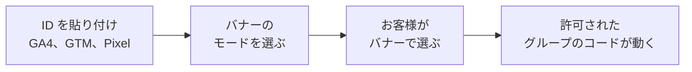
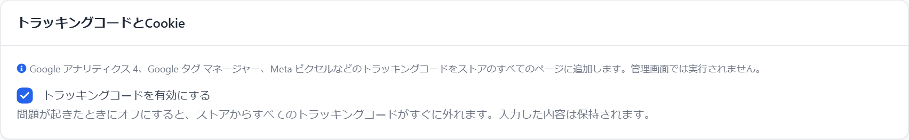
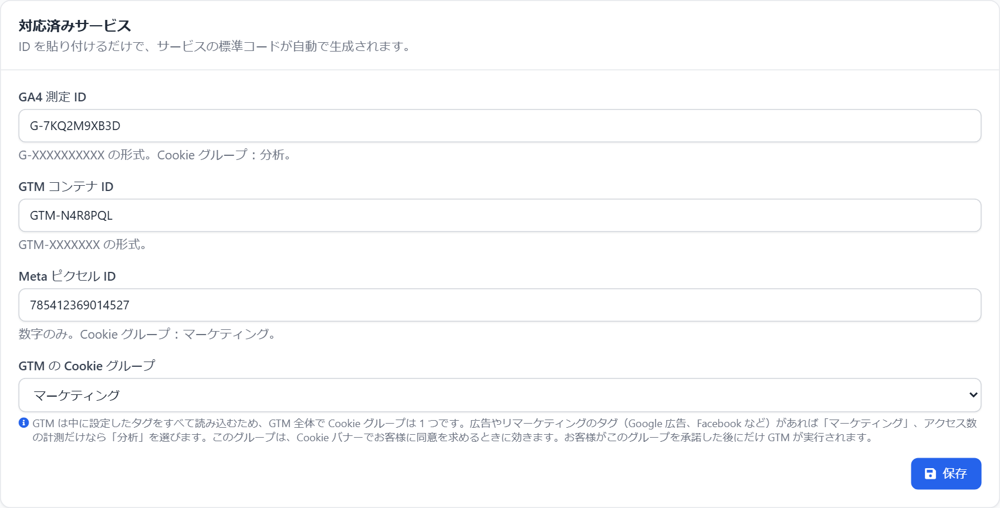
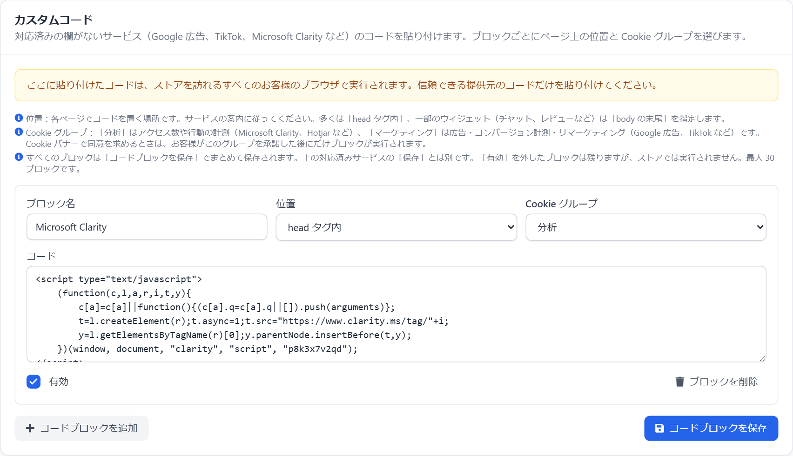
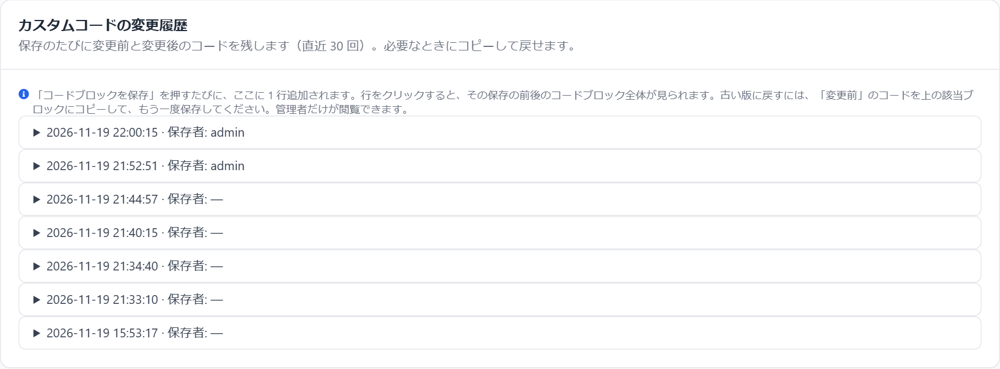
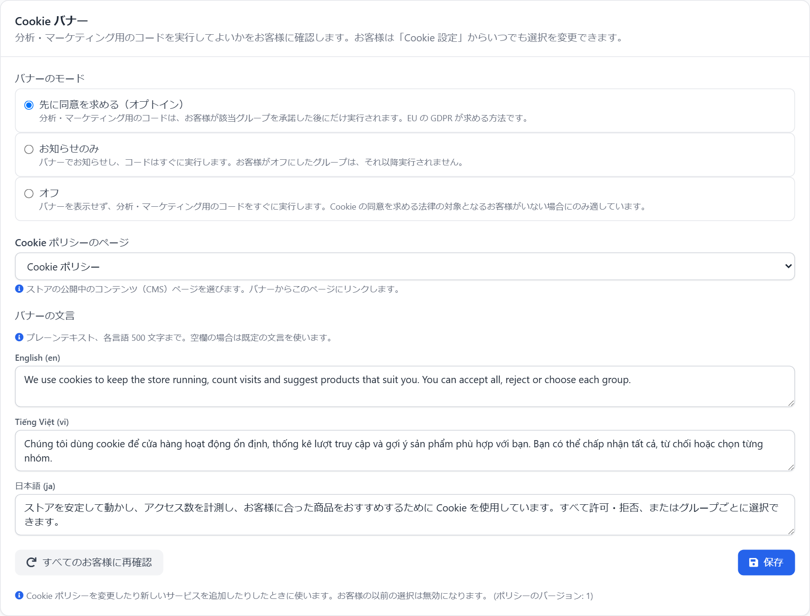
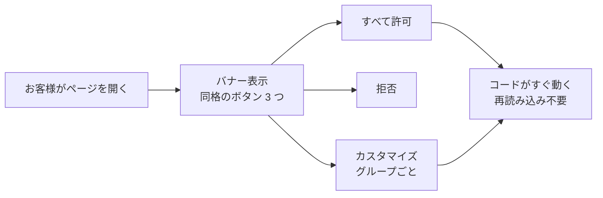

> 🌐 **言語:** [🇻🇳 Tiếng Việt](./tracking-and-cookies_vi.md) · [🇬🇧 English](./tracking-and-cookies.md) · 🇯🇵 日本語（現在）

# トラッキングコードと Cookie バナー

## はじめに
このページでは、**Google アナリティクス 4（GA4）**、**Google タグ マネージャー（GTM）**、**Meta ピクセル** や他のサービスのコードをストアに追加し、コードが動く前にお客様に確認する **Cookie バナー** を有効にする方法を説明します。技術に詳しくないサイト運営者向けです。読み終えると、ID を貼り付けるだけでコードを設定でき、合ったバナーのモードを選び、広告からの売上を GA4 や Meta で確認できるようになります。

## ひと目でわかる
作業はすべて 1 つの画面 **SEO › トラッキングコードとCookie** で行います。コードは、その Cookie グループが許可されたときだけお客様のブラウザで動きます。

- **ID を貼り付けるだけ** — GA4、GTM、Meta ピクセルの標準コードはシステムが自動で作ります。
- **コードはそれぞれ 1 つの Cookie グループに属します**：**分析**（アクセス数の計測）または **マーケティング**（広告）。
- **バナーのモードは 3 つ**：オフ・お知らせのみ・先に同意を求める。既定は **オフ** です。
- **販売イベントは自動で送信**：商品の閲覧、カートへの追加、購入手続きの開始、購入。
- **スイッチ 1 つですべてのコードを止められます**。入力したコードは残ります。

> ℹ️ **対応バージョン:** gp247/front 3.12.0（トラッキングコード、Cookie バナー）。販売イベントには gp247/shop 3.13.0 も必要です

## このページの内容
- [「トラッキングコードとCookie」画面を開く](#トラッキングコードとcookie画面を開く) — 開ける人、対象のストア
- [GA4、GTM、Meta ピクセルを設定する](#ga4gtmmeta-ピクセルを設定する) — ID の確認場所と貼り付け場所
- [他のサービスのコードを追加する](#他のサービスのコードを追加する) — Google 広告、TikTok、Microsoft Clarity など
- [Cookie バナーを有効にする](#cookie-バナーを有効にする) — 3 つのモード、文言、ポリシーのページ、再確認
- [ストアでお客様に表示される内容](#ストアでお客様に表示される内容) — バナー、Cookie 設定
- [GA4 と Meta に送られる販売イベント](#ga4-と-meta-に送られる販売イベント) — 4 つのイベントと確認場所
- [緊急時にすべてのコードを止める](#緊急時にすべてのコードを止める)
- [管理画面の警告](#管理画面の警告)
- [バナーは法的助言の代わりにならない](#バナーは法的助言の代わりにならない)
- [条件と制約](#条件と制約操作の前に確認)

## 「トラッキングコードとCookie」画面を開く
この画面は **SEO** メニューグループの **トラッキングコードとCookie** にあります。**Meta & JSON-LD** 画面にも、ここへのリンクがあります。

- **開いて保存できるのは管理者（Administrator）アカウントだけです。** ここに貼り付けたコードはすべてのお客様のブラウザで動くため、他のロールにはこの権限を与えません。
- **複数ストアのサイト**：**設定中のストア** でストアを選びます。子ストアは、個別に変更するまでルートストアの値を使います。戻すには **ルートストアの値を使う** を押します。
- **管理画面ではトラッキングコードは一切動きません** — 管理画面を自由に見ても、計測値はずれません。

## GA4、GTM、Meta ピクセルを設定する
**対応済みサービス** のブロックでは、コード全体ではなく ID だけを貼り付けます。

| サービス | 入力欄 | ID の形式 | 確認場所 | Cookie グループ |
| --- | --- | --- | --- | --- |
| Google アナリティクス 4 | **GA4 測定 ID** | `G-ABC123XYZ9` | GA4 › 管理 › データストリーム › ウェブストリーム | 分析 |
| Google タグ マネージャー | **GTM コンテナ ID** | `GTM-AB12CD3` | GTM の画面上部、コンテナ名の横 | 自分で選ぶ |
| Meta ピクセル | **Meta ピクセル ID** | `123456789012345` | Meta イベントマネージャ › データソース | マーケティング |

1. **SEO › トラッキングコードとCookie** を開きます。
2. ID を該当する欄に貼り付けます。大文字・小文字や余分な空白は気にしなくて大丈夫です。システムが自動で直します。
3. GTM の場合は **GTM の Cookie グループ** を選びます。GTM に広告やリマーケティングのタグ（Google 広告、Facebook など）があれば **マーケティング**、アクセス数の計測だけなら **分析** です。
4. **保存** を押します。ID の形式が違うとその欄が赤くなり、何も保存されません。

成功したら、ストアのページを開いてください。バナーがオフならすぐに、バナーが有効なら **すべて許可** を押した後に、コードが動きます。

> 💡 **ヒント:** 同じ GA4 アカウントには、GA4 **または** GA4 タグを含む GTM のどちらか一方を使ってください。両方使うと、ページビューが二重に計測されます。

## 他のサービスのコードを追加する
**カスタムコード** のブロックは、専用の入力欄がないサービス（Google 広告、TikTok、Microsoft Clarity など）用です。コードブロックごとに名前、位置、Cookie グループ、**有効** スイッチがあります。

1. **コードブロックを追加** を押します。
2. 後で見分けやすいように **ブロック名** を付けます（例：「Clarity」）。
3. サービスの案内に従って **位置** を選びます。ほとんどは **head タグ内** ですが、一部のウィジェット（チャット、レビュー）は **body の末尾** を指定します。
4. **Cookie グループ** を選びます。統計や行動分析は **分析**、広告・コンバージョン計測・リマーケティングは **マーケティング** です。
5. サービスが提供する **コード全体** を、開始タグと終了タグも含めて貼り付けます（例：``）。
6. **コードブロックを保存** を押します。すべてのブロックがまとめて保存されます。対応済みサービスの **保存** ボタンとは別です。

**コードブロックを保存** を押すたびに、**カスタムコードの変更履歴** に 1 行追加され、その保存の前後のコードがすべて残ります（直近 30 回）。古い版に戻すには、履歴の行を開き、**変更前** のコードを該当するブロックにコピーして、もう一度保存します。

> ⚠️ **注意:** カスタムコードはすべてのお客様のブラウザで動きます。サービスの管理画面から直接取得したコードだけを貼り付け、知らない人からメッセージやメールで送られてきたコードは貼り付けないでください。

## Cookie バナーを有効にする
**Cookie バナー** のブロックで、コードが動く前にお客様に確認するかどうかを決めます。お客様が住む地域と、そこで適用される法律に合わせてモードを選んでください。

| モード | バナー | 分析・マーケティングのコードが動くタイミング | 向いているケース |
| --- | --- | --- | --- |
| **オフ**（既定） | 表示しない | ページを開いてすぐ | お客様の地域で同意の取得が法律上求められていない |
| **お知らせのみ** | 案内として表示 | すぐ（お客様がオフにしたグループを除く） | お客様に知らせ、必要ならオフにしてもらいたい |
| **先に同意を求める（オプトイン）** | 表示し、お客様が選ぶ | お客様がそのグループを許可した後だけ | 欧州（GDPR）や同様の法律がある地域のお客様 |

1. **バナーのモード** を選びます。
2. **Cookie ポリシーのページ** を選びます。ストアの公開中のコンテンツ（CMS）ページです。バナーからこのページにリンクします。
3. 必要なら、言語ごとに **バナーの文言** を編集します（プレーンテキスト、500 文字まで）。空欄なら既定の文言を使います。
4. **保存** を押します。

Cookie ポリシーを変更したり、新しいサービスを追加したりしたときは、**すべてのお客様に再確認** を押します。すべてのお客様の以前の選択が無効になり、もう一度バナーが表示されます。

> ℹ️ **情報:** バナーが **オフ** のままストアにコードがある場合、画面に黄色の警告が表示されます。**先に同意を求める** への切り替えを検討してください。

## ストアでお客様に表示される内容
**先に同意を求める** モードでは、初めて訪れたお客様に画面下部のバナーが表示されます。お客様が選ぶまで、ページは GA4、GTM、Meta、カスタムコードを **一切** 読み込みません。

- **3 つのボタンは同じ大きさ・同じスタイル**：**すべて許可**・**拒否**・**カスタマイズ**。拒否ボタンは隠されません。
- **カスタマイズ** で選択パネルが開きます：ログイン・カート・セキュリティ用の **必要（常にオン）**、**分析**、**マーケティング**。
- **選択はすぐに反映** され、ページの再読み込みは不要です。お客様のブラウザに **6 か月** 記憶されます。
- **お客様はいつでも選択を変えられます**：フッターの **Cookie 設定** リンク（GP247 のテンプレート）、またはテンプレートにこのリンクがない場合は画面下の隅の小さなボタンから。グループの許可を取り消すと、そのグループの Cookie は削除され、次のページからそのグループのコードは止まります。
- **Google Consent Mode v2（ベーシック）**：Google のコードはお客様の同意後にだけ読み込まれ、お客様が選んだグループどおりの同意シグナルが送られます。

## GA4 と Meta に送られる販売イベント
GA4、GTM、Meta ピクセルのいずれかを設定すると、ストアは 4 つの販売イベントを自動で送ります。追加のインストールは不要です。データはサーバー上のカート・注文から取得し、お客様が表示している通貨で送られます。

| お客様の操作 | GA4 / GTM | Meta ピクセル |
| --- | --- | --- |
| 商品ページを見る | `view_item` | `ViewContent` |
| カートに追加する | `add_to_cart` | `AddToCart` |
| 購入手続きのページを開く | `begin_checkout` | `InitiateCheckout` |
| 注文を確定する | `purchase` | `Purchase` |

- **お客様が同意したサービスにだけ送信**（GA4 → 分析、ピクセル → マーケティング、GTM → 選んだグループ）。
- **購入は注文ごとにちょうど 1 回だけ送信**：サンクスページを再読み込みしたり戻ったりしても、追加で送られません。
- **お客様の個人情報は送りません**：メール、電話番号、住所、氏名は含みません。送るのは商品コード、名前、カテゴリ、ブランド、価格、数量、通貨、合計、注文番号だけです。
- **確認場所**：GA4 › レポート › 収益化、Meta イベントマネージャ › ピクセルのデータソース。
- **REST API、AI エージェント、データインポートで作成した注文** はサンクスページを通らないため、購入イベントはありません。

## 緊急時にすべてのコードを止める
ストアが遅い、表示が崩れる、見覚えのないコードがありそうなときは、画面上部の **トラッキングコードを有効にする** のチェックを外します。次のページからストアのコードはすべて消えます。ID とコードブロックは残るので、再びオンにすれば元どおり動きます。

> ℹ️ **情報:** 複数ストアのサイトでは、**ルートストア** でオフにすると **すべての** ストアでオフになります。子ストアでオフにすると、そのストアだけがオフになります。

## 管理画面の警告
ダッシュボードの **システムアラート** ブロック（と `php artisan gp247:doctor` コマンド）は、設定に問題があると知らせます：

- **バナーがオフなのにコードが動いている** — すべてのお客様が確認なしで計測されています。
- **使用中のテンプレートが `meta-head` コンポーネントを呼び出していない** — コードもバナーもストアで動きません。GP247 のテンプレートは呼び出し済みです。自作テンプレートでは、`<head>` 内の `<x-gp247-front::meta-head …>` の行を残してください。
- **レイアウト HTML ブロックに ``） — タグがないと、JavaScript がすべてのページに文字として表示されてしまいます。
- **最大 30 ブロック、1 ブロック 100,000 文字、ストアごとの合計 200,000 文字、ブロック名は 100 文字まで** — コードはすべてのページに入るため、長すぎるとストアが遅くなります。
- **カスタムコードには「必要」グループがありません** — **先に同意を求める** が有効なとき、貼り付けたコードは必ずお客様の同意を待ちます。

**バナーを設定するとき**
- **バナーの文言はプレーンテキスト、各言語 500 文字まで** — バナーがコードを差し込む入口にならないよう、HTML は受け付けません。
- **ポリシーのページは、そのストア自身の公開中のコンテンツページに限ります** — 見知らぬページへのリンクを避けるため、手入力の URL は受け付けません。複数ストアのサイトでは、ストアごとに自分のページを選びます。

## よくある質問（Q&A）
**Q1: GA4 の ID を貼り付けたのに、GA4 にアクセスが表示されません。**

→ バナーのモードを確認してください。**先に同意を求める** では、お客様が **すべて許可** を押すか **分析** をオンにした後だけ計測されます。シークレットウィンドウでストアを開き、バナーを許可してから GA4 の **リアルタイム** レポートを見てください。

**Q2: どのバナーのモードを選べばよいですか？**

→ 欧州など、法律で同意の取得が求められる地域のお客様がいるなら **先に同意を求める** を選びます。お客様に知らせるだけでよければ **お知らせのみ** です。迷ったら法律の専門家に相談してください（[バナーは法的助言の代わりにならない](#バナーは法的助言の代わりにならない) を参照）。

**Q3: 以前、GA のコードをレイアウトブロックに貼り付けていました。どうすればよいですか？**

→ そのレイアウトブロックを削除（または無効化）し、GA4 の ID を **トラッキングコードとCookie** 画面に貼り付けてください。レイアウトブロックのコードは Cookie バナーと無関係に動き、二重に計測されることがあります。

**Q4: お客様が拒否すると、計測値がすべてなくなりますか？**

→ 拒否したお客様の分は計測されませんが、その代わりストアはお客様の選択を尊重できます。同意したお客様は引き続きすべて計測されます。

**Q5: 購入イベントを送るためにプラグインが必要ですか？**

→ 不要です。GA4、GTM、Meta ピクセルのいずれかを設定するだけで、4 つの販売イベントが自動で送られます。

**Q6: カスタムコードにも販売イベントは届きますか？**

→ 自動では届きません。イベントは専用欄に入力した GA4、GTM、Meta ピクセルにだけ送られます。他のサービスにイベントを送りたい場合は、そのサービスを GTM の中で設定してください。

**Q7: バナーの文言を変えると、お客様にもう一度バナーが表示されますか？**

→ 表示されません。すでに選んだお客様にバナーをもう一度表示するには、**すべてのお客様に再確認** を押します。

**Q8: 自作のテンプレートでも使えますか？**

→ レイアウトの `<head>` 内で `<x-gp247-front::meta-head …>` を呼び出していれば使えます。呼び出していない場合は、**トラッキングコードとCookie** 画面と **システムアラート** で知らせます。

**Q9: 貼り付けたコードでストアが壊れたらどうしますか？**

→ **トラッキングコードを有効にする** のチェックを外してすべてのコードをすぐに止め、原因のコードブロックを修正または削除してください。以前のコードは **カスタムコードの変更履歴** に残っています。

**Q10: コードの設定をスタッフに任せられますか？**

→ 通常の権限では任せられません。コードはすべてのお客様のブラウザで動くため、この画面を開けるのは管理者アカウントだけです。

---

📅 **最終更新:** 2026-11-20 · ✍️ **作成者 (Author):** GP247
