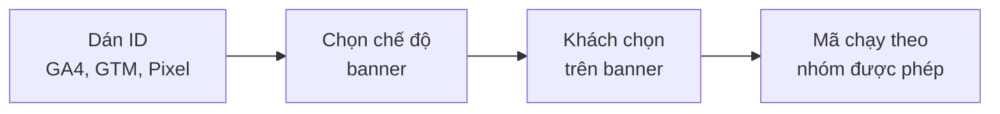
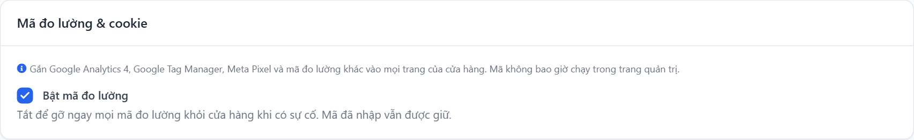
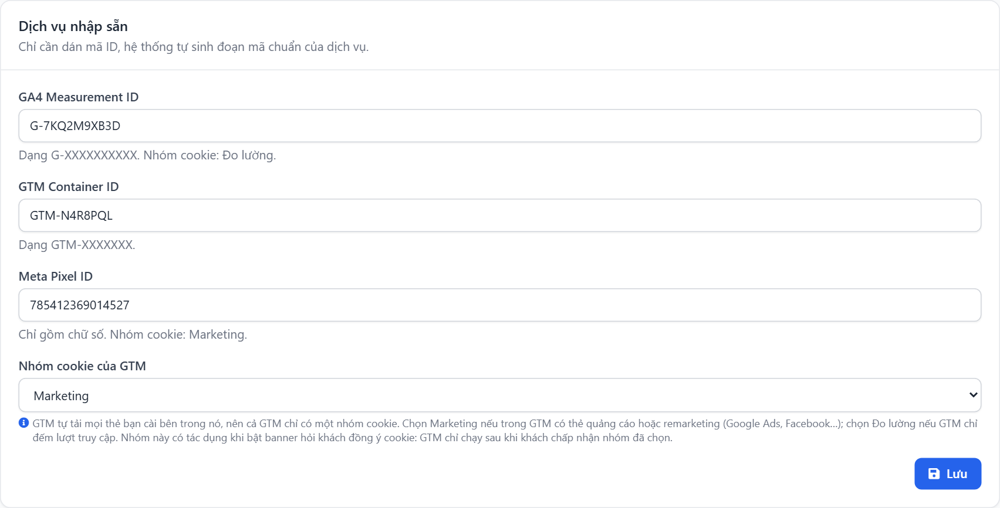
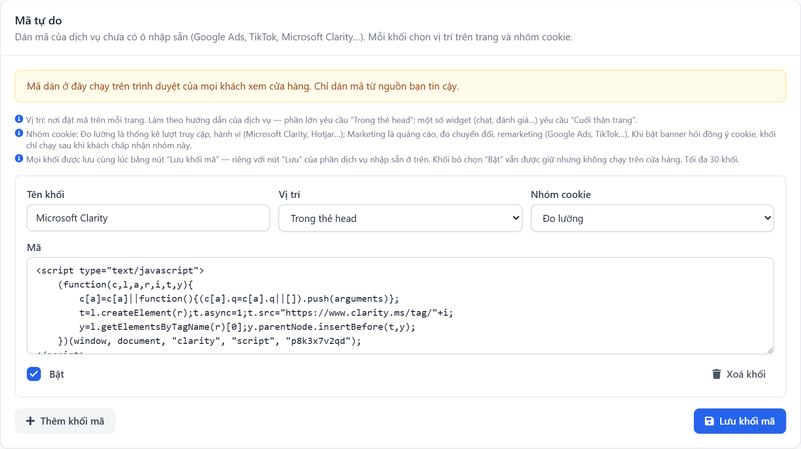
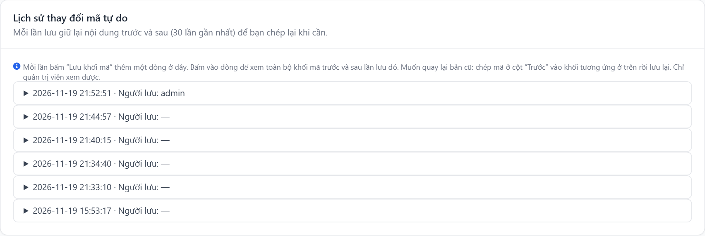
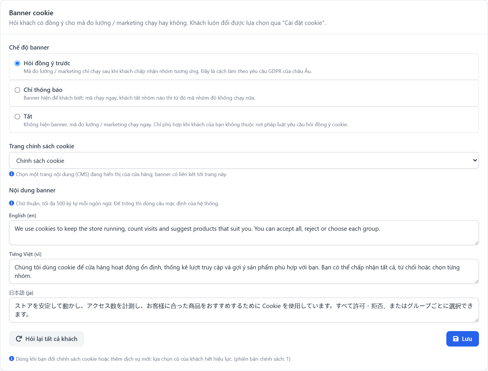
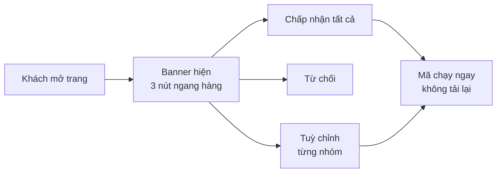

> 🌐 **Ngôn ngữ:** 🇻🇳 Tiếng Việt (hiện tại) · [🇬🇧 English](./tracking-and-cookies.md) · [🇯🇵 日本語](./tracking-and-cookies_ja.md)

# Mã đo lường & banner cookie

## Giới thiệu
Trang này hướng dẫn gắn **Google Analytics 4 (GA4)**, **Google Tag Manager (GTM)**, **Meta Pixel** và mã của các dịch vụ khác vào cửa hàng, rồi bật **banner cookie** để hỏi khách trước khi mã chạy. Dành cho chủ site không chuyên kỹ thuật. Đọc xong, bạn tự gắn mã chỉ bằng cách dán ID, chọn được chế độ banner phù hợp và biết xem doanh thu từ quảng cáo trong GA4 / Meta.

## Nhìn nhanh
Mọi việc làm ở một màn: **SEO › Mã đo lường & cookie**. Mã chỉ chạy trên trình duyệt của khách khi nhóm cookie của nó được phép.

- **Chỉ cần dán ID** — hệ thống tự sinh đoạn mã chuẩn của GA4, GTM và Meta Pixel.
- **Mỗi đoạn mã thuộc một nhóm cookie**: **Đo lường** (thống kê lượt truy cập) hoặc **Marketing** (quảng cáo).
- **Ba chế độ banner**: Tắt · Chỉ thông báo · Hỏi đồng ý trước. Mặc định là **Tắt**.
- **Sự kiện bán hàng gửi tự động**: xem sản phẩm, thêm giỏ, bắt đầu thanh toán, mua hàng.
- **Một công tắc tắt toàn bộ mã** khi có sự cố; mã đã nhập vẫn được giữ.

> ℹ️ **Có từ:** gp247/front 3.12.0 (mã đo lường, banner cookie); sự kiện bán hàng cần thêm gp247/shop 3.13.0

## Trong trang này
- [Mở màn Mã đo lường & cookie](#mở-màn-mã-đo-lường--cookie) — ai mở được, cửa hàng nào
- [Gắn GA4, GTM, Meta Pixel](#gắn-ga4-gtm-meta-pixel) — lấy ID ở đâu, dán vào đâu
- [Thêm mã của dịch vụ khác](#thêm-mã-của-dịch-vụ-khác) — Google Ads, TikTok, Microsoft Clarity…
- [Bật banner cookie](#bật-banner-cookie) — ba chế độ, nội dung, trang chính sách, hỏi lại khách
- [Khách thấy gì trên cửa hàng](#khách-thấy-gì-trên-cửa-hàng) — banner, Cài đặt cookie
- [Sự kiện bán hàng gửi tới GA4 và Meta](#sự-kiện-bán-hàng-gửi-tới-ga4-và-meta) — bốn sự kiện, xem ở đâu
- [Tắt khẩn cấp toàn bộ mã](#tắt-khẩn-cấp-toàn-bộ-mã)
- [Cảnh báo trên trang quản trị](#cảnh-báo-trên-trang-quản-trị)
- [Banner không thay cho tư vấn pháp lý](#banner-không-thay-cho-tư-vấn-pháp-lý)
- [Điều kiện & ràng buộc](#điều-kiện--ràng-buộc-hiểu-trước-khi-thao-tác)

## Mở màn Mã đo lường & cookie
Màn này nằm trong nhóm menu **SEO**, mục **Mã đo lường & cookie**. Màn **Meta & JSON-LD** cũng có dòng dẫn sang đây.

- **Chỉ tài khoản Quản trị viên (Administrator) mở và lưu được.** Mã dán ở đây chạy trên trình duyệt của mọi khách, nên quyền này không giao cho vai trò khác.
- **Site nhiều cửa hàng**: chọn cửa hàng ở ô **Cửa hàng đang cấu hình**. Cửa hàng con dùng giá trị của cửa hàng gốc cho tới khi bạn đổi riêng; bấm **Dùng giá trị của cửa hàng gốc** để quay về.
- **Trang quản trị không bao giờ chạy mã đo lường** — bạn xem admin thoải mái mà không làm sai số liệu.

## Gắn GA4, GTM, Meta Pixel
Ở khối **Dịch vụ nhập sẵn**, bạn chỉ dán ID, không dán cả đoạn mã.

| Dịch vụ | Ô nhập | ID có dạng | Lấy ở đâu | Nhóm cookie |
| --- | --- | --- | --- | --- |
| Google Analytics 4 | **GA4 Measurement ID** | `G-ABC123XYZ9` | GA4 › Quản trị › Luồng dữ liệu › luồng web | Đo lường |
| Google Tag Manager | **GTM Container ID** | `GTM-AB12CD3` | Đầu trang GTM, cạnh tên vùng chứa | Bạn chọn |
| Meta Pixel | **Meta Pixel ID** | `123456789012345` | Meta Events Manager › Nguồn dữ liệu | Marketing |

1. Mở **SEO › Mã đo lường & cookie**.
2. Dán ID vào ô tương ứng. Không cần lo chữ hoa / chữ thường hay khoảng trắng thừa, hệ thống tự sửa.
3. Với GTM, chọn **Nhóm cookie của GTM**: **Marketing** nếu trong GTM có thẻ quảng cáo / remarketing (Google Ads, Facebook…); **Đo lường** nếu GTM chỉ đếm lượt truy cập.
4. Bấm **Lưu**. Nếu ID sai định dạng, ô đó báo đỏ và không có gì được lưu.

Nếu thành công, mở một trang của cửa hàng: mã chạy ngay khi banner đang Tắt, hoặc sau khi bạn bấm **Chấp nhận tất cả** khi banner đang bật.

> 💡 **Mẹo:** dùng GA4 **hoặc** GTM có chứa thẻ GA4, không dùng cả hai cho cùng một tài khoản GA4 — lượt xem sẽ bị đếm hai lần.

## Thêm mã của dịch vụ khác
Khối **Mã tự do** dành cho dịch vụ chưa có ô nhập sẵn (Google Ads, TikTok, Microsoft Clarity…). Mỗi khối mã có tên, vị trí, nhóm cookie và công tắc **Bật** riêng.

1. Bấm **Thêm khối mã**.
2. Đặt **Tên khối** (ví dụ "Clarity") để sau này dễ nhận ra.
3. Chọn **Vị trí** theo hướng dẫn của dịch vụ: phần lớn là **Trong thẻ head**; một số widget (chat, đánh giá) yêu cầu **Cuối thân trang**.
4. Chọn **Nhóm cookie**: **Đo lường** cho thống kê, hành vi; **Marketing** cho quảng cáo, đo chuyển đổi, remarketing.
5. Dán **nguyên đoạn mã** dịch vụ cung cấp, kể cả thẻ mở và thẻ đóng (ví dụ ``).
6. Bấm **Lưu khối mã**. Mọi khối được lưu cùng lúc, riêng với nút **Lưu** của dịch vụ nhập sẵn.

Mỗi lần **Lưu khối mã** thêm một dòng vào **Lịch sử thay đổi mã tự do**, giữ toàn bộ mã trước và sau lần lưu đó (30 lần gần nhất). Muốn quay lại bản cũ: mở dòng lịch sử, chép mã ở cột **Trước** vào khối tương ứng rồi lưu lại.

> ⚠️ **Lưu ý:** mã tự do chạy trên trình duyệt của mọi khách. Chỉ dán mã lấy trực tiếp từ trang quản trị của dịch vụ, không dán mã người lạ gửi qua tin nhắn hay email.

## Bật banner cookie
Khối **Banner cookie** quyết định khách có được hỏi trước khi mã chạy hay không. Chọn chế độ theo nơi khách của bạn sống và luật áp dụng cho họ.

| Chế độ | Banner | Mã đo lường / marketing chạy khi | Phù hợp khi |
| --- | --- | --- | --- |
| **Tắt** (mặc định) | Không hiện | Ngay khi mở trang | Khách không thuộc nơi luật yêu cầu hỏi đồng ý |
| **Chỉ thông báo** | Hiện để khách biết | Ngay, trừ nhóm khách đã tắt | Muốn báo cho khách, cho họ tắt khi muốn |
| **Hỏi đồng ý trước** | Hiện, khách phải chọn | Chỉ sau khi khách chấp nhận nhóm đó | Khách ở châu Âu (GDPR) hoặc nơi luật tương tự |

1. Chọn **Chế độ banner**.
2. Chọn **Trang chính sách cookie**: một trang nội dung (CMS) đang hiển thị của cửa hàng. Banner có link tới trang này.
3. Nếu muốn, sửa **Nội dung banner** cho từng ngôn ngữ (chữ thường, tối đa 500 ký tự). Để trống thì dùng câu mặc định.
4. Bấm **Lưu**.

Khi bạn đổi chính sách cookie hoặc thêm một dịch vụ mới, bấm **Hỏi lại tất cả khách**: lựa chọn cũ của mọi khách hết hiệu lực và banner hiện lại cho họ.

> ℹ️ **Thông tin:** khi banner đang **Tắt** mà cửa hàng đã có mã, màn hình hiện cảnh báo vàng để bạn cân nhắc chuyển sang **Hỏi đồng ý trước**.

## Khách thấy gì trên cửa hàng
Với chế độ **Hỏi đồng ý trước**, khách mới vào thấy banner ở cuối màn hình; trước khi khách chọn, trang **không** tải mã của GA4, GTM, Meta hay mã tự do nào.

- **Ba nút cùng cỡ, cùng kiểu**: **Chấp nhận tất cả** · **Từ chối** · **Tuỳ chỉnh**. Nút từ chối không bị giấu.
- **Tuỳ chỉnh** mở bảng chọn: **Cần thiết (luôn bật)** cho đăng nhập, giỏ hàng, bảo mật; **Đo lường**; **Marketing**.
- **Lựa chọn có hiệu lực ngay**, không cần tải lại trang, và được nhớ **6 tháng** trên trình duyệt của khách.
- **Khách đổi ý bất cứ lúc nào** qua **Cài đặt cookie**: link ở chân trang (các template của GP247) hoặc nút nhỏ ở góc dưới trang khi template không có link này. Rút lại một nhóm thì cookie của nhóm đó bị xoá và mã của nhóm đó dừng từ trang kế tiếp.
- **Google Consent Mode v2 (mức cơ bản)**: mã Google chỉ được tải sau khi khách đồng ý, kèm tín hiệu đồng ý đúng nhóm khách chọn.

## Sự kiện bán hàng gửi tới GA4 và Meta
Khi đã gắn GA4, GTM hoặc Meta Pixel, cửa hàng tự gửi bốn sự kiện bán hàng — bạn không phải cài thêm gì. Dữ liệu lấy từ giỏ / đơn trên máy chủ, theo đúng tiền tệ khách đang xem.

| Khi khách | GA4 / GTM | Meta Pixel |
| --- | --- | --- |
| Xem trang sản phẩm | `view_item` | `ViewContent` |
| Thêm vào giỏ | `add_to_cart` | `AddToCart` |
| Mở trang thanh toán | `begin_checkout` | `InitiateCheckout` |
| Đặt đơn thành công | `purchase` | `Purchase` |

- **Chỉ gửi tới dịch vụ khách đã đồng ý** (GA4 → Đo lường, Pixel → Marketing, GTM → nhóm bạn chọn).
- **Mua hàng gửi đúng một lần mỗi đơn**: tải lại hay quay lại trang cảm ơn không gửi thêm.
- **Không gửi thông tin cá nhân của khách**: không email, số điện thoại, địa chỉ, tên. Chỉ mã sản phẩm, tên, danh mục, thương hiệu, giá, số lượng, tiền tệ, tổng và mã đơn.
- **Xem ở đâu**: GA4 › Báo cáo › Kiếm tiền (Monetization); Meta Events Manager › nguồn dữ liệu Pixel của bạn.
- **Đơn tạo qua REST API, AI agent hay nhập dữ liệu** không qua trang cảm ơn nên không có sự kiện mua hàng.

## Tắt khẩn cấp toàn bộ mã
Nếu cửa hàng chạy chậm, lỗi giao diện hay bạn nghi có mã lạ, bỏ chọn **Bật mã đo lường** ở đầu màn. Mọi mã biến mất khỏi cửa hàng ngay ở trang kế tiếp; ID và khối mã vẫn được giữ, bật lại là chạy như cũ.

> ℹ️ **Thông tin:** trên site nhiều cửa hàng, tắt ở **cửa hàng gốc** là tắt cho **mọi** cửa hàng; tắt ở một cửa hàng con chỉ tắt cửa hàng đó.

## Cảnh báo trên trang quản trị
Khối **Cảnh báo hệ thống** trên Dashboard (và lệnh `php artisan gp247:doctor`) báo khi cấu hình có vấn đề:

- **Banner đang tắt mà mã vẫn chạy** — mọi khách bị đo mà không được hỏi.
- **Template đang dùng không gọi component `meta-head`** — mã và banner không chạy trên cửa hàng. Các template của GP247 đều gọi sẵn; template tự viết cần giữ dòng `<x-gp247-front::meta-head …>` trong `<head>`.
- **Khối layout HTML có ``) — dán thiếu thẻ thì đoạn JavaScript sẽ hiện thành chữ trên mọi trang.
- **Tối đa 30 khối, mỗi khối 100 000 ký tự, tổng 200 000 ký tự mỗi cửa hàng; tên khối tối đa 100 ký tự** — mã nằm trên mọi trang, quá dài sẽ làm cửa hàng chậm.
- **Không có nhóm "Cần thiết" cho mã tự do** — mã do bạn dán luôn phải chờ khách đồng ý khi bật **Hỏi đồng ý trước**.

**Khi cài banner**
- **Nội dung banner là chữ thường, tối đa 500 ký tự mỗi ngôn ngữ** — không nhận HTML để banner không thành chỗ chèn mã.
- **Trang chính sách phải là trang nội dung đang hiển thị của chính cửa hàng đó** — không nhận đường dẫn tự gõ để tránh link tới trang lạ. Trên site nhiều cửa hàng, mỗi cửa hàng chọn trang của mình.

## Hỏi & Đáp (Q&A)
**Câu 1: Tôi đã dán ID GA4 nhưng GA4 không thấy lượt truy cập?**

→ Kiểm tra chế độ banner: ở **Hỏi đồng ý trước**, lượt truy cập chỉ được đếm sau khi khách bấm **Chấp nhận tất cả** hoặc bật **Đo lường**. Thử mở cửa hàng ở cửa sổ ẩn danh, chấp nhận banner rồi xem báo cáo **Thời gian thực** của GA4.

**Câu 2: Tôi nên chọn chế độ banner nào?**

→ Có khách ở châu Âu hoặc nơi luật yêu cầu hỏi đồng ý thì chọn **Hỏi đồng ý trước**. Chỉ muốn báo cho khách biết thì chọn **Chỉ thông báo**. Nếu phân vân, hãy hỏi người có chuyên môn pháp lý — xem [Banner không thay cho tư vấn pháp lý](#banner-không-thay-cho-tư-vấn-pháp-lý).

**Câu 3: Trước đây tôi dán mã GA vào Khối layout, giờ làm sao?**

→ Xoá (hoặc tắt) khối layout đó, rồi dán ID GA4 vào màn **Mã đo lường & cookie**. Mã ở khối layout chạy ngoài banner cookie và có thể bị đếm hai lần.

**Câu 4: Khách từ chối thì tôi mất hết số liệu à?**

→ Bạn mất số liệu của những khách từ chối, đổi lại cửa hàng tôn trọng lựa chọn của họ. Khách đồng ý vẫn được đo đầy đủ.

**Câu 5: Có cần cài thêm plugin để gửi sự kiện mua hàng không?**

→ Không. Chỉ cần gắn GA4, GTM hoặc Meta Pixel; bốn sự kiện bán hàng được gửi tự động.

**Câu 6: Mã tự do của tôi có nhận sự kiện bán hàng không?**

→ Không tự động. Sự kiện chỉ gửi tới GA4, GTM và Meta Pixel nhập ở ô sẵn. Muốn đưa sự kiện tới dịch vụ khác, hãy cấu hình dịch vụ đó trong GTM.

**Câu 7: Tôi đổi nội dung banner thì khách có thấy lại banner không?**

→ Không. Chỉ khi bấm **Hỏi lại tất cả khách** thì banner mới hiện lại cho người đã chọn.

**Câu 8: Template của tôi tự viết, có dùng được không?**

→ Được, nếu layout gọi `<x-gp247-front::meta-head …>` trong `<head>`. Nếu không, màn **Mã đo lường & cookie** và **Cảnh báo hệ thống** sẽ báo để bạn biết.

**Câu 9: Lỡ dán mã làm hỏng cửa hàng thì sao?**

→ Bỏ chọn **Bật mã đo lường** để tắt mọi mã ngay, rồi sửa hoặc xoá khối mã gây lỗi. Bản mã trước đó còn trong **Lịch sử thay đổi mã tự do**.

**Câu 10: Tôi có thể giao việc gắn mã cho nhân viên không?**

→ Không qua quyền thường: chỉ tài khoản Quản trị viên mới mở được màn này, vì mã chạy trên trình duyệt của mọi khách.

---

📅 **Cập nhật lần cuối:** 2026-11-20 · ✍️ **Tác giả (Author):** GP247
